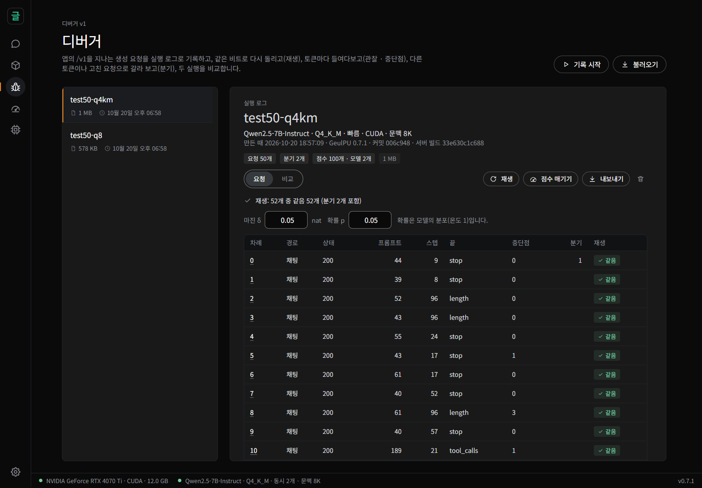
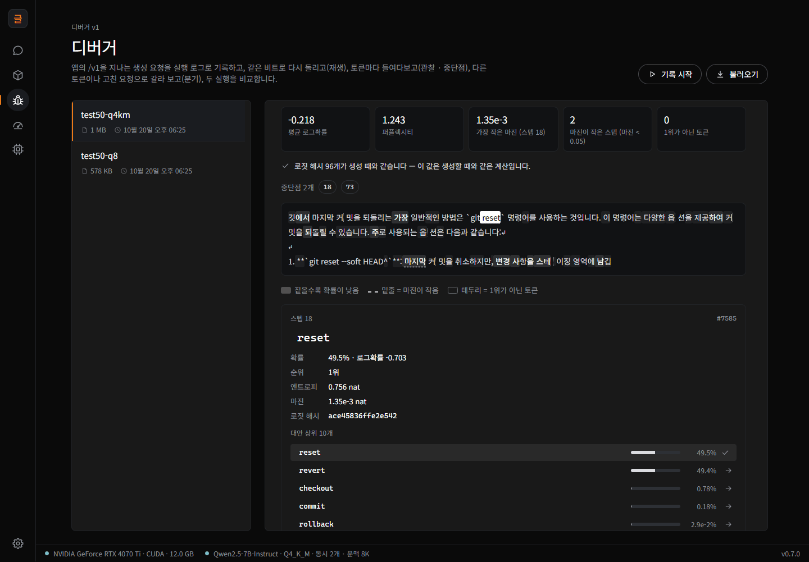
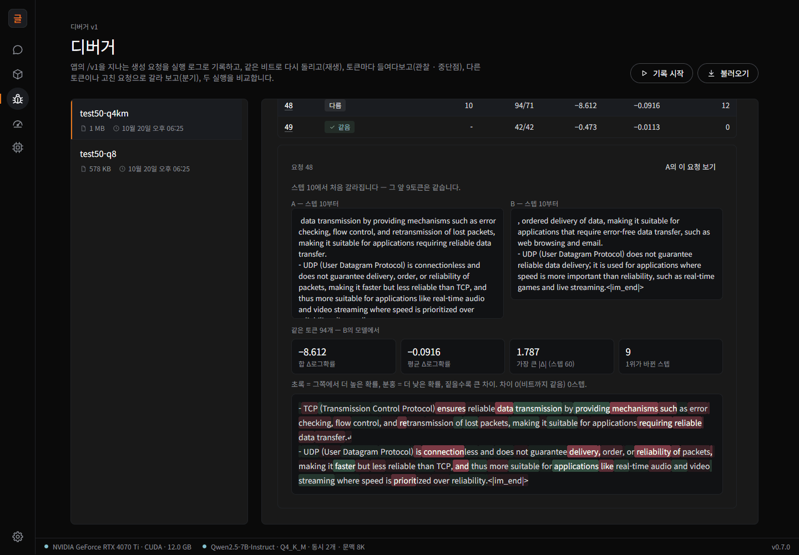
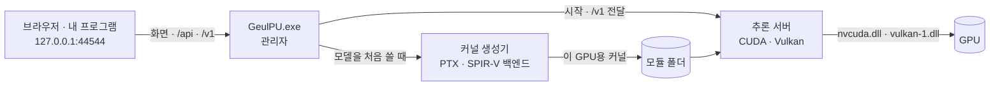

<div align="center">


# GeulPU

**내 PC의 GPU로 언어 모델을 돌리고, 언제나 같은 비트를 얻습니다.**

디버거가 든 로컬 LLM 엔진 — 실행을 기록하고 비트까지 재생하고,<br>
어느 토큰에서든 분기하고, 모델 · 양자화를 요청마다 비교합니다.

[](https://github.com/wwoosshh/GeulPUv2/releases/latest)
[](https://pypi.org/project/geulpu/)
[](https://github.com/wwoosshh/GeulPUv2/actions/workflows/ci.yml)
[](LICENSE)
[](https://doi.org/10.5281/zenodo.23548056)


[설치](#설치) · [기능](#기능) · [디버거](#디버거) · [벤치마크](#벤치마크) · [문서](#문서) · [기여](CONTRIBUTING.md) ·
[English](README.md)

</div>

<p align="center">
  
</p>

GeulPU는 Qwen3 · Qwen2.5 · DeepSeek-R1-Distill · Llama 3 · Mistral 같은 GGUF 모델을 내 PC의 NVIDIA · AMD 그래픽카드에서 돌립니다.
채팅 화면은 브라우저에 열리고, 다른 프로그램은 OpenAI 호환 API로 씁니다. 계산은 **정밀도 계약**(precision contract)이라는 문서로
정해져 있어 모든 결과가 CPU 참조 구현과 비트까지 같습니다 — 같은 요청이면 배치 · 슬롯 · 프롬프트 캐시 · 추측 디코딩과 상관없이,
정밀 모드에서는 GPU가 달라도 같은 토큰과 로짓이 나옵니다.

그래서 로컬 모델을 **디버깅**할 수 있습니다. 에이전트 세션이나 테스트 세트를 기록하고, 그대로 재생하고, 하나만 바꿔서 — 토큰 하나,
도구 결과 하나, 양자화 — 그 하나의 효과만 봅니다.

## 기능

- **언제나 같은 비트.** 배치 · 슬롯 · 프롬프트 캐시 · 추측 디코딩이 출력을 바꾸지 않습니다. 정밀 모드에서는 NVIDIA(CUDA)와 AMD 등
  다른 GPU(Vulkan)도 같습니다 — DeepSeek-R1-Distill-Qwen-7B의 디코딩 82,673 스텝이 NVIDIA 세 세대와 Radeon RX 9060 XT에서 모두
  같았습니다.
- **로컬 모델을 위한 디버거.** 실행을 기록하고, 비트까지 재생하고, 마진이 작은 스텝을 찾고, 어느 토큰이나 고친 요청에서 분기하고,
  두 실행을 요청마다 비교합니다 — 앱 화면에서도, 스크립트에서도.
- **연구 패널.** 채팅의 답마다 토큰의 확률 · 순위 · 상위 10 대안 · 엔트로피 · 마진을 보고, 분기 · 비교 · 점수 매기기 · 내보내기 ·
  재현 파일 확인을 합니다.
- **필요한 곳에서 빠름.** 기본 설정으로 잰 모든 길이에서 프롬프트와 생성이 llama.cpp보다 빠릅니다(Qwen2.5-7B에서 llama.cpp 시간의
  0.76 ~ 0.97배, Llama-3.1-8B의 긴 세션은 0.48배까지). 추측 디코딩은 고쳐 쓰는
  작업에서 3.5 ~ 4배 빠르면서 출력이 비트까지 같고, SSD의 프롬프트 캐시는 앱을 다시 켠 뒤에도 코딩 에이전트의 15k 토큰 프롬프트를
  0.3초에 복원합니다.
- **쓰던 도구와 함께.** 코딩 에이전트를 위한 도구 호출(Qwen Code로 시험), 로그확률 · echo 스코어링 · 토큰화 엔드포인트,
  lm-evaluation-harness를 지원하는 OpenAI 호환 API.
- **작고, 따로 설치할 것이 없음.** 내려받는 크기는 약 1.5 MB이고, CUDA 툴킷 · Python · PyTorch 없이 그래픽 드라이버만으로 돕니다. 엔진 · GPU
  커널 · 서버 · 앱 모두 한국어 프로그래밍 언어 [글(geul)](https://github.com/wwoosshh/geul-lang)로 썼고, 글(geul)의 자체 컴파일러로
  빌드합니다.

## 설치

Windows 10 · 11(64비트)과 NVIDIA RTX 30 시리즈 이상(CUDA), 또는 Vulkan 1.3을 지원하는 다른 GPU(AMD Radeon 등)가 필요합니다. 그래픽
메모리는 작은 모델이 6 GB, 7B · 8B 모델이 8 GB(Q4_K_M) · 12 GB(Q8_0)부터입니다.

**파이썬이 있다면** — 명령 한 줄([PyPI](https://pypi.org/project/geulpu/)):

```powershell
pipx install geulpu   # 또는 uv tool install geulpu · pip install geulpu
geulpu                # 브라우저에 http://127.0.0.1:44544 가 열립니다
```

**파이썬 없이** — [최신 릴리스](https://github.com/wwoosshh/GeulPUv2/releases/latest)에서 `GeulPU-<버전>-windows-x64.zip`을 받아
풀고 `GeulPU.exe`를 실행합니다. 코드 서명을 하지 않은 실행 파일이라 *Windows의 PC 보호* 창이 뜨면 **추가 정보 → 실행**을 누릅니다.
릴리스 파일은 GitHub Actions가 이 저장소의 소스로 빌드하고, SHA-256 값을 함께 올립니다.

그다음 **모델 → 모델 찾기**에서 *이 PC에 추천* 표시가 붙은 파일을 받아 채팅을 시작합니다. 첫 메시지 때 이 GPU에 맞는 커널을 만듭니다
(버전마다 한 번, 10초 ~ 몇 분). 화면마다의 자세한 안내는 [사용 안내](사용안내.md)에 있습니다.

## 코드에서 쓰기

모델이 올라가 있으면 `http://127.0.0.1:44544/v1`이 OpenAI 호환 엔드포인트입니다(API 키 · 모델 이름은 아무것이나):

```python
from openai import OpenAI

client = OpenAI(base_url="http://127.0.0.1:44544/v1", api_key="geulpu")
r = client.chat.completions.create(
    model="geulpu",
    messages=[{"role": "user", "content": "하늘은 왜 파란가요?"}],
    seed=7, logprobs=True, top_logprobs=5,
    extra_body={"geulpu": {"logit_hash": True}},   # 스텝마다 로짓의 64비트 해시
)
print(r.choices[0].message.content)
```

같은 요청을 다시 보내면 — 이 PC든, 같은 모델 파일 · 계산 방식의 다른 PC든 — 같은 토큰 · 로그확률 · 로짓 해시가 나옵니다. 코딩
에이전트 연결 · 점수 매기기 · 토큰화 · lm-evaluation-harness는 [사용 안내의 API 절](사용안내.md#다른-프로그램에서-쓰기-openai-호환-api)에
있습니다.

## 디버거

디버거는 답 하나가 아니라 **실행**(run) — 에이전트 세션이나 테스트 세트 — 을 다룹니다. 기록을 켜고 에이전트나 스크립트를 평소처럼 API에
붙여 쓴 뒤, 앱의 **디버거** 화면이나 [`도구/debugger.py`](도구/debugger.py)(파이썬 표준 라이브러리만)로 그 실행을 다룹니다:

```bash
# 에이전트 세션을 기록하고 재생 · 살펴보기
python 도구/debugger.py record-start agent-session    # 이제 /v1 요청이 모두 실행 로그에 남습니다
#   ... 에이전트를 http://127.0.0.1:44544/v1 에 붙여 씁니다 ...
python 도구/debugger.py record-stop
python 도구/debugger.py replay agent-session          # 모두 다시 보내 비트까지 비교
python 도구/debugger.py breakpoints agent-session     # 마진이 작은 스텝 · 저확률 샘플 · 도구 호출
python 도구/debugger.py branch agent-session --request 3 --step 17   # 다른 토큰에서 이어 생성

# 테스트 세트를 두 양자화로 돌려 요청마다 비교
python 도구/debugger.py run-set tests.jsonl q4km
python 도구/debugger.py load <Q8_0 파일의 id>
python 도구/debugger.py run-set tests.jsonl q8
python 도구/debugger.py compare q4km q8
```

<p>
  
  
</p>

실행 로그는 JSONL 파일 하나입니다. 내보내서 다른 PC에서 불러와 재생하거나, [`도구/repro_check.py`](도구/repro_check.py)로 GPU 없이
정밀도 계약의 CPU 참조와 대조합니다. [디버거 안내서](디버거안내.md)가 테스트 세트 하나로 모든 단계를 따라갑니다.

## 벤치마크

**결정성** — 같은 GGUF 파일로, 무엇이 출력을 바꾸는가:

| 바꾼 것 | GeulPU | llama.cpp |
|---|---|---|
| 동시 요청 1 ↔ 8 — lm-evaluation-harness, gsm8k(100문항) | 같음 | 생성 100개 중 41개가 바뀜(b11643) |
| 추측 디코딩 켬 ↔ 끔 | 토큰 · 로짓이 같음(요청 17개 × 맞는 · 틀린 · 반쯤 틀린 초안) | 탐욕 답 8개 중 2개가 바뀜(b11721, `ngram-simple`) |
| 디스크의 프롬프트 캐시에서 복원 ↔ 다시 계산 — 에이전트 요청 54개 | 같음(1,728 스텝) | — |
| 다른 GPU — RTX 3080 Ti · 4070 Ti · 5070 · Radeon RX 9060 XT(정밀 모드) | 같음(82,673 스텝) | — |

llama.cpp는 배치와 상관없이 같은 출력을 목표로 하지 않습니다. 이 비교는 그런 계약이 없을 때 무엇이 바뀌는지를 보입니다.

**속도** — GeulPU의 시간 ÷ llama.cpp의 시간(잴 때의 최신 공식 릴리스 — b11827 —, 같은 GGUF, llama.cpp의 f16 · q8_0 KV 캐시 가운데
빠른 쪽 — 작을수록 빠름). RTX 4070 Ti(12 GB), Qwen2.5-7B-Instruct Q4_K_M, 기본 설정(빠른 모드에 KV 캐시 8비트 · 빠른 어텐션):

| 작업 | GeulPU ÷ llama.cpp |
|---|---|
| 깊이 8k / 32k / 64k 토큰에서 디코딩(생성) | 0.97 / 0.89 / 0.82배 |
| 프롬프트 512 / 2,048 / 8,192 / 32,768 / 65,536 토큰 | 0.83 / 0.87 / 0.90 / 0.95 / 0.92배 |
| 깊이 8k / 32k / 64k 토큰의 세션에 새 입력 1,024 토큰 | 0.90 / 0.92 / 0.76배 |
| 기록한 코딩 에이전트 세션(요청 54 개, Qwen Code) | llama.cpp의 가장 빠른 설정(0.5B 초안 모델)의 0.59배 |

정밀 모드는 계약의 두 자리 활성값을 그대로 써서 8k 토큰까지의 프롬프트가 llama.cpp의 1.19 ~ 1.40배 시간입니다(32k에서 1.74배).
추측 디코딩(기본 켬)으로 코드 고치기는 초당 329 ~ 356 토큰 — 추측 없을 때의 3.5배, llama.cpp의 가장 빠른 추측 설정의 1.2 ~ 1.5배 —
이고 출력은 비트까지 같습니다. 모든 측정의 방법과 수치는 [사용 안내](사용안내.md#무엇이-다른가)에 있습니다.

## 지원하는 모델과 하드웨어

| 구조 | 모델 | 가중치 형식 |
|---|---|---|
| `qwen2` | Qwen2.5-Instruct · Qwen2.5-Coder · DeepSeek-R1-Distill-Qwen(1.5B 이상) | Q8_0 · Q4_0 · Q4_K_M · Q5_K_M · Q6_K · IQ4_XS(CUDA) |
| `qwen3` | Qwen3 0.6B · 1.7B · 4B · 8B(14B는 합성 모델로 모양 확인, 32B는 0.6B · 4B와 같은 길로 불러옴) | 같음 |
| `llama` | Llama 3.1 · 3.2 Instruct(3B · 8B) · Mistral 7B Instruct v0.3 · DeepSeek-R1-Distill-Llama · HyperCLOVAX-SEED · MiniCPM5 | 같음 |

미세조정 모델도 돕니다 — 서버가 모델 파일의 채팅 템플릿을 그대로 실행합니다(transformers와 바이트까지 같은 jinja 해석기).
Qwen2.5(7B 이상) · Qwen3는 YaRN으로 문맥 131,072 토큰까지 받습니다. GPU: NVIDIA RTX
30 시리즈 이상은 CUDA, 그 밖의 Vulkan 1.3 GPU(AMD Radeon RX 9060 XT에서 확인 — AMD의 Windows 드라이버에서는 아직 Q8_0 · Q4_0만).
릴리스는 Windows x64용이고, Linux에서는 소스에서 빌드합니다(WSL2에서 시험). 아직 안 되는 것: 다른 구조(Gemma · Phi 등), MoE 모델,
이미지 입력, F16 · BF16 · Q2_K · Q3_K · IQ4_XS 밖의 IQ 형식(IQ4_XS 는 CUDA 에서), macOS([자세히](사용안내.md#지원하는-모델)).

## 동작 방식



모델을 처음 쓸 때 커널 생성기가 그 모델의 모양과 형식에 맞는 GPU 커널을 글(geul)로 쓰고, 글(geul) 컴파일러의 백엔드가 그것을
PTX(NVIDIA)나 SPIR-V(Vulkan)로 바꿉니다. 추론 서버는 그 커널을 그래픽 드라이버로 바로 돌립니다. 활성값은 블록 정수이고, 합은 정수
텐서 코어에서 정확히 더하고, 반올림하는 자리는 모두 [계약](계약/계약.md)에 적혀 있습니다 — 그래서 GPU가 CPU 참조와 비트까지 같을
수 있습니다.

## 문서

| | 한국어 | English |
|---|---|---|
| 사용 안내 — 설치 · 모델 · 채팅 · 설정 · API · 문제 해결 | [사용안내.md](사용안내.md) | [docs/user-guide.md](docs/user-guide.md) |
| 디버거 안내서 | [디버거안내.md](디버거안내.md) | [docs/debugger-guide.md](docs/debugger-guide.md) |
| 연구 패널 안내서 | [연구자안내.md](연구자안내.md) | [docs/research-guide.md](docs/research-guide.md) |
| 정밀도 계약 | [계약/계약.md](계약/계약.md) | [계약/contract.md](계약/contract.md) |
| 개발 — 소스에서 빌드 · 구조 · 점검 | [문서/개발.md](문서/개발.md) | [docs/development.md](docs/development.md) |
| 바뀐 것 · 버전 규칙 | [바뀐것.md](문서/바뀐것.md) · [버전규칙.md](문서/버전규칙.md) | [CHANGELOG.md](CHANGELOG.md) · [docs/versioning.md](docs/versioning.md) |
| 용어 | [용어.md](문서/용어.md) | [docs/glossary.md](docs/glossary.md) |

## 저장소 구조

| 폴더 | 내용 |
|---|---|
| [`엔진/`](엔진/) | GGUF 읽기 · 토크나이저 · 커널 선택 · 샘플링과 로그확률 · 추론 서버 · GPU 백엔드(CUDA · Vulkan) |
| [`커널/`](커널/) | 커널 생성기 — 모델 구조 · 모양 · 가중치 형식 · 장치마다 커널 모듈을 씁니다 |
| [`앱/`](앱/) | `GeulPU.exe`(관리자) · 웹 화면 · 모델 목록 · 릴리스 패키징 |
| [`계약/`](계약/) | 정밀도 계약과 그 CPU 참조 구현(`정수계약.py`) |
| [`도구/`](도구/) | `debugger.py` · `repro_check.py` |
| [`시험/`](시험/) | CI가 돌리는 빠른 점검 · CPU 참조와의 비트 대조 시험 · 서버 회귀 시험 |
| [`재기/`](재기/) | 속도 · 품질 측정 스크립트 |
| [`교차검증/`](교차검증/) | 재현성 기준(출력 · 빌드 해시) |
| [`문서/`](문서/) · [`docs/`](docs/) | 한국어 문서 · 영어 문서 |

## 프로젝트의 방향

GeulPU가 되려는 것은 로컬 모델을 시험하고 디버깅하는 곳입니다. 모델을 미세조정하거나 양자화해 GGUF로 바꾸고, 모든 결과를 다시 만들고
들여다보고 비교할 수 있는 엔진에서 돌립니다 — 내 PC에서도, 다른 사람의 PC에서도. 바탕은 결정성입니다. 같은 입력이 늘 같은 비트를
낸다면, 달라진 곳에는 늘 찾을 수 있는 까닭이 있습니다.

앞으로의 일도 여기서 나옵니다.

- **에이전트를 위한 긴 문맥.** 코딩 에이전트는 지시문만 1만 ~ 1만 5천 토큰이고, 일할수록 프롬프트가 늘어납니다. 결과가 비트까지
  같은 채로, 개인 PC의 GPU에서 10만 토큰 이상을 목표로 합니다.
- **학습에서 시험까지.** 디버거를 PyTorch · Hugging Face 체크포인트와 이어, GGUF 파일을 그것을 만든 원래 모델과 토큰마다 비교할 수
  있게 합니다.
- **더 넓은 지원.** 더 많은 모델 계열 · 가중치 형식 · GPU — 하나하나 CPU 참조와 비트까지 대조한 뒤에 지원합니다.

릴리스마다 더해진 것은 [바뀐 것](문서/바뀐것.md)에 있습니다.

GeulPU는 연구에서 나왔습니다 — 40단계에 걸쳐 단계마다 측정 전에 판정 기준을 정하고, 모든 커널 변형을 시간을 재기 전에 비트까지
대조했습니다. 그 기록과 연구 기록 · 논문 초안은 [GeulPU 연구 저장소](https://github.com/wwoosshh/GeulPU)에 있습니다. 그때의 표어는
지금도 그대로입니다: *적힌 대로만 잃는다. 덜 잃는 데 드는 계산은 숨기지 않는다.*

## 기여

버그 · 재현성 문제 · 하드웨어 결과 보고와 풀 리퀘스트를 한국어 · 영어 모두 환영합니다 — [CONTRIBUTING.md](CONTRIBUTING.md)(영어).
버전은 [버전 규칙](문서/버전규칙.md)을 따릅니다: 호환되지 않는 변경은 MAJOR, 기능 추가는 MINOR, 버그 수정은 PATCH. 보안 문제는
[SECURITY.md](SECURITY.md).

## 인용

연구에 GeulPU를 쓰셨다면 인용해 주세요 — GitHub의 **Cite this repository** 단추가 [CITATION.cff](CITATION.cff)를 읽습니다.
릴리스는 모두 Zenodo에 보관됩니다: [10.5281/zenodo.23548056](https://doi.org/10.5281/zenodo.23548056)은 모든 버전을 가리키고, 버전마다의
DOI는 Zenodo 페이지에 있습니다.

## 라이선스

GeulPU는 [MIT 라이선스](LICENSE)입니다. 모델은 저마다의 라이선스(Apache 2.0 · MIT · Meta의 Llama 커뮤니티 라이선스 등)가 있고, 앱의 모델
자세히 보기에 나옵니다.
