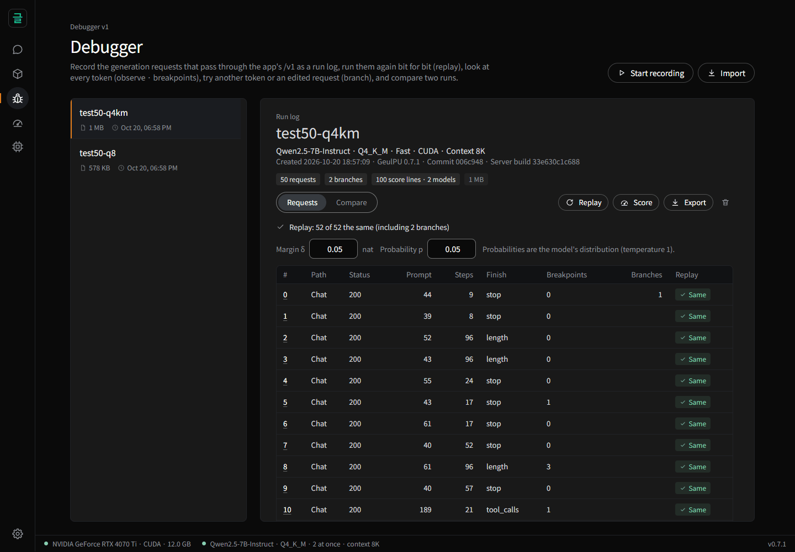
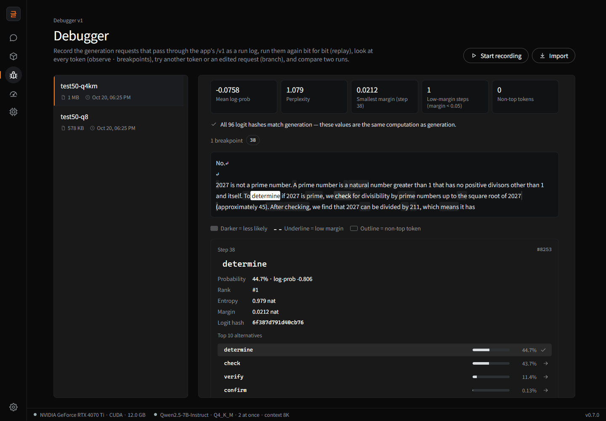
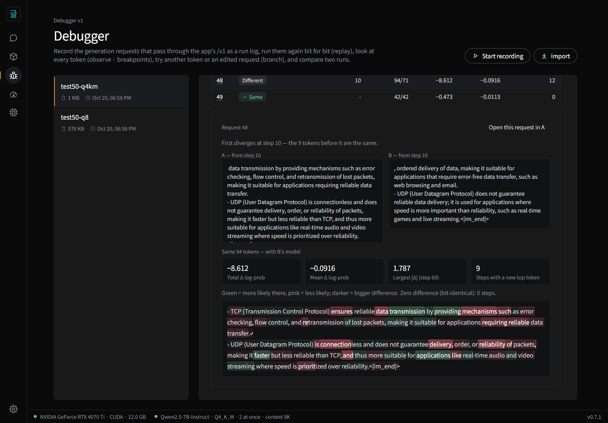
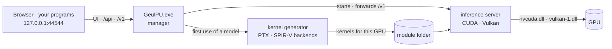

<div align="center">


# GeulPU

**Run language models on your own GPU — and get the same bits every time.**

A local LLM engine with a debugger: record a run, replay it bit for bit,<br>
branch from any token, and compare models and quantizations request by request.

[](https://github.com/wwoosshh/GeulPUv2/releases/latest)
[](https://pypi.org/project/geulpu/)
[](https://github.com/wwoosshh/GeulPUv2/actions/workflows/ci.yml)
[](LICENSE)
[](https://doi.org/10.5281/zenodo.23548056)


[Install](#install) · [Features](#features) · [Debugger](#debugger) · [Benchmarks](#benchmarks) · [Docs](#documentation) ·
[Contributing](CONTRIBUTING.md) · [한국어](README.ko.md)

</div>

<p align="center">
  
</p>

GeulPU runs GGUF models — Qwen3, Qwen2.5, DeepSeek-R1-Distill, Llama 3 and Mistral — on your own NVIDIA or AMD graphics card, with a chat
screen in the browser and an OpenAI-compatible API. Its arithmetic is fixed by a written **precision contract**, so every result is
bit-identical to a CPU reference implementation: the same request gives the same tokens and logits whatever the batch, the slot, the
prompt cache or speculative decoding — and, in exact mode, whatever the GPU.

That turns a local model into something you can **debug**. Record an agent session or a test set, replay it exactly, change one thing —
a token, a tool result, the quantization — and see the effect of that one change and nothing else.

## Features

- **Same bits, every time.** Batching, slots, the prompt cache and speculative decoding never change the output. In exact mode NVIDIA
  (CUDA) and AMD or other GPUs (Vulkan) agree too: 82,673 decoding steps of DeepSeek-R1-Distill-Qwen-7B were identical on three NVIDIA
  generations and a Radeon RX 9060 XT.
- **Debugger for local models.** Record runs, replay them bit for bit, find low-margin steps, branch from any token or edited request,
  and compare two runs request by request — from the app or from scripts.
- **Research panel.** For any answer in the chat: each token's probability, rank, top-10 alternatives, entropy and margin; branch,
  compare, score text, export, and check reproduction files.
- **Fast where it matters.** With the default settings, prompts and generation are faster than llama.cpp at every length measured
  (0.76–0.97× its time on Qwen2.5-7B, down to 0.48× deep into a Llama-3.1-8B session); speculative decoding that is 3.5–4× faster on
  editing tasks *and* bit-identical; a prompt cache on the SSD that restores a coding agent's 15k-token prompt in
  0.3 s after a restart.
- **Works with your tools.** An OpenAI-compatible API with tool calling for coding agents (tested with Qwen Code), log-probabilities,
  echo scoring and tokenization endpoints, and lm-evaluation-harness support.
- **Small and self-contained.** A download of about 1.5 MB that runs on the graphics driver alone — no CUDA toolkit, Python or
  PyTorch. The engine, GPU kernels, server and app are written in [글(geul)](https://github.com/wwoosshh/geul-lang), a programming
  language with Korean keywords, and built by its own compiler.

## Install

Windows 10 or 11 (64-bit) with an NVIDIA RTX 30-series or newer card (CUDA), or another GPU with Vulkan 1.3 such as an AMD Radeon.
Small models need 6 GB of graphics memory; 7B and 8B models need 8 GB (Q4_K_M) or 12 GB (Q8_0).

**With Python** — one command ([PyPI](https://pypi.org/project/geulpu/)):

```powershell
pipx install geulpu   # or: uv tool install geulpu · pip install geulpu
geulpu                # opens http://127.0.0.1:44544 in your browser
```

**Without Python** — download `GeulPU-<version>-windows-x64.zip` from the
[latest release](https://github.com/wwoosshh/GeulPUv2/releases/latest), extract it and run `GeulPU.exe`. The executable is not
code-signed: if Windows shows *Windows protected your PC*, choose **More info → Run anyway**. Release files are built from this
repository by GitHub Actions, with their SHA-256 sums attached.

Then open **Models → Find models**, download a file marked *Recommended for this PC*, and start chatting. The first message builds
kernels for your GPU (once per version, 10 seconds to a few minutes). The [user guide](docs/user-guide.md) walks through every screen.

## Use it from code

While a model is loaded, `http://127.0.0.1:44544/v1` is an OpenAI-compatible endpoint (any API key, any model name):

```python
from openai import OpenAI

client = OpenAI(base_url="http://127.0.0.1:44544/v1", api_key="geulpu")
r = client.chat.completions.create(
    model="geulpu",
    messages=[{"role": "user", "content": "Why is the sky blue?"}],
    seed=7, logprobs=True, top_logprobs=5,
    extra_body={"geulpu": {"logit_hash": True}},   # a 64-bit hash of every step's logits
)
print(r.choices[0].message.content)
```

Send the same request again — on this PC or another one with the same model file and computation mode — and you get the same tokens,
log-probabilities and logit hashes. The [API section of the user guide](docs/user-guide.md#use-it-from-other-programs-openai-compatible-api)
covers coding agents, scoring, tokenization and lm-evaluation-harness.

## Debugger

The debugger works on **runs** — an agent session or a test set — instead of single answers. Turn on recording, use your agent or
script against the API as usual, then work on the run from the app's **Debugger** screen or from
[`도구/debugger.py`](도구/debugger.py) (Python standard library only):

```bash
# Record an agent session, then replay and inspect it
python 도구/debugger.py record-start agent-session    # every /v1 request now goes into a run log
#   ... run your agent against http://127.0.0.1:44544/v1 ...
python 도구/debugger.py record-stop
python 도구/debugger.py replay agent-session          # send everything again and compare bit for bit
python 도구/debugger.py breakpoints agent-session     # low-margin steps, low-probability samples, tool calls
python 도구/debugger.py branch agent-session --request 3 --step 17   # continue from another token

# Run a test set on two quantizations and compare them request by request
python 도구/debugger.py run-set tests.jsonl q4km
python 도구/debugger.py load <id of the Q8_0 file>
python 도구/debugger.py run-set tests.jsonl q8
python 도구/debugger.py compare q4km q8
```

<p>
  
  
</p>

A run log is one JSONL file. Export it, import it on another PC and replay it there, or check it without a GPU against the precision
contract's CPU reference with [`도구/repro_check.py`](도구/repro_check.py). The [debugger guide](docs/debugger-guide.md) follows one test
set through every step.

## Benchmarks

**Determinism.** What changes the output, measured with the same GGUF files:

| Change | GeulPU | llama.cpp |
|---|---|---|
| 1 vs 8 concurrent requests — lm-evaluation-harness, gsm8k (100 items) | identical | 41 of 100 generations changed (b11643) |
| Speculative decoding on vs off | identical tokens and logits (17 requests × right, wrong and half-wrong drafts) | 2 of 8 greedy answers changed (b11721, `ngram-simple`) |
| Prompt cache restored from disk vs recomputed — 54 agent requests | identical (1,728 steps) | — |
| Another GPU — RTX 3080 Ti · 4070 Ti · 5070 · Radeon RX 9060 XT (exact mode) | identical (82,673 steps) | — |

llama.cpp does not aim for batch-invariant output; the comparison shows what changes when there is no such contract.

**Speed** — GeulPU's time divided by llama.cpp's (latest official release at the time of measurement — b11827 —, same GGUF, the faster
of its f16 and q8_0 KV caches; lower is better). RTX 4070 Ti (12 GB), Qwen2.5-7B-Instruct Q4_K_M, default settings (fast mode with the
8-bit KV cache and fast attention):

| Workload | GeulPU ÷ llama.cpp |
|---|---|
| Decoding (generation) at a depth of 8k / 32k / 64k tokens | 0.97 / 0.89 / 0.82× |
| Prompt of 512 / 2,048 / 8,192 / 32,768 / 65,536 tokens | 0.83 / 0.87 / 0.90 / 0.95 / 0.92× |
| 1,024 new tokens into a session 8k / 32k / 64k tokens deep | 0.90 / 0.92 / 0.76× |
| A recorded coding-agent session (54 requests, Qwen Code) | 0.59× of llama.cpp's fastest setting (a 0.5B draft model) |

Exact mode keeps the contract's two-digit activations and costs 1.19–1.40× llama.cpp's time on prompts up to 8k tokens (1.74× at 32k).
With speculative decoding (on by default), editing code generates 329–356 tokens/s — 3.5× the speed without it and 1.2–1.5× llama.cpp's
fastest speculative setting — with bit-identical output. Every measurement, with the method and the raw numbers, is in the [user guide](docs/user-guide.md#what-is-different).

## Supported models and hardware

| Architecture | Models | Weight formats |
|---|---|---|
| `qwen2` | Qwen2.5-Instruct · Qwen2.5-Coder · DeepSeek-R1-Distill-Qwen (1.5B and larger) | Q8_0 · Q4_0 · Q4_K_M · Q5_K_M · Q6_K · IQ4_XS (CUDA) |
| `qwen3` | Qwen3 0.6B · 1.7B · 8B (14B checked on a synthetic model; 4B · 32B load the same way as 0.6B) | same |
| `llama` | Llama 3.1 · 3.2 Instruct (3B · 8B) · Mistral 7B Instruct v0.3 · DeepSeek-R1-Distill-Llama · HyperCLOVAX-SEED | same |

Fine-tunes of these models with the same chat template run too. Qwen2.5 (7B and larger) and Qwen3 take up to 131,072 tokens of context
with YaRN. GPUs: NVIDIA RTX 30-series and newer on CUDA; other GPUs with Vulkan 1.3 (verified on an AMD Radeon RX 9060 XT — on AMD's
Windows driver only Q8_0 and Q4_0 files run for now). Releases are built for Windows x64; on Linux GeulPU builds from source (tested
under WSL2). Not yet: other architectures (Gemma, Phi, …), mixture-of-experts models, image input, F16 / BF16 and Q2_K · Q3_K · IQ
formats other than IQ4_XS (which runs on CUDA), macOS ([details](docs/user-guide.md#supported-models)).

## How it works



The first time a model is used, the kernel generator writes GPU kernels in 글(geul) for that model's shape and format, and the 글(geul)
compiler's backends turn them into PTX (NVIDIA) or SPIR-V (Vulkan). The inference server runs them through the graphics driver
directly. Activations are block integers, sums are exact on integer tensor cores and every rounding point is written down in the
[contract](계약/contract.md) — which is why the GPU can match a CPU reference bit for bit.

## Documentation

| | English | 한국어 |
|---|---|---|
| User guide — install, models, chat, settings, API, troubleshooting | [docs/user-guide.md](docs/user-guide.md) | [사용안내.md](사용안내.md) |
| Debugger guide | [docs/debugger-guide.md](docs/debugger-guide.md) | [디버거안내.md](디버거안내.md) |
| Research panel guide | [docs/research-guide.md](docs/research-guide.md) | [연구자안내.md](연구자안내.md) |
| Precision contract | [계약/contract.md](계약/contract.md) | [계약/계약.md](계약/계약.md) |
| Development — build from source, layout, checks | [docs/development.md](docs/development.md) | [문서/개발.md](문서/개발.md) |
| Changelog · versioning | [CHANGELOG.md](CHANGELOG.md) · [docs/versioning.md](docs/versioning.md) | [바뀐것.md](문서/바뀐것.md) · [버전규칙.md](문서/버전규칙.md) |
| Glossary — Korean names in the code | [docs/glossary.md](docs/glossary.md) | [용어.md](문서/용어.md) |

## Repository layout

The folder names are Korean because the code is written in 글(geul):

| Folder | Contents |
|---|---|
| [`엔진/`](엔진/) engine | GGUF reader, tokenizers, kernel selection, sampling and log-probabilities, the inference server, GPU backends (CUDA · Vulkan) |
| [`커널/`](커널/) kernels | The kernel generator — writes a kernel module per model architecture, shape, weight format and device |
| [`앱/`](앱/) app | `GeulPU.exe` (the manager), the web UI, the model catalog and release packaging |
| [`계약/`](계약/) contract | The precision contract and its CPU reference implementation (`정수계약.py`) |
| [`도구/`](도구/) tools | `debugger.py` and `repro_check.py` |
| [`시험/`](시험/) tests | The quick check run by CI, bit-comparison tests against the CPU reference, server regression tests |
| [`재기/`](재기/) benchmarks | Speed and quality measurement scripts |
| [`교차검증/`](교차검증/) cross-check | The reproducibility reference (outputs and build hashes) |
| [`문서/`](문서/) · [`docs/`](docs/) | Documents in Korean · in English |

## Where GeulPU is going

GeulPU aims to be the place where local models are tested and debugged: you fine-tune or quantize a model, convert it to GGUF, and run
it in an engine where every result can be reproduced, inspected and compared — on your own PC, and on anyone else's. Determinism is the
foundation. When the same input always gives the same bits, every difference has a cause you can find.

The work ahead follows from that:

- **Longer contexts for agents.** A coding agent's instructions alone are 10–15k tokens, and its prompts keep growing as it works. The
  aim is 100k tokens and more on a consumer GPU, with results that stay bit-exact.
- **From training to testing.** Connecting the debugger to PyTorch and Hugging Face checkpoints, so that a GGUF file can be compared
  token by token with the model it was converted from.
- **Wider coverage.** More model families, weight formats and GPUs — each one checked bit for bit against the CPU reference before it is
  supported.

What each release added is in the [changelog](CHANGELOG.md).

GeulPU grew out of a research program — 40 stages, each with its criteria fixed before measuring and every kernel variant compared bit
for bit before it was timed. That record, a research log and a paper draft are in the
[GeulPU research repository](https://github.com/wwoosshh/GeulPU). Its motto still holds: *it loses only what is written down — and it
shows what losing less costs.*

## Contributing

Bug reports, reproducibility reports, hardware results and pull requests are welcome, in English or Korean — see
[CONTRIBUTING.md](CONTRIBUTING.md). Versions follow the [versioning rules](docs/versioning.md): MAJOR for incompatible changes, MINOR
for features, PATCH for fixes. Security problems: [SECURITY.md](SECURITY.md).

## Citation

If you use GeulPU in research, please cite it — GitHub's **Cite this repository** button reads [CITATION.cff](CITATION.cff).
Every release is archived on Zenodo: [10.5281/zenodo.23548056](https://doi.org/10.5281/zenodo.23548056) stands for all versions,
and the Zenodo page lists the DOI of each version.

## License

GeulPU is released under the [MIT License](LICENSE). Models have their own licenses (Apache 2.0, MIT, Meta's Llama community
licenses, …), shown in the app's model details.
