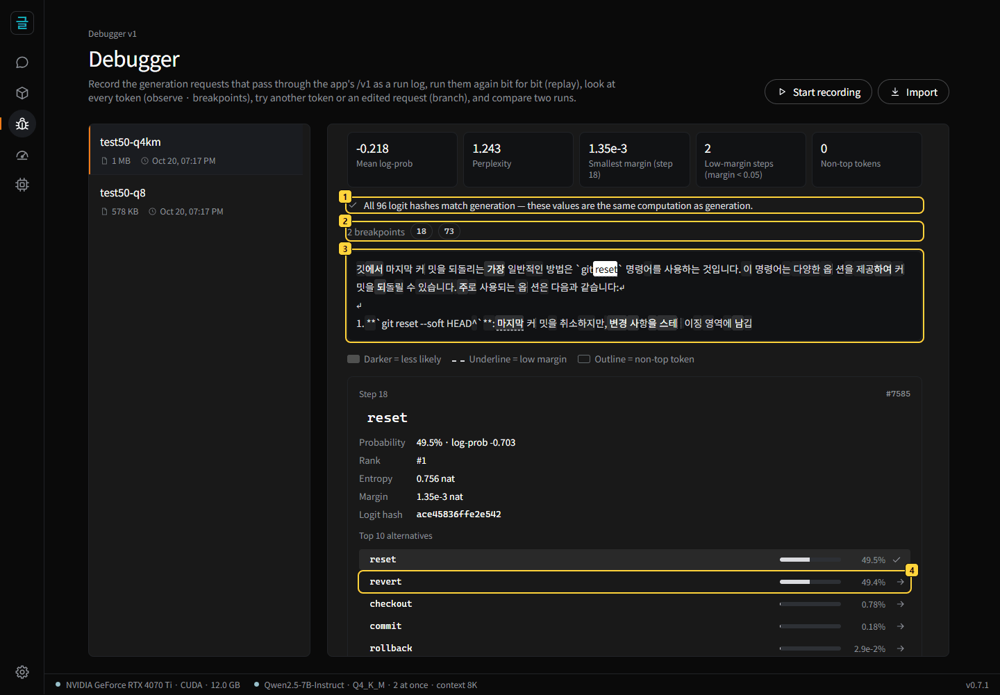
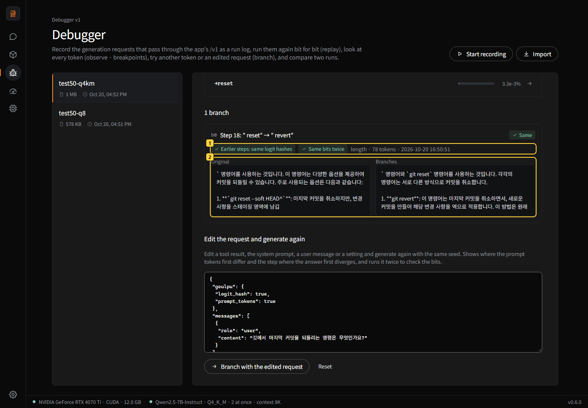
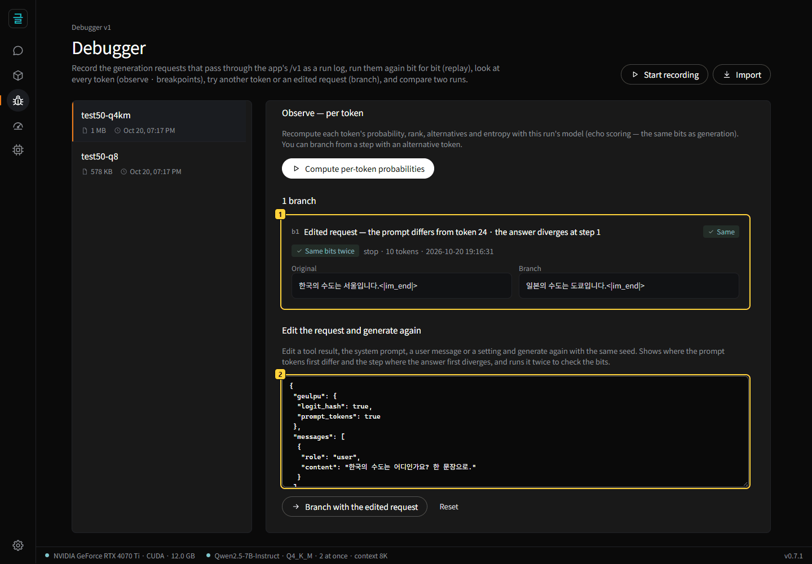
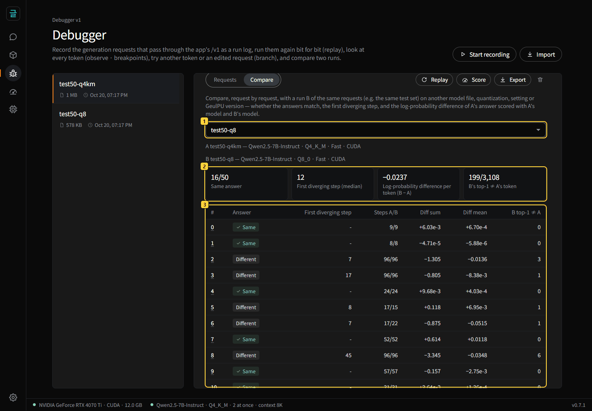
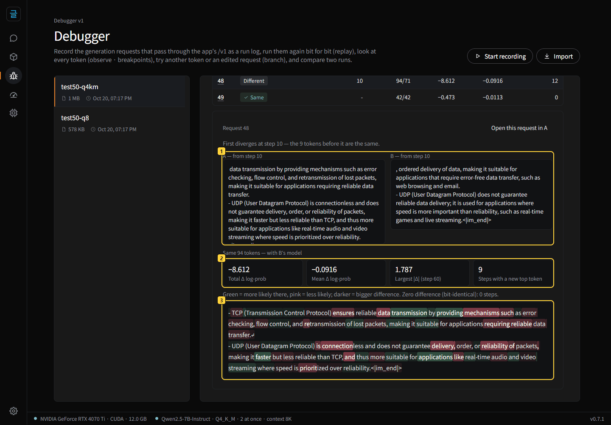
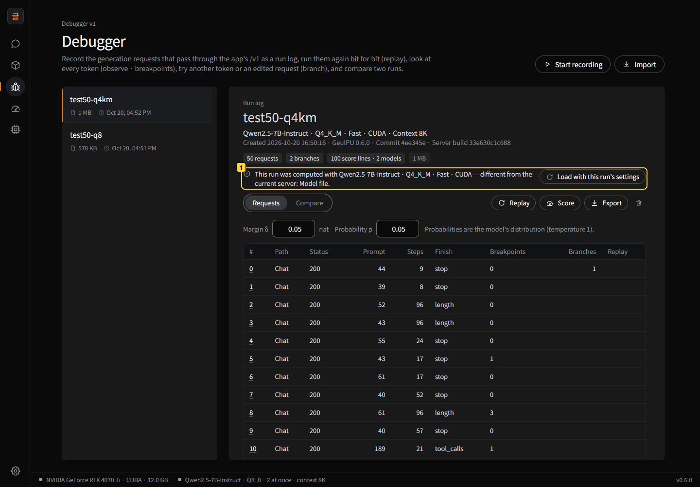

# GeulPU debugger — a guide

**[한국어](../디버거안내.md)** · [README](../README.md) · [user guide](user-guide.md) · [research panel guide](research-guide.md) · [plan and verdicts — 문서/디버거.md](../문서/디버거.md) (Korean)

GeulPU's **debugger** works on **runs** — many requests, such as an agent session or a test set — rather than on a single answer. It
records the generation requests that pass through the app as a **run log**, runs them again bit for bit (**replay**), looks at every
token (**observe** · **breakpoints**), continues from another token or from an edited request (**branch**), **compares** two runs, and
moves a run log to another PC with **export** · **import** to run it again there.

All of this works because GeulPU gives **the same bits for the same input**: the same values come out whatever the number of concurrent
requests, the prompt cache, speculative decoding or the slot, and exact mode also matches across CUDA ↔ Vulkan ([contract](../계약/contract.md)).
So a replay matches the recording bit for bit, and any difference a branch or a comparison shows comes only from the one thing you
changed. Every picture in this guide is a run of the test set ([`시험/디버거/묶음50.jsonl`](../시험/디버거/묶음50.jsonl)) on
Qwen2.5-7B-Instruct. With the same model file and the same computation mode, **your PC will show the same answers and the same numbers**.

## Contents

- [1. Setup](#1-setup)
- [2. Recording](#2-recording)
- [3. A run — the request table and replay](#3-a-run--the-request-table-and-replay)
- [4. Looking into a request — observe and breakpoints](#4-looking-into-a-request--observe-and-breakpoints)
- [5. Branches — another token · an edited request](#5-branches--another-token--an-edited-request)
- [6. Comparing two runs — Q4_K_M ↔ Q8_0](#6-comparing-two-runs--q4_k_m--q8_0)
- [7. To another PC — export · import · checking without a GPU](#7-to-another-pc--export--import--checking-without-a-gpu)
- [8. From scripts — debugger.py · API · run log](#8-from-scripts--debuggerpy--api--run-log)
- [9. Costs](#9-costs)
- [10. Caveats and FAQ](#10-caveats-and-faq)

## 1. Setup

1. Use **GeulPU 0.7.0 or later** ([install](user-guide.md#install)). The bug button on the left rail opens the debugger. The pictures
   in this guide were taken with a pre-release build of 0.7.0, so they show version 0.6.0.
2. **Model**: this guide uses **Qwen2.5-7B-Instruct Q4_K_M**, and the comparison in section 6 also uses **Q8_0** of the same model (get
   them from Models → Find models). Any other model works the same way; only the numbers change.
3. The **computation mode** is the default (fast mode — NVIDIA). In exact mode CUDA ↔ Vulkan (AMD included) also give the same bits, and
   the numbers differ slightly from fast mode.
4. For scripts, get [`도구/debugger.py`](../도구/debugger.py) from the repository (Python standard library only).

## 2. Recording

There are two ways to record.

- **In the app**: press **Start recording** in the debugger and pick a name. From then on every generation request that passes through
  the app's `/v1` — an agent (Qwen Code etc.), a script, or this app's chat — goes into the run log, one line per request. Press
  **Stop recording** when done. While recording, the server adds the seed, the prompt tokens and every step's logit hash to the response
  (the answer itself does not change — recording adds 0.35 % to request time).
- **From a test set**: run a JSONL file with one request per line as one run. A request without a seed gets `--seed` (default 1000) +
  its index, so the same file gives the same run.

  ```
  python 도구/debugger.py run-set 시험/디버거/묶음50.jsonl test50-q4km
  ```

Run logs are stored as `실행기록\<name>.jsonl` in the data folder. They contain the conversations, so record only while you need to.

## 3. A run — the request table and replay


1. **Run list** — name · size · modified. A run being recorded is marked.
2. **Start recording · Import** (a run log exported from another PC — [section 7](#7-to-another-pc--export--import--checking-without-a-gpu)).
3. **Run header** — the model · computation mode · backend · context this run was computed with, when it was created, and the GeulPU
   version · commit · server build; below it, the number of requests · branches · score lines.
4. **Replay · Score · Export · Delete**.
   - **Replay** sends the recorded requests and branches again with the same seeds and compares the prompt tokens, the generated tokens,
     every step's logit hash and the finish reason (`finish_reason`). A request that ended in an error must give the same error
     (status · code).
   - **Score** recomputes each request's answer with the current model (echo scoring) and keeps the result in the run log as score lines.
     Breakpoints and comparisons use them.
5. **Request table** — # · path (chat · completion) · status · prompt tokens · steps · finish reason · breakpoints · branches · replay
   result. The picture is after a replay — all 50 requests and 2 branches are **Same**.

## 4. Looking into a request — observe and breakpoints

Click a request's number in the table to open it: the last three messages · the request JSON · the answer text. **Compute per-token
probabilities** recomputes the answer with this run's model (a few seconds).

Request 20 is `깃에서 마지막 커밋을 되돌리는 명령은 무엇인가요?` ("What is the command to undo the last commit in git?", temperature 0).
The numbers at the top summarize the whole answer — mean log-prob −0.218 nat · perplexity 1.243 · the smallest margin (step 18) · 2
low-margin steps · 0 non-top tokens.



1. **All 96 logit hashes match generation** — these values are the same computation as generation.
2. **Breakpoints** — click one to jump to that step. There are three kinds:
   - **Low-margin step**: the gap between the top-1 and top-2 log-probabilities (the margin) is below δ (default 0.05 nat).
   - **Low-probability sample**: the chosen token's probability is below p (default 0.05).
   - **Tool-call start**: a step that chose `<tool_call>` or `<|python_tag|>`.
3. **Token strip** — darker = less likely, underline = low margin, outline = a sampled token that was not top-1 (as in the research
   panel).
4. **The step-18 card** — the model nearly tossed a coin between ` reset` (49.5 %) and ` revert` (49.4 %) (margin 1.35 × 10⁻³ nat). The
   arrow on each alternative branches with that token.

Probabilities are the model's distribution (temperature 1, no filtering — [contract §5.2](../계약/contract.md)). The request table counts
breakpoints from the score lines of the model that generated the request (press **Score** first).

## 5. Branches — another token · an edited request

**Another token**: click the arrow on the alternative ` revert` at step 18. The debugger sends the prompt + the first 17 tokens + ` revert`
and continues with the same seed, the same sampling settings and, from step 19 on, the same random numbers as the original. The same
request also returns the logit hashes of the earlier steps to check that they match the original, and the branch runs twice to check
that the bits match.



1. **Checks** — the earlier steps' logit hashes match the original, and two runs gave the same bits. The only change is the chosen token.
2. **Original · branch** — the original answer, which chose ` reset`, explains the options of `git reset` (`--soft HEAD^` and so on); the
   branch with ` revert` introduces both `git revert` and `git reset`.

A branch with the original token (a self-check) must reproduce the rest of the original answer, and its card then shows **Same as the
original answer**.

**An edited request**: in **Edit the request and generate again** at the bottom of a request, edit the request JSON — tool results ·
system prompt · user message · settings (temperature etc.). It generates again with the same seed and compares with the original.



1. A branch that changes request 0, `한국의 수도는 어디인가요? 한 문장으로.` ("What is the capital of Korea? In one sentence."), to
   `일본의 수도는 어디인가요? 한 문장으로.` ("…of Japan…") — it shows where the prompt tokens first differ (24) and the step where the
   answer first diverges (1).
2. **The request to edit** — holds the recorded request JSON as is. Edit it, then press **Branch with the edited request**.

In an agent session, use this to edit a failed tool result (test output, for example) and see whether that one result made the model act
differently. Every branch is stored in the run log as a **branch line**, and replay runs it again too.

## 6. Comparing two runs — Q4_K_M ↔ Q8_0

Compares, request by request, two runs of the same request sequence (the same test set) with a different model file · quantization ·
settings · GeulPU version. Here B is `test50-q8`, the same test set run with Q8_0.



1. Pick **run B** to compare.
2. **Summary** — **16/50** same answers; median first diverging step **12**; the log-probability difference of A's answers scored with
   B's model is **−0.0237 nat** per token; B's top-1 differs from A's token at **199/3,108** steps (for reference, A itself sampled a
   non-top-1 token at 119 steps — half of the test set uses temperature 0.7).
3. **Per request** — same answer? · first diverging step · steps A/B · diff sum · diff mean · B top-1 ≠ A.

The differences come from scoring A's answers **with A's model and with B's model**. If scores are missing, the **Score** button loads
both models in turn and scores them. With no computational noise, every nonzero difference is the effect of the model file alone.

Click a row to see that request's two answers side by side.



1. Request 48 (`What is the difference between TCP and UDP? Two bullet points.`) first diverges at **step 10** — the 9 tokens before it
   are the same.
2. Scoring A's answer (94 tokens) with B's model gives a total of −8.612 and a mean of −0.0916 nat; the largest |Δ| is at step 60, and 9
   steps have a new top token.
3. **Δ per token** — green = more likely with B's model, pink = less likely, darker = bigger difference.

## 7. To another PC — export · import · checking without a GPU

- **Export** downloads the run log file (JSONL) as is. Scores and branches are inside it.
- **Import** opens a run log exported from another GeulPU. It checks that the first line is a header and sends large files in parts.
  With the same GeulPU version · model file (sha256) · computation mode, replay matches bit for bit — we moved run logs to another app
  with a fresh data folder and replayed them there with the same result.
- **If the current server differs from the run**, the header shows what differs.



**Load with this run's settings** finds and loads this run's model file and, if the computation mode or backend differ, changes the
app's settings (chat uses them too). If you replay on a different server, the screen asks first and the tool stops (with
`--ignore-header` it goes ahead).

**Checking without a GPU**: compute the requests and branches of a received run log with the CPU reference of the precision contract —
without GeulPU — and check them bit for bit (Python + numpy).

```
python -I 도구/repro_check.py test50-q4km.jsonl Qwen2.5-7B-Instruct-Q4_K_M.gguf --requests 0,25 --branches 0
```

It compares every step's logit hash and sampled token, the log-probabilities · entropy · top-k when a score line exists, and the logit
hashes of a branch's earlier steps (echo rows). A 7B model takes 9–19 minutes per request or branch on the CPU (depending on the answer
length), so pick what to check.

## 8. From scripts — debugger.py · API · run log

Everything on the screen can also be done with [`도구/debugger.py`](../도구/debugger.py) (Python standard library only — on a
researcher's laptop or in CI). The app address is `--app` (default `http://127.0.0.1:44544`) or the environment variable `GEULPU_APP`.
The tools (`debugger.py` and `repro_check.py`) print their messages in Korean.

| Command | What it does |
|---|---|
| `status` | Recording state and the list of runs |
| `record-start [NAME]` · `record-stop` | Start · stop the app's recording |
| `run-set TESTSET.jsonl NAME [--seed 1000]` | Record a test set as one run |
| `get NAME FILE.jsonl` · `delete NAME` | Download · delete a run log |
| `load MODEL [--precision exact\|fast] [--layer cuda\|vulkan]` | Load a model (model id · first 8+ characters of the sha256 · `run:NAME` — that run's model) |
| `replay RUN [--requests 3,7] [--ignore-header] [--out FILE]` | Replay — compare requests and branches bit for bit |
| `score RUN [--check]` | Score (echo scoring) — `--check` recomputes and compares bit for bit |
| `breakpoints RUN [--margin 0.05] [--prob 0.05]` | Breakpoints |
| `branch RUN --request I --step K [--token ID\|same] [--alt N]` | Token branch |
| `branch RUN --request I --set PATH=VALUE [--set-file PATH=FILE]` | Request branch (e.g. `--set messages.2.content=…`) |
| `compare RUN_A RUN_B [--out FILE]` | Compare — the same inputs give the same report (byte for byte) |

`RUN` is a run name in the app or a run log file. **Step numbers start at 0 in the tool and in JSON, and at 1 on the screen** — step 18
on the screen is `--step 17`.

```
python 도구/debugger.py score test50-q4km
python 도구/debugger.py breakpoints test50-q4km
python 도구/debugger.py branch test50-q4km --request 20 --step 17
python 도구/debugger.py compare test50-q4km test50-q8 --out compare.json
```

**App API**: `GET /api/debug` (recording state · runs) · `GET /api/debug/run?name=` (a run log) · `POST /api/debug/record/start {name}` ·
`/api/debug/record/stop` · `/api/debug/run/delete {name}` · `/api/debug/run/append {name, lines}` (analysis lines — each with a top-level
`type`) · `/api/debug/run/import {name, text, part, last}` (import — the first line of the first part is the header). Replay, scoring and
branches use `/v1` with the [`geulpu` extension fields](user-guide.md#use-it-from-other-programs-openai-compatible-api): `logit_hash` ·
`prompt_tokens` · `step_offset` (start the step index of the sampling random numbers at this number — a branch continues with the same
random numbers as the rest of the original answer) · `echo_from` (with `echo` on `/v1/completions`).

**Run log** (JSONL):

- First line, the **header**: `{"format": "geulpu-run-log/1", "app", "commit", "model": {id, file, sha256, …}, "server": {…}, "build": {…}}`
- **Request lines**: `{"i", "at", "ms", "path", "status", "model", "server", "request", "response"}` — `server` is the server that
  computed the request (model sha256 · backend · computation mode · context · YaRN factor), and `response.geulpu` holds the seed ·
  `prompt_tokens` · `tokens` · `logit_hashes`.
- **Analysis lines** (with a top-level `type`): `score` (one request's answer echo-scored by one server — per step the log-prob · entropy ·
  top 2 · token text · logit hash, and `hash_check` for whether the hashes match generation) · `branch` (a branch's request · response ·
  checks).

## 9. Costs

Measured on an RTX 4070 Ti · Qwen2.5-7B-Instruct Q4_K_M · fast mode ([`재기/디버거비용.py`](../재기/디버거비용.py) · [문서/디버거.md](../문서/디버거.md)).

| Task | Test set of 50 (short prompts · 3,108 answer tokens · 49 branches) | Agent session (Qwen Code — 16 requests · prompts of 5,926–18,414 tokens · 4,834 answer tokens · 3 branches) |
|---|---|---|
| Time when recorded (requests) | 27.1 s | 53.0 s (streaming) |
| Replay — prompt cache empty | requests 27.2 s + branches 22.0 s | requests 54.3 s + branches 4.5 s |
| Replay — prompt cache warm | requests 27.2 s + branches 21.6 s | requests 41.9 s + branches 4.2 s |
| Score (recompute) | 5.0 s | 7.7 s |
| Compare (no GPU) | 1.2 ms | — |

Creating a branch (two runs, compared) took 0.07 s and 0.65 s for this guide's branches and 0.48–3.25 s for the agent session's.
Recording adds 0.35 % to request time. Checking without a GPU computes the 7B model on the CPU: 9–19 minutes per request or branch.

## 10. Caveats and FAQ

- **For the same bits** you need the same model file (sha256) · computation mode · YaRN factor, and in fast mode the same backend.
  Context length · slots · prompt cache · speculative decoding · concurrent requests do not matter. If the GeulPU version · server build ·
  module differ, replay tells you first — a build with changed kernels may change the bits, and replay shows that right away.
- **Replay · scoring · branches stop while recording** — their requests would go into the run log being recorded too. Stop recording
  first.
- **Streamed requests** keep their last event (finish reason · `geulpu`) as the response. The answer text is rebuilt from the tokens (it
  shows when a model with the same vocabulary as the run's model is loaded).
- **Token branches go to `/v1/completions`** — tool calls stay as plain text instead of being parsed, and chat rules such as ending at the
  first tool call with `parallel_tool_calls: false` (the Llama 3 chat template) do not apply. A branch ends only at an EOS token ·
  `max_tokens` · `stop`.
- **Seeds** are 64-bit integers. Re-saving a run log with a program that reads JSON numbers as floating point can change the seeds, so
  move the file as is (GeulPU's screen and tools read and write them exactly).
- **Load with this run's settings** changes the app's settings (computation mode · backend). Chat uses them too.
- **Deep analysis of a single answer** (scores · reproduction files · export) is in the [research panel guide](research-guide.md). The
  debugger extends it to whole runs.
