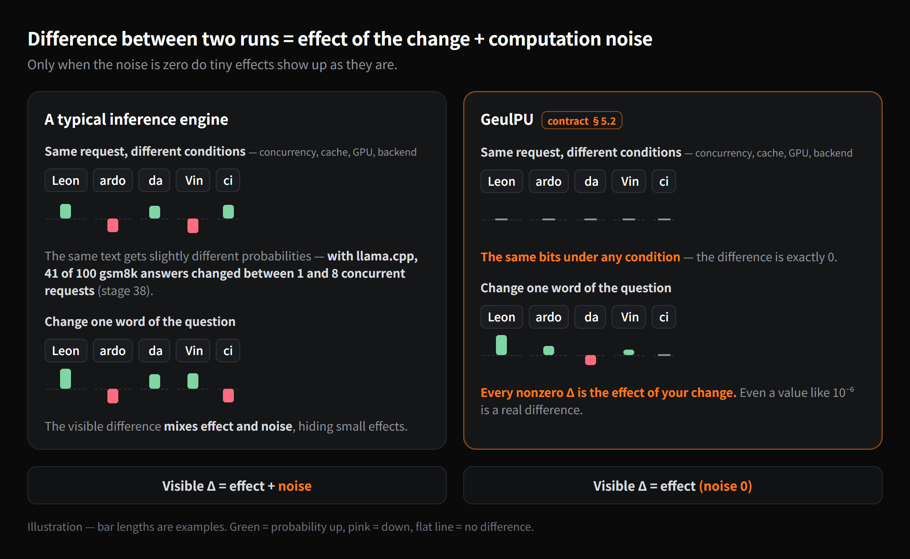
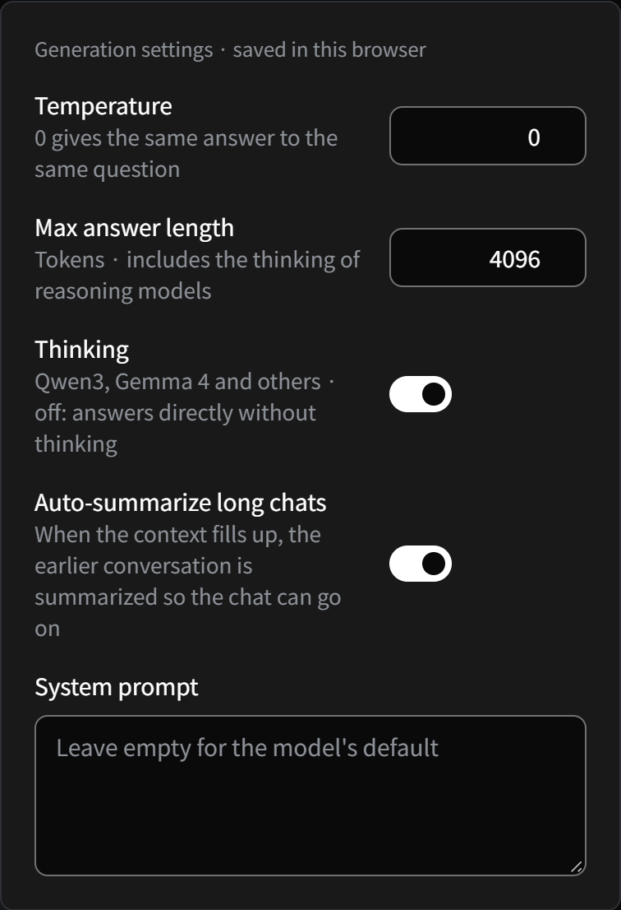
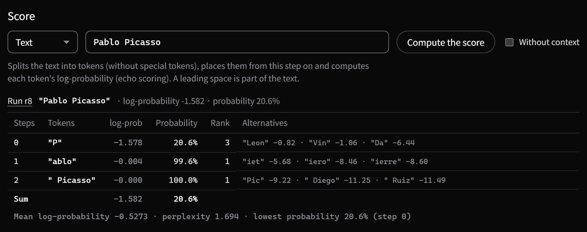
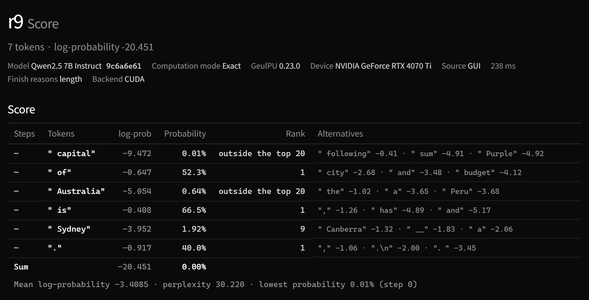
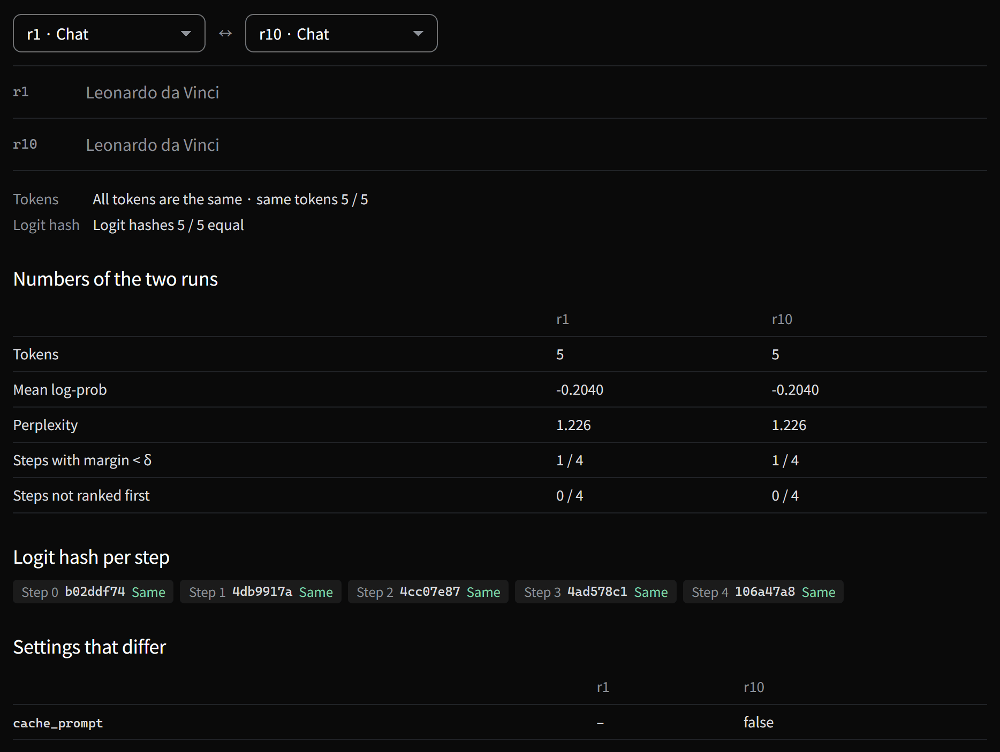
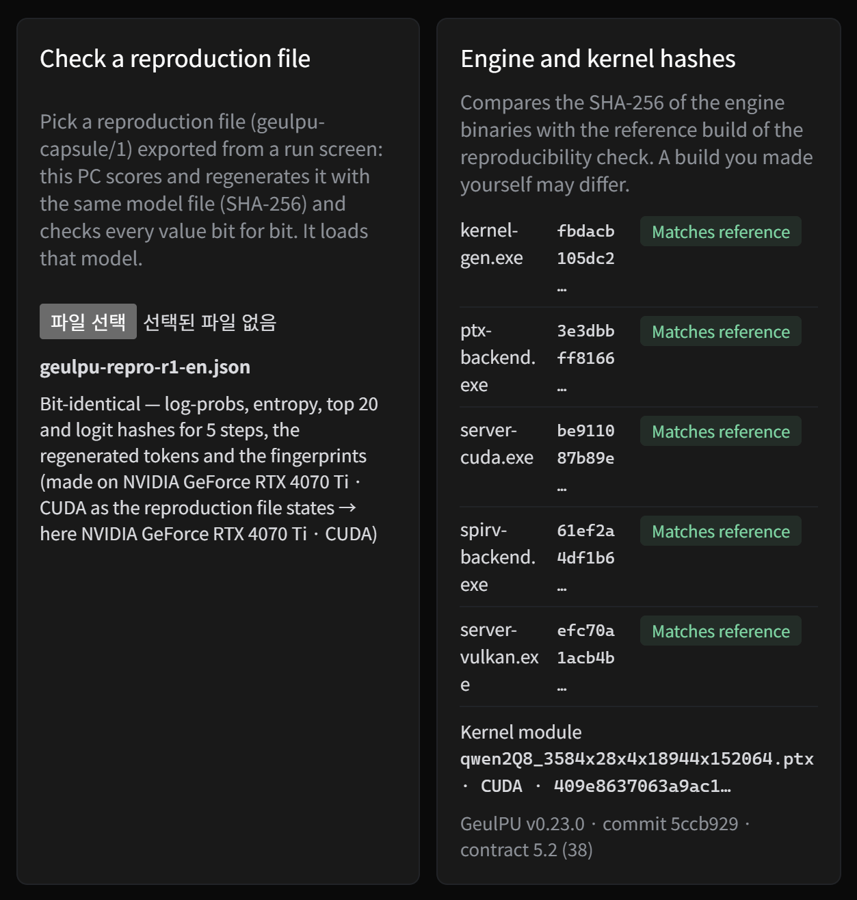
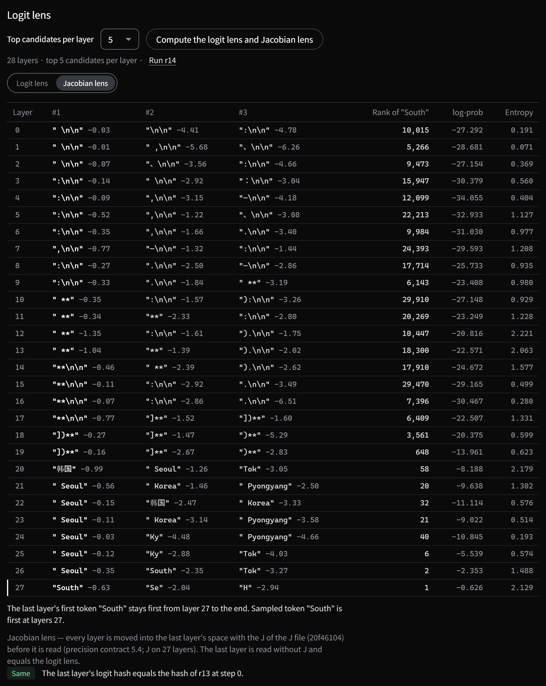
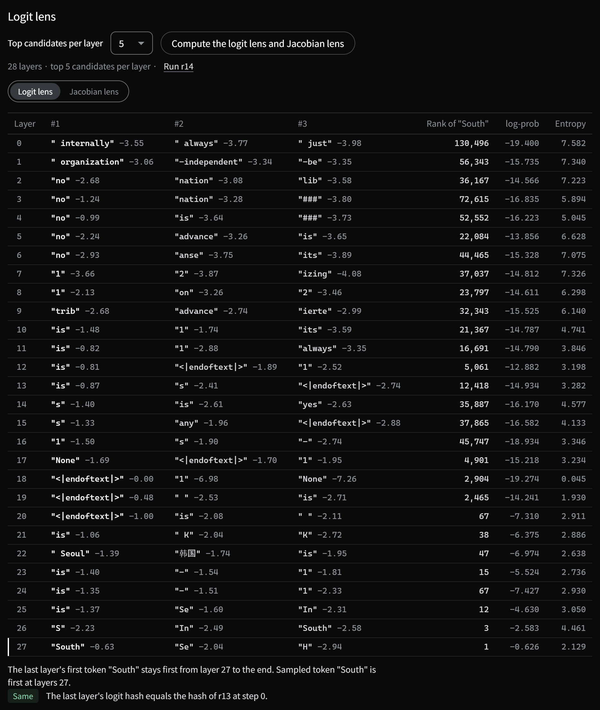

# GeulPU research guide

**[한국어](../연구자안내.md)** · [README](../README.md) · [user guide](user-guide.md) · [contract §5.2](../계약/contract.md) · [research log](https://github.com/wwoosshh/GeulPU/blob/main/docs/research-log.md) · [debugger guide](debugger-guide.md)

GeulPU records every chat answer as a **run** of an experiment. The **run screen** splits an answer into tokens to show at which step
the model was unsure, lets you pick a different token there and continue, and computes how much one word of the question — or one model
file — changes the probabilities of the same answer, token by token. The **step and layer screen** reads one step's distribution at
every layer. Every computation stays in the experiment folder, and a single file (a reproduction file) lets someone else check it, bit
for bit, on their own PC. 0.23.0 removed the research panel beside the chat; its features moved to these screens.

This guide walks through eight experiments from start to finish and explains these screens along the way. With the same model
file (Qwen2.5-7B-Instruct Q8_0 — Qwen3-0.6B Q8_0 for experiment 8), exact computation mode and temperature 0, **your PC will show the same
answers and the same numbers as this guide** — that is the premise of these screens. The screenshots are of this guide's own runs,
taken with GeulPU 0.23.0 — run numbers (r1, r3 …) follow the order of what was done in the experiment, so yours may differ.

## Contents

- [0. Why GeulPU — comparisons without noise](#0-why-geulpu--comparisons-without-noise)
- [1. Setup](#1-setup)
- [2. Opening the run screen — a map](#2-opening-the-run-screen--a-map)
- [3. Reading the numbers](#3-reading-the-numbers)
- [4. Walkthrough — eight experiments](#4-walkthrough--eight-experiments)
  - [Experiment 1. Where did the model hesitate](#experiment-1-where-did-the-model-hesitate) (Observe)
  - [Experiment 2. What if it had picked another token](#experiment-2-what-if-it-had-picked-another-token) (Intervene)
  - [Experiment 3. Where did two answers part](#experiment-3-where-did-two-answers-part) (Compare)
  - [Experiment 4. How much does quantization change the same answer](#experiment-4-how-much-does-quantization-change-the-same-answer) (Compare)
  - [Experiment 5. How much does one word of the question change the same answer](#experiment-5-how-much-does-one-word-of-the-question-change-the-same-answer) (Compare)
  - [Experiment 6. How plausible is a line of text](#experiment-6-how-plausible-is-a-line-of-text) (Score)
  - [Experiment 7. Having someone else check your result](#experiment-7-having-someone-else-check-your-result) (Reproduce)
  - [Experiment 8. At which layer does the answer appear — the logit lens](#experiment-8-at-which-layer-does-the-answer-appear--the-logit-lens) (Observe — from 0.13.0)
  - [Where did the prompt cache break](#where-did-the-prompt-cache-break) (Observe)
  - [Getting the data out](#getting-the-data-out) (Export)
- [5. From scripts — the API](#5-from-scripts--the-api)
- [6. Caveats and FAQ](#6-caveats-and-faq)

## 0. Why GeulPU — comparisons without noise



When you compare two runs, the visible difference is **the effect of what you changed + computation noise**. In a typical inference
engine the probabilities of the very same request shift a little when the number of concurrent requests, the batch size, the cache or the
GPU changes. With llama.cpp, for example, 41 of 100 gsm8k answers came out different between 1 and 8 concurrent requests (see the
[research log, stage 38](https://github.com/wwoosshh/GeulPU/blob/main/docs/research-log.md)). Small effects drown in that noise.

GeulPU fixes the order of every sum and every rounding in a [contract](../계약/contract.md), so it gives the same bits under any condition
(log-probabilities are contract §5.2). So **every nonzero Δ is the effect of the one thing you changed** — even a value like 10⁻⁶ is a
real difference. That makes questions like these cleanly answerable:

- At which step of an answer did the model hesitate, and which token did it almost pick?
- Had it picked another token there, how would the answer have continued?
- How much does one word of the question, or one model file (a quantization), change the probabilities of the same answer, token by token?
- Does someone else's result reproduce bit for bit on my PC?

## 1. Setup

1. Install **GeulPU 0.23.0 or later** ([Install in the user guide](user-guide.md#install)). The run screen and the step and layer screen
   arrived in 0.23.0.
2. **Model**: this guide uses **Qwen2.5-7B-Instruct Q8_0** (**Models › Files**). Experiment 4 also needs the same model's **Q4_K_M**.
   Any other model works the same way; only the numbers change.
3. Click the **computation mode** chip above the chat (**Fast** · **Exact**) and choose **Exact**; the loaded model reloads in exact mode
   (**Computation mode** in **Settings › App** does the same). Every answer carries a tag with the mode it was computed in, and the run
   screen and the step and layer screen say so in one line when the loaded model or computation mode differs from the run's, with
   **Load this run's model** and **Use this run's computation mode** buttons to match it. This guide's numbers are exact-mode numbers. The
   default fast mode feeds 8-bit activations into the matrix multiplications, so its probabilities differ slightly — with this guide's
   first question it even answers `Vincent van Gogh` instead of `Leonardo da Vinci`. Both modes are deterministic; exact mode also gives
   the same bits on NVIDIA and AMD, CUDA and Vulkan.
4. In the **generation settings** (the sliders button at the top right of the chat), check that **temperature is 0**. It is the default.
   At temperature 0 the same question always gets the same answer, so you can follow this guide's numbers exactly. Leave the system
   prompt empty (the model's default).
5. Open **Chat** under **Experiments** in the sidebar (the chat screen) and send the question in a **new chat**.



> From 0.23.0 every chat answer is recorded as a run of the default experiment "Conversations": in `<date>-chat` in the `experiments` folder,
> each run's `records/runs/rN.json` keeps the full request sent and response received, so clearing the browser's data does not remove
> it. Computations on the screens (branch, score, lens) are runs of that experiment too. For answers from before 0.23.0, see
> [section 6](#6-caveats-and-faq).

## 2. Opening the run screen — a map

Send the question `Name one famous painter. Answer with just the name.` and the answer is `Leonardo da Vinci`.


- **Run rN** under an answer opens that answer's **run screen**. The answer was recorded as a run of the default experiment "Conversations" —
  **Conversations** in the path **Experiments › Conversations** above the chat screen opens that experiment's screen, whose **Runs** tab has one run per
  answer.
- The **computation mode** chip above the chat — the mode the loaded model computes in now (**Exact** or **Fast**). Click it to switch (setup step 3).
- The answer's tag — the mode that answer was computed in. Every answer in this guide is **Exact**.
- **Generation settings** (temperature, maximum length, system prompt).

While it generates, the chat also receives the top 2 candidates, the entropy and the logit hash of every step and keeps them in the run
record, which the run screen reads. For more candidates, or for the end token's step, **Top candidates at every step** on the run screen
computes the same tokens again (scoring — `echo`). The recomputed values are **bit-identical** to those of generation (checked in stage 38
on four models and two backends).

![Run screen — chat run r1 (Qwen2.5 7B Instruct Q8_0, Exact, temperature 0, 5 tokens): path and title, run details with fingerprints, summary values (smallest margin 0.2404 nat · step 0), margin threshold δ with previous and next, the bar choice, the token-by-token output with a margin bar under each token after the dim prompt (up to the end token), and on the right the selected step 0's two top candidates with 'Branch with this token', margin, probability of the sampled token, entropy and logit hash, the Step and layer screen, Re-run and New run with these settings buttons, and Computations below](img/guide/03-run-screen-en.png)

**The run screen** (top to bottom)

- **Path and title** — `Experiments › <experiment id> › Run rN`, the run's kind (chat, text generation, branch, re-run, score, logit
  lens) and a one-line description.
- **Run details** — model (the first 8 characters of its SHA-256), computation mode, GeulPU version, device, seed, sampling (temperature,
  top-k, top-p, min-p), source and time taken, plus finish reason, tokens/s, backend and **fingerprints**
  ([experiment 7](#experiment-7-having-someone-else-check-your-result)). When the loaded model or the computation mode differs from the
  run's, a line with buttons appears below (setup step 3).
- **Summary values** — mean log-prob, perplexity, mean entropy, the smallest margin and its step, steps with margin < δ, steps not ranked first.
- **Margin threshold δ** — steps whose margin is below δ are counted; **Previous — margin < δ** and **Next — margin < δ** jump between
  them. δ is remembered in this browser.
- **Bars** — what the bar under each token shows: **Margin**, **Probability** or **Entropy**.
- **Token-by-token output** — dim text is the prompt, then come the answer's tokens. Tokens with a margin below δ get a dashed underline,
  and the step with the smallest margin is labeled above. Click a token to open that step on the right. Keys: ← → previous and next step,
  Enter step and layer screen, b branch with the highest other candidate.
- **Selected step** — top candidates (log-probability and bar; 'sampled' on the sampled token, **Branch with this token** on the others),
  the margin, the probability and rank of the sampled token, the entropy and the logit hash, and the **Step and layer screen**,
  **Re-run** and **New run with these settings** buttons.
- **Computations** — **Top candidates at every step**, **Re-run without cache**, and scoring with another model (**Pick another model** →
  **Load and score**).
- **Prompt cache** — how much of the prompt was reused, and from where ([Where did the prompt cache break](#where-did-the-prompt-cache-break)).
- **Export** — token table as JSON or CSV, **Reproduction file (JSON)**, Python code ([Getting the data out](#getting-the-data-out)).

| Activity | Question it answers | Where |
|---|---|---|
| **Observe** | Where was the model unsure? | **Run screen** — per token probability, rank, entropy, margin and top candidates. **Step and layer screen** — 1 to 128 top candidates, the logit lens |
| **Intervene** | What if it had picked another token? | **Branch with this token**, **Re-run** and **New run with these settings** on the run screen; **Branch** on every candidate of the step and layer screen |
| **Compare** | What changes what, and by how much? | The experiment's **Compare** tab — where two runs first differ, one run's answer scored under the other run's prompt (Δ). Scoring with another model on the run screen (Δ) |
| **Score** | How plausible is this text? | **Score** on the step and layer screen — text or token ids, without context |
| **Reproduce** | Will others get the same result? | **Fingerprints** in the run details, **Re-run without cache**, **Export › Reproduction file (JSON)**, **Reproduce › Check** (check a reproduction file, engine and kernel hashes) |
| **Export** | How do I get the data out? | **Export** on the run screen — token table as JSON or CSV, reproduction file, Python code |

Every computation on these screens (branch, top candidates, score, logit lens) is recorded as a run of the experiment — the full request
sent and response received in `records/runs/rN.json`. It is still there when you open the screen again, and the **console** on the right
of every screen shows one line per call with the `GeulPU` command that does the same thing (for example
`GeulPU experiment branch --run r1 --step 3 --token 785`). Research records no longer live only in the browser, so you can hand the
experiment folder to someone else as it is.

## 3. Reading the numbers

| Name | Meaning |
|---|---|
| **Step** | One computation that picks one token of the answer. The screens and the CLI count from 0 — step 0 is the answer's first token (a branch run continues its base run's numbers). |
| **Probability · log-prob** | The probability the model gave that token at that step, and its natural log (nats). log-prob −0.816 = probability e<sup>−0.816</sup> = 44.2 %. The run screen lists top candidates by log-probability, the step and layer screen as percentages too. |
| **Rank** | Where the token stood among all tokens at that step. At temperature 0 the top token is always picked. |
| **Entropy** | How spread out the step's distribution is (nats). 0 = all on one token; 1.08 ≈ e<sup>1.08</sup> ≈ 3 equally likely tokens. |
| **Margin** | The log-prob gap between #1 and #2 = ln(p₁ / p₂). The smaller, the closer the call. |
| **Low-margin step** | A step whose margin is below the threshold δ (the screen's 'steps with margin < δ') — a step where a slightly different computation or setting could pick another token. Default δ = 0.05 nats (a probability ratio of about 1.05). |
| **Steps not ranked first** | Steps where sampling (temperature > 0) picked a token other than #1. A branch run's changed token is in its prompt and is not counted. |
| **Perplexity** | exp(−mean log-prob). The closer to 1, the more the model takes the text for granted. |
| **Δ log-prob** | The difference between the log-probs of the same token under two conditions — 'that model − this run' when scoring with another model, 'B's prompt − A' for the Compare tab's score. A total Δ of x means the whole answer's probability is multiplied by e<sup>x</sup>. |
| **Logit hash** | A 64-bit hash of the step's logit row (the scores over the whole vocabulary). Compares two computations bit for bit, step by step. The screens show the first 8 characters; hover for the whole hash. |
| **End token** | `<\|im_end\|>` — the token with which the model ends the answer. It appears at the end of the token-by-token output and is a step too. A generation record has no probability for this step (like the OpenAI-style log-prob arrays), so **Top candidates at every step** scores the whole answer to fill it in — the token table, the reproduction file, scoring with another model and the Compare tab's score use those values. |
| **Character split across tokens** | A character (e.g., Korean) whose UTF-8 bytes are split across two or more tokens. The token-by-token output shows the character on the first token and keeps the others zero-width (← → still step through them one by one). |

**Probabilities are the model's distribution (temperature 1)** — not the distribution filtered by the temperature, top-k or top-p used
for sampling. So the same token has the same probability whatever temperature you generate with.

## 4. Walkthrough — eight experiments

### Experiment 1. Where did the model hesitate

**Question**: how sure was the answer `Leonardo da Vinci`?


1. Open the run screen with **Run rN** under the answer. The summary shows **Smallest margin** 0.2404 nat · step 0, and the screen opens
   with that step selected (labeled above `Leon`).
2. With the default threshold δ = 0.05 there are no **steps with margin < δ**. Type `0.5` into **Margin threshold δ**: the count becomes 1
   and `Leon` in the token-by-token output gets a dashed underline.
3. A chat answer records only the top 2 candidates per step. Under **Computations**, press the button next to **Top candidates at every
   step** (20 by default): a run that scores the whole answer appears, and the selected step lists its top 20 candidates (from the CLI:
   `GeulPU experiment score --run rN --top_logprobs 20`).

**Reading**
- The selected step (step 0): **probability of the sampled token** 44.2 % · rank 1 (log-prob −0.816), **entropy** 1.081 nats, **margin**
  0.240 nats. It was the top token, but with less than even odds.
- **Top candidates**: `Leon` 44.2 % · `Vin` 34.8 % · `P` 20.6 % · `Da` 0.16 % … The run screen shows them as log-probabilities with bars,
  the step and layer screen (Enter) as percentages too. The model was choosing between Leonardo, Vincent (van Gogh) and Picasso; an
  entropy of 1.08 nats is about three equally likely options, and that is what the list shows.
- The steps after the first (`ardo` · ` da` · ` Vinci` · end) are all close to 100 %. **The uncertainty sat entirely in the first step.**

> With the same model file and the same question your screen shows the same numbers, and the logit hash is `b02ddf74` too (hover for the
> whole `b02ddf74a62086f7`).

### Experiment 2. What if it had picked another token

**Question**: had the model picked the runner-up `Vin` at the first step, how would the answer have continued?


1. On the run screen, with step 0 selected, press **Branch with this token** next to the candidate `Vin` (the b key — branch with the
   highest other candidate — does the same).

GeulPU continues from the prompt + the earlier tokens (none here) + the changed token `Vin`. With sampling (temperature > 0) it would use
**the same seed and the same per-step random numbers**, so the changed token is the only difference. The app builds the request from the
original run's record (prompt tokens, answer, sampling settings, seed), and the console shows a command like
`GeulPU experiment branch --run … --step 0 --token …`. The branch becomes a new run of the experiment and opens in the **Compare** tab
next to the original ([experiment 3](#experiment-3-where-did-two-answers-part)). The chat gets no new version.

On the same run screen, **Re-run** sends the very same request again and records it as a re-run (check), and **New run with these
settings** opens the new-run dialog filled in with this run's settings — change the temperature, seed, maximum tokens or messages and
press **Run** for a new run. Empty top-p, top-k and min-p sample with the engine's defaults (0.95 · 40 · 0.05 — shown greyed in the
fields), and an empty seed lets the server pick one. The values actually used go into the run record.

The answer continued as **`Vincent van Gogh`**. Open the branch run from the Runs tab: the description under the title shows the kept and
the new tokens and where the original random numbers continue (the picture: 'r1 step 0 → "Vin" · seed … · temperature 0 · 1 kept + 5 new
= 6 tokens · original random numbers from step 1' — the one kept token is `Vin`), and the changed token at the end of the dim prompt has a dashed outline. A branch
run's step numbers continue the original's, and it has per-token values like any other run, ready for Observe and Compare.

### Experiment 3. Where did two answers part


1. After branching, the **Compare** tab shows the original run and the branch side by side. Pick any other two runs in the two lists
   above (first run ↔ second run), or open the tab with **Compare two runs** in the Runs tab.

**Reading**
- The two lines at the top — the two runs' answers, split into the shared beginning and the differing rest.
- **First step with a different token: 0**, and below it **First differing step 0** — the original run has `Leon` (probability 44.2 % ·
  rank 1), the branch `Vin` (34.8 % · rank 2). The **first step with a different logit hash** is 1: the prompt and all earlier tokens
  are the same, so **step 0's distribution is bit-identical in both runs**; only the token differs. **Show this step of rN** at the end
  of the line opens that step in the step and layer screen.
- **Numbers of the two runs** — tokens, mean log-prob, perplexity, steps with margin < δ and steps not ranked first, side by side. A
  branch run's numbers count only the tokens it made (the changed token `Vin` is in its prompt).
- **Logit hash per step** and **Settings that differ** — the hashes around the first differing step, and the request fields that differ.

Runs made with other settings (**New run with these settings** — say temperature 0.7 and another seed) are compared the same way; the
first step with a different token is where sampling first picked a different token, and that step's logit hash is the same — the
distribution was the same and only the sampling differed. The CLI's `GeulPU experiment compare --path <experiment> --a r1 --b r2` gives
the same values from the experiment's records, without a model.

### Experiment 4. How much does quantization change the same answer

**Question**: if you use the Q4_K_M file instead of Q8_0, how much do the probabilities of the same answer change, token by token?


1. On the branch run's run screen (`Vincent van Gogh`), first compute **Top candidates at every step** — this gives the values of this
   run's model (Q8_0) up to the end token's step.
2. Under **Computations**, choose `Qwen2.5 7B Instruct · Q4_K_M` in **Pick another model** and press **Load and score**. The loaded model
   switches, which takes tens of seconds. Only installed models with the same vocabulary and chat template are listed. Afterwards Q4_K_M
   is loaded, so the line at the top says the model differs — **Load this run's model** switches back.

**Reading** — the branch run's 5 new tokens (`cent` through the end token), recomputed with Q4_K_M. The changed token `Vin` is in this
run's prompt, so it is not in this Δ.
- Under **Scored with another model — … · Δ = that model − this run**, these five tokens barely move: the box shows a Δ sum of −0.0000,
  and every difference is below 10⁻⁴ (the largest, ` van`, is +7.4 × 10⁻⁵).
- The per-token Δ — green = more likely under Q4_K_M, pink = less likely, darker = bigger. No step has a zero difference — quantization
  leaves a mark on every step. With zero computation noise, **all of this is the effect of the model file alone**.
- The change sits at the token the branch put in: `Vin` is 34.8 % under Q8_0 and 45.4 % under Q4_K_M. Over the whole answer (6 tokens,
  `Vin` included) the total Δ is +0.267 — the answer is e<sup>0.267</sup> ≈ 1.31× as likely under Q4_K_M — and at step 0 Q4_K_M's top
  token is `Vin` where Q8_0's is `Leon`.

That flip is not hypothetical: ask the same question with Q4_K_M loaded and the answer itself changes — Q8_0 answers `Leonardo da Vinci`,
Q4_K_M answers **`Vincent van Gogh`** (Vin 45.4 % · Leon 32.8 % · P 21.3 %). One quantization step changes the answer.

### Experiment 5. How much does one word of the question change the same answer

**Question**: if the question says "Italian", how much more likely does the answer `Leonardo da Vinci` become?


1. On the original run's run screen (`Leonardo da Vinci`), press **New run with these settings**. The new-run dialog opens with this run's
   settings (type Chat, user message, max tokens, temperature 0, seed). Change the **User message** to `Name one famous Italian painter.
   Answer with just the name.` and press **Run**: the answer `Leonardo da Vinci` is recorded as a new run and its run screen opens.
   Editing and resending the question in the chat records its answer as a new run of "Conversations" too.
2. On the new run's run screen, compute **Top candidates at every step** (this fills in the end token's step).


3. In the **Compare** tab, set the first run to the new run (the edited question's answer) and the second run to the original. As the
   prompts differ, a section scores the new run's answer under the original run's prompt (titled with the run ids — say 'r3's answer
   under r1's prompt'). Press **Score**: the new run's answer tokens are recomputed after the original question (recorded as a score run).

**Reading**
- **Δ sum −0.807** — here Δ is original question − edited question. After the original question this answer is e<sup>−0.807</sup> ≈
  0.45× as likely — the one word "Italian" makes it e<sup>0.807</sup> ≈ **2.2×** as likely — and practically all of it is **step 0**:
  `Leon` 99.1 % → 44.2 % (Δ −0.807). The line above says the answers' tokens are the same at every step — `Leon` is #1 after both
  questions, so no step has a new top token.
- The per-token Δ — the other steps barely move, but they do move (Δ of −3.2 × 10⁻⁵, +1.0 × 10⁻⁴, +1 × 10⁻⁶ …; the API example below shows
  the same values with the opposite sign). With zero noise, even these are effects of that word.

Swap the first and second run and the same Δ come out with the opposite sign — here both runs answer with the same tokens.

### Experiment 6. How plausible is a line of text

**Question**: which part of `The capital of Australia is Sydney.` does the model find odd?

<p>


</p>

1. Open the step and layer screen of any run (pick a step on its run screen and press Enter). Under **Score** at the bottom, keep the input
   type at **Text**, enter `The capital of Australia is Sydney.`, switch on **Without context** and press **Compute the score**. The
   loaded model (Q8_0) computes it.
2. A score run is recorded and its run screen opens (right picture).

**Reading**
- The **Score** table — for each token its log-prob, probability, rank (when within the top 20) and **Alternatives** (the three other top
  candidates at that position), with the **Sum** −20.451 and the mean log-probability, perplexity 30.220 and lowest probability below.
  The text is 7 tokens and the table has 6 rows — without context the first token `The` has no probability (this model has no start
  token, so the first token serves as context). The lowest is ` capital` (7.7 × 10⁻³ %, shown as 0.01%) — without context the beginning of a text is naturally
  unlikely. So **look at the position you care about**.
- ` Sydney` is **1.92 %, rank 9**, and the first **alternative** at that position is ` Canberra` (log-prob −1.32 — 26.7 %) — the model
  expected Canberra there. Score `The capital of Australia is Canberra.` instead and ` Canberra` gets 26.7 % (log-prob −1.32), and
  perplexity drops to 20.12.

With **Without context** off, the text is placed after that run's step and scored there — use it to compare several candidate answers to
one question (for example, open the step and layer screen of step 0 of the painter question's run and try `Pablo Picasso`). These scores
stack up as tables under **Score** on the step and layer screen (left picture). Special tokens that cannot be typed as text (such as
`<|im_end|>`) are entered by number with the input type set to **Token ids**.

### Experiment 7. Having someone else check your result

**Question**: can someone else see exactly the numbers I saw, on their own PC?

<p>


</p>

On the original answer's run screen (`Leonardo da Vinci`):

- **Fingerprints** — after 'Fingerprints' at the end of the run details, the first 8 characters of the token fingerprint (SHA-256 of the
  model file + prompt + answer tokens) and of the logit fingerprint (+ every step's logit hash); hover for the whole values. The same
  model file, prompt and result give the same fingerprint on any GPU or backend. This guide's answer has a token fingerprint starting
  `f81ce6ed` — if yours does too, **your answer is bit-identical to this one**. The recipe is in [contract §5.2](../계약/contract.md).
- **Re-run without cache** — regenerates the same request without the prompt cache (`cache_prompt: false`) and opens the **Compare** tab
  with the original run: 'All tokens are the same', 'Logit hashes 5 / 5 equal' (the answer's tokens — left picture).
- **Export › Reproduction file (JSON)** — the request, result, every step's log-probability, entropy, top candidates and logit hash, the
  fingerprints, the model file's SHA-256, the device it was made on and the sampling values actually used (temperature, top_k, top_p,
  min_p, seed) in one JSON file. Any logit lens computed goes in too. The per-step values come from a run that scored the whole answer, so
  without one the screen scores the whole answer first (that run stays in the experiment).
- **Reproduce › Check › Check a reproduction file** — the recipient picks the file in their own GeulPU. The same model file (SHA-256) must
  be installed, and that model is loaded during the check. When scoring, regeneration and fingerprints all match you see 'Bit-identical'
  (right picture — with the device and backend the file says it was made on, and the ones here). A difference shows the first differing
  step and the settings that differ (computation mode, KV cache, fast attention, YaRN). It must match across NVIDIA and AMD, CUDA and
  Vulkan as well.
- **Reproduce › Check › Engine and kernel hashes** — **Show engine and kernel hashes** tells whether the five engine binaries equal the
  official build (the cross-check reference), which kernel module is in use, and the GeulPU version, commit and contract.

From the CLI: `GeulPU experiment repro --path <experiment> --run rN --out repro.json` (from the experiment's records, no model needed — it
needs a whole-answer score run) and `GeulPU check repro --json @repro.json` (checks on this PC with the file's model loaded).

Someone without a GPU can check too: clone the repository, install numpy in a virtual environment (venv) and recompute with the
contract's CPU reference implementation (a few minutes for 7B — the downloaded file is named
`geulpu-repro-<first 12 characters of the token fingerprint>.json`).

```bash
python -m venv .venv                      # once — `python -I` ignores packages installed with `pip install --user`
.venv/Scripts/pip install numpy               # Linux · macOS: .venv/bin/pip
.venv/Scripts/python -I 도구/repro_check.py geulpu-repro.json Qwen2.5-7B-Instruct-Q8_0.gguf
```

### Experiment 8. At which layer does the answer appear — the logit lens

**Question**: just before the model writes its answer, what does the computation in the middle layers point at?

From 0.13.0. Only the last layer produces the next token, but the computation of any layer (the residual stream) can be read with the
final output computation too — the **logit lens** (the distribution the model would give if it stopped at that layer). The **Jacobian
lens** (Anthropic, 2026) first moves that layer's values into the final layer's basis with a matrix J fitted on the original model, then
reads them, so what the position points at shows earlier in the layers. The logit lens works for the Qwen2.5, Qwen3, Llama and Gemma 4
architectures (for Gemma 4 the reading ends with the final logits' softcap), and the Jacobian lens for Qwen2.5, Qwen3 and Llama, whose
J can be fitted.

The setup differs a little from the other experiments:

- The model is **Qwen3-0.6B Q8_0** (**Models › Files**). Put the J file attached to the release,
  **`Qwen3-0.6B-Q8_0.jlens.safetensors`**, in the same folder as the model file and load the model (again). Once the server accepts the
  J file, the step and layer screen's button reads **Compute the logit lens and Jacobian lens** (without a J file: **Compute the logit
  lens** and a note on where to put one).
- Computation mode **Exact**, temperature 0, and turn off **Thinking** in the generation settings (Qwen3 writes its thinking first by
  default).
- In a new chat, send **What is the capital of South Korea? Answer in one word.** The answer is `South Korea's capital is Seoul.`

<p>


</p>

1. Open the run screen with **Run rN** under the answer, click the first token, `South` (step 0), in the token-by-token output and press
   Enter for the step and layer screen.
2. Under **Logit lens**, choose **Top candidates per layer** (3, 5, 10 or 20 — 5 by default) and press **Compute the logit lens and
   Jacobian lens**. For every layer (0–27) the table shows the top three candidates with their log-probabilities, the sampled token's rank
   and log-prob, and the entropy. Click a layer number to unfold all of its top candidates; a line runs left of the layer numbers from the
   first layer from which the last layer's top token stays first to the end. The sentence below the table names that layer and the layers
   where the sampled token is first. The computation is recorded as a logit lens run of the experiment.
3. **Jacobian lens** (left picture — switch with **Logit lens** · **Jacobian lens** above the table): layer 20 is `韩国` (Korea, 37.1 %)
   and layers 21–26 are ` Seoul` (57.0 → 97.0 → 70.2 %) (the table shows log-probabilities — probability = e<sup>log-prob</sup>). While
   the model writes `South`, the answer five tokens ahead is already in the middle layers.
4. Switch to the **logit lens** (right picture): at the same step ` Seoul` is among the top three only at layer 22 (first, 24.8 %) — reading a middle layer's
   values as if they were the last layer's does not bring such concepts out as well. The last layer (27) is the same in both lenses (the
   final output, read without J — 53.5 %).

In Korean (**대한민국의 수도는 어디인가요? 한 단어로 답하세요.**) the 0.6B model answers wrongly, `대한민국의 수도는 **인천**입니다.`
(Incheon). At the asterisk token ` **` right before `인천` (step 7), the Jacobian lens has `东京` (Tokyo) at layers 18–21, ` Seoul` at 22–23
and ` 서울` (Seoul) at 24–26 — the middle layers pointed at Seoul as the word to write after the asterisks, and at the next step the model
wrote `인천` instead. The logit lens shows only ` **` from layer 19 at that step.

Things to keep in mind:

- Both lenses are fixed by the precision contract (the logit lens by [5.3](../계약/contract.md), the Jacobian lens by 5.4), so they are
  bit-identical on every GPU and in every run. 'Same' below the table means the last layer's logit hash equals that step's hash at
  generation time. A reproduction file ([experiment 7](#experiment-7-having-someone-else-check-your-result)) carries the run's logit lens
  runs, and the recipient checks both lenses bit for bit without a GPU:
  `.venv/Scripts/python -I 도구/repro_check.py geulpu-repro.json Qwen3-0.6B-Q8_0.gguf --jlens Qwen3-0.6B-Q8_0.jlens.safetensors` (the J
  file is matched by its SHA-256).
- J was fitted on the original (BF16) model. On Q8_0, the per-layer top 1 was measured to agree with the original's in at least 93.8 % of
  positions in layers 9–26, under a criterion set before measuring ([`문서/층렌즈.md`](../문서/층렌즈.md), in Korean). On low-bit files such as Q4_K_M
  the per-layer top 1 agrees less with the original — read it for which concept shows up at which layer.
- J files for other models are fitted from the original (Hugging Face) model with `도구/jlens_fit.py` — it needs a GPU and torch ·
  transformers · jlens; the 0.6B model took about 17 minutes on an RTX 4070 Ti. From the CLI it is
  `GeulPU experiment lens --run rN --step 0 --jacobian`; through the API, add
  `"geulpu": {"echo_from": n, "layer_lens": {"jacobian": true}}` to the echo request of [5. From scripts — the API](#5-from-scripts--the-api).

### Where did the prompt cache break

**Question**: a coding agent resends the same long instructions with every request — how much of the prompt did GeulPU reuse, and
why was the rest computed again?

GeulPU reuses the computed state (the KV cache) of a prompt's beginning wherever it matches token for token: in the slot itself,
copied from another slot inside the GPU, or read from the **prompt cache** — 256-token chunks on the SSD that survive restarts and
model switches (Settings › Prompt cache, on by default for an SSD). KV is byte-identical however it was filled, so reuse never
changes an answer; it only skips work. The run screen's **Prompt cache** shows how much was reused and where reuse stopped.

![The run screen's Prompt cache — 'Reused prompt 270/576 tokens — this slot 0 · other slot 270 · prompt cache 0' and 'Cache break: token 270 — differs from the earlier content [1 → 2]'](img/guide/14-prompt-cache-en.png)

The first line is how much was reused and from where, the second why reuse stopped — 'Cache break: token N — differs from the earlier
content [before → now]', 'Cache break: token N — as far as the prompt cache had it', or 'Reused the whole prompt', 'Reused all of the
earlier content', 'No shared beginning — computed from the start', 'Computed without the cache' (`cache_prompt: false`).

1. In generation settings, set the system prompt below — rules, then `Today's date: 2026-10-19`, then project notes. Ask
   `How do I run this project's tests? Answer in one sentence.` The answer is ``Run the tests with `python -m pytest`.``
2. Change the date to `2026-10-20`, start a **new chat** with the same model, ask the same question, and open this answer's run screen
   with **Run rN**.

**Reading**
- 'Reused prompt 270/576 tokens — this slot 0 · other slot 270 · prompt cache 0'. The new chat took the free slot and copied the shared
  beginning from the first chat's slot.
- 'Cache break: token 270 — differs from the earlier content [1 → 2]' — the brackets hold the token at that place before → now. The date
  changed, so everything after it — the project notes and the question, 306 tokens — was computed again.
- Put what changes from request to request (date, time, working folder, git status) **after** what stays the same. Coding agents run
  into this too: in our recording of Qwen Code (stage 4 in [문서/문맥저장소.md](../문서/문맥저장소.md), Korean) a new task in another
  folder broke at token 3,819 of 14,671 (the working folder in the system prompt), a new task in the same folder on the next day at
  13,591 (the date line), and on the same day only at the task text (14,633).

3. Restart the app (or load another model and come back) — the slots are empty now — and ask the second chat another question:
   `To add a command that lists only overdue to-dos, which file do I change and how? Two sentences.` Open that answer's run screen.

**Reading**
- 'Reused prompt 512/619 tokens — this slot 0 · other slot 0 · prompt cache 512'. Nothing was left in the slots, so the beginning of the
  chat came from the SSD instead of being computed (10 ms — `geulpu.store.restore_ms` in the run record). The prompt cache keeps whole
  256-token chunks, and the chat so far filled two.
- 'Cache break: token 512 — as far as the prompt cache had it'. Only the rest (107 tokens: the end of the first exchange and the new
  question) was computed. Reopening a 31,000-token conversation after a restart takes 0.74 s to the first token instead of 10 s of
  recomputation, 1.1 s when the chunks are not in the OS file cache as after a reboot (Qwen2.5-7B Q4_K_M, stage 4).
- To check that reuse changed nothing, **Re-run without cache** on the run screen generates the answer again without the prompt cache and
  compares it with the original run step by step.

<details>
<summary>The system prompt used here</summary>

```text
You are a coding assistant for the project below. Keep answers short and exact, and say so when you do not know. When you change code, add one line on why and update the tests with it. Ask before deleting or renaming a file.

# Rules
- Python 3.12, standard library only. Ask before adding an outside package.
- Function names in snake_case, class names in PascalCase, constants in UPPER_CASE.
- Every public function has a docstring and type hints for its arguments and return value.
- Store data only in todo.json (UTF-8, indent 2). Write to a temporary file and swap it in, so that a crash never leaves a broken file.
- Handle dates as ISO 8601 (YYYY-MM-DD), without time zones.
- Read command-line arguments with argparse, with help text for every subcommand.
- Report errors as one readable line on standard error and exit with code 1. Only unexpected errors leave a traceback.
- Print a human-readable table by default, and a single JSON line with --json.
- No function longer than 40 lines; split it into smaller functions.
- Commit messages: a one-line summary, an empty line, then the reason.

Today's date: 2026-10-19

# Project: a to-do command-line tool
Files: todo.py (commands), store.py (reading and writing todo.json), tests/test_todo.py and tests/test_store.py (pytest), README.md.

## Commands
- add <title> [--due date] [--tag tag] — adds a to-do and prints its number.
- list [--done] [--tag tag] [--json] — lists to-dos in number order; by default only the unfinished ones.
- done <number> — marks it done; if it is already done, just says so.
- remove <number> — deletes it; a deleted number is never reused.
- edit <number> [--title title] [--due date] — changes it.

## Data
A to-do is {"id": int, "title": str, "due": date or null, "tags": [str], "done": bool, "created": date}.
todo.json has the form {"version": 1, "next_id": int, "items": [to-do]}; if the version differs, stop reading and say so.

## Tests
Tests run with python -m pytest and create todo.json in a temporary folder (tmp_path). Every command gets at least one success and
one failure case. Tests that need a date never use today's date directly; they pass it in as an argument.
```

</details>

### Getting the data out


**Export** at the bottom of the run screen gives you the run's values as files.

- **Token table** — JSON or CSV. The CSV columns are `step,id,text,logprob,prob,rank,entropy,margin,logit_hash` (`step` counts the run's
  tokens from 1 — not the screen's step numbers); the JSON (`geulpu-tokens/1`) also has each step's top candidates plus the prompt tokens,
  fingerprints, the model's SHA-256 and where it was made. When a run scored the whole answer, its values are used (up to the end-token
  step, with more top candidates).
- **Δ as CSV** — the Δ of scoring with another model (experiment 4) and of the Compare tab's score (experiment 5) each have a **CSV**
  button, with the columns `step,id,text,logprob,other_logprob,delta`.
- **Reproduction file (JSON)** — [experiment 7](#experiment-7-having-someone-else-check-your-result).
- **Python code** — code that fetches the same values from the API (with the `openai` package: scoring this run with echo, and getting
  log-probabilities while generating; a standard-library version is in section 5).

## 5. From scripts — the API

Every value on the run screen and the step and layer screen is also available from the API. With a model loaded in the app, send requests
to `http://127.0.0.1:44544`.
The Python below uses only the standard library (nothing to install). The API's default temperature is 0.8, independent of the app's
generation settings, so pass `"temperature": 0` to get this guide's answers (with the computation mode set to Exact, as in the setup).

```python
import json, math, urllib.request

BASE = "http://127.0.0.1:44544"          # with a model loaded in the app


def post(path, body):
    rq = urllib.request.Request(BASE + path, json.dumps(body).encode(), {"Content-Type": "application/json"})
    with urllib.request.urlopen(rq) as r:
        return json.load(r)


# Example 1 — probabilities and alternatives at every step while generating (experiment 1)
r = post("/v1/chat/completions", {
    "messages": [{"role": "user", "content": "Name one famous painter. Answer with just the name."}],
    "temperature": 0, "logprobs": True, "top_logprobs": 5})
print("answer:", r["choices"][0]["message"]["content"], "| model:", r["model"])
for i, t in enumerate(r["choices"][0]["logprobs"]["content"]):    # steps from 0, as on the screens
    alts = ", ".join(f"{a['token']!r} {math.exp(a['logprob']):.1%}" for a in t["top_logprobs"])
    print(f"step {i}: {t['token']!r} {math.exp(t['logprob']):.1%} | {alts}")
```

```text
answer: Leonardo da Vinci | model: qwen2.5-7b-instruct-q8_0
step 0: 'Leon' 44.2% | 'Leon' 44.2%, 'Vin' 34.8%, 'P' 20.6%, 'Da' 0.2%, ' Leonardo' 0.0%
step 1: 'ardo' 100.0% | 'ardo' 100.0%, 'ard' 0.0%, 'ado' 0.0%, 'aro' 0.0%, 'arda' 0.0%
step 2: ' da' 100.0% | ' da' 100.0%, 'da' 0.0%, ' Da' 0.0%, '_da' 0.0%, '-da' 0.0%
step 3: ' Vinci' 100.0% | ' Vinci' 100.0%, ' Vince' 0.0%, ' Vin' 0.0%, ' Vas' 0.0%, ' Vine' 0.0%
```

```python
# Example 2 — score the same answer after two questions to measure the effect of one word (experiment 5)
def prompt_of(question):            # prompt tokens with the chat template applied (up to the answer)
    return post("/tokenize", {"messages": [{"role": "user", "content": question}]})["tokens"]


def score(prompt, answer):          # log-prob of every answer token — scoring only, no generation (echo)
    r = post("/v1/completions", {"prompt": prompt + answer, "echo": True, "max_tokens": 0, "logprobs": 1,
                                 "geulpu": {"echo_from": len(prompt)}})
    return r["choices"][0]["logprobs"]["token_logprobs"][len(prompt):]


A = prompt_of("Name one famous painter. Answer with just the name.")
B = prompt_of("Name one famous Italian painter. Answer with just the name.")
r = post("/v1/completions", {"prompt": B, "temperature": 0, "max_tokens": 32, "geulpu": {}})
answer = r["geulpu"]["tokens"]      # the tokens generated after B, as they are (end token included)
la, lb = score(A, answer), score(B, answer)
for t, a, b in zip(answer, la, lb):
    print(f"{post('/detokenize', {'tokens': [t]})['prompt']!r:8} {math.exp(a):7.2%} → {math.exp(b):7.2%}  Δ {b - a:+.3g}")
print(f"total Δ {sum(lb) - sum(la):+.3f}")
```

```text
'Leon'    44.23% →  99.12%  Δ +0.807
'ardo'   100.00% → 100.00%  Δ +3.2e-05
' da'     99.97% →  99.96%  Δ -0.000101
' Vinci' 100.00% → 100.00%  Δ -1e-06
'<|im_end|>' 100.00% → 100.00%  Δ -2.85e-07
total Δ +0.807
```

These are the numbers of experiment 5 — whose Compare tab counts Δ as original − edited, so its signs are the other way round. The tiny
Δ values are real: with zero computation noise they are effects of the word "Italian", not jitter.

```python
# Example 3 — per-token probabilities of a line of text, without context (experiment 6)
ids = post("/tokenize", {"prompt": "The capital of Australia is Sydney."})["tokens"]
for t, x in zip(ids[1:], score(ids[:1], ids[1:])):    # the first token has no preceding context, so no probability
    print(f"{post('/detokenize', {'tokens': [t]})['prompt']!r:8} {math.exp(x):.2%}")
```

```text
' capital' 0.01%
' of'    52.34%
' Australia' 0.64%
' is'    66.48%
' Sydney' 1.92%
'.'      39.96%
```

Things you will use:

- **`/v1/chat/completions`**: `"logprobs": true, "top_logprobs": 5` (0–20). Add `"geulpu": {}` and the response's `geulpu` carries the
  sampled token ids (`tokens`), the seed and timings; `"geulpu": {"logit_hash": true, "prompt_tokens": true}` adds every step's logit
  hash and the prompt tokens after the chat template.
- **`/v1/completions`**: `"echo": true, "max_tokens": 0, "logprobs": k` scores without generating. `prompt` is text or an array of token
  ids; `"geulpu": {"echo_from": n}` scores from token n on (earlier ones are `null`). The response's `geulpu` has `prompt_entropy`,
  `prompt_top_ids`, `prompt_top_logprobs` and `prompt_logit_hashes`.
- **`/tokenize`** (`{"prompt": "…"}` or `{"messages": […]}` — the prompt with the chat template applied), **`/detokenize`**,
  **`/tokenizer_info`** — in the same shape as vLLM. `/detokenize` also returns `n_bytes` (the bytes the tokens stand for, before
  cleaning to UTF-8 — from 0.20.0).
- **Leave `model` out** of a request and the response's `model` names the model that is actually loaded (put it in and the name you sent
  comes back — the request's `model` does not pick a model). Leave it out when you want a record of which model answered.
- In a generation response, `geulpu.tokens` and `logit_hashes` include the step that sampled the end token, while the log-prob arrays
  cover only the answer's tokens, as in OpenAI (one shorter when the answer ends with the end token). To get the end token's probability,
  score `tokens` with echo (that is what **Top candidates at every step** on the run screen does).
- **CLI and console** — every computation on the screens is also a `GeulPU` command: `experiment branch --run r1 --step 3 --token 785`,
  `experiment score --run r1 [--step 3]`, `experiment lens --run r1 --step 3 [--jacobian]`, `experiment summary`,
  `experiment compare --path <experiment> --a r1 --b r2`, `experiment repro`. The app builds the request from the run's record and
  records the result as a run of the experiment. Clicking on a screen shows the same command in the console — see
  [section 6 of the user guide](user-guide.md#6-console-cli-and-python--the-screens-operations-as-commands); Python is `import geulpu`
  ([python-api.md](python-api.md)), and the one-page guide for AI agents is [cli.md](cli.md).
- **lm-evaluation-harness** — connects with `local-completions` + `tokenizer_backend=remote`. Per-item results are bit-identical whatever
  the number of concurrent requests, CUDA or Vulkan ([README](user-guide.md#use-it-from-other-programs-openai-compatible-api)).

## 6. Caveats and FAQ

- **There is no 'Run rN' under an answer.** It is an answer from before 0.23.0, or from a time when the experiment could not be created.
  If this browser still has the answer's research record, **Record this answer in the experiment** (the flask button) under it generates
  again with the same request and seed, records a run of "Conversations" and links it when the tokens match the record. Without a record, send the
  question again.
- **Low-margin steps show 0.** The default δ = 0.05 nats counts only steps closer than a probability ratio of 1.05. Raise it to 0.3–0.7 for a
  wider net (0.5 ≈ #1 within 1.65× of #2).
- **The step numbers are one lower than in the old guide.** The research panel counted steps from 1; the 0.23.0 screens and CLI count from 0.
- **The model changed.** **Load and score** (scoring with another model), reproduction file checks and **Load this run's model** load the
  model they need (tens of seconds). Sending a chat message switches back to that chat's model. The API also answers with whatever model
  is loaded, so don't switch models on the screens while a script is running.
- **The probabilities don't match my generation settings.** The screens show the model's temperature-1 distribution. Temperature, top-k
  and top-p only decide which token is sampled.
- **Probabilities shown as 0.00%.** The screens write a probability like 17.8% from 10 % up and like 4.79% below, so anything under
  0.005 % reads 0.00%. Look at the log-probability instead (log-prob −10 = 0.0045 %).
- **A reproduction file check says it differs.** If a reproduction file is opened and re-saved by another tool, the seed (a 64-bit integer) can lose digits —
  JavaScript's `JSON.parse` does. Pass the file on unchanged. "Made on" is a record written by whoever made the reproduction file; it is not used in
  the check.
- **Where are the records?** In the experiment folder — chat answers are runs of the default experiment "Conversations" (`<date>-chat` in the
  `experiments` folder), each with `records/runs/rN.json` (the full request sent and response received), and operation calls from the
  screens and the CLI are in `records/commands.jsonl`. You can hand the folder to someone else as it is. Research records from before
  0.23.0 (the latest 60 in this browser) are read only by **Record this answer in the experiment**.
- **Does it slow chat down?** Asking for log-probabilities during generation adds about 2 % per token — and the 0.23.0 chat asks for the
  top 2 candidates and the logit hashes with every answer, for the run screen. The other computations on the run screen and the step and
  layer screen (top candidates, score, lens) run only when you press them.
- **Deeper**: the definition of log-probabilities is [contract §5.2](../계약/contract.md); the stage that built this feature is in the
  [research log](https://github.com/wwoosshh/GeulPU/blob/main/docs/research-log.md); checking without a GPU is [`도구/repro_check.py`](../도구/repro_check.py); the CLI is [cli.md](cli.md).
- **Many requests at once?** Recording, replaying, branching and comparing many requests as a run — an agent session or a test set — is
  in the [debugger guide](debugger-guide.md). The debugger opens from the experiment's **Records** tab.
