# GeulPU research panel — a guide for researchers

**[한국어](../연구자안내.md)** · [README](../README.md) · [user guide](user-guide.md) · [contract §5.2](../계약/contract.md) · [research log](https://github.com/wwoosshh/GeulPU/blob/main/docs/research-log.md) · [debugger guide](debugger-guide.md)

GeulPU's **research panel** is a workbench next to the chat. It splits an answer into tokens to show where the model hesitated, lets you
pick a different token and continue from there, and measures how much one word of the question — or one model file — changes the
probabilities of the same answer. Results can be saved as a single file (a reproduction file) that someone else checks, bit for bit,
on their own PC.

This guide walks through eight experiments from start to finish and explains every part of the panel along the way. With the same model
file (Qwen2.5-7B-Instruct Q8_0 — Qwen3-0.6B Q8_0 for experiment 8), exact computation mode and temperature 0, **your PC will show the same answers and the same numbers as
this guide** — that is the premise of the panel.

## Contents

- [0. Why this panel — comparisons without noise](#0-why-this-panel--comparisons-without-noise)
- [1. Setup](#1-setup)
- [2. Opening the panel — a map](#2-opening-the-panel--a-map)
- [3. Reading the numbers](#3-reading-the-numbers)
- [4. Walkthrough — eight experiments](#4-walkthrough--eight-experiments)
  - [Experiment 1. Where did the model hesitate](#experiment-1-where-did-the-model-hesitate) (Observe)
  - [Experiment 2. What if it had picked another token](#experiment-2-what-if-it-had-picked-another-token) (Intervene)
  - [Experiment 3. Where did two answers part](#experiment-3-where-did-two-answers-part) (Compare)
  - [Experiment 4. How much does quantization change the same answer](#experiment-4-how-much-does-quantization-change-the-same-answer) (Compare)
  - [Experiment 5. How much does one word of the question change the same answer](#experiment-5-how-much-does-one-word-of-the-question-change-the-same-answer) (Compare)
  - [Experiment 6. How plausible is a line of text](#experiment-6-how-plausible-is-a-line-of-text) (Score)
  - [Experiment 7. Having someone else check your result](#experiment-7-having-someone-else-check-your-result) (Reproduce)
  - [Experiment 8. At which layer does the answer appear — the layer lens](#experiment-8-at-which-layer-does-the-answer-appear--the-layer-lens) (Observe — from 0.13.0)
  - [Where did the prompt cache break](#where-did-the-prompt-cache-break) (Observe)
  - [Getting the data out](#getting-the-data-out) (Export)
- [5. From scripts — the API](#5-from-scripts--the-api)
- [6. Caveats and FAQ](#6-caveats-and-faq)

## 0. Why this panel — comparisons without noise

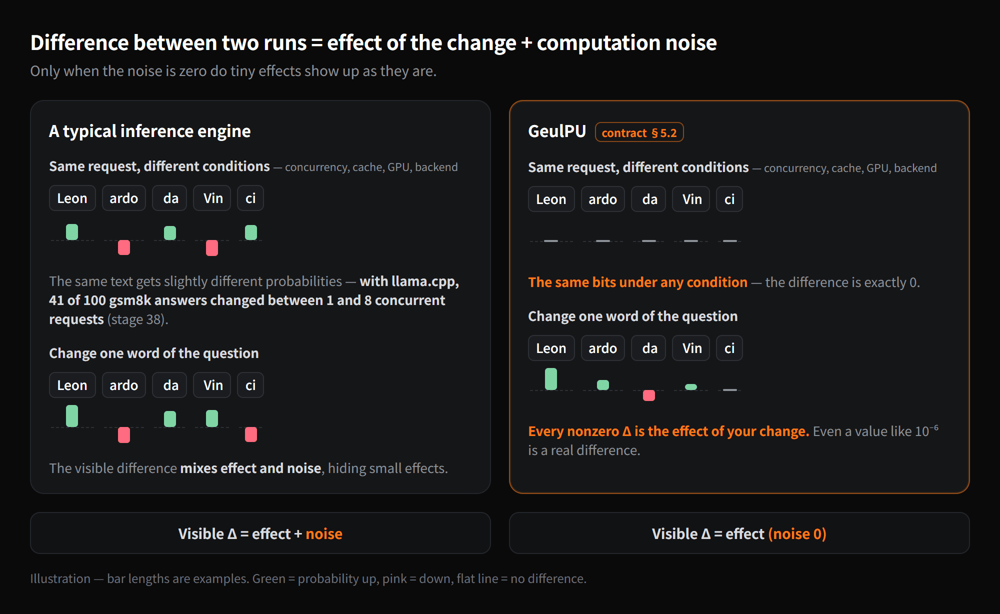

When you compare two runs, the visible difference is **the effect of what you changed + computation noise**. In a typical inference
engine the probabilities of the very same request shift a little when the number of concurrent requests, the batch size, the cache or the
GPU changes. With llama.cpp, for example, 41 of 100 gsm8k answers came out different between 1 and 8 concurrent requests (see the
[research log, stage 38](https://github.com/wwoosshh/GeulPU/blob/main/docs/research-log.md)). Small effects drown in that noise.

GeulPU fixes the order of every sum and every rounding in a [contract](../계약/contract.md), so it gives the same bits under any condition
(log-probabilities are contract §5.2). So **every nonzero Δ is the effect of the one thing you changed** — even a value like 10⁻⁶ is a
real difference. That makes questions like these cleanly answerable:

- At which step of an answer did the model hesitate, and which token did it almost pick?
- Had it picked another token there, how would the answer have continued?
- How much does one word of the question, or one model file (a quantization), change the probabilities of the same answer, token by token?
- Does someone else's result reproduce bit for bit on my PC?

## 1. Setup

1. Install **GeulPU 0.5.0 or later** ([Install in the README](user-guide.md#install)).
2. **Model**: this guide uses **Qwen2.5-7B-Instruct Q8_0** (Models → Find models). Experiment 4 also needs the same model's **Q4_K_M**.
   Any other model works the same way; only the numbers change.
3. Click the **computation mode** chip above the chat (**Fast** · **Exact**) and choose **Exact**; the loaded model reloads in exact mode
   (**Settings → Computation mode** does the same). Every answer carries a tag with the mode it was computed in, and when the research
   panel's values come from a server in another mode than the answer's, it says so and offers to recompute them in the answer's mode. This guide's
   numbers are exact-mode numbers. The default fast mode feeds 8-bit activations into the matrix multiplications, so its probabilities
   differ slightly — with this guide's first question it even answers `Vincent van Gogh` instead of `Leonardo da Vinci`. Both modes are
   deterministic; exact mode also gives the same bits on NVIDIA and AMD, CUDA and Vulkan.
4. In the **generation settings** (the sliders button at the top right of the chat), check that **temperature is 0**. It is the default.
   At temperature 0 the same question always gets the same answer, so you can follow this guide's numbers exactly. Leave the system
   prompt empty (the model's default).
5. Send the question in a **new chat**.

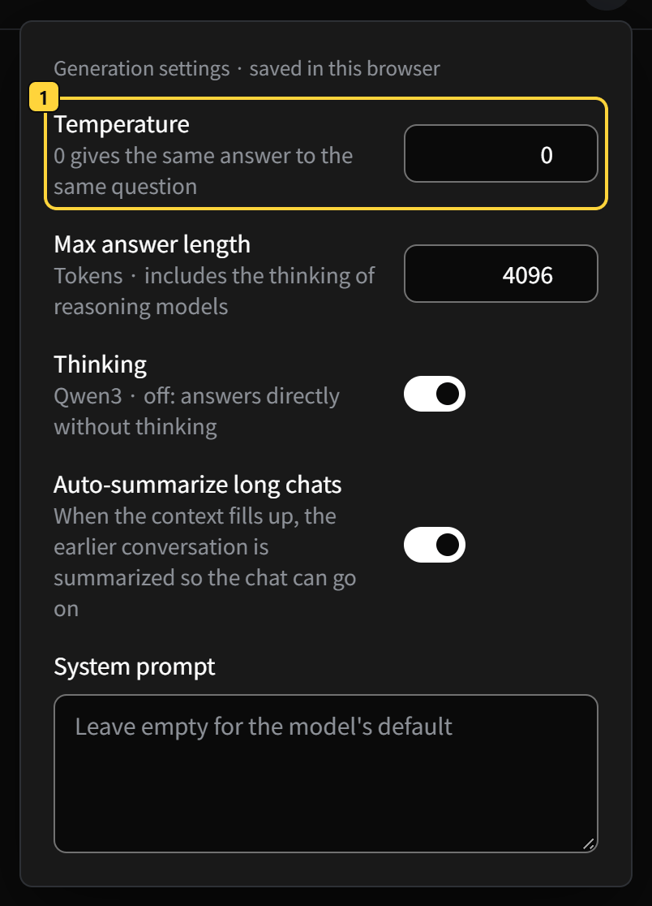

> Research records exist **for answers received in 0.5.0 or later** and are kept **only in this browser** (the latest 60). Clearing the
> browser's data removes them, so save anything you want to keep with [Export](#getting-the-data-out).

## 2. Opening the panel — a map

Send the question `Name one famous painter. Answer with just the name.` and the answer is `Leonardo da Vinci`.

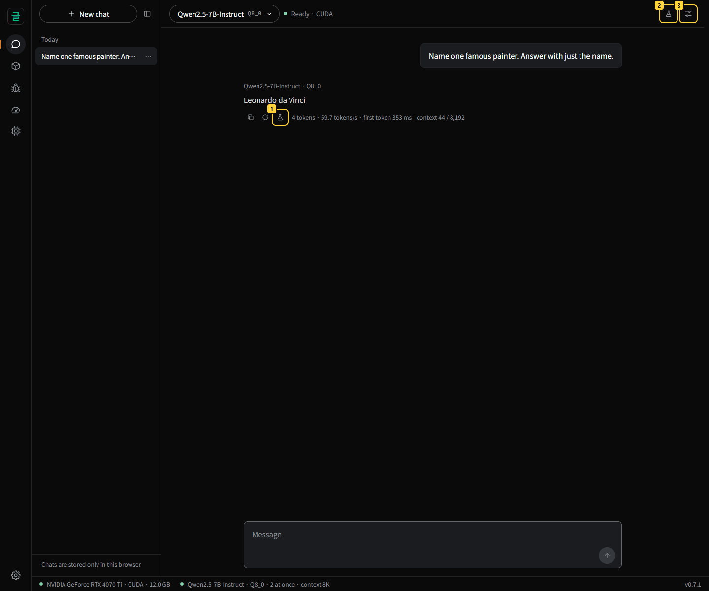

- **(1)** The **flask button** under an answer opens the panel on the right and analyzes that answer token by token (a few seconds).
- **(2)** The flask above the chat opens and closes the panel. In a narrow window the panel covers the chat.
- **(3)** Generation settings (temperature, maximum length, system prompt).
- **(4)** The **computation mode** chip — the mode the loaded model computes in now (**Exact** or **Fast**). Click it to switch (setup step 3).
- **(5)** The answer's tag — the mode that answer was computed in. Every answer in this guide is **Exact**.

The panel never touches chat speed. Chat generates as usual; only when you open the panel are the answer's tokens recomputed (scoring —
`echo`). The recomputed values are **bit-identical** to those of generation (checked in stage 38 on four models and two backends).

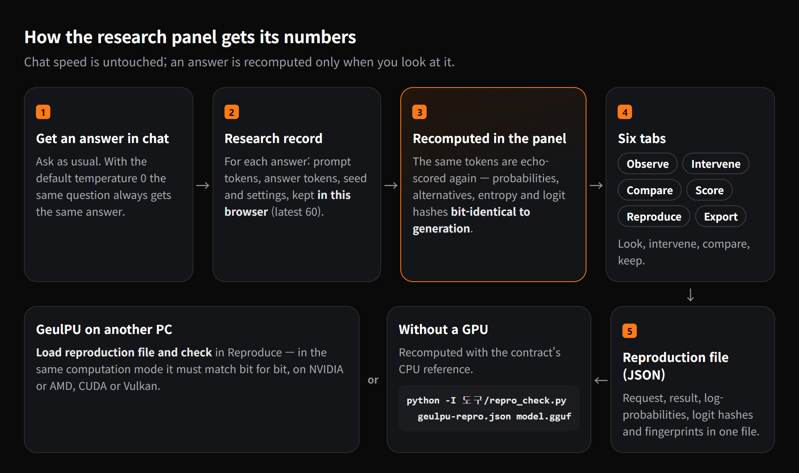

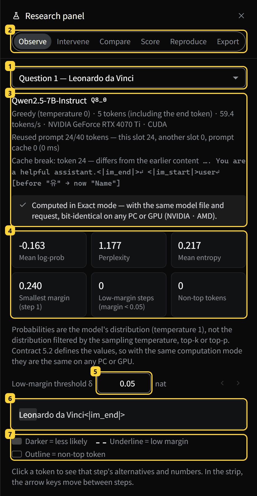

**Parts of the panel** (numbers in the picture)

1. **Answer to analyze** — pick an answer of this chat (question, version, branch). Earlier versions are listed too.
2. **Six tabs** — Observe, Intervene, Compare, Score, Reproduce, Export (table below).
3. **Answer header** — model and quantization, temperature (0 = greedy) and seed, token count (including the end token), generation
   speed, the device and backend it was made on, and the **computation mode** this answer was computed in (a green line for Exact —
   with the same model file and request, the same bits on any PC or GPU).
4. **Six summary numbers** — mean log-prob, perplexity, mean entropy, smallest margin, number of low-margin steps, number of non-top tokens.
5. **Low-margin threshold δ** — steps whose top-two gap (margin) is below δ count as low-margin steps. ‹ › jump between them.
6. **Token strip** — the answer's tokens. Darker = less likely, underline = low-margin step, outline = a step that picked a non-top token.
   Click a token to open that step's card below (arrow keys move too).
7. **Legend**.

<br clear="right">

| Tab | Question it answers | What it does |
|---|---|---|
| **Observe** | Where did the model hesitate? | Per token: probability, rank, entropy, margin; top-10 alternatives |
| **Intervene** | What if it had picked another token? | Branch here (pick an alternative at a step and continue), regenerate with other settings |
| **Compare** | What changes what, and by how much? | The first step where two answers part; per-token Δ of the same answer under another model or another prompt |
| **Score** | How plausible is this text? | Per-token log-probability and perplexity of pasted text |
| **Reproduce** | Will others get the same result? | Fingerprints, re-run without the cache, export and check reproduction files, engine hashes |
| **Export** | How do I get the data out? | Every visible number as JSON or CSV, and Python code that fetches the same values |

## 3. Reading the numbers

| Name | Meaning |
|---|---|
| **Step** | One computation that picks one token of the answer. Step 1 is the answer's first token. |
| **Probability · log-prob** | The probability the model gave that token at that step, and its natural log (nats). log-prob −0.816 = probability e<sup>−0.816</sup> = 44.2 %. |
| **Rank** | Where the token stood among all tokens at that step. At temperature 0 the top token is always picked. |
| **Entropy** | How spread out the step's distribution is (nats). 0 = all on one token; 1.08 ≈ e<sup>1.08</sup> ≈ 3 equally likely tokens. |
| **Margin** | The log-prob gap between #1 and #2 = ln(p₁ / p₂). The smaller, the closer the call. |
| **Low-margin step** | A step whose margin is below the threshold δ — a place where a slightly different computation or setting could pick another token. Default δ = 0.05 nats (a probability ratio of about 1.05). |
| **Non-top tokens** | Steps where sampling (temperature > 0) or a branch picked a token other than #1. |
| **Perplexity** | exp(−mean log-prob). The closer to 1, the more the model takes the text for granted. |
| **Δ log-prob** | The difference between the log-probs of the same token under two conditions (that one − this answer). A total Δ of x means the whole answer's probability is multiplied by e<sup>x</sup>. |
| **Logit hash** | A 64-bit hash of the step's logit row (the scores over the whole vocabulary). Compares two computations bit for bit, step by step. |
| **End token** | `<\|im_end\|>` — the token with which the model chose to end the answer. It appears at the end of the strip and is a step too. |
| **Byte fragment** | A character (e.g., Korean) split across two or more tokens. The strip joins them with a dotted boundary. |

**Probabilities are the model's distribution (temperature 1)** — not the distribution filtered by the temperature, top-k or top-p used
for sampling. So the same token has the same probability whatever temperature you generate with.

## 4. Walkthrough — eight experiments

### Experiment 1. Where did the model hesitate

**Question**: how sure was the answer `Leonardo da Vinci`?

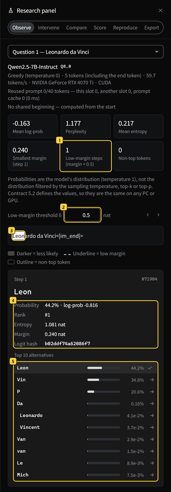

1. The panel opens on **Observe**. The summary shows **smallest margin 0.240 (step 1)**.
2. With the default threshold δ = 0.05 there are no low-margin steps. Type `0.5` into **(2)** the δ box: **(1)** low-margin steps become 1 and
   **(3)** `Leon` in the strip gets an underline.
3. Click `Leon` to open step 1's card.

**Reading**
- **(4)** Probability 44.2 % (log-prob −0.816), #1, **entropy 1.081 nats**, margin 0.240 nats. It was the top token, but with less than
  even odds.
- **(5) Top-10 alternatives**: `Leon` 44.2 % · `Vin` 34.8 % · `P` 20.6 % · `Da` 0.16 % … The model was choosing between Leonardo, Vincent
  (van Gogh) and Picasso; an entropy of 1.08 nats is about three equally likely options, and that is what the list shows.
- The steps after the first (`ardo` · ` da` · ` Vinci` · end) are all close to 100 %. **The uncertainty sat entirely in the first step.**

<br clear="right">

> With the same model file and the same question your card shows the same numbers, and the logit hash is `b02ddf74a62086f7` too.

### Experiment 2. What if it had picked another token

**Question**: had the model picked the runner-up `Vin` at step 1, how would the answer have continued?

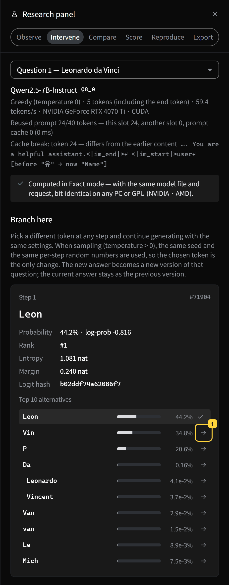

1. Open **Intervene**. The card of step 1, picked in Observe, is still there (if no step is picked, use "Pick the closest call").
2. Click **(1) the arrow (Branch here)** next to the alternative `Vin`.

GeulPU continues from the prompt + the earlier tokens (none here) + the chosen token `Vin`. With sampling (temperature > 0) it would use
**the same seed and the same per-step random numbers**, so the chosen token is the only thing that changed. The new answer becomes a new
version of that question; the original stays as the earlier version.

Further down the same tab, **Regenerate with different settings** makes a new version with the same question and conversation, changing only
the temperature, seed or maximum length. Leave the seed empty and the server picks one (it is recorded).

<br clear="right">

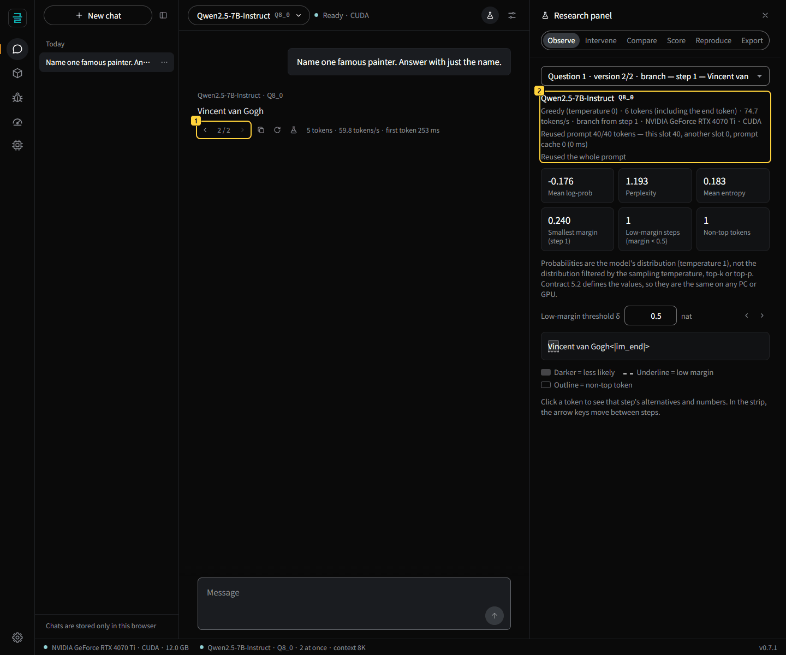

The answer continued as **`Vincent van Gogh`**. **(1)** The chat now has a version switcher (‹ 2 / 2 ›) to go back to the original
answer, and **(2)** the panel's header says "branch from step 1". This answer is analyzed like any other, ready for Observe and Compare.

### Experiment 3. Where did two answers part

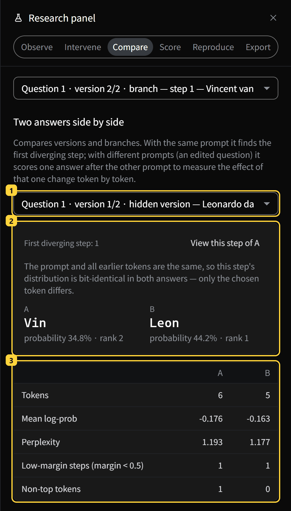

1. Open **Compare**. The answer to analyze at the top (A) is the branch.
2. In **(1) Answer to compare (B)**, pick the original answer (version 1).

**Reading**
- **(2) First diverging step: 1** — A has `Vin` (34.8 %, rank 2), B has `Leon` (44.2 %, rank 1). The prompt and all earlier tokens are the
  same, so **this step's distribution is bit-identical in both answers**; only the chosen token differs. "View this step of A" jumps to
  that step in Observe.
- **(3) Summary table** — tokens 6 vs 5, mean log-prob −0.176 vs −0.163, non-top tokens 1 vs 0 (A picked the runner-up by branching).

Versions made with other settings (say temperature 0.7 and another seed) are compared the same way; the first diverging step is where
sampling first picked a different token.

<br clear="right">

### Experiment 4. How much does quantization change the same answer

**Question**: if you use the Q4_K_M file instead of Q8_0, how much do the probabilities of the same answer change, token by token?

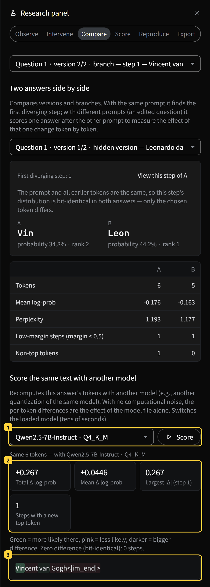

1. Lower in Compare, under **Score the same text with another model**, choose **(1)** `Qwen2.5-7B-Instruct · Q4_K_M` and press **Score**.
   The loaded model switches, which takes tens of seconds. Only models with the same vocabulary and chat template are listed.

**Reading** — the 6 tokens of `Vincent van Gogh`, recomputed with Q4_K_M.
- **(2) Total Δ +0.267** — the whole answer is e<sup>0.267</sup> ≈ 1.31× as likely under Q4_K_M, almost all of it at **step 1**: `Vin` 34.8 % →
  45.4 %. **1 step with a new top token** — at step 1, Q8_0's top token is `Leon` but Q4_K_M's is `Vin`.
- **(3) Strip** — green = more likely under Q4_K_M, pink = less likely, darker = bigger. No step has a zero difference — quantization
  leaves a mark on every step. With zero computation noise, **all of this is the effect of the model file alone**.

<br clear="right">

That flip is not hypothetical: ask the same question with Q4_K_M loaded and the answer itself changes — Q8_0 answers `Leonardo da Vinci`,
Q4_K_M answers **`Vincent van Gogh`** (Vin 45.4 % · Leon 32.8 % · P 21.3 %). One quantization step changes the answer.

### Experiment 5. How much does one word of the question change the same answer

**Question**: if the question says "Italian", how much more likely does the answer `Leonardo da Vinci` become?

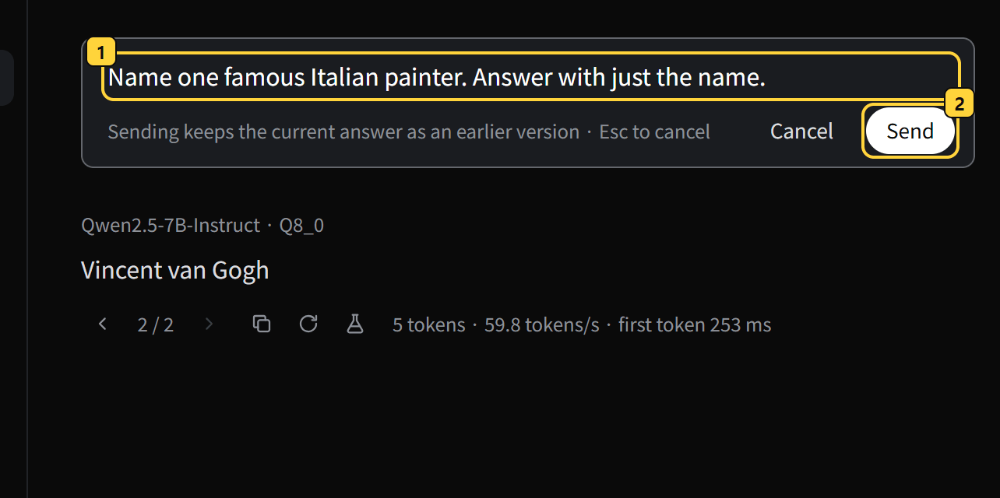

1. Hover over the question in the chat, click the **pencil (edit)**, change it to **(1)** `Name one famous Italian painter. Answer with
   just the name.` and press **(2) Send**. The answer `Leonardo da Vinci` arrives as a new version (3/3); the two earlier answers stay as
   hidden versions.

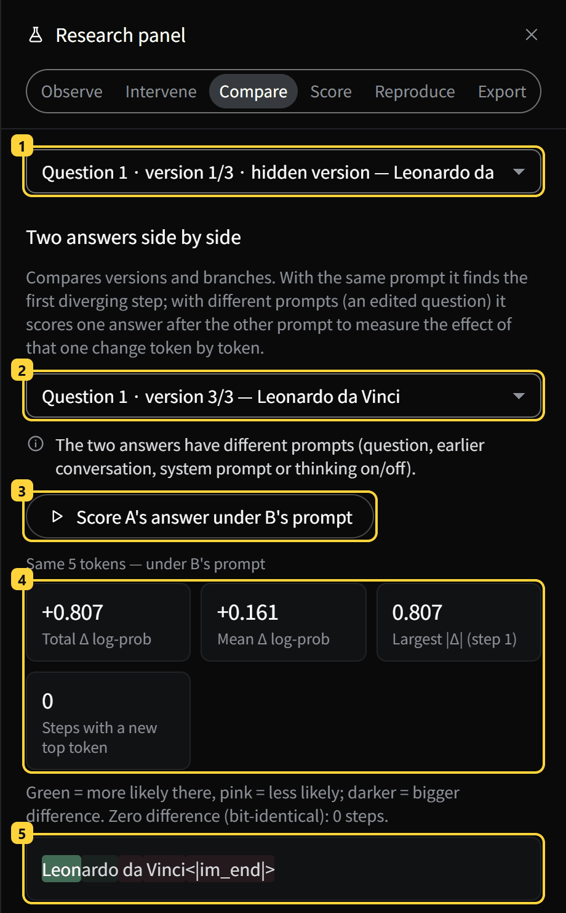

2. In the panel, set **(1) Answer to analyze (A)** to the original answer (version 1 — `Leonardo da Vinci` after the original question)
   and, in Compare, **(2) Answer to compare (B)** to version 3. If B has not been analyzed yet, press "Compute B too" first.
3. Press **(3) Score A's answer under B's prompt**. A's answer tokens are recomputed after B's question.

**Reading**
- **(4) Total Δ +0.807** — the one word "Italian" makes this answer e<sup>0.807</sup> ≈ **2.2×** as likely, and practically all of it is **step 1**:
  `Leon` 44.2 % → 99.1 % (Δ +0.807). No step has a new top token — `Leon` was already #1.
- **(5) Strip** — the other steps barely move, but they do move (Δ of +3.2 × 10⁻⁵, −1.0 × 10⁻⁴, −1 × 10⁻⁶ …; see the API example below).
  With zero noise, even these are effects of that word.

<br clear="right">

### Experiment 6. How plausible is a line of text

**Question**: which part of `The capital of Australia is Sydney.` does the model find odd?

<p>
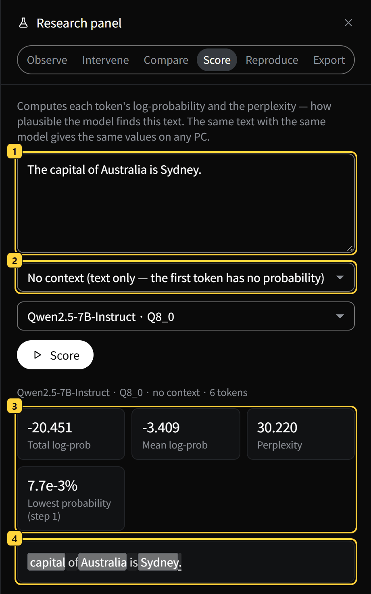
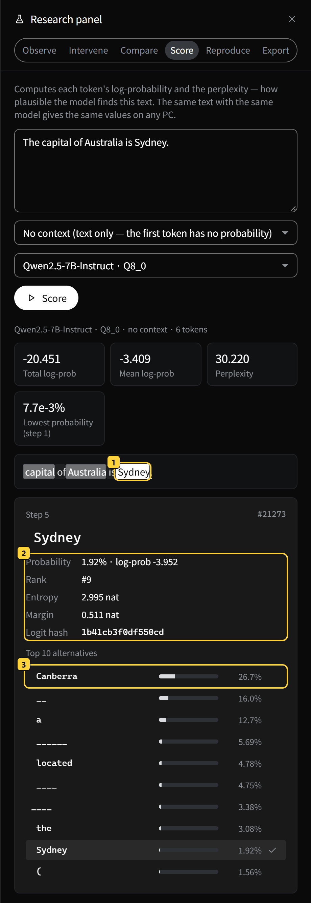
</p>

1. In **Score**, paste the text **(1)**, set **(2) Context** to "No context", keep the model at Q8_0 and press **Score**.
2. Click ` Sydney` in the strip (right picture).

**Reading**
- **(3)** 6 tokens, total log-prob −20.451, perplexity 30.220. Without context the beginning of a text is naturally unlikely (the first
  token `The` has no probability, and the lowest is step 1 ` capital` at 7.7 × 10⁻³ %), so **click the position you care about**.
- ` Sydney` is **1.92 %, rank 9**, and the top alternative at that position is **` Canberra` 26.7 %** — the model expected Canberra
  there. Score `The capital of Australia is Canberra.` instead and ` Canberra` gets 26.7 % (log-prob −1.32), and perplexity drops to 20.12.

The other **Context** option, **"In place of the selected answer"**, scores the text after the same question and conversation as the
selected answer — use it to compare several candidate answers to one question (for example, try `Pablo Picasso` for the painter
question). The model is then the answer's model.

### Experiment 7. Having someone else check your result

**Question**: can someone else see exactly the numbers I saw, on their own PC?

<p>
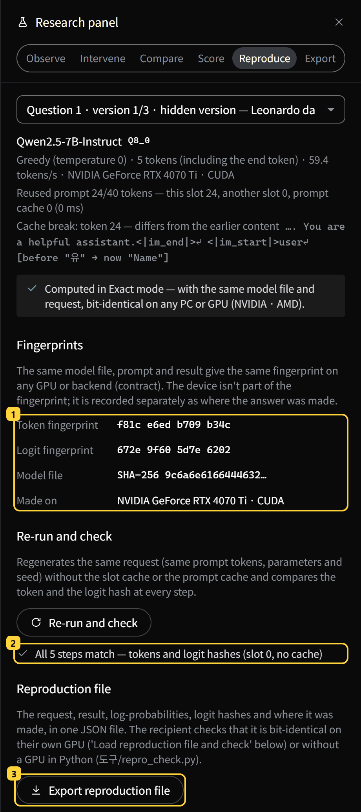
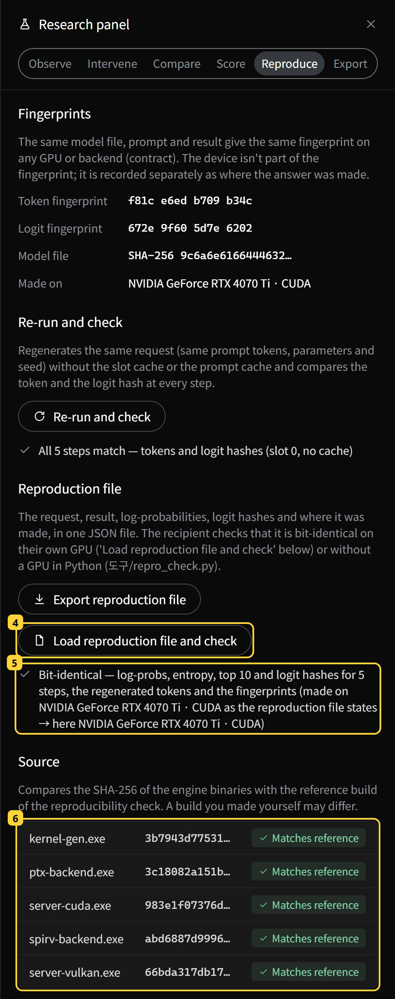
</p>

In **Reproduce**, with the original answer (version 1) selected:

- **(1) Fingerprints** — the token fingerprint (SHA-256 of the model file + prompt + answer tokens) and the logit fingerprint (+ every
  step's logit hash). The same model file, prompt and result give the same fingerprint on any GPU or backend. This guide's answer has a
  token fingerprint starting `f81c e6ed b709 b34c…` — if yours does too, **your answer is bit-identical to this one**. The recipe is in
  [contract §5.2](../계약/contract.md).
- **(2) Re-run and check** — regenerates the same request (prompt tokens, parameters, seed) without the cache and compares tokens and logit
  hashes step by step: "All 5 steps match".
- **(3) Export reproduction file** — the request, result, log-probabilities, logit hashes, fingerprints and the model file's SHA-256 in one JSON file.
- **(4) Load reproduction file and check** — the recipient opens it in their own GeulPU. The same model file (SHA-256) must be installed, and that
  model is loaded during the check. When scoring, regeneration and fingerprints all match you see **(5) "Bit-identical"**. It must match
  across NVIDIA and AMD, CUDA and Vulkan as well.
- **(6) Show engine and kernel hashes** — whether the five engine binaries equal the official build (the cross-check reference), and which
  kernel module is in use.

Someone without a GPU can check too: clone the repository, install numpy in a virtual environment (venv) and recompute with the
contract's CPU reference implementation (a few minutes for 7B).

```bash
python -m venv .venv                      # once — `python -I` ignores packages installed with `pip install --user`
.venv/Scripts/pip install numpy               # Linux · macOS: .venv/bin/pip
.venv/Scripts/python -I 도구/repro_check.py geulpu-repro.json Qwen2.5-7B-Instruct-Q8_0.gguf
```

### Experiment 8. At which layer does the answer appear — the layer lens

**Question**: just before the model writes its answer, what does the computation in the middle layers point at?

From 0.13.0. Only the last layer produces the next token, but the computation of any layer (the residual stream) can be read with the
final output computation too — the **logit lens** (the distribution the model would give if it stopped at that layer). The **Jacobian
lens** (Anthropic, 2026) first moves that layer's values into the final layer's basis with a matrix J fitted on the original model, then
reads them, so what the position points at shows earlier in the layers. The layer lens works for the Qwen2.5, Qwen3, Llama and Gemma 4
architectures (for Gemma 4 the reading ends with the final logits' softcap), and the Jacobian lens for Qwen2.5, Qwen3 and Llama, whose
J can be fitted.

The setup differs a little from the other experiments:

- The model is **Qwen3-0.6B Q8_0** (download it in Find models). Put the J file attached to the release,
  **`Qwen3-0.6B-Q8_0.jlens.safetensors`**, in the same folder as the model file and load the model (again). The app passes the J file to
  the server, and once the server accepts it the layer lens gets a 'logit lens | Jacobian lens' switch (without a J file you get the logit
  lens only).
- Computation mode **Exact**, temperature 0, and turn off **Thinking** in the generation settings (Qwen3 writes its thinking first by
  default).
- In a new chat, send **What is the capital of South Korea? Answer in one word.** The answer is `South Korea's capital is Seoul.`

<p>
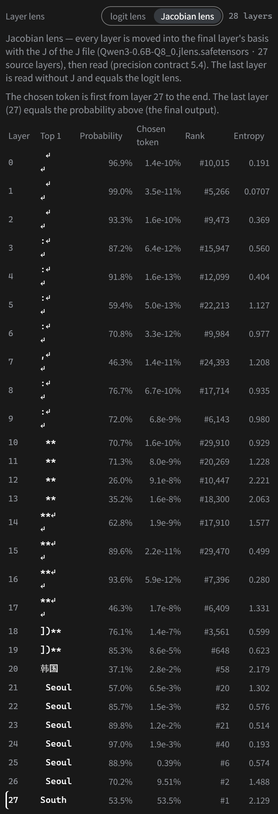
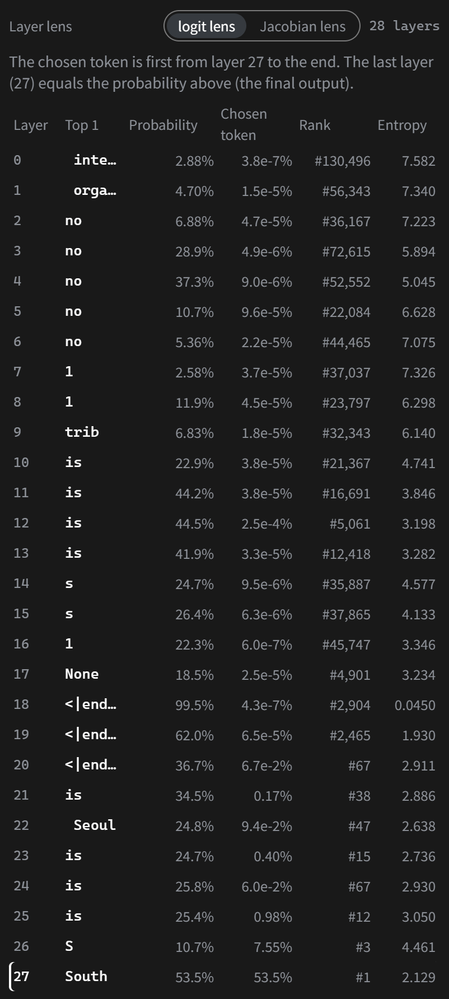
</p>

1. Open the panel with the flask under the answer (Observe) and click the first token, `South` (step 1), in the token strip.
2. Under the step detail, click **Layer lens → Read every layer**. For every layer (0–27) you get the top-1 token and its probability,
   the chosen token's probability and rank, and the entropy. Click a layer to unfold its top k; the first layer from which the chosen token
   stays first to the end is marked with a line.
3. **Jacobian lens** (left picture): layer 20 is `韩国` (Korea, 37.1 %) and layers 21–26 are ` Seoul` (57.0 → 97.0 → 70.2 %). While the
   model writes `South`, the answer five tokens ahead is already in the middle layers.
4. Switch to the **logit lens** (right picture): at the same step ` Seoul` shows up only at layer 22 (24.8 %) — reading a middle layer's
   values as if they were the last layer's does not bring such concepts out as well. The last layer (27) is the same in both lenses (the
   final output, read without J — 53.5 %).

In Korean (**대한민국의 수도는 어디인가요? 한 단어로 답하세요.**) the 0.6B model answers wrongly, `대한민국의 수도는 **인천**입니다.`
(Incheon). At the asterisk token ` **` right before `인천` (step 8), the Jacobian lens has `东京` (Tokyo) at layers 18–21, ` Seoul` at 22–23
and ` 서울` (Seoul) at 24–26 — the middle layers pointed at Seoul as the word to write after the asterisks, and at the next step the model
wrote `인천` instead. The logit lens shows only ` **` from layer 19 at that step.

Things to keep in mind:

- Both lenses are fixed by the precision contract (the logit lens by [5.3](../계약/contract.md), the Jacobian lens by 5.4), so they are
  bit-identical on every GPU and in every run. A reproduction file ([experiment 7](#experiment-7-having-someone-else-check-your-result))
  carries the layer lens you computed, and the recipient checks both lenses bit for bit without a GPU:
  `.venv/Scripts/python -I 도구/repro_check.py geulpu-repro.json Qwen3-0.6B-Q8_0.gguf --jlens Qwen3-0.6B-Q8_0.jlens.safetensors` (the J
  file is matched by its SHA-256).
- J was fitted on the original (BF16) model. On Q8_0, the per-layer top 1 was measured to agree with the original's in at least 93.8 % of
  positions in layers 9–26, under a criterion set before measuring ([`문서/층렌즈.md`](../문서/층렌즈.md), in Korean). On low-bit files such as Q4_K_M
  the per-layer top 1 agrees less with the original — read it for which concept shows up at which layer.
- J files for other models are fitted from the original (Hugging Face) model with `도구/jlens_fit.py` — it needs a GPU and torch ·
  transformers · jlens; the 0.6B model took about 17 minutes on an RTX 4070 Ti. Through the API, add
  `"geulpu": {"echo_from": n, "layer_lens": {"jacobian": true}}` to the echo request of [5. From scripts — the API](#5-from-scripts--the-api).

### Where did the prompt cache break

**Question**: a coding agent resends the same long instructions with every request — how much of the prompt did GeulPU reuse, and
why was the rest computed again?

GeulPU reuses the computed state (the KV cache) of a prompt's beginning wherever it matches token for token: in the slot itself,
copied from another slot inside the GPU, or read from the **prompt cache** — 256-token chunks on the SSD that survive restarts and
model switches (Settings → Prompt cache, on by default for an SSD). KV is byte-identical however it was filled, so reuse never
changes an answer; it only skips work. The answer header shows how much was reused and where reuse stopped.

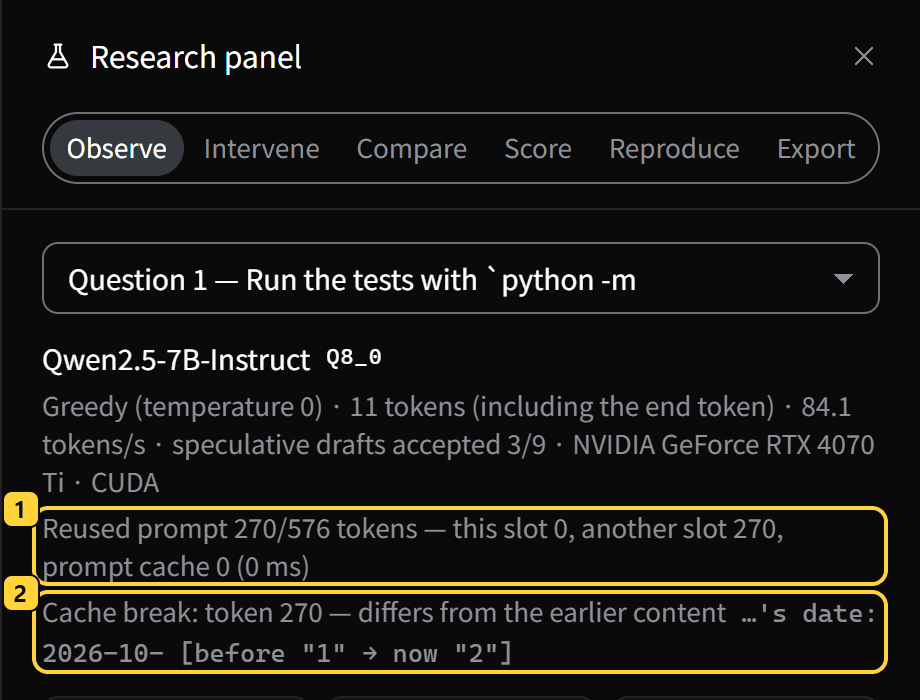

1. In generation settings, set the system prompt below — rules, then `Today's date: 2026-10-19`, then project notes. Ask
   `How do I run this project's tests? Answer in one sentence.` The answer is ``Run the tests with `python -m pytest`.``
2. Change the date to `2026-10-20`, start a **new chat** with the same model, ask the same question, and open this answer in the panel.

**Reading**
- **(1)** Reused prompt 270/576 tokens — this slot 0, another slot 270, prompt cache 0. The new chat took the free slot and copied the shared
  beginning from the first chat's slot.
- **(2)** Cache break: token 270 — differs from the earlier content, then the 12 tokens before it (…`'s date: 2026-10-`) and the token
  at that place before → now (`"1"` → `"2"`). The date changed, so everything after it — the project notes and the question, 306
  tokens — was computed again.
- Put what changes from request to request (date, time, working folder, git status) **after** what stays the same. Coding agents run
  into this too: in our recording of Qwen Code (stage 4 in [문서/문맥저장소.md](../문서/문맥저장소.md), Korean) a new task in another
  folder broke at token 3,819 of 14,671 (the working folder in the system prompt), a new task in the same folder on the next day at
  13,591 (the date line), and on the same day only at the task text (14,633).

<br clear="right">

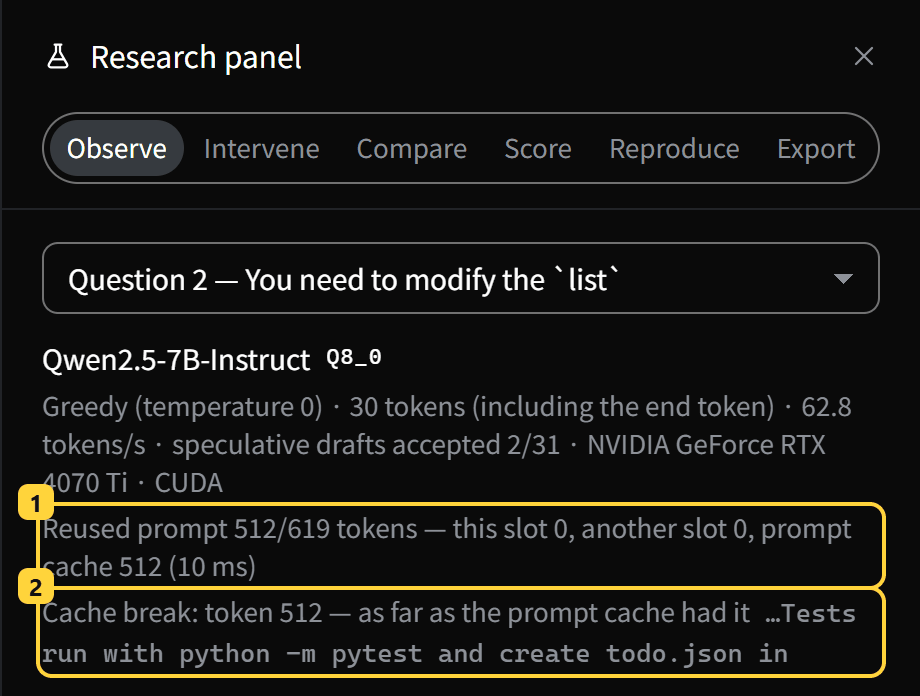

3. Restart the app (or load another model and come back) — the slots are empty now — and ask the second chat another question:
   `To add a command that lists only overdue to-dos, which file do I change and how? Two sentences.`

**Reading**
- **(1)** Reused prompt 512/619 tokens — prompt cache 512 (10 ms). Nothing was left in the slots, so the beginning of the chat came from the
  SSD instead of being computed. The prompt cache keeps whole 256-token chunks, and the chat so far filled two.
- **(2)** Cache break: token 512 — as far as the prompt cache had it. Only the rest (107 tokens: the end of the first exchange and the new
  question) was computed. Reopening a 31,000-token conversation after a restart takes 0.74 s to the first token instead of 10 s of
  recomputation, 1.1 s when the chunks are not in the OS file cache as after a reboot (Qwen2.5-7B Q4_K_M, stage 4).
- To check that reuse changed nothing, **Reproduce → Re-run and check** generates the answer again without the cache and without the
  prompt cache and compares every step.

<br clear="right">

<details>
<summary>The system prompt used here</summary>

```text
You are a coding assistant for the project below. Keep answers short and exact, and say so when you do not know. When you change code, add one line on why and update the tests with it. Ask before deleting or renaming a file.

# Rules
- Python 3.12, standard library only. Ask before adding an outside package.
- Function names in snake_case, class names in PascalCase, constants in UPPER_CASE.
- Every public function has a docstring and type hints for its arguments and return value.
- Store data only in todo.json (UTF-8, indent 2). Write to a temporary file and swap it in, so that a crash never leaves a broken file.
- Handle dates as ISO 8601 (YYYY-MM-DD), without time zones.
- Read command-line arguments with argparse, with help text for every subcommand.
- Report errors as one readable line on standard error and exit with code 1. Only unexpected errors leave a traceback.
- Print a human-readable table by default, and a single JSON line with --json.
- No function longer than 40 lines; split it into smaller functions.
- Commit messages: a one-line summary, an empty line, then the reason.

Today's date: 2026-10-19

# Project: a to-do command-line tool
Files: todo.py (commands), store.py (reading and writing todo.json), tests/test_todo.py and tests/test_store.py (pytest), README.md.

## Commands
- add <title> [--due date] [--tag tag] — adds a to-do and prints its number.
- list [--done] [--tag tag] [--json] — lists to-dos in number order; by default only the unfinished ones.
- done <number> — marks it done; if it is already done, just says so.
- remove <number> — deletes it; a deleted number is never reused.
- edit <number> [--title title] [--due date] — changes it.

## Data
A to-do is {"id": int, "title": str, "due": date or null, "tags": [str], "done": bool, "created": date}.
todo.json has the form {"version": 1, "next_id": int, "items": [to-do]}; if the version differs, stop reading and say so.

## Tests
Tests run with python -m pytest and create todo.json in a temporary folder (tmp_path). Every command gets at least one success and
one failure case. Tests that need a date never use today's date directly; they pass it in as an argument.
```

</details>

### Getting the data out

<p>
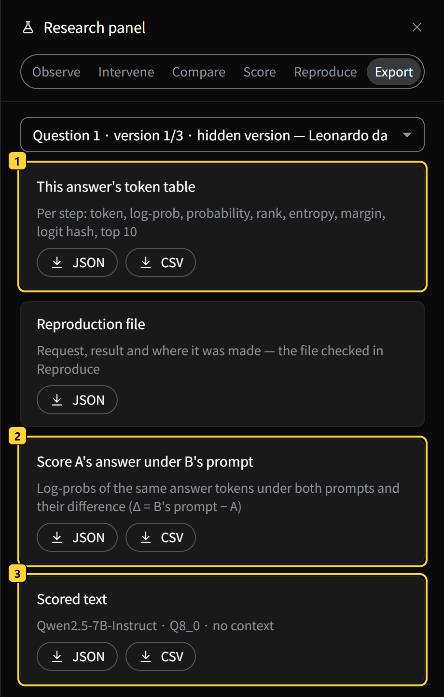
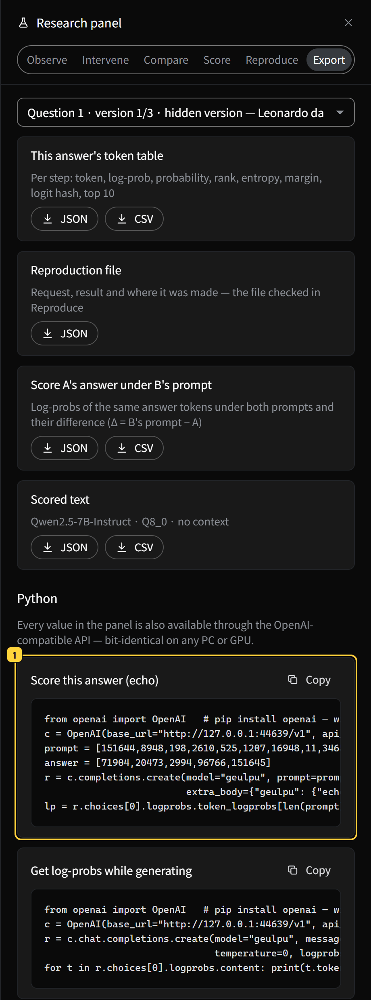
</p>

**Export** gives you every number the panel shows, as files.

- **This answer's token table** — JSON or CSV. The CSV columns are `step,id,text,logprob,prob,rank,entropy,margin,logit_hash`; the JSON
  also has each step's top 10 plus the prompt tokens, fingerprints and the model's SHA-256.
- **Scored with another model · Score A's answer under B's prompt** — the same columns plus `other_logprob` and `delta`. They appear after
  experiments 4 and 5.
- **Scored text · Reproduction file**.
- **Python** — code that fetches the same values from the API (with the `openai` package; a standard-library version is in section 5).

## 5. From scripts — the API

Every number in the panel is also available from the API. With a model loaded in the app, send requests to `http://127.0.0.1:44544`.
The Python below uses only the standard library (nothing to install). The API's default temperature is 0.8, independent of the app's
generation settings, so pass `"temperature": 0` to get this guide's answers (with the computation mode set to Exact, as in the setup).

```python
import json, math, urllib.request

BASE = "http://127.0.0.1:44544"          # with a model loaded in the app


def post(path, body):
    rq = urllib.request.Request(BASE + path, json.dumps(body).encode(), {"Content-Type": "application/json"})
    with urllib.request.urlopen(rq) as r:
        return json.load(r)


# Example 1 — probabilities and alternatives at every step while generating (experiment 1)
r = post("/v1/chat/completions", {
    "messages": [{"role": "user", "content": "Name one famous painter. Answer with just the name."}],
    "temperature": 0, "logprobs": True, "top_logprobs": 5})
print("answer:", r["choices"][0]["message"]["content"], "| model:", r["model"])
for i, t in enumerate(r["choices"][0]["logprobs"]["content"], 1):
    alts = ", ".join(f"{a['token']!r} {math.exp(a['logprob']):.1%}" for a in t["top_logprobs"])
    print(f"step {i}: {t['token']!r} {math.exp(t['logprob']):.1%} | {alts}")
```

```text
answer: Leonardo da Vinci | model: qwen2.5-7b-instruct-q8_0
step 1: 'Leon' 44.2% | 'Leon' 44.2%, 'Vin' 34.8%, 'P' 20.6%, 'Da' 0.2%, ' Leonardo' 0.0%
step 2: 'ardo' 100.0% | 'ardo' 100.0%, 'ard' 0.0%, 'ado' 0.0%, 'aro' 0.0%, 'arda' 0.0%
step 3: ' da' 100.0% | ' da' 100.0%, 'da' 0.0%, ' Da' 0.0%, '_da' 0.0%, '-da' 0.0%
step 4: ' Vinci' 100.0% | ' Vinci' 100.0%, ' Vince' 0.0%, ' Vin' 0.0%, ' Vas' 0.0%, ' Vine' 0.0%
```

```python
# Example 2 — score the same answer after two questions to measure the effect of one word (experiment 5)
def prompt_of(question):            # prompt tokens with the chat template applied (up to the answer)
    return post("/tokenize", {"messages": [{"role": "user", "content": question}]})["tokens"]


def score(prompt, answer):          # log-prob of every answer token — scoring only, no generation (echo)
    r = post("/v1/completions", {"prompt": prompt + answer, "echo": True, "max_tokens": 0, "logprobs": 1,
                                 "geulpu": {"echo_from": len(prompt)}})
    return r["choices"][0]["logprobs"]["token_logprobs"][len(prompt):]


A = prompt_of("Name one famous painter. Answer with just the name.")
B = prompt_of("Name one famous Italian painter. Answer with just the name.")
r = post("/v1/completions", {"prompt": B, "temperature": 0, "max_tokens": 32, "geulpu": {}})
answer = r["geulpu"]["tokens"]      # the tokens generated after B, as they are (end token included)
la, lb = score(A, answer), score(B, answer)
for t, a, b in zip(answer, la, lb):
    print(f"{post('/detokenize', {'tokens': [t]})['prompt']!r:8} {math.exp(a):7.2%} → {math.exp(b):7.2%}  Δ {b - a:+.3g}")
print(f"total Δ {sum(lb) - sum(la):+.3f}")
```

```text
'Leon'    44.23% →  99.12%  Δ +0.807
'ardo'   100.00% → 100.00%  Δ +3.2e-05
' da'     99.97% →  99.96%  Δ -0.000101
' Vinci' 100.00% → 100.00%  Δ -1e-06
'<|im_end|>' 100.00% → 100.00%  Δ -2.85e-07
total Δ +0.807
```

These are the same numbers as in experiment 5. The tiny Δ values are real: with zero computation noise they are effects of the word
"Italian", not jitter.

```python
# Example 3 — per-token probabilities of a line of text, without context (experiment 6)
ids = post("/tokenize", {"prompt": "The capital of Australia is Sydney."})["tokens"]
for t, x in zip(ids[1:], score(ids[:1], ids[1:])):    # the first token has no preceding context, so no probability
    print(f"{post('/detokenize', {'tokens': [t]})['prompt']!r:8} {math.exp(x):.2%}")
```

```text
' capital' 0.01%
' of'    52.34%
' Australia' 0.64%
' is'    66.48%
' Sydney' 1.92%
'.'      39.96%
```

Things you will use:

- **`/v1/chat/completions`**: `"logprobs": true, "top_logprobs": 5` (0–20). Add `"geulpu": {}` and the response's `geulpu` carries the
  sampled token ids (`tokens`), the seed and timings; `"geulpu": {"logit_hash": true, "prompt_tokens": true}` adds every step's logit
  hash and the prompt tokens after the chat template.
- **`/v1/completions`**: `"echo": true, "max_tokens": 0, "logprobs": k` scores without generating. `prompt` is text or an array of token
  ids; `"geulpu": {"echo_from": n}` scores from token n on (earlier ones are `null`). The response's `geulpu` has `prompt_entropy`,
  `prompt_top_ids`, `prompt_top_logprobs` and `prompt_logit_hashes`.
- **`/tokenize`** (`{"prompt": "…"}` or `{"messages": […]}` — the prompt with the chat template applied), **`/detokenize`**,
  **`/tokenizer_info`** — in the same shape as vLLM.
- **Leave `model` out** of a request and the response's `model` names the model that is actually loaded (put it in and the name you sent
  comes back — the request's `model` does not pick a model). Leave it out when you want a record of which model answered.
- In a generation response, `geulpu.tokens` and `logit_hashes` include the step that sampled the end token, while the log-prob arrays
  cover only the answer's tokens, as in OpenAI (one shorter when the answer ends with the end token). To get the end token's probability,
  score `tokens` with echo (that is what the panel does).
- **lm-evaluation-harness** — connects with `local-completions` + `tokenizer_backend=remote`. Per-item results are bit-identical whatever
  the number of concurrent requests, CUDA or Vulkan ([README](user-guide.md#use-it-from-other-programs-openai-compatible-api)).

## 6. Caveats and FAQ

- **There is no flask under an answer.** Research records start with answers received in 0.5.0. Send the question again.
- **Low-margin steps show 0.** The default δ = 0.05 nats counts only steps closer than a probability ratio of 1.05. Raise it to 0.3–0.7 for a
  wider net (0.5 ≈ #1 within 1.65× of #2).
- **The model changed.** Compare's "score with another model", reproduction file checks and analyses of answers made with another model load the
  model they need (tens of seconds). Sending a chat message switches back to that chat's model. The API also answers with whatever model
  is loaded, so don't switch models in the panel while a script is running.
- **The probabilities don't match my generation settings.** The panel shows the model's temperature-1 distribution. Temperature, top-k
  and top-p only decide which token is sampled.
- **Values like 4.1e-2%.** Probabilities below 0.1 % are shown in exponent form, always in percent.
- **A reproduction file check says it differs.** If a reproduction file is opened and re-saved by another tool, the seed (a 64-bit integer) can lose digits —
  JavaScript's `JSON.parse` does. Pass the file on unchanged. "Made on" is a record written by whoever made the reproduction file; it is not used in
  the check.
- **Where are the records?** In this browser (localStorage), the latest 60 (up to 1.5 MB). They don't move to another browser or PC, so
  keep what matters with Export.
- **Does it slow chat down?** No. The panel computes only when you look. Asking the API for log-probabilities during generation adds about
  2 % per token.
- **Deeper**: the definition of log-probabilities is [contract §5.2](../계약/contract.md); the stage that built this feature is in the
  [research log](https://github.com/wwoosshh/GeulPU/blob/main/docs/research-log.md); checking without a GPU is [`도구/repro_check.py`](../도구/repro_check.py).
- **Many requests at once?** Recording, replaying, branching and comparing many requests as a run — an agent session or a test set — is
  in the [debugger guide](debugger-guide.md).
