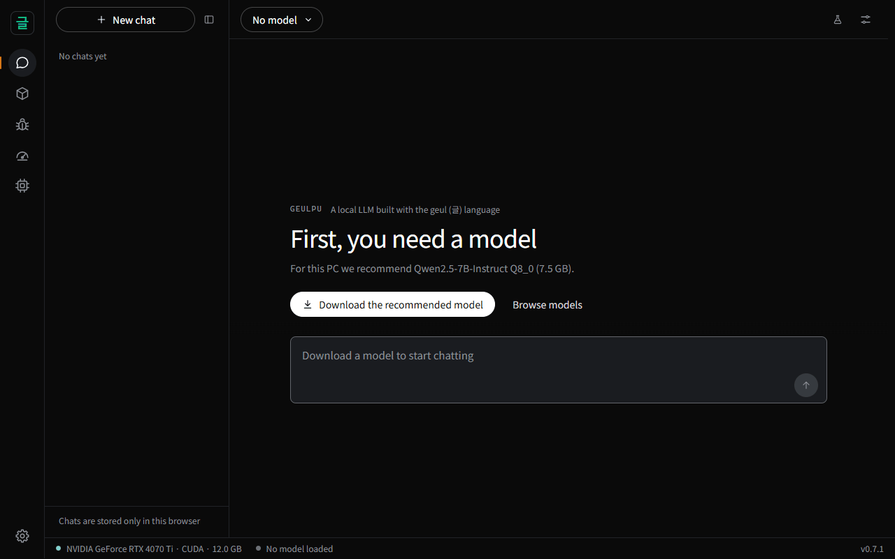
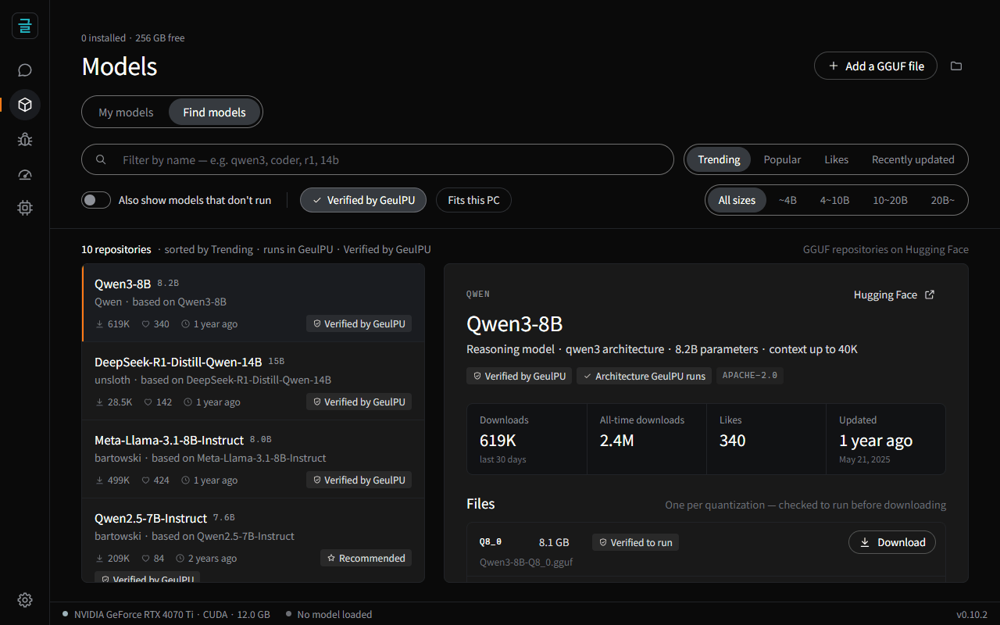
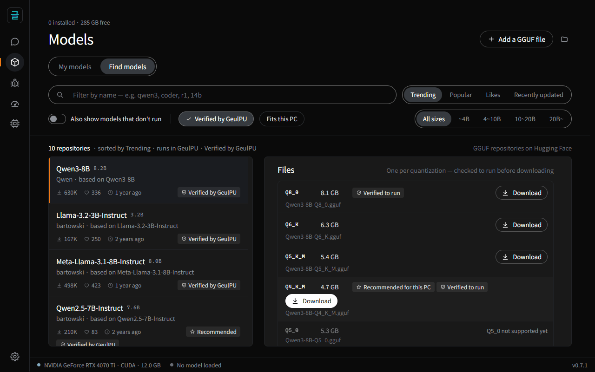
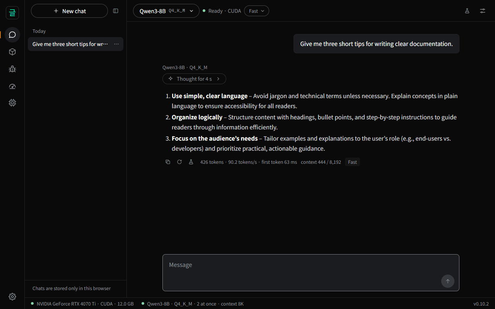
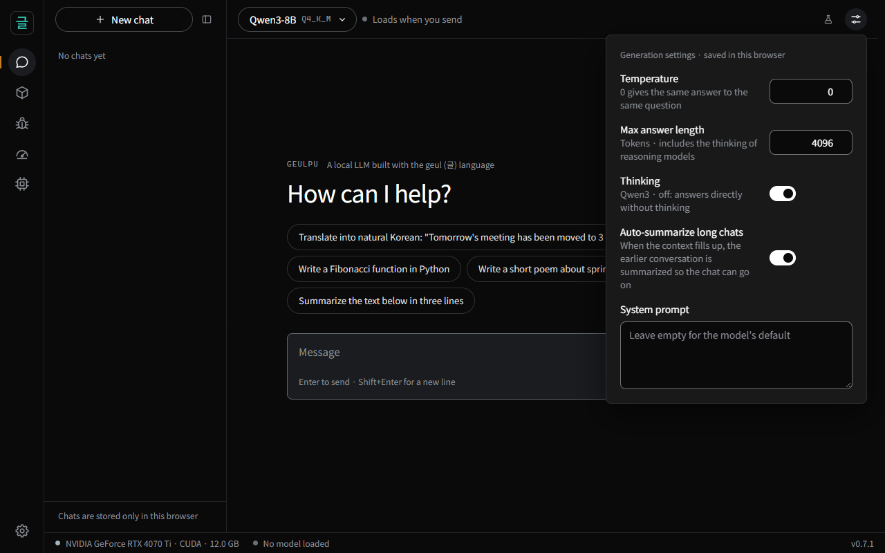
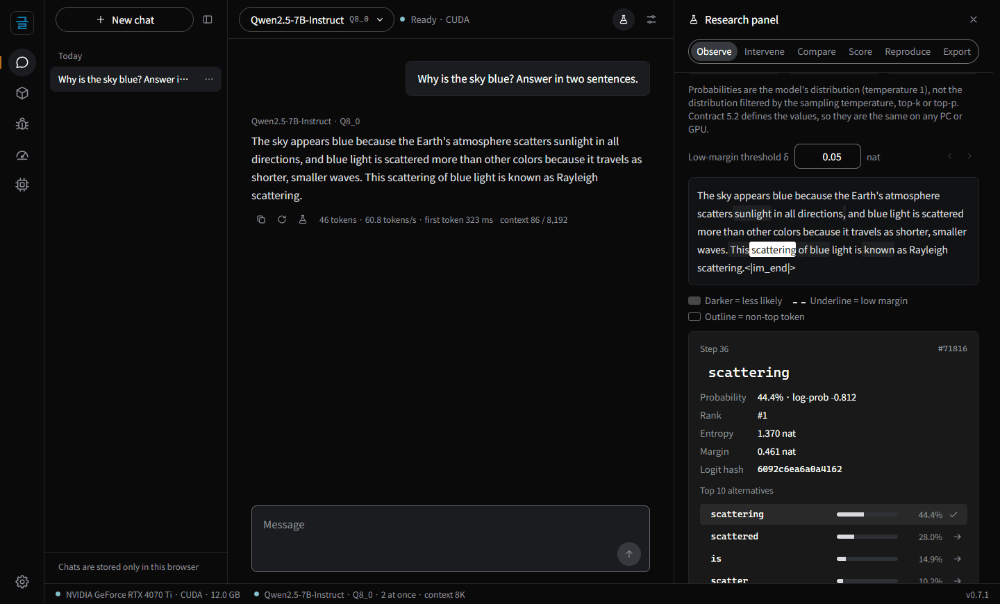
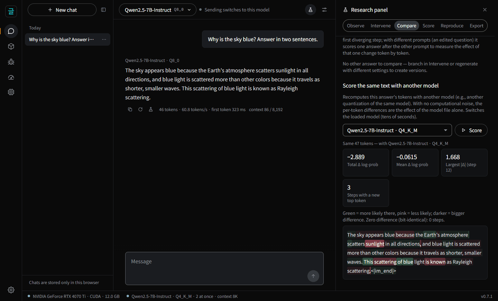
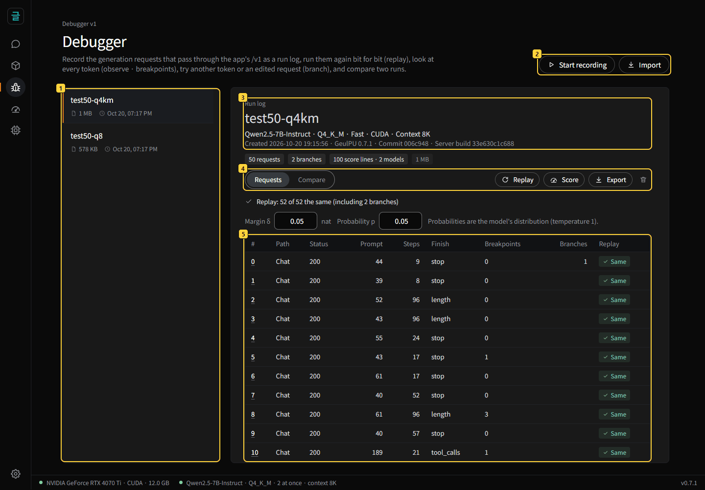
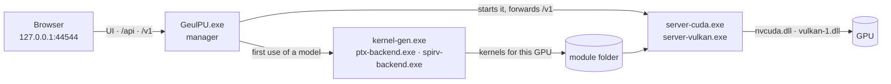

# GeulPU user guide

**[한국어](../사용안내.md)** · [README](../README.md) · [debugger guide](debugger-guide.md) · [research panel guide](research-guide.md) ·
[development](development.md) · [glossary](glossary.md)

Everything about installing and using GeulPU — the app, its settings, the OpenAI-compatible API and the supported models — and what
makes it different, with the measurements. The [README](../README.md) has the overview; building from source is in
[development](development.md).

[Install](#install) · [First steps](#first-steps) · [Supported models](#supported-models) · [How it runs](#how-it-runs) ·
[Troubleshooting](#troubleshooting) · [Update and uninstall](#update-and-uninstall) · [What is different](#what-is-different)

## Install

### Requirements

| | |
|---|---|
| OS | Windows 10 or 11 (64-bit) |
| GPU | NVIDIA RTX 30 series or newer runs on CUDA; other GPUs (AMD Radeon, …) run on Vulkan 1.3 |
| Graphics memory | From 6 GB (small models). 7B / 8B need 8 GB (Q4_K_M) or 12 GB (Q8_0); 14B needs 12 GB or more ([table below](#which-model-fits-your-pc)) |
| Disk | About 5 MB for the app plus 2–9 GB per model |
| Internet | Only to find and download models and to check for new versions |

Keep the graphics driver up to date. NVIDIA cards older than the RTX 30 series (RTX 20, GTX 16 and earlier) cannot use the CUDA path
(compute capability below 8.0); the app then checks by itself whether they can run on Vulkan. On AMD, a Radeon RX 9060 XT has been
verified.

### With Python — one command

Instead of downloading and extracting the zip, you can install with a Python installer and run it right away
([geulpu on PyPI](https://pypi.org/project/geulpu/) — the same app as the release zip).

```powershell
pipx install geulpu        # or: uv tool install geulpu · pip install geulpu
geulpu                     # opens http://127.0.0.1:44544 in your browser
```

- To update, quit the app, then run `pipx upgrade geulpu` (`uv tool upgrade geulpu`, `pip install -U geulpu`). The app shows the
  command when a new version is out.
- Models, settings and results live in `%USERPROFILE%\GeulPU` as with the zip, so uninstalling the package (`pipx uninstall geulpu`)
  keeps them.
- If the `geulpu` command is not found, run `python -m geulpu` (pip's per-user install may leave its scripts folder off PATH). pipx or
  uv is recommended.

Steps 1–3 below install from the zip.

### 1. Download

Get **`GeulPU-<version>-windows-x64.zip`** from the [releases page](https://github.com/wwoosshh/GeulPUv2/releases/latest). It is small
because it contains no model — you download models inside the app.

To check that the file arrived intact (optional), compare it with `SHA256SUMS.txt` on the same page. In PowerShell:

```powershell
Get-FileHash .\GeulPU-*-windows-x64.zip
```

### 2. Unzip

Right-click the zip, choose **Extract All…**, and pick any folder (for example `C:\GeulPU`). Do not run `GeulPU.exe` from inside the
opened zip — extract it first.

### 3. Run

Double-click `GeulPU.exe`.

1. If **"Windows protected your PC"** appears, click **More info → Run anyway**. The executable is not code-signed; release zips are
   built from this repository's source by GitHub Actions ([How it runs](#how-it-runs)).
2. A black console window opens. That window *is* GeulPU — **closing it quits the app.**
3. Your browser opens `http://127.0.0.1:44544`. If it does not, type that address into the address bar.

## First steps

The app speaks English unless your browser prefers Korean — switch any time in **Settings → Language** (Auto · 한국어 · English).
The icons in the left bar are, from the top, **Chat · Models · Debugger · Benchmark · Hardware**, with **Settings** at the bottom.

With no model installed, the app first shows this screen. **Download the recommended model** fetches a model chosen for your graphics
memory right away; **Browse models** opens Find models, described below.



### 1. Get a model — Models → Find models

- Hugging Face's GGUF models are listed by **Trending**. Switch to Popular, Likes or Recently updated, or type part of a name (for
  example `qwen3`, `coder`, `14b`) into the box at the top to narrow the list.
- By default only **models GeulPU can run** are shown. **Also show models that don't run** shows everything, with the ones that don't
  run dimmed and the reason given. **Fits this PC** keeps only models that fit your graphics memory.
- New to this? Switch on **Verified by GeulPU**: only repositories with files GeulPU has run itself remain (picture below); see
  [which model fits your PC](#which-model-fits-your-pc).



- Click a model to see its description, downloads, license and **file list** on the right. The file that suits this PC best is marked
  **Recommended for this PC**, files GeulPU has run are marked **Verified to run**, and files that are tight or too large for your
  graphics memory say so. Click **Download** on the file you want.



- Before downloading, the app reads only the beginning of the file to check that it will run; interrupted downloads resume; finished
  files are verified with SHA-256. Downloads in progress appear under **My models** and in the status bar at the bottom, where you can
  pause or resume them.
- GGUF files you already have can be added with **Add a GGUF file** at the top; they stay where they are.

### 2. Chat

- Pick a model with the model button at the top and send a message (**Enter** sends, **Shift+Enter** adds a line).
- **The first time**, GeulPU builds the kernels for your GPU and model (about 10 seconds on a fast CPU, 1–3 minutes on a slow one) and
  loads the model into graphics memory (about 20 seconds for 7B). Later only the loading happens.
- **Reasoning models** (Qwen3, DeepSeek-R1) think before answering. The thinking is collapsed as "Thought for N s"; click it to expand.
  Token count and speed (tokens/s) appear under the answer.



- **To turn Qwen3's thinking off**: **Generation settings** (the slider icon at the top right) → switch off **Thinking**. It then
  answers directly.
- Generation settings also hold the temperature (0 gives the same answer to the same question every time), the maximum answer length
  and a system prompt, saved in this browser.


- You can regenerate an answer or edit and resend your message; earlier answers stay as versions you can flip through (‹ 1 / 2 ›).
  Code, tables and math (LaTeX) are rendered.
- **Long chats**: when a chat nears the context length per chat, the same model summarizes the earlier conversation (the latest turns
  stay word for word) and the chat goes on without an error. The summary stays in the chat as a card you can expand, and the
  summarized messages stay, dimmed. "context N / L" under an answer shows how much is used. Turn it off with **Auto-summarize long
  chats** in Generation settings.
- Conversations are stored only in this browser.

### 3. Benchmark (optional)

- **Hardware diagnosis**: measures memory bandwidth and tensor-core throughput and shows how close each kernel comes to the hardware's
  limit.
- **Speed test**: prompt processing (512 and 2048 tokens) and generation speed in tokens per second.
- **Reproducibility check**: solves 32 math problems with DeepSeek-R1-Distill-Qwen-7B Q8_0 and compares the output with the reference
  PC bit for bit (the quick check uses 2 problems and 64 tokens).
- Results can be exported as a zip (user paths are removed). The raw tool output and the result files themselves stay in Korean.

### 4. Settings

GPU backend (Auto · CUDA · Vulkan), Vulkan device, concurrent chats (how many chats can answer at once, 1–8) and context length per
chat, **computation mode**, **8-bit KV cache**, **fast attention**, **speculative decoding**, **prompt cache**, model folder, language,
new-version notice.
Changes are saved immediately.

Since 0.11.0 the **8-bit KV cache** and **fast attention** are on by default. Settings saved by an earlier version are moved to these
defaults once, the first time 0.11.0 starts; to go back, set either one to **Off** here (the choice is kept from then on).

**Computation mode** — **Fast** (default) or **Exact**. Applies the next time a model is loaded. The computation mode chip above the chat
switches it too and reloads the loaded model in that mode. Every answer carries a tag with the mode it was computed in (Fast · Exact,
8-bit KV · fast attention).
- **Fast**: the activations entering the matrix multiplications are 8-bit (the same class as llama.cpp). Prompt processing is 1.3–1.6×
  faster than Exact (CUDA · 7B · 8B), and the change in next-token probabilities is of the same order as llama.cpp's
  ([문서/2단계.md](../문서/2단계.md)).
- **Exact**: the contract as it was up to 0.5.0 (16-bit activations — research precision).
- Both modes match the contract's CPU reference bit for bit, and within one mode every path gives the same bits. The
  reproducibility check and Vulkan devices always use Exact.

**8-bit KV cache** — **On** (default since 0.11.0) or Off. When on, the keys and values of the earlier tokens (the KV cache) are kept as 8-bit
integers with one scale per 32 values and multiplied in that form (contract F1A′ — [contract.md](../계약/contract.md) section 2.1). The
KV cache is 0.55× the size, so longer contexts fit on the same GPU, and long contexts get faster — on an RTX 4070 Ti (12 GB),
Qwen2.5-7B Q4_K_M goes from 87,488 to 131,072 tokens for one chat (47,808 to 80,320 for two), Qwen3-8B from 35,328 to 59,392 and
Llama-3.1-8B from 39,936 to 66,688, and at 64k tokens prompts are 22 % and generation 19 % faster (short contexts are not slower). The
change in next-token probabilities is of the same order as llama.cpp's q8_0 KV cache. It is used only with **Fast**, CUDA and k-quant
models (files such as Q4_K_M) and is otherwise the same as Off (Q8_0 and Q4_0 files do not pass the quality bar, so they are blocked).
The answer bits differ from the 16-bit KV cache but are always the same under the same settings — results match the contract's CPU
reference bit for bit, and the debugger and reproduction files record this setting and warn when it differs. Applies the next time a
model is loaded ([문서/긴문맥.md](../문서/긴문맥.md) ③b, Korean).

**Fast attention** — **On** (default since 0.11.0) or Off. Used only with the **8-bit KV cache** on; otherwise the same as Off. When on, attention is
computed in a lighter form (contract F2 — [contract.md](../계약/contract.md) section 2.2: one value scale per head instead of one per 32
values, a base-2 exponential, and probabilities as 16-bit integers with one exponent per 64 keys). Long prompts get faster — on an RTX
4070 Ti, 1,024 new tokens at depth 32k and 64k are 22.6 % and 27.6 % faster for Qwen2.5-7B Q4_K_M and empty-cache prompts of 32k and
64k 17.2 % and 23.0 % faster (Llama-3.1-8B is similar), and all four are faster than the latest llama.cpp (b11796) with an f16 or a q8_0
KV cache. Generation is unchanged and speculative verify steps are 4–6 % faster. The change in next-token probabilities is of the same
order as the 8-bit KV cache (Qwen2.5, Llama-3.1 and Mistral passed the quality bar; Qwen3 models pass it with F2B, a variant that keeps the
exponent of q per block). The answer bits differ from Off but are always the same under the same settings — results match the contract's CPU reference bit
for bit, and the debugger and reproduction files record this setting and warn when it differs. Applies the next time a model is loaded
([문서/빠른어텐션.md](../문서/빠른어텐션.md), Korean).

**Speculative decoding** — **On** (default) or Off. Looks up likely next tokens in the prompt and the answer so far (no draft model)
and verifies several in one step. Because this engine gives the same bits whatever the number of rows in a step, **answers,
log-probabilities and research-panel values are bit-identical to Off**, while answers that repeat pieces of the prompt — editing
code, rewriting a document, quoting summaries — generate 3.5–4× faster (ordinary chat 1.0–1.5× — [문서/3단계.md](../문서/3단계.md), Korean).
Applies the next time a model is loaded.

**Prompt cache** — **Default** (on when the location is an SSD, off for an HDD) · On · Off. Keeps what the model computed for long
prompts (the KV cache) on the SSD in 256-token chunks and restores it instead of recomputing whenever a request starts the same way —
even after restarting the app, switching models and back, or another chat taking the slot. For coding agents, which resend long system
prompts and conversations, the first token drops sharply — after restarting the app, a new task's first request (15k tokens) goes from
3.2 s to 0.3 s, and reopening a 31k-token conversation from 10.0 s to 0.74 s (0.52 s and 1.1 s when the chunks are not in the OS file
cache, as after a reboot — Qwen2.5-7B, RTX 4070 Ti). Because this engine produces
the same KV bytes whichever way it is filled, **answers, log-probabilities and research-panel values are bit-identical to Off.** Chunks
are told apart by the model file's SHA-256; when the file at a path is replaced (its size or modification time changes), the app counts
the SHA-256 again at the next load. The
location (default: data folder\문맥저장소), size limit (default 20 GB — the longest-unused chunks go first), writing (all · only when
evicted · read only) and **Clear the store** are here too. The chunks are derived from your chats, so turn it off or clear it on a shared
PC. Applies the next time a model is loaded ([문서/문맥저장소.md](../문서/문맥저장소.md), Korean).

### 5. Research panel — per-token probabilities · intervene · compare · reproduce

GeulPU's arithmetic is fixed by a written contract, so scoring the same text again gives **bit-identical** probabilities to those at
generation time — whatever the number of concurrent requests, the cache, the GPU or the backend (CUDA · Vulkan), within one
computation mode (Vulkan always computes Exact, so set the computation mode to Exact to compare with CUDA). The difference between two
runs therefore comes only from what you changed. Open the panel with the flask button at the top of the chat, or the
flask under an answer (answers received in this version onward — research records stay in this browser).

**New to it? Start with the [research panel guide](research-guide.md)** — seven experiments (where the model hesitated, branching,
comparing two answers, the effect of quantization, the effect of one word, scoring text, reproduction files) with screenshots, how to
read the numbers, and API examples.

- **Observe** — the answer as tokens: each token's probability, rank, top-10 alternatives, entropy and the gap between the top two
  (margin). Low-margin steps (margin < δ — places where a slightly different computation or setting could pick another token) and steps
  where sampling picked a token that wasn't ranked first are marked. The answer header shows where the prompt was reused from (this
  slot · another slot · the prompt cache) and the **cache break** (which token, the text before it, before → now token) — when an agent
  puts something that changes every time (a clock, a working-folder path) near the start of its prompt, you can see the cache break there
  ([guide — where did the prompt cache break](research-guide.md#where-did-the-prompt-cache-break)).
- **Intervene** — pick an alternative token at any step and **branch here**: generation continues with the same settings, the same
  seed and the same per-step random numbers, so the chosen token is the only change. You can also regenerate with only the
  temperature, seed or max length changed. New answers stay as versions.
- **Compare** — the first diverging step of two answers (versions or branches). For an edited question, score the same answer tokens
  under the other prompt and see the per-token difference; score the same text with another model (e.g. Q8_0 ↔ Q4_K_M of the same
  model) to see the effect of the quantization alone.
- **Score** — paste text and get each token's log-probability and the perplexity.
- **Reproduce** — fingerprints (SHA-256 — the recipe is in [contract](../계약/contract.md) §5.2), re-run without the cache and check, export a **reproduction file** (request, result,
  log-probabilities and logit hashes in one JSON file) and load one to check it, hashes of the engine binaries and kernels.
- **Export** — every value shown as JSON or CSV, and Python code that fetches the same values.

Probabilities are the model's distribution (temperature 1), not the distribution filtered by the sampling temperature, top-k or
top-p. The panel computes only when you look, so chat speed is unchanged.





A reproduction file can be checked without a GPU, too — clone the repository, install numpy in a virtual environment
(`python -m venv .venv`, then `.venv/Scripts/pip install numpy` — `python -I` ignores packages installed with `pip install --user`) and run
`.venv/Scripts/python -I 도구/repro_check.py <repro.json> <model.gguf>`. The contract's CPU reference implementation recomputes the tokens, logit hashes
and log-probabilities (a few minutes for 7B). A reproduction file records its computation mode and is checked in that mode.

### 6. Debugger — record · replay · branch · compare

Where the research panel looks into one answer, the **debugger** (the bug button on the left rail) works on **runs** — many requests,
such as an agent session or a test set. It is for people who build or use local models: run a session or a test set again bit for bit
and find where and why it changed (since GeulPU 0.7.0).

**New to it? Start with the [debugger guide](debugger-guide.md)** — it follows one test set through recording, replay, observing,
branching, comparing, export and import with screenshots, and covers the script (`도구/debugger.py`), the API, the run log format and the
costs.

- **Record** — press **Start recording** and every generation request through the app's `/v1` (agents · scripts · chat) goes into a run
  log (JSONL), one line each — request and response with the seed, the prompt tokens and every step's logit hash. A test set (JSONL) can
  also be run as one run. Recording adds 0.35 % to request time.
- **Replay** — sends the recorded requests and branches again with the same seeds and compares the tokens and every step's logit hash.
  With the same version · model file · computation mode it matches bit for bit on another PC too.
- **Observe · breakpoints** — per request, per token: probability · alternatives · margin (echo scoring — the same bits as generation).
  Breakpoints find low-margin steps · low-probability samples · tool-call starts.
- **Branch** — generate again from an alternative token at some step, or from an edited request (tool result · system prompt ·
  settings). Same seed, same random numbers, so any difference comes only from what you changed.
- **Compare** — two runs of the same request sequence with a different model file · quantization · settings · version, request by
  request: same answer? · first diverging step · the log-probability difference of the same answer scored by both models.
- **Export · import** — move a run to another PC as one run log file and replay it there, or check it without a GPU against the precision
  contract's CPU reference (`도구/repro_check.py`).



### Use it from other programs (OpenAI-compatible API)

While a model is loaded in the app (sending one chat message loads it), use `http://127.0.0.1:44544/v1` as an OpenAI-compatible base
URL. Any `model` name works — the loaded model answers. The response's `model` echoes the name you sent, so check `/v1/models` to see
which model answered.

Paste this into a PowerShell window (it reads the response as UTF-8 so non-English text is not garbled; to save it as a `.ps1` file,
use "UTF-8 with BOM"):

```powershell
$body = @{ messages = @(@{ role = 'user'; content = 'Hello' }) } | ConvertTo-Json -Depth 4
$r = Invoke-WebRequest -Uri http://127.0.0.1:44544/v1/chat/completions -Method Post -ContentType 'application/json; charset=utf-8' -Body ([Text.Encoding]::UTF8.GetBytes($body)) -UseBasicParsing
([Text.Encoding]::UTF8.GetString($r.RawContentStream.ToArray()) | ConvertFrom-Json).choices[0].message.content
```

```python
from openai import OpenAI   # pip install openai
client = OpenAI(base_url="http://127.0.0.1:44544/v1", api_key="geulpu")   # any key
r = client.chat.completions.create(model="geulpu", messages=[{"role": "user", "content": "Hello"}])
print(r.choices[0].message.content)
```

- To turn thinking off on models that switch it (Qwen3, MiniCPM5), add `"chat_template_kwargs": {"enable_thinking": false}` to the
  request (`extra_body=` in Python). Other values in `chat_template_kwargs` are passed to the chat template as they are.
- By default the thinking (Qwen3, DeepSeek-R1, MiniCPM5) comes in front of the answer without tags. Add `"geulpu": {"special": true}` to
  receive `<think>` and `</think>` as text, so you can separate the thinking from the answer. In requests that send `tools`, the
  thinking comes separately as `reasoning_content`.
- Only this PC can connect, and there is no authentication. Requests that other websites send through your browser are refused.
- `/v1/chat/completions` runs the model file's own chat template (the GGUF's `tokenizer.chat_template`) with a jinja interpreter that
  produces the same text as transformers, byte for byte. Files without a template get the basic ChatML template, as in llama.cpp.
- If the template uses a date (the Llama 3 system header, for example), it is fixed to `26 Jul 2024` so that the same question does not
  become a different prompt every day; change it with `"chat_template_kwargs": {"date_string": "16 Oct 2026"}` in the request. If the
  template does not render a system role (Mistral v0.3), a system message is put in front of the first question as `{system}\n\n` (the
  same form as llama.cpp).
- For Llama 3 and Mistral a BOS token is prepended to text prompts (the text of `/v1/completions` and the `prompt` of `/tokenize`), as
  llama.cpp and vLLM do — `/tokenize` leaves it out with `"add_special_tokens": false`. Prompts given as token ids are used as they are.

**Connecting a coding agent (tools)** — agents such as Qwen Code, OpenCode, Continue and Cline that call tools (read and write files, run
commands) through an OpenAI-compatible API can connect.

- The address is `http://127.0.0.1:44544/v1`; any API key and any model name work (the model loaded in the app answers — load a model
  in the app before using the agent).
- Models that take tools: those whose chat template renders tools and whose call format is one of the four GeulPU reads (Qwen's
  `<tool_call>` JSON, Llama 3's JSON, the XML of Qwen3.5 and Qwen3-Coder, MiniCPM's XML) — Qwen2.5, Qwen3, Llama 3.1 · 3.2 and MiniCPM5.
  Prompts with tools are also the model file's own chat template. Mistral, DeepSeek-R1 and HyperCLOVAX-SEED have no tools in their
  templates, so they refuse them (400). In tests Qwen2.5 1.5B and 3B often wrote the call's JSON wrongly (`{{…}}`), and
  Qwen2.5-Coder-14B wrapped its calls in `<tools>` instead of `<tool_call>`, so they were not read as calls (the prompts match the
  official template — this is the models' own behaviour).
- In tests Qwen2.5-7B and Qwen3-8B finished the tasks; Llama 3.x sometimes repeated the same call after getting the tool result — Qwen is
  recommended for agents. `tool_choice` accepts only `auto` (default) and `none`.
- **The bigger the context, the better.** An agent's base instructions alone are 10,000–15,000 tokens (Qwen Code: 14,501), and they
  grow as it works. Feature-level development (for example planning, reviewing, implementing and reporting a login feature) without
  compaction needs 100k tokens or more. Set concurrent chats to 1 and the context length per chat high (e.g. 131072) in Settings; the
  engine reduces it to the model's maximum and to the graphics memory. For Qwen2.5 7B and larger and Qwen3, a context beyond the
  model file's position count (32,768 · 40,960) turns on **YaRN** (the position scaling Qwen recommends — factor 2 or 4) up to 131,072;
  the model list shows 'YaRN' next to the context. The factor follows the context you set (2 up to 65,536, 4 above), not the context
  the engine ends up with after fitting the graphics memory, so the same settings always give the same bits. Files with fewer than 32,768
  positions are not scaled. With a scaled context, short texts are computed the same way too (static YaRN, as in other engines), so set a
  large context only when you need long texts ([문서/긴문맥.md](../문서/긴문맥.md), Korean). Maximum reached on an RTX 4070 Ti (12 GB):

  | Model | Max context | Limit |
  |---|---|---|
  | Qwen2.5-7B Q4_K_M | 87,488 (YaRN — 47,808 with two concurrent chats) | graphics memory |
  | Qwen2.5-7B · Coder-7B Q8_0 | 38,784 (YaRN) | graphics memory |
  | Qwen3-8B Q4_K_M | 35,328 | graphics memory |
  | Llama-3.1-8B Q4_K_M | 39,936 | graphics memory |
  | Llama-3.2-3B Q8_0 | 57,984 | graphics memory |
  | Qwen2.5-14B Q4_K_M | 8,448 | graphics memory |

- When the context overflows, the server answers with an OpenAI-style error (`code: context_length_exceeded`, with the token counts) so
  the agent can shorten the conversation itself. `max_model_len` in `/v1/models` is the current context.
- Example (Qwen Code): set the environment variables `OPENAI_BASE_URL=http://127.0.0.1:44544/v1`, `OPENAI_API_KEY=geulpu` and
  `OPENAI_MODEL=qwen2.5-7b-instruct-q4_k_m`, then run `qwen` in your project folder.

**Log-probabilities · scoring · tokenization (for research)** — every value in the research panel is also available from the API.
Contract 5.2 ([contract](../계약/contract.md)) defines the values, so they are bit-identical on any PC or GPU.

- `/v1/chat/completions`: `"logprobs": true, "top_logprobs": 5` (0–20), in the OpenAI shape (`token` · `logprob` · `bytes` ·
  `top_logprobs`).
- `/v1/completions`: `"logprobs": 5`, `"echo": true` (log-probabilities of the prompt tokens too), `"max_tokens": 0` (score only, no
  generation). `prompt` is text or an array of token ids.
- The `"geulpu"` extension: `"logit_hash": true` (a 64-bit hash of each step's logit row), `"prompt_tokens": true` (the prompt tokens
  after the chat template), `"echo_from": n` (echo log-probabilities from the token at index n on — 0-based; earlier ones are null), `"step_offset": n` (start the
  step index of the sampling random numbers at n — a branch continues with the same random numbers as the rest of the original answer),
  and `entropy` · `top_ids` · `top_logprobs` (aligned with the ids) · `seed` in the response.
- `/tokenize` · `/detokenize` · `/tokenizer_info` — in the same shape as vLLM.
- In `geulpu`, `tokens` and `logit_hashes` include the step that sampled the stop token (EOS), while the log-probability arrays
  (`logprobs`, `entropy`, `top_ids`, `top_logprobs`) cover only the answer's tokens, as in OpenAI — one shorter when the answer ends with
  EOS (score `tokens` with echo to get the EOS step's probability). Despite its name, `first_token_ms` is in µs (kept for compatibility).
- Asking for log-probabilities during generation adds about 2% per token (7B · 8B — the computation hides behind the next step's GPU
  work). Without them, speed is unchanged.

```python
# Log-probability of each token of a text (scoring) — the first token has no context, so it is null
r = client.completions.create(model="geulpu", prompt="The capital of France is Paris.", echo=True, max_tokens=0, logprobs=5)
print(list(zip(r.choices[0].logprobs.tokens, r.choices[0].logprobs.token_logprobs)))
```

**lm-evaluation-harness** — it connects as `local-completions`. It uses the server's tokenizer (`tokenizer_backend=remote`), so no
Hugging Face tokenizer is downloaded. Per-item results are bit-identical whatever `num_concurrent`, the number of concurrent chats or
CUDA ↔ Vulkan ([stage 38](https://github.com/wwoosshh/GeulPU/blob/main/문서/38단계.md)). Raise the number of concurrent chats in **Settings** (up to 8).

```bash
pip install "lm-eval[api]"
lm_eval --model local-completions --tasks arc_easy,gsm8k --model_args model=geulpu,base_url=http://127.0.0.1:44544/v1/completions,tokenizer_backend=remote,tokenized_requests=True,num_concurrent=8
```

## Supported models

GeulPU takes a single GGUF file (merge split files with llama.cpp's `llama-gguf-split --merge`).

| Architecture | Models | Sizes |
|---|---|---|
<<<<<<< HEAD
| qwen2 | Qwen2.5-Instruct · Qwen2.5-Coder · DeepSeek-R1-Distill-Qwen and their fine-tunes | 1.5B and up (head size 128) — 1.5B · 3B · 7B · 14B run on this project's PC |
| qwen3 | Qwen3 and its fine-tunes | 0.6B · 1.7B · 4B · 8B · 14B · 32B — 0.6B · 1.7B · 4B · 8B run on this project's PC (14B on a synthetic model) |
| llama | Llama 3.1 · 3.2 Instruct, Mistral 7B Instruct v0.3, DeepSeek-R1-Distill-Llama, HyperCLOVAX-SEED, MiniCPM5, and their fine-tunes | 1.5B · 2B · 3B · 7B · 8B — 70B checked as a shape with a synthetic model |

The chat template is run from the model file as it is, so fine-tunes may change it (only templates GeulPU's jinja interpreter cannot
parse are refused — it parsed all 228 templates of the 1,000 most-downloaded GGUF repositories on Hugging Face).

- **Formats**: Q8_0 · Q4_K_M · Q5_K_M · Q6_K · IQ4_XS, and Q4_0 files whose tensors are all Q4_0.
- **Licenses** differ by model. In the app's list, Llama 3.1 · 3.2 use Meta's community licenses (usage conditions and an Acceptable
  Use Policy — services with more than 700 million monthly users need permission from Meta), the Mistral 7B v0.3, Qwen2.5 (except 3B),
  Qwen3 and MiniCPM5 files are Apache 2.0, Qwen2.5-3B has the Qwen Research License (research and evaluation only — commercial use needs a
  license from Alibaba Cloud), DeepSeek-R1-Distill-Qwen is MIT (R1-Distill-Llama also follows Llama 3.1's license), and HyperCLOVAX-SEED has NAVER's own
  HyperCLOVA X SEED license (also shown in the app's model descriptions).
- **Not yet**: other architectures (Gemma, Phi, …), Mistral NeMo · Small (their tekken tokenizer), small models with head size 64 (Qwen2.5-0.5B, Llama 3.2 1B), MoE (Mixtral, Qwen3-30B-A3B, …),
  image input, Q2_K · Q3_K · IQ formats other than IQ4_XS · Q5_0 · F16 · BF16. Find models hides such files by default.
- **Depending on the GPU**: k-quants (Q4_K_M, …) run on CUDA and on Vulkan GPUs with at least 48 KB of shared memory. With AMD's
  Windows driver (32 KB of shared memory) only Q8_0 (and Q4_0) files run for now. IQ4_XS runs only on CUDA (NVIDIA GPUs) for now.

### Which model fits your PC

Files GeulPU has run itself (**Verified by GeulPU** in the app). Sizes use 1024-based units, as Windows Explorer does.

| Graphics memory | Suggested files |
|---|---|
| 4 GB | Qwen3-0.6B Q8_0 (0.6 GB) · HyperCLOVAX-SEED-Text-Instruct-1.5B Q4_K_M (1.1 GB) · MiniCPM5-2B Q4_K_M (1.5 GB) |
| 6 GB | Qwen3-1.7B Q8_0 (1.7 GB) · Qwen2.5-1.5B-Instruct Q8_0 (1.8 GB) · Qwen3-4B Q4_K_M (2.3 GB) · Llama-3.2-3B-Instruct Q8_0 (3.2 GB) · Qwen2.5-3B-Instruct Q8_0 (3.4 GB) |
| 8 GB | Qwen3-8B Q4_K_M (4.7 GB) · Qwen2.5-7B-Instruct Q4_K_M (4.4 GB) · DeepSeek-R1-Distill-Qwen-7B Q4_K_M (4.4 GB) · DeepSeek-R1-Distill-Llama-8B Q4_K_M (4.6 GB) · Llama-3.1-8B-Instruct Q4_K_M (4.6 GB) · Mistral-7B-Instruct-v0.3 Q4_K_M (4.1 GB) · Qwen3-4B Q8_0 (4.0 GB) |
| 12 GB | Qwen3-8B Q8_0 (8.1 GB) · Qwen2.5-7B-Instruct Q8_0 · Qwen2.5-Coder-7B-Instruct Q8_0 · DeepSeek-R1-Distill-Qwen-7B Q8_0 (7.5 GB) · Llama-3.1-8B-Instruct Q8_0 (8.0 GB) · Mistral-7B-Instruct-v0.3 Q8_0 (7.2 GB) — 14B Q4_K_M also runs with a reduced context |
| 16 GB or more | Qwen2.5-14B-Instruct Q4_K_M · Qwen2.5-Coder-14B-Instruct Q4_K_M · DeepSeek-R1-Distill-Qwen-14B Q4_K_M (8.4 GB) |

Qwen3-14B Q4_K_M has only been checked bit for bit on a synthetic model of the same shape and has not been run yet. The app tells you
for every file whether it fits your graphics memory.

## How it runs



1. The **manager** (`GeulPU.exe`) serves the UI on `127.0.0.1:44544` and opens your browser. It listens only inside this PC; if it is
   already running on that port, it just opens the page. 44544 is the code point of '글' (U+AE00).
2. It first checks the GPU — CUDA (`nvcuda.dll`) on an NVIDIA RTX 30 or newer, otherwise Vulkan (`vulkan-1.dll`). You can change this
   in Settings.
3. The first time a model is used, it **builds kernels**: the kernel generator (`kernel-gen.exe`) writes GPU kernel source in geul for
   the model's architecture, shape and format, and the geul compiler's backends (`ptx-backend.exe`, `spirv-backend.exe`) turn it into
   PTX (NVIDIA) or SPIR-V (Vulkan) in the data folder — once per app version.
4. The **inference server** (`server-cuda.exe` or `server-vulkan.exe`) loads the GGUF into graphics memory and runs those kernels
   directly through the graphics driver. No CUDA toolkit, runtime or Python is needed.
5. Chat goes browser → manager → inference server (an OpenAI-style API), and the answer streams back token by token.
6. Closing the console window stops the manager together with every process under it (server, tools).

The manager, the inference server, the kernel generator and the backends are all written in geul; they import only Windows DLLs (the
manager: kernel32, ws2_32, shell32, winhttp, bcrypt, advapi32) and the graphics driver's DLL.

**Inside the zip**

| File | What it does |
|---|---|
| `GeulPU.exe` | The manager — UI, model download and verification, starting the server and tools |
| `bin\server-cuda.exe` · `bin\server-vulkan.exe` | Inference server (OpenAI-style HTTP API) |
| `bin\kernel-gen.exe` | Kernel generator — kernel source (geul) for a model's shape |
| `bin\ptx-backend.exe` · `bin\spirv-backend.exe` | The geul compiler's backends — kernels to PTX and SPIR-V |
| `bin\device-*.exe` · `bin\diag-*.exe` · `kernels\` | GPU detection and hardware diagnosis |
| `web\` | The UI (HTML, CSS, JavaScript) |
| `data\` | Catalog of downloadable models · reproducibility-check reference |
| `version.json` | Version, commit and the SHA-256 of every file |

**Data folder** — `%USERPROFILE%\GeulPU` (kept across versions)

| | |
|---|---|
| `모델\` (models) | Downloaded models (GGUF) |
| `모듈\<version>\` (modules) | Kernels built for this GPU |
| `결과\` (results) | Benchmark results |
| `기록\` (logs) | Server and job logs — look here when something goes wrong |
| `설정.json` · `모델목록.json` · `허깅목록.json` | Settings · your model list · files picked on Hugging Face |

To move the data folder, set the environment variable `GEULPU_HOME` or run `GeulPU.exe --자료 <folder>`. Other options:
`--포트 <number>` (another port) and `--열지않음` (do not open the browser).

**Network and privacy**

- The manager and the inference server listen only on `127.0.0.1` — other devices cannot connect.
- The internet is used for three things only: Find models (the page reads the Hugging Face API directly), downloading models
  (huggingface.co) and the new-version check (GitHub — switch off **New-version notice** in Settings).
- No usage statistics are sent. Conversations stay in your browser's storage.
- There is no installer, and nothing is written to the registry.

**Build and trust**: release zips are built from this repository's source by GitHub Actions when a tag is pushed (`앱/꾸리기.ps1` — it
builds the geul compiler to its self-hosting fixed point, then the backends, servers, tools and the manager). The server, generator and
backends are packaged only after their bytes are checked against the build hashes of the reproducibility reference
(`교차검증/expected.json`).

## Troubleshooting

| Symptom | What to do |
|---|---|
| The browser does not open | Type `http://127.0.0.1:44544` into the address bar. |
| "Windows protected your PC" | **More info → Run anyway** (the executable is not code-signed). |
| Antivirus blocks it | Add an exception for the extracted GeulPU folder. The source and the build process are public in this repository. |
| Port 44544 is taken by another program | Start it on another port, e.g. `GeulPU.exe --포트 44600`. |
| "No usable GPU" | Update the graphics driver, then **Hardware → Check again**. |
| "Not supported on this GPU" · "Not enough VRAM" | Choose a smaller file (Q4_K_M) or a smaller model. A shorter context per chat or fewer concurrent chats in Settings also use less memory. |
| The first message takes long | The first time builds kernels (1–3 minutes). After that, only loading the model (tens of seconds). |
| A download stopped | **Resume download** under My models or in the status bar — it continues where it stopped. |
| Part of the screen is in Korean | Messages from the engine are translated when they are shown; raw logs, tool output and result files stay in Korean. Paths such as `%USERPROFILE%\GeulPU\모델\` are real folder names. |
| Anything else | Open an [issue](https://github.com/wwoosshh/GeulPUv2/issues) and attach the logs from `%USERPROFILE%\GeulPU\기록\`. |

## Update and uninstall

- **New version**: the app tells you when GitHub has a new release. Quit the app, unzip the new zip and run its `GeulPU.exe`. Models,
  settings and results stay in the data folder, so nothing is downloaded again (the kernels are rebuilt once for the new version).
  Changes are listed in the [changelog](../CHANGELOG.md).
- **Uninstall**: quit the app and delete the GeulPU folder. To delete the downloaded models as well, also delete
  `%USERPROFILE%\GeulPU`.
- **Installed with a Python installer**: to update, quit the app, then `pipx upgrade geulpu` (`uv tool upgrade geulpu` ·
  `pip install -U geulpu`); to uninstall, `pipx uninstall geulpu` (`uv tool uninstall geulpu` · `pip uninstall geulpu`) — the data
  folder stays.

## What is different

- **Precision is a written contract.** Activations are integers per 32-value block — two balanced base-256 digits (±2¹⁴ of the block
  maximum) in the exact mode; in the fast mode (the default — [stage 2](../문서/2단계.md), Korean) only the activations entering the matrix
  multiplications have one digit (8 bits) —, the KV cache is two-digit block integers, products are summed exactly on integer tensor
  cores, and exp is a written polynomial. Every rounding point is fixed in the source, so in both modes the GPU result is
  **bit-identical** to the CPU reference implementation ([`계약/정수계약.py`](../계약/정수계약.py)). The only losses are the model file's own
  quantization and the roundings the contract writes down — see [docs/contract.md](../계약/contract.md).
- **The same bits whichever way it computes.** Feeding a prompt at once, in pieces, one token at a time, as a continuing conversation,
  or batched with other sentences gives identical results. Common engines change output bits with the amount of work computed
  together: llama.cpp's wikitext-2 perplexity varies from 15.8171 to 15.8200 with batch settings, while GeulPU gives the same value to
  the last bit for every way of feeding the text (stage 20). Across GPUs too: an RTX 3080 Ti (Ampere), an RTX 4070 Ti (Ada) and an RTX 5070
  (Blackwell) gave bit-identical outputs and per-step logits (82,673 steps) on 32 math problems with DeepSeek-R1-Distill-Qwen-7B, while llama.cpp's
  outputs all changed with the number of concurrent requests on one PC ([교차검증](../교차검증/)). Evaluation tools too: lm-evaluation-harness
  per-item results (arc_easy 500, gsm8k 100) were identical across num_concurrent 1 ↔ 8 and CUDA ↔ Vulkan (with the same setup,
  llama.cpp b11643 changed the generated text of 41 of 100 gsm8k items between 1 and 8 concurrent requests — [stage 38](https://github.com/wwoosshh/GeulPU/blob/main/문서/38단계.md)).
- **Speculative decoding gives the same answers.** Thanks to the property above, the logits of a verification step (several rows)
  are bit-identical to computing the tokens one by one, so greedy decoding and sampling (random numbers fixed by the step number)
  produce the same tokens — with speculation on, the tokens, per-step logit hashes and log-probabilities equal those with it off
  (tests: seventeen requests × correct, wrong and half-wrong drafts, four concurrent slots, CUDA and Vulkan — [stage 3](../문서/3단계.md)).
  In the same measurement, llama.cpp b11721's llama-server changed the answers of two of eight greedy requests (summary, math) when
  `--spec-type ngram-simple` was switched on.
- **The prompt cache gives the same answers.** KV restored from the SSD is byte-identical to recomputed KV (the contract — KV is the same
  whichever way it is filled), so with the store on, the tokens and per-step logit hashes equal those with it off. Tests: 54 recorded Qwen
  Code requests sent with recomputation · store off · empty store · after a server restart · one slot alternating conversations · 40
  corrupted chunks — all 1,728 steps identical; a Vulkan server reading chunks written by CUDA matched too. So did a replay that
  generates the recorded answer lengths (19,552 steps), a new task, reopening a 31k-token conversation and rewinding it (from the OS
  cache and from a cold SSD), and switching between more conversations than slots ([문서/문맥저장소.md](../문서/문맥저장소.md), Korean).
- **The exact mode's hidden loss is small — measured on 0.5B.** Qwen2.5-0.5B-Instruct (Q8_0): the hidden loss (KL against an fp64 forward pass of the same
  weights) is 1/615 of llama.cpp's (a 461-token evaluation text) and 1/385 (wikitext-2, 148,920 tokens); its perplexity is
  indistinguishable from fp64 (relative −6.6 × 10⁻⁶), while llama.cpp's is 0.34% higher — the same order as the Q8_0 weight quantization
  itself (0.24%). How this was measured: [docs/hidden-loss.md](https://github.com/wwoosshh/GeulPU/blob/main/docs/hidden-loss.md). 7B and 14B were not measured with the real engine
  (see the simulation below). The fast mode keeps the hidden loss at llama.cpp's level — measured against the exact mode, its
  next-token KL is 0.65–0.98× llama.cpp's on k-quant 7B · 8B models and 2.2–2.4× on Q8_0 ([stage 2](../문서/2단계.md)).
- **Speed — with the default settings faster than llama.cpp at every length measured.** On one RTX 4070 Ti:
  - Default settings since 0.11.0 (fast mode with the 8-bit KV cache and fast attention — [문서/0.11.0.md](../문서/0.11.0.md) step 1-5,
    Korean; latest official llama.cpp b11827, same GGUF, the faster of its f16 and q8_0 KV caches): for Qwen2.5-7B Q4_K_M, empty-cache
    prompts of 512 / 2,048 / 8,192 / 32,768 / 65,536 tokens take 0.83 / 0.87 / 0.90 / 0.95 / 0.92× llama.cpp's time, 1,024 new tokens
    at session depth 8k / 32k / 64k 0.90 / 0.92 / 0.76×, and decoding at those depths 0.97 / 0.89 / 0.82×; for Llama-3.1-8B Q4_K_M the
    prompts take 0.85 / 0.88 / 0.92 / 0.92× (512–32,768), new input at depth 32k / 64k 0.63 / 0.48× and decoding there 0.90 / 0.80×. A
    recorded Qwen Code session (54 requests, Qwen2.5-7B Q4_K_M) takes 102.3 s adjusted total against 131.6 s for 0.10.2's defaults and
    173.3 s for llama.cpp's fastest setting (a Qwen2.5-0.5B draft model); its prompt processing takes 24.0 s (llama.cpp: 28.4 s with
    f16, 28.1 s with q8_0). The exact mode took 1.19–1.40× llama.cpp's time on prompts up to 8k tokens in the same run (1.74× at 32k). The
    items below are earlier measurements, kept for the record.
  - Fast mode (stage 4 — latest official llama.cpp b11721, same GGUF, median of three alternating rounds, llama.cpp at its fastest
    setting per length): prompt time is 0.89 / 0.90 / 0.95 / 1.04× llama.cpp's for Qwen2.5-7B Q4_K_M, 0.74 / 0.76 / 0.81 / 0.92× for Q8_0
    and 0.92 / 0.93 / 0.99 / 1.11× for Llama-3.1-8B Q4_K_M (512 / 2048 / 4096 / 8192 tokens — [stage 4](../문서/4단계.md)). The slowdown at
    long contexts is the attention, which still has two digits. The exact mode took 1.16–1.47× in the same run.
  - Long sessions ([long-context measurement](../문서/긴문맥재기.md), fast mode): filling an empty cache with 16k / 32k tokens takes 1.19 / 1.40×
    llama.cpp's time (Qwen2.5-7B Q4_K_M) and 1.29 / 1.40× (Llama-3.1-8B Q4_K_M); a new 1,024-token input at session depth 8k / 16k / 31k
    takes 1.18 / 1.40 / 1.57× and 1.29 / 1.44 / 1.08× — the attention costs 1.9–2.4× llama.cpp's per token of depth. Decoding at the same
    depths is 1.01–1.06×. Context goes up to 87,488 for Qwen2.5-7B Q4_K_M with YaRN (③a — 50 s to the first token for 80k tokens,
    decoding at 80k depth 38.8 ms/token) and to about 33k for Llama-3.1-8B on 12 GB.
  - Speculative decoding (stage 3 — on by default; Qwen2.5-7B Q4_K_M, fast mode, one slot, median of three rounds, generated tokens
    per second): editing code 329 / 356, rewriting a document 389, a quoting summary 347 — 3.5–4.1× the 95 with speculation off and
    1.2–2.5× llama.cpp b11721's fastest speculation (ngram-simple: 266 / 245 / 188 / 139). Ordinary chat: greedy 112, sampling 97,
    math 144; translation 96 (no speculation: 95 — llama.cpp also 95).
  - Qwen2.5-7B / 14B (Q8_0 · Q4_0 · k-quants) decode at parity with llama.cpp (0.970–1.012× its time), 1.11–1.17× the bandwidth floor
    (llama.cpp: 1.13–1.19×). Decoding is bound by reading the weights, so the extra arithmetic hides behind it. Fast-mode decoding
    takes 0.993–0.998× the exact mode's time (stage 2 — short context, 2048 and 8192).
  - Exact-mode prompts were faster only when short (stage 30): 7B Q4_0 took 0.85× (32 tokens), 1.03× (128), 1.11× (2048) and 1.27× (8192) the time of the latest
    official llama.cpp release (b11567, same GGUF), Q8_0 0.85–1.30× and k-quants 0.95–1.56× (same run, stage 30). At equal optimization the two-digit activations double
    the integer tensor-core work of llama.cpp's 8-bit activations, and the attention's exact sums and written exp add more; the ratio grows
    with length because of the attention.
  - The 0.5B results (prompts of 128–8192 tokens at 0.55–0.82× llama.cpp's time, decoding at 0.63–0.65× with a generation megakernel)
    and GPT-2 XL (prompts at 0.78–0.87×) come from kernel engineering — fusion and a megakernel — not from the contract being free.
  - The old motto's "it is not slower" was withdrawn in stage 30. The price at equal optimization was measured on 2026-10-13 by switching
    constraints off in the same engine (in a scratch folder; the raw data is not in this repository). Two activation digits → one in the
    tile kernels: 7B Q4_0 prompts of 512 / 2048 / 8192 tokens took 1.38 / 1.35 / 1.26× (a lower bound: epilogues and the attention's q
    keep two digits). Written exponent → approximate exponent: almost free. Decode: about 1.0× (weight reads dominate). Determinism alone
    could not be isolated. Stage 33 (a formal re-measurement) was stopped for that reason.
  - Stage 34, Vulkan speed — the emulated integer tensor op became cooperative-matrix tensor-core work in the tile kernels,
    attention and the decode line kernels; the SPIR-V backend's division and subnormal flushing (no re-flush of values already flushed), the
    Vulkan layer's barriers and the tile kernels' loading were fixed. All bit-exact (CPU reference, CUDA records byte for byte). Measured alternately in one session, 7B on Vulkan takes 1.19–1.27×
    the CUDA path's prompt time (stage 31: 4.3–5.5×) and 1.00–1.06× its decode time (stage 31: 1.09–1.27×; short-context decode varies
    about 3% between runs); prompt tile kernels and short prompts (128 rows: 1.39–1.47×) remain ([stage 34](https://github.com/wwoosshh/GeulPU/blob/main/문서/34단계.md), Korean). Stage 31 (Vulkan): the geul host runs on vulkan-1.dll alone and reproduces the CUDA records byte for byte on NVIDIA and on Intel
    integrated graphics; on a friend's AMD Radeon RX 9060 XT (RDNA4) the 7B R1 run matched the NVIDIA CUDA reference in all 82,673 steps
    (stage 34). Stage 32 (self-tuning to the device's floor) waits for runs on
    friends' PCs. See the [research log](https://github.com/wwoosshh/GeulPU/blob/main/docs/research-log.md).
  - Now: stage 37, Qwen3 — a one-run preview of Qwen3-8B decoding took 0.982–1.007× llama.cpp's time (b11567) for Q8_0 and 1.037–1.055×
    for Q4_K_M; the pre-registered speed criterion (37c, ≤ 1.05×) was not measured officially ([stage 37](https://github.com/wwoosshh/GeulPU/blob/main/문서/37단계.md), Korean).
- **Larger models keep the advantage.** A simulation that reproduces only the rounding points (validated against the measured 0.5B value:
  1/637 simulated vs 1/615 measured) gives a hidden loss of 1/3805 (7B Q8_0) and 1/4467 (14B Q4_0) of a llama.cpp-like pipeline.

