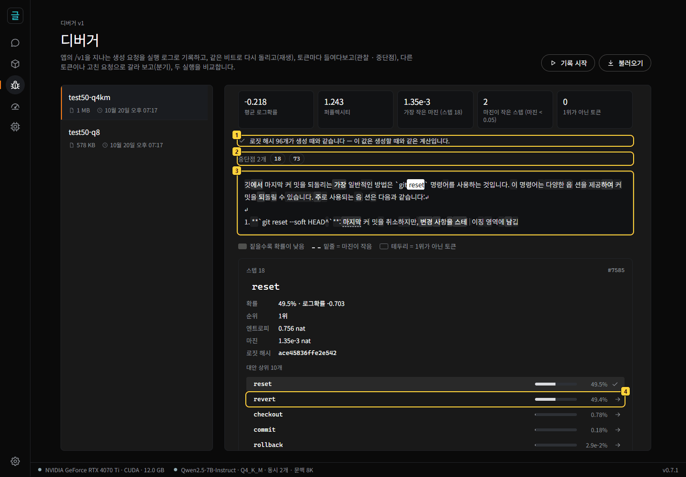
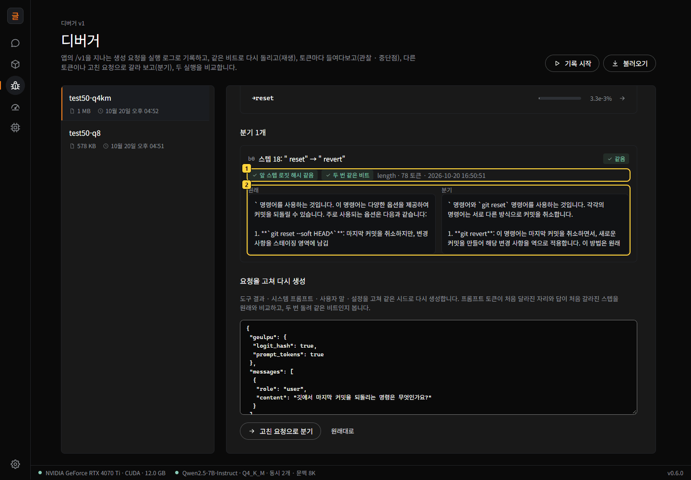
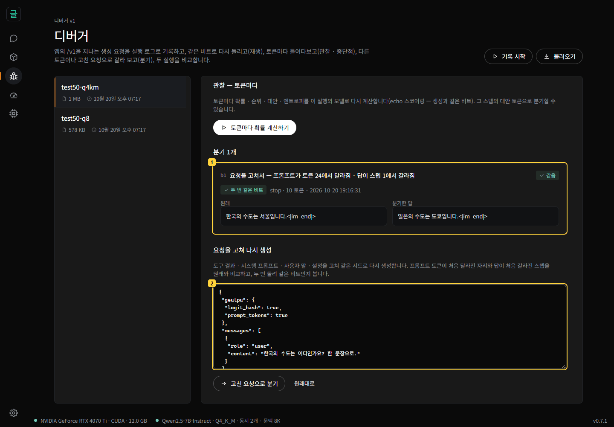
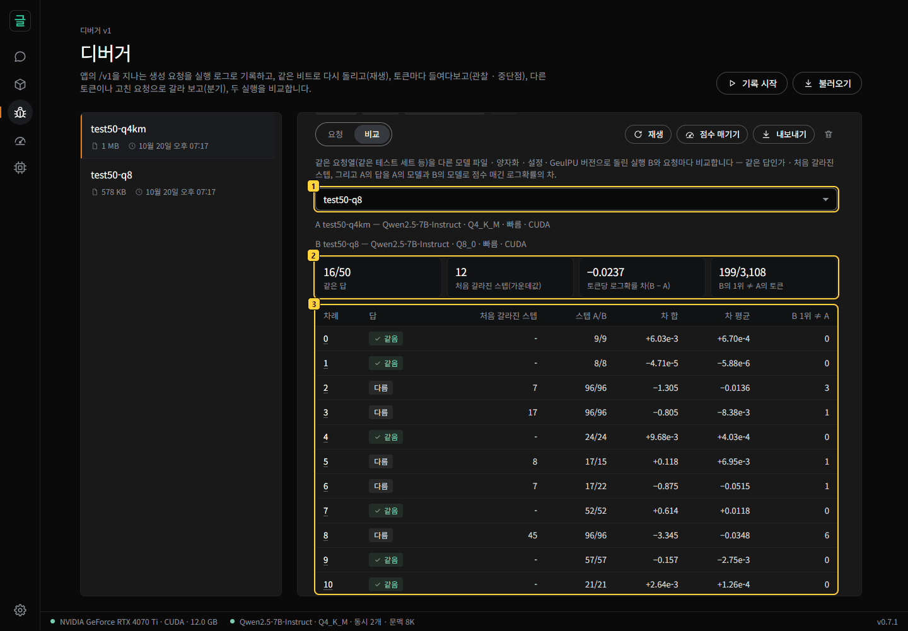
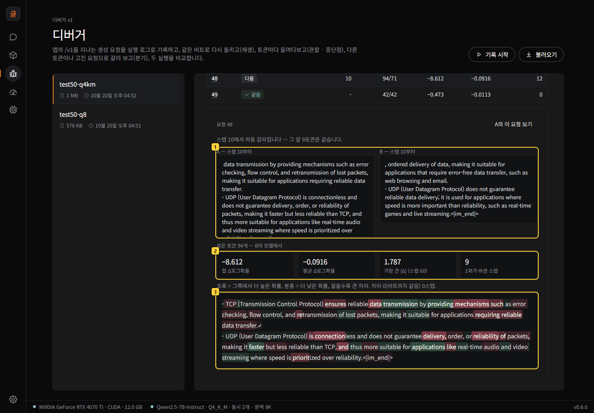
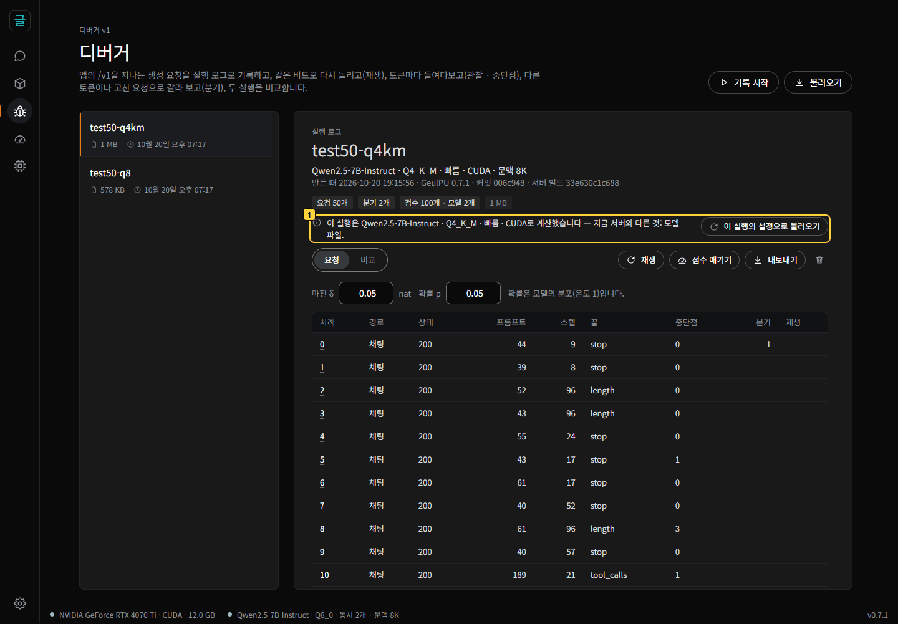

# GeulPU 디버거 안내서

**[English](docs/debugger-guide.md)** · [README](README.ko.md) · [사용 안내](사용안내.md) · [연구 패널 안내서](연구자안내.md) · [계획과 판정 — 문서/디버거.md](문서/디버거.md)

GeulPU의 **디버거**는 답 하나가 아니라 **실행**(요청 여럿 — 에이전트 세션 · 테스트 세트)을 다룹니다. 앱을 지나는 생성 요청을
**실행 로그**(run log)로 기록하고, 같은 비트로 다시 돌리고(**재생**, replay), 토큰마다 들여다보고(**관찰** · **중단점**, breakpoint),
다른 토큰이나 고친 요청으로 이어 생성해 보고(**분기**, branch), 두 실행을 **비교**하고(comparison), 실행 로그를
**내보내기**(export) · **불러오기**(import)로 다른 PC에 옮겨 다시 돌립니다.

이 모든 것은 GeulPU가 **같은 입력이면 같은 비트**를 내기 때문에 됩니다. 함께 도는 요청 수 · 프롬프트 캐시 · 추측 디코딩 · 슬롯과
상관없이 같은 값이 나오고, 정밀 모드는 CUDA ↔ Vulkan도 같습니다([계약](계약/계약.md)). 그래서 재생은 기록과 비트까지 같고, 분기와
비교에서 보이는 차이는 바꾼 것 하나에서만 나옵니다. 이 안내서의 그림은 모두 테스트 세트([`시험/디버거/묶음50.jsonl`](시험/디버거/묶음50.jsonl))를
Qwen2.5-7B-Instruct로 돌린 실행입니다. 같은 모델 파일 · 같은 계산 방식이면 **여러분 PC에서도 같은 답 · 같은 숫자가 나옵니다**.

## 목차

- [1. 준비](#1-준비)
- [2. 기록하기](#2-기록하기)
- [3. 실행 보기 — 요청 표와 재생](#3-실행-보기--요청-표와-재생)
- [4. 요청 들여다보기 — 관찰과 중단점](#4-요청-들여다보기--관찰과-중단점)
- [5. 분기 — 다른 토큰으로 · 요청을 고쳐서](#5-분기--다른-토큰으로--요청을-고쳐서)
- [6. 두 실행 비교 — Q4_K_M ↔ Q8_0](#6-두-실행-비교--q4_k_m--q8_0)
- [7. 다른 PC로 — 내보내기 · 불러오기 · GPU 없이 확인](#7-다른-pc로--내보내기--불러오기--gpu-없이-확인)
- [8. 스크립트로 — debugger.py · API · 실행 로그](#8-스크립트로--debuggerpy--api--실행-로그)
- [9. 드는 시간](#9-드는-시간)
- [10. 주의할 점과 자주 묻는 것](#10-주의할-점과-자주-묻는-것)

## 1. 준비

1. **GeulPU 0.7.0 이상**을 씁니다([설치](사용안내.md#설치)). 왼쪽 레일의 벌레 단추가 디버거입니다.
2. **모델**: 이 안내서는 **Qwen2.5-7B-Instruct Q4_K_M**을 쓰고, 6장의 비교에는 같은 모델의 **Q8_0**도 씁니다(모델 → 모델 찾기에서
   받기). 다른 모델로도 똑같이 할 수 있고, 숫자만 달라집니다.
3. **계산 방식**은 기본(빠른 모드 — NVIDIA)입니다. 정밀 모드면 CUDA ↔ Vulkan(AMD 포함)도 같은 비트이고, 숫자는 빠른 모드와 조금
   다릅니다.
4. 스크립트를 쓰려면 저장소의 [`도구/debugger.py`](도구/debugger.py)(파이썬 표준 라이브러리만)를 받습니다.

## 2. 기록하기

기록 방법은 둘입니다.

- **앱에서**: 디버거의 **기록 시작**을 누르고 이름을 정합니다. 그때부터 앱의 `/v1`을 지나는 생성 요청 — 에이전트(Qwen Code 등) ·
  스크립트 · 이 앱의 채팅 — 이 실행 로그에 한 줄씩 남습니다. 끝나면 **기록 멈춤**. 기록하는 동안 서버는 응답에 시드 · 프롬프트 토큰 ·
  스텝마다 로짓 해시를 덧붙입니다(답은 그대로입니다 — 기록이 늘리는 시간은 0.35 %).
- **테스트 세트로**: 요청을 줄마다 적은 JSONL 파일을 실행 하나로 돌립니다. 시드가 없는 요청에는 `--seed`(기본 1000) + 차례를 넣어,
  같은 파일이면 같은 실행이 됩니다.

  ```
  python 도구/debugger.py run-set 시험/디버거/묶음50.jsonl test50-q4km
  ```

실행 로그는 데이터 폴더의 `실행기록\<이름>.jsonl` 입니다. 대화 내용이 담기니 필요한 동안만 기록하세요.

## 3. 실행 보기 — 요청 표와 재생


1. **실행 목록** — 이름 · 크기 · 고친 때. 기록 중인 실행에는 표시가 붙습니다.
2. **기록 시작 · 불러오기**(다른 PC에서 내보낸 실행 로그 — [7장](#7-다른-pc로--내보내기--불러오기--gpu-없이-확인)).
3. **실행의 헤더** — 이 실행을 계산한 모델 · 계산 방식 · 백엔드 · 문맥, 만든 때, GeulPU 버전 · 커밋 · 서버 빌드.
4. **재생 · 점수 매기기 · 내보내기 · 지우기**.
   - **재생**은 기록한 요청과 분기를 같은 시드로 다시 보내 프롬프트 토큰 · 나온 토큰 · 스텝마다 로짓 해시 · 끝난 까닭(finish_reason)을 비교합니다.
     오류로 끝난 요청은 같은 오류(상태 · 코드)가 나오는지 봅니다.
   - **점수 매기기**는 요청마다 답을 지금 모델로 다시 계산해(echo 스코어링) 점수 줄로 실행 로그에 남깁니다. 중단점과 비교가 이것을
     씁니다.
5. **요청 표** — 차례 · 경로(채팅 · 완성) · 상태 · 프롬프트 토큰 · 스텝 · 끝난 까닭 · 중단점 수 · 분기 수 · 재생 결과. 그림은 재생 뒤입니다 —
   요청 50개와 분기 2개가 모두 **같음**입니다.

## 4. 요청 들여다보기 — 관찰과 중단점

요청 표에서 차례를 누르면 그 요청이 열립니다: 메시지의 끝 셋 · 요청 JSON · 답의 글. **토큰마다 확률 계산하기**를 누르면 답을 이
실행의 모델로 다시 계산합니다(몇 초).

요청 20은 `깃에서 마지막 커밋을 되돌리는 명령은 무엇인가요?`(온도 0)입니다. 맨 위의 수는 답 전체의 요약입니다 — 평균 로그확률
−0.218 nat · 퍼플렉시티 1.243 · 가장 작은 마진(스텝 18) · 마진이 작은 스텝 2개 · 1위가 아닌 토큰 0개.



1. **로짓 해시 96개가 생성 때와 같습니다** — 이 값들이 생성할 때와 같은 계산이라는 확인입니다.
2. **중단점** — 단추를 누르면 그 스텝으로 갑니다. 세 가지를 찾습니다.
   - **마진이 작은 스텝**: 1위와 2위의 로그확률 차(마진)가 δ(기본 0.05 nat)보다 작은 스텝.
   - **저확률 샘플**: 고른 토큰의 확률이 p(기본 0.05)보다 낮은 스텝.
   - **도구 호출의 시작**: `<tool_call>` · `<|python_tag|>` 를 고른 스텝.
3. **토큰 줄** — 짙을수록 확률이 낮고, 밑줄은 마진이 작은 스텝, 테두리는 1위가 아닌 토큰을 샘플링한 스텝입니다(연구 패널과 같습니다).
4. **스텝 18의 카드** — 모델은 ` reset`(49.5 %)과 ` revert`(49.4 %) 사이에서 거의 동전을 던졌습니다(마진 1.35 × 10⁻³ nat). 대안마다의
   화살표가 그 토큰으로 분기합니다.

확률은 모델의 분포(온도 1 · 거르기 없음 — [계약 5.2](계약/계약.md))입니다. 요청 표의 중단점 수는 그 요청을 생성한 모델의 점수 줄에서 셉니다(먼저
**점수 매기기**).

## 5. 분기 — 다른 토큰으로 · 요청을 고쳐서

**다른 토큰으로**: 스텝 18의 대안 ` revert`의 화살표를 누르면, 프롬프트 + 앞 17 토큰 + ` revert`를 넣고 같은 시드 · 같은 샘플링 설정 ·
스텝 19부터 원래와 같은 난수로 이어 생성합니다. 같은 요청에서 앞 스텝들의 로짓 해시도 함께 받아 원래와 같은지 보고, 두 번 돌려 같은
비트인지 봅니다.



1. **확인** — 앞 스텝 로짓 해시가 원래와 같고, 두 번 돌려 같은 비트입니다. 바뀐 것은 고른 토큰 하나뿐입니다.
2. **원래 · 분기의 이어진 글** — ` reset`을 고른 원래 답은 `git reset`의 옵션(`--soft HEAD^` 등)을 설명하고, ` revert`로 분기한 답은
   `git revert`와 `git reset`을 함께 소개합니다.

원래 토큰으로 분기하면(자기 확인) 원래 답의 뒤가 그대로 나와야 하고, 카드에 **원래 답과 같음**이 붙습니다.

**요청을 고쳐서**: 요청 화면 아래의 **요청을 고쳐 다시 생성**에서 요청 JSON을 고칩니다 — 도구 결과 · 시스템 프롬프트 · 사용자 말 ·
설정(온도 등). 같은 시드로 다시 생성하고 원래와 비교합니다.



1. 요청 0의 `한국의 수도는 어디인가요? 한 문장으로.`를 `일본의 수도는 어디인가요? 한 문장으로.`로 고친 분기입니다 — 프롬프트 토큰이 처음
   달라진 자리(24)와 답이 처음 갈라진 스텝(1)이 보입니다.
2. **고칠 요청** — 기록한 요청 JSON이 그대로 들어 있습니다. 고친 뒤 **고친 요청으로 분기**.

에이전트 세션이면 실패한 도구 결과(예: 테스트 출력)를 고쳐 보는 데 씁니다 — 모델이 그 결과 하나 때문에 다르게 행동했는지 봅니다.
분기는 모두 실행 로그에 **분기 줄**로 남고, 재생이 함께 다시 돌립니다.

## 6. 두 실행 비교 — Q4_K_M ↔ Q8_0

같은 요청열(같은 테스트 세트)을 다른 모델 파일 · 양자화 · 설정 · GeulPU 버전으로 돌린 두 실행을 요청마다 비교합니다. 여기서는 같은
테스트 세트를 Q8_0으로 돌린 `test50-q8` 입니다.



1. **비교할 실행 B**를 고릅니다.
2. **요약** — 같은 답 **16/50**, 처음 갈라진 스텝의 가운데값 **12**, A의 답을 B의 모델로 점수 매긴 로그확률의 차가 토큰당 **−0.0237
   nat**, B의 1위가 A의 토큰과 다른 스텝 **199/3,108**(참고로 A 자신이 1위가 아닌 토큰을 샘플링한 스텝은 119 — 테스트 세트의
   절반이 온도 0.7).
3. **요청마다** — 같은 답인가, 처음 갈라진 스텝, 스텝 A/B, 차의 합 · 평균, B의 1위 ≠ A.

차는 A의 답을 **A의 모델과 B의 모델로 점수 매긴 것**에서 나옵니다. 점수가 모자라면 **점수 매기기** 단추가 두 모델을 차례로 불러와
매깁니다. 계산의 잡음이 없으므로 0이 아닌 차는 모두 모델 파일 하나의 효과입니다.

행을 누르면 그 요청의 두 답을 나란히 봅니다.



1. 요청 48(`What is the difference between TCP and UDP? Two bullet points.`)은 **스텝 10**에서 처음 갈라집니다 — 그 앞 9 토큰은 같습니다.
2. A의 답(94 토큰)을 B의 모델로 점수 매기면 합 −8.612 · 평균 −0.0916 nat, 가장 큰 차는 스텝 60, 1위가 바뀐 스텝 9.
3. **토큰마다 Δ** — 초록은 B에서 더 높은 확률, 분홍은 더 낮은 확률, 짙을수록 큰 차이입니다.

## 7. 다른 PC로 — 내보내기 · 불러오기 · GPU 없이 확인

- **내보내기**는 실행 로그 파일(JSONL)을 그대로 받습니다. 점수 · 분기도 그 안에 있습니다.
- **불러오기**는 다른 GeulPU에서 내보낸 실행 로그를 엽니다. 첫 줄이 헤더인지 보고, 큰 파일은 나눠 보냅니다. 같은 GeulPU 버전 · 같은
  모델 파일(sha256) · 같은 계산 방식이면 재생이 비트까지 같습니다 — 새 데이터 폴더의 다른 앱으로 옮겨 재생해 같음을 확인했습니다.
- **지금 서버가 이 실행과 다르면** 헤더 아래에 다른 것이 보입니다.



**이 실행의 설정으로 불러오기**는 이 실행의 모델 파일을 찾아 불러오고, 계산 방식 · 백엔드가 다르면 앱의 설정을 바꿉니다(채팅도 그 설정을
씁니다). 다른 서버로 재생하면 화면은 먼저 묻고, 도구는 멈춥니다(`--ignore-header`면 그대로).

**GPU 없이 확인**: 받은 실행 로그의 요청 · 분기를 GeulPU 없이 정밀도 계약의 CPU 참조로 계산해 비트까지 확인합니다(파이썬 + numpy).

```
python -I 도구/repro_check.py test50-q4km.jsonl Qwen2.5-7B-Instruct-Q4_K_M.gguf --requests 0,25 --branches 0
```

스텝마다 로짓 해시 · 샘플링한 토큰, 점수 줄이 있으면 로그확률 · 엔트로피 · 상위 k, 분기의 앞 스텝(echo 행) 로짓 해시를 비교합니다. 계산
방식 · YaRN 배는 실행 로그에 적힌 서버의 것을 씁니다(긴 문맥으로 기록한 실행도 그대로 확인됩니다). 7B는
CPU로 요청 · 분기 하나에 9 ~ 19분이라(답의 길이에 따라) 확인할 것을 고릅니다.

## 8. 스크립트로 — debugger.py · API · 실행 로그

화면의 일은 모두 [`도구/debugger.py`](도구/debugger.py)로도 합니다(파이썬 표준 라이브러리만 — 연구자의 노트북 · CI에서). 앱 주소는
`--app`(기본 `http://127.0.0.1:44544`) 또는 환경 변수 `GEULPU_APP`.

| 명령 | 하는 일 |
|---|---|
| `status` | 기록 상태와 실행 목록 |
| `record-start [NAME]` · `record-stop` | 앱의 기록 시작 · 멈춤 |
| `run-set TESTSET.jsonl NAME [--seed 1000]` | 테스트 세트를 실행 하나로 기록 |
| `get NAME FILE.jsonl` · `delete NAME` | 실행 로그 받기 · 지우기 |
| `load MODEL [--precision exact\|fast] [--layer cuda\|vulkan]` | 모델 불러오기(모델 아이디 · sha256 앞 8자 이상 · `run:실행이름` — 그 실행의 모델) |
| `replay RUN [--requests 3,7] [--ignore-header] [--out FILE]` | 재생 — 요청과 분기를 비트까지 비교 |
| `score RUN [--check]` | 점수 매기기(echo 스코어링) — `--check`는 다시 계산해 비트까지 비교 |
| `breakpoints RUN [--margin 0.05] [--prob 0.05]` | 중단점 |
| `branch RUN --request I --step K [--token ID\|same] [--alt N]` | 토큰 분기 |
| `branch RUN --request I --set PATH=VALUE [--set-file PATH=FILE]` | 요청 분기(예: `--set messages.2.content=…`) |
| `compare RUN_A RUN_B [--out FILE]` | 비교 — 같은 입력이면 같은 보고(바이트까지) |

`RUN`은 앱의 실행 이름이나 실행 로그 파일입니다. **스텝 번호는 도구 · JSON에서 0부터, 화면에서 1부터**입니다 — 화면의 스텝 18은 `--step 17`.

```
python 도구/debugger.py score test50-q4km
python 도구/debugger.py breakpoints test50-q4km
python 도구/debugger.py branch test50-q4km --request 20 --step 17
python 도구/debugger.py compare test50-q4km test50-q8 --out 비교.json
```

**앱 API**: `GET /api/debug`(기록 상태 · 실행 목록) · `GET /api/debug/run?name=`(실행 로그) · `POST /api/debug/record/start {name}` ·
`/api/debug/record/stop` · `/api/debug/run/delete {name}` · `/api/debug/run/append {name, lines}`(분석 줄 — 줄마다 맨 위에 `type`) ·
`/api/debug/run/import {name, text, part, last}`(불러오기 — 첫 조각의 첫 줄은 헤더). 재생 · 점수 · 분기는 `/v1` 과
[`geulpu` 확장 필드](사용안내.md#다른-프로그램에서-쓰기-openai-호환-api)로 합니다: `logit_hash` · `prompt_tokens` · `step_offset`(샘플링
난수의 스텝 번호를 이 수부터 — 분기가 원래 답의 뒤 스텝과 같은 난수로 잇는다) · `echo_from`(`/v1/completions` 의 `echo` 와 함께).

**실행 로그**(JSONL):

- 첫 줄 **헤더** `{"format": "geulpu-run-log/1", "app", "commit", "model": {id, file, sha256, …}, "server": {…}, "build": {…}}`
- **요청 줄** `{"i", "at", "ms", "path", "status", "model", "server", "request", "response"}` — `server`는 그 요청을 계산한 서버(모델
  sha256 · 백엔드 · 계산 방식 · 문맥 · YaRN 배), `response.geulpu`에 시드 · `prompt_tokens` · `tokens` · `logit_hashes`.
- **분석 줄**(맨 위에 `type`): `score`(요청 하나의 답을 한 서버로 echo 스코어링 — 스텝마다 로그확률 · 엔트로피 · 상위 2 · 토큰의 글 ·
  로짓 해시, 생성 때와 해시가 같은지 `hash_check`) · `branch`(분기의 요청 · 응답 · 확인).

## 9. 드는 시간

RTX 4070 Ti · Qwen2.5-7B-Instruct Q4_K_M · 빠른 모드에서 잰 값입니다([재기/디버거비용.py](재기/디버거비용.py) · [문서/디버거.md](문서/디버거.md)).

| 일 | 테스트 세트 50(짧은 프롬프트 · 답 3,108 토큰 · 분기 49) | 에이전트 세션(Qwen Code — 요청 16 · 프롬프트 5,926 ~ 18,414 토큰 · 답 4,834 토큰 · 분기 3) |
|---|---|---|
| 기록할 때 걸린 시간(요청) | 27.1 초 | 53.0 초(스트리밍) |
| 재생 — 프롬프트 캐시 비움 | 요청 27.2 초 + 분기 22.0 초 | 요청 54.3 초 + 분기 4.5 초 |
| 재생 — 프롬프트 캐시 있음 | 요청 27.2 초 + 분기 21.6 초 | 요청 41.9 초 + 분기 4.2 초 |
| 점수 매기기(다시 계산) | 5.0 초 | 7.7 초 |
| 비교(GPU 없음) | 1.2 ms | — |

분기를 만들 때(두 번 돌려 비교)는 이 안내서의 분기가 0.07 · 0.65 초, 에이전트 세션의 분기가 0.48 ~ 3.25 초였습니다. 기록을 켜면 요청
시간이 0.35 % 늘어납니다. GPU 없는 확인은 7B를 CPU로 계산해 요청 · 분기 하나에 9 ~ 19 분입니다.

## 10. 주의할 점과 자주 묻는 것

- **비트가 같으려면** 같은 모델 파일(sha256) · 같은 계산 방식 · 같은 YaRN 배, 빠른 모드면 같은 백엔드가 필요합니다. 문맥 길이 · 슬롯 ·
  프롬프트 캐시 · 추측 디코딩 · 함께 도는 요청은 상관없습니다. GeulPU 버전 · 서버 빌드 · 모듈이 다르면 재생이 먼저 알립니다 — 커널이 바뀐
  빌드면 비트가 다를 수 있고, 재생이 그것을 바로 보여 줍니다.
- **기록 중에는 재생 · 점수 · 분기가 멈춥니다** — 그 요청들도 기록 중인 실행 로그에 들어가기 때문입니다. 먼저 기록을 멈추세요.
- **스트리밍으로 받은 요청**은 마지막 이벤트(끝난 까닭 · geulpu)가 응답으로 남습니다. 답의 글은 토큰으로 다시 만듭니다(그 실행의 모델과 어휘가
  같은 모델을 불러오면 보입니다).
- **토큰 분기는 `/v1/completions`로 보냅니다** — 도구 호출을 풀지 않고 글 그대로 남기며, `parallel_tool_calls: false`(Llama 3 채팅 템플릿)처럼
  채팅에서 첫 호출에서 끝내는 규칙도 없습니다. 분기는 EOS 토큰 · `max_tokens` · `stop`에서만 끝납니다.
- **시드**는 64비트 정수입니다. 실행 로그를 JSON 수를 부동소수로 읽는 프로그램으로 다시 저장하면 시드가 바뀔 수 있으니 파일은 그대로
  옮기세요(GeulPU의 화면과 도구는 그대로 읽고 씁니다).
- **이 실행의 설정으로 불러오기**는 앱의 설정(계산 방식 · 백엔드)을 바꿉니다. 채팅도 그 설정을 씁니다.
- **한 답의 깊은 분석**(점수 · 재현 파일 · 내보내기)은 [연구 패널 안내서](연구자안내.md)에 있습니다. 디버거는 그것을 실행 단위로
  넓힌 것입니다.
