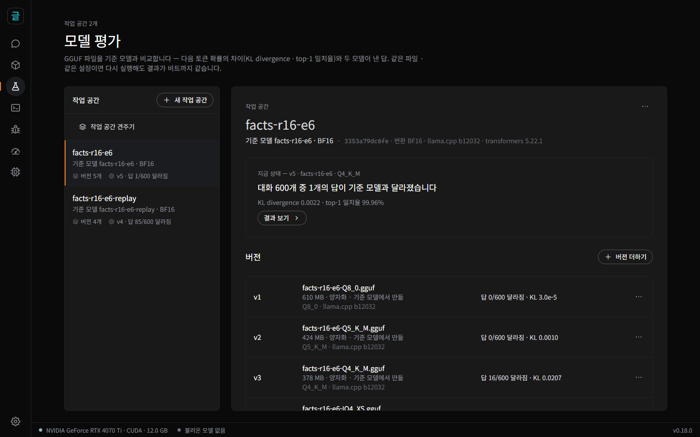
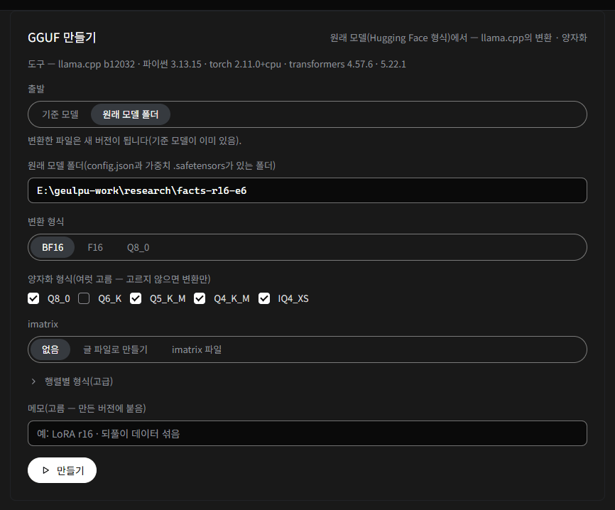
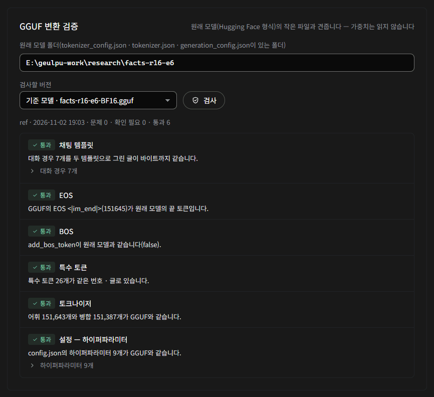
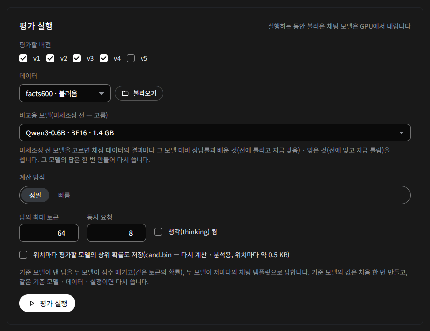
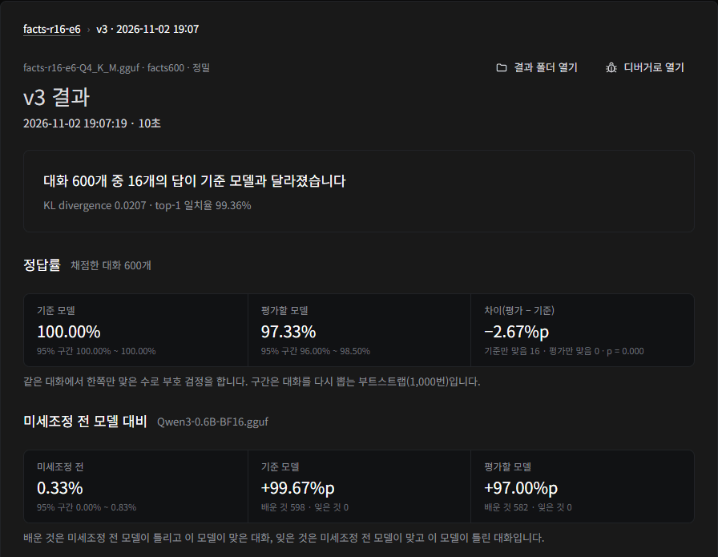
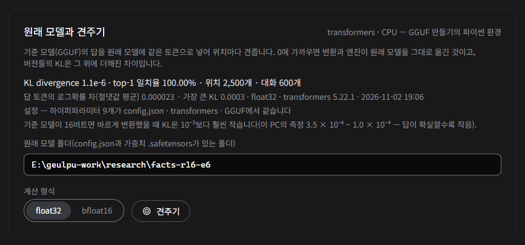
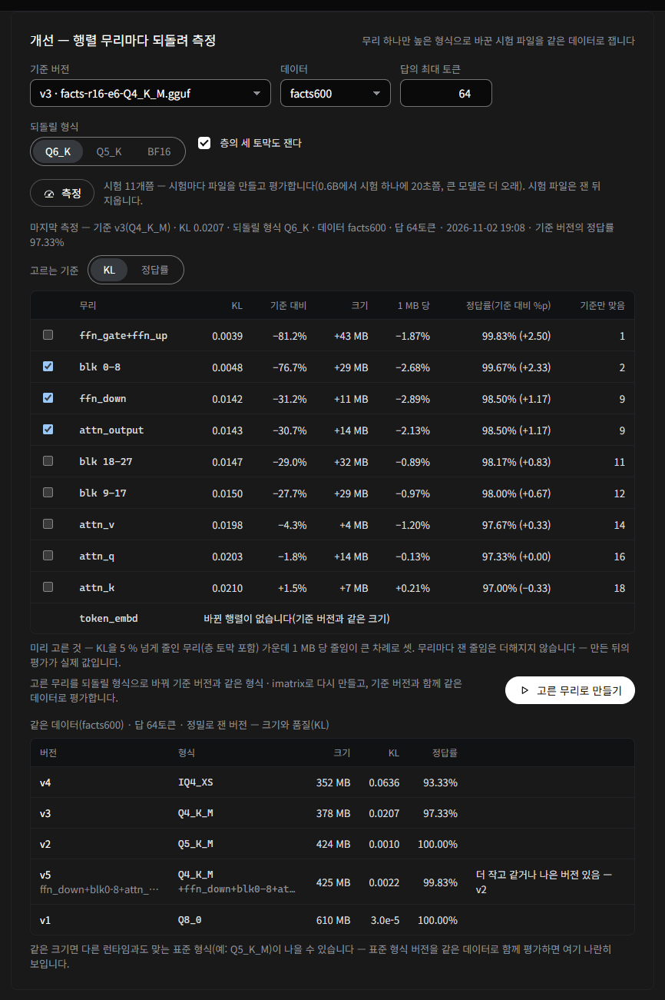
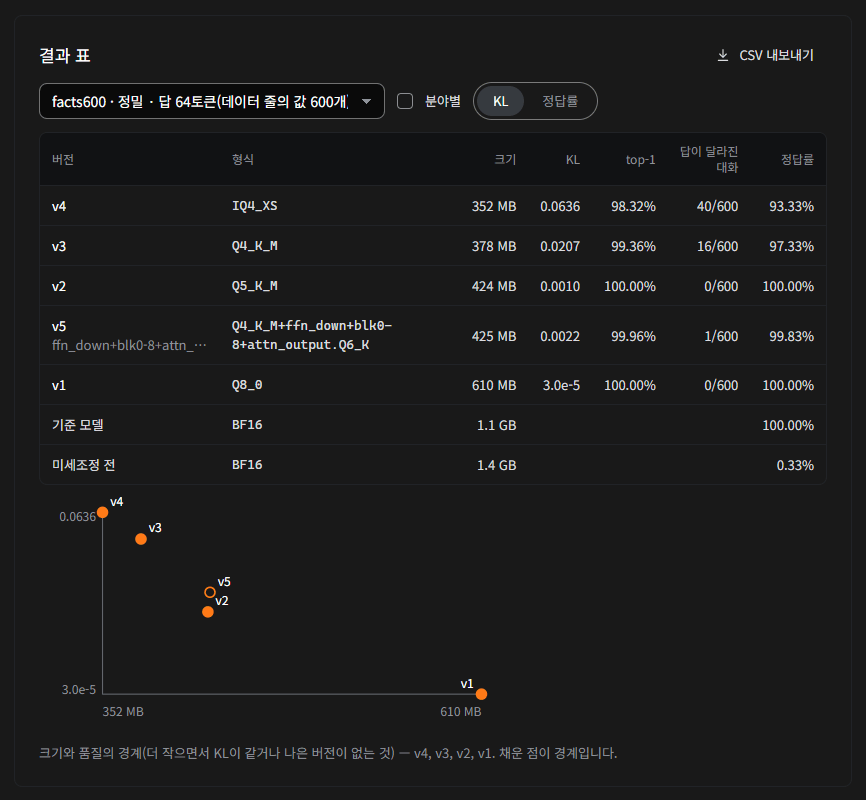
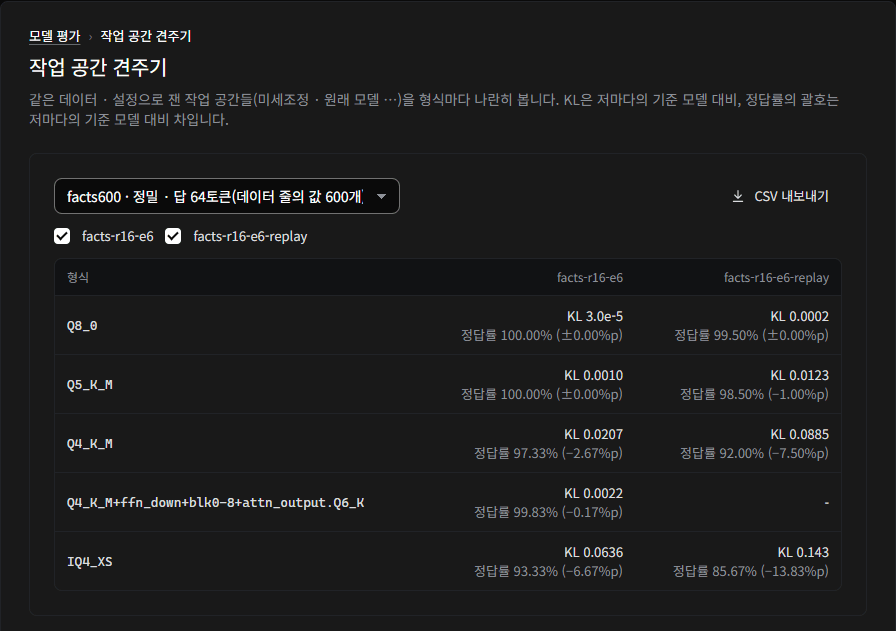

# GeulPU 모델 평가 안내서 — GGUF 를 만들고 · 확인하고 · 고치기

**[English](docs/model-evaluation-guide.md)** · [README](README.ko.md) · [사용 안내](사용안내.md) · [디버거 안내서](디버거안내.md) · [연구 패널 안내서](연구자안내.md) · [구현 계획과 측정](문서/모델평가.md)

**모델 평가**(왼쪽 줄의 플라스크 단추)는 GGUF 파일의 시험대입니다. 미세조정한 모델(Hugging Face 형식 폴더)을 GGUF 로 만들고, 변환이
바른지 확인하고, 양자화에 따라 무엇이 달라지는지 재고, 미세조정 전 모델 대비 배운 것 · 잊은 것을 세고, 품질을 덜 잃는 파일로 다시 만들어
전후를 견줍니다. 같은 파일 · 데이터 · 설정이면 다시 돌려도 결과가 비트까지 같아서, 전후 비교에는 바꾼 것의 차이만 남습니다.

## 목차

- [1. 낱말](#1-낱말)
- [2. 한 바퀴 — 미세조정한 모델을 GGUF 로](#2-한-바퀴--미세조정한-모델을-gguf-로)
- [3. 데이터](#3-데이터)
- [4. 채점 규칙](#4-채점-규칙)
- [5. 지표 읽기](#5-지표-읽기)
- [6. 원래 모델과 견주기](#6-원래-모델과-견주기)
- [7. 미세조정 전 모델 대비 — 배운 것 · 잊은 것](#7-미세조정-전-모델-대비--배운-것--잊은-것)
- [8. 개선 — 행렬 무리마다 되돌려 측정](#8-개선--행렬-무리마다-되돌려-측정)
- [9. 결과 표 · 작업 공간 견주기](#9-결과-표--작업-공간-견주기)
- [10. 파일](#10-파일)
- [11. 스크립트로 — API](#11-스크립트로--api)
- [12. 자주 묻는 것](#12-자주-묻는-것)

## 1. 낱말

- **작업 공간** — 모델 하나의 작업입니다. 기준 모델 하나와, 그와 견줄 GGUF 파일들(**버전**)과, 결과를 묶습니다. 작업 공간의 이름은 만든
  파일의 이름과 모델 이름(GGUF 의 `general.name`)이 됩니다 — 영문 · 숫자를 넣으면 파일 이름에 그대로 들어갑니다.
- **기준 모델** — 버전들을 견줄 기준입니다. 같은 모델의 BF16 · F16 파일이 가장 좋고(그래픽 메모리에 들지 않으면 Q8_0), 미세조정한 모델이면
  'GGUF 만들기'로 변환한 16비트 파일(저장된 가중치 텐서가 bfloat16 이면 BF16, float32 · float16 이면 F16)이 기준 모델이 됩니다. 다른
  모델 · 다른 미세조정의 파일을 기준으로 고르면 모든 KL 이 엉뚱한 것을 잽니다.
- **비교용 모델**(고름) — 미세조정 전 모델의 GGUF 입니다. 고르면 채점 데이터의 결과마다 미세조정이 배운 것 · 잊은 것을 셉니다(7 절).
- **버전** — 견줄 GGUF 파일(v1, v2, …)입니다. 만든 설정(형식 · imatrix · 행렬별 형식 · 도구의 판)과 메모가 함께 남습니다.
- **원래 모델** — Hugging Face 형식 폴더(`config.json` · 가중치 `.safetensors` · 토크나이저 파일)입니다. 변환 · 변환 검증 · 원래 모델과 견주기가
  이 폴더를 읽습니다.

## 2. 한 바퀴 — 미세조정한 모델을 GGUF 로



이 안내서의 그림은 Qwen3-0.6B 에 지어낸 사실 300 개를 LoRA 로 넣은 미세조정 두 개(transformers 5.22.1 로 저장)를 한 바퀴 돌린 것입니다.

1. **새 작업 공간** — 이름을 적고, 기준 모델은 '없음 — GGUF 만들기로 원래 모델에서 변환'으로 두고, 원래 모델 폴더를 정합니다.
2. **도구 준비**(처음 한 번) — 'GGUF 만들기' 카드의 단추입니다. 받을 것과 크기 · 출처를 보이고, 누른 뒤에만 받습니다:
   - llama.cpp 의 정한 태그의 실행 파일과 변환 스크립트(파일마다 SHA-256 을 확인),
   - 이 PC 의 파이썬(3.10 이상)으로 만드는 앱 전용 가상 환경 둘 — llama.cpp 가 정한 transformers 4.57.6 환경과, transformers 5 로 저장한
     폴더를 읽는 transformers 5.22.1 환경(torch 는 첫 환경의 것을 함께 씁니다). 파이썬 자체는 받지 않습니다.
3. **GGUF 만들기** — 출발 '원래 모델 폴더', 변환 형식(BF16 · F16 · Q8_0), 양자화 형식(여럿 고름 — Q8_0 · Q6_K · Q5_K_M · Q4_K_M · Q4_0 ·
   IQ4_XS). 변환한 파일이 기준 모델이 되고, 양자화한 파일이 버전이 됩니다. 폴더의 `config.json` 에 적힌 `transformers_version` 을 보고 맞는
   환경을 저절로 고릅니다. 변환 형식의 기본값은 원래 가중치를 저장한 형식을 따릅니다 — bfloat16 이면 BF16, float32 · float16 이면
   F16(llama.cpp `--outtype auto` 와 같은 고름). 형식은 `config.json` 이 아니라 저장된 텐서에서 읽습니다: safetensors 파일의 머리(가중치는
   읽지 않음)에서 2 차원 이상 텐서의 형식 가운데 값이 가장 많은 것(나뉜 파일이면 index 에서 이름이 가장 앞인 파일)이고, 머리를 읽지 못하거나
   FP8 · 정수로 묶은 양자화가 가장 많으면 `config.json` 의 `torch_dtype` · `dtype` 입니다. 그래서 가중치는 float32 인데 `config.json` 에
   bfloat16 이 적힌 폴더(학습 루프가 float32 주 가중치를 저장했거나, DeepSpeed `zero_to_fp32.py` 의 가중치 옆에 학습 때의 config 를 둔
   경우)도 F16 이 되고, 카드는 `config.json` 의 값도 함께 적습니다. 전체 미세조정처럼 float32 로 저장한 모델을 BF16 으로 바꾸면
   반올림만으로 원래 모델과의 KL 이 10⁻⁴ 대가 되고, F16 이면 10⁻⁶ 대입니다 — 카드가 원래 가중치의 형식과 이 까닭을 보입니다.
   엔진이 받지 않는 파일을 만들면 작업 요약에 그 형식과 까닭이 나옵니다. 너비 · FFN 이 256 의 배수가 아닌 작은 모델은 k-양자화가 llama.cpp 의
   대체 형식(Q5_0 · Q5_1 · IQ4_NL)으로 바뀌어 받지 않으므로 Q8_0 · Q4_0 을 쓰세요(카드가 짚어 줍니다 — Q4_0 은 낱말표 · 출력도 Q4_0).
   imatrix(글 파일로 만들기 · 가진 파일)와 행렬별 형식(`attn_v=q6_k` 처럼 한 줄에 하나 — llama-quantize `--tensor-type`)도 고를 수 있습니다.
   imatrix 는 잰 청크의 수(청크마다 512 토큰)가 작업 기록과 버전에 남습니다 — 글이 짧으면 청크가 적습니다.

   

4. **변환 검증** — 만들기가 끝나면 저절로 돌고, '변환 검증' 카드에서 다시 돌릴 수 있습니다. 원래 폴더의 작은 파일(가중치는 읽지 않음)과
   견줍니다:
   - 채팅 템플릿 — 대화 경우 5 ~ 7 개를 두 템플릿으로 그려 바이트까지 같은가,
   - EOS · BOS — GGUF 의 끝 토큰이 원래 모델의 끝 토큰에 드는가, 원래 토크나이저가 BOS 를 붙이는지(`tokenizer_config.json` 의
     `add_bos_token`, 없으면 `tokenizer.json` 의 post_processor — transformers 5 는 여기에만 적습니다)가 GGUF 와 같은가,
   - 특수 토큰 · 토크나이저 — 번호 · 글 · 병합이 같은가(SentencePiece GGUF 는 병합 없이 점수로 나누므로 어휘만 견줍니다),
   - 설정 — `config.json` 의 하이퍼파라미터(층 수 · hidden · FFN · 머리 수 · KV 머리 수 · 머리 크기 · rope 기준값 · RMS eps · 어휘 수)가
     GGUF 와 같은가.

   템플릿 · EOS · `add_bos_token` 처럼 메타데이터로 고칠 수 있는 문제는 '고친 버전 만들기'가 텐서를 그대로 두고 키만 바꾼 새 버전을 씁니다.
   특수 토큰 · 토크나이저 · 설정이 다르면 다시 변환해야 합니다.

   

5. **평가 실행** — 데이터(3 절), 평가할 버전들, 계산 방식(정밀 · 빠름 — 빠름은 CUDA 에서만), 답의 최대 토큰을 고릅니다. 기준 모델의 답과
   위치마다 상위 64 개(기준값)는 처음 한 번 만들고, 같은 기준 모델 · 데이터 · 설정이면 다시 씁니다. 비교용 모델(미세조정 전)도 고를 수
   있습니다(7 절). 엔진이 받지 않는 버전은 고를 수 없고, 버전 카드에 그 까닭이 보입니다.

   

6. **원래 모델과 견주기** — 결과 화면 아래의 카드입니다(6 절). 변환과 엔진이 원래 모델을 얼마나 그대로 옮겼는지 봅니다.
7. **개선** — 양자화한 버전에서 어느 행렬 무리를 높은 형식으로 되돌리면 KL(채점 데이터면 정답률도)이 가장 나아지는지 재고, 고른 무리로 다시
   만듭니다(8 절).
8. **전후 비교** — 결과 목록에서 둘을 고릅니다. 같은 데이터 · 설정 · 기준 모델의 결과끼리 견주고, 기준 모델과 같아진 대화 · 새로 달라진
   대화로 나아졌는지 판정합니다.
9. **결과 표** — 작업 공간의 버전들을 한 표와 크기와 품질 그림으로 보고 CSV 로 내보냅니다. 다른 미세조정의 작업 공간과는 '작업 공간 견주기'로
   형식마다 나란히 봅니다(9 절).

## 3. 데이터

내장 데이터 — `basic60`(GeulPU 가 쓴 대화 60 — 여섯 분야), `tasks40`(채점하는 과제 40), `gsm8k`(GSM8K test 1,319), `mmlu-pro-500`
(MMLU-Pro test 에서 분야마다 고르게 500). 출처 · 라이선스는 데이터 고르기 옆에 보입니다.

**내 데이터(JSONL)** — 줄마다 대화 하나입니다. '데이터 불러오기'가 자료 폴더의 `평가\데이터\` 로 복사합니다.

```json
{"id": "q-001", "category": "facts", "messages": [{"role": "user", "content": "When was the Woulwivceim Orchestra founded?"}], "max_tokens": 16, "answer": "1867", "grader": "number"}
```

| 칸 | 뜻 |
|---|---|
| `messages` | 대화(필수) — OpenAI 꼴. 시스템 메시지 · 여러 턴을 넣을 수 있습니다 |
| `id` · `category` | 대화의 이름과 분야 — 지표 · 정답률을 분야마다도 냅니다 |
| `tools` | 도구 정의(OpenAI 꼴) |
| `max_tokens` | 이 대화의 답의 최대 토큰 — 실행 설정보다 앞섭니다(결과 줄이 '답 512토큰(데이터 줄의 값 600개)'처럼 보입니다) |
| `thinking` | 생각(thinking)을 켜거나 끕니다 — 기본은 실행 설정 |
| `answer` · `grader` | 정답과 채점 규칙(4 절) — 있으면 정답률을 냅니다 |

**텍스트(.txt)** — 글 하나를 토큰으로 나눠 문맥 512 의 청크마다 뒤쪽 절반을 점수 매깁니다(llama-perplexity 와 같은 위치). 생성 비교 · 채점은
하지 않습니다. 청크 수는 평가 실행 카드의 '청크 수' · API 의 `chunks`(기본 64 — 1 ~ 4096)로 정합니다 — 앞에서부터 그 수만큼. 글에 있는
청크보다 많이 요청하면 있는 만큼 재고, 결과에는 잰 수가 남습니다('청크 201(요청 4096)' — 같은 글은 요청한 수와 상관없이 같은 설정으로
묶입니다). 모델의 최대 위치(문맥)가 512 이상이어야 합니다(512 인 작은 모델도 됩니다).

## 4. 채점 규칙

| grader | 맞는 답 |
|---|---|
| `number` | 답 글의 **마지막 수**와 정답의 수가 같다(정답 글에 `####` 가 있으면 그 뒤의 수 — GSM8K). 수는 `[-]숫자[,숫자…][.숫자…]` — 쉼표는 빼고 정수 부분의 앞 0 과 소수점 뒤의 끝 0 · 점은 지웁니다: `1,000` = `1000`, `12.50` = `12.5`, `3.0` = `3`, `-0` = `0` |
| `choice` | `answer is`(대소문자 무시) 뒤의 빈칸 · `:` · `(` 다음 글자 A ~ J(뒤가 영문자가 아닐 때) 가운데 마지막 것, 없으면 답 글 전체가 `X` · `(X)` · `X.` · `X)` 일 때 그 글자 — 정답 글자와 같다 |
| `exact` | 앞뒤 빈칸을 떼고, 영문 대문자를 소문자로, 빈칸 묶음을 하나로, 끝의 `.` `!` `?` `。` 를 뗀 글이 같다 |
| `tool_call` | 첫 도구 호출의 이름이 같고 인자가 같다 — 인자는 JSON 으로 견줍니다(객체는 열쇠 차례와 상관없이, 수는 값으로). 정답은 `"answer": {"name": "get_weather", "arguments": {"city": "Seoul"}}` 꼴 |

`tools` 가 든 대화는 GeulPU 가 읽는 도구 호출 꼴(Qwen 의 `<tool_call>` JSON · Llama 3 의 JSON · Qwen3.5 · Coder 의 XML · MiniCPM 의 XML ·
Gemma 4)의 채팅 템플릿만 받습니다. 다른 꼴로 미세조정한 모델은 평가가 그 까닭과 함께 실패합니다(실행 로그 `run-*.jsonl` 의 `error`).

정답률의 95 % 구간은 부트스트랩입니다 — 대화 n 개를 다시 뽑아 1,000 번 정답률을 내고 25 번째 · 975 번째 값(씨앗이 정해져 있어 다시 돌려도
같습니다). 기준 모델과 평가할 모델의 정답 여부를 대화마다 나란히 보이고, '기준만 맞음' · '평가만 맞음'의 수를 셉니다.

## 5. 지표 읽기



**(가) 같은 토큰의 분포** — 기준 모델이 그리디로 낸 답을 두 모델이 같은 토큰으로 점수 매깁니다. 차이는 가중치에서만 옵니다.

- **KL divergence** KL(기준 ‖ 평가) — 기준 모델의 상위 64 개 토큰과 나머지 확률 하나로 계산합니다. 나머지를 하나로 합치므로 모든 어휘로
  계산한 값의 **아래쪽 값**입니다(Qwen3-0.6B 에서 모든 어휘의 값의 98 % 안팎). 평균 · 99 백분위수 · 최댓값.
- **top-1 일치율** — 두 모델의 1위 토큰이 같은 위치의 비율.
- **Δp** — 기준 모델이 고른 토큰의 확률 차(기준 − 평가) · **PPL 비** — 그 토큰의 평균 음의 로그확률 차를 exp 로.
- **PPL · NLL** — 같은 토큰의 평균 음의 로그확률(nat)과 그 exp — 기준 모델 · 평가할 모델 둘 다. 텍스트 데이터는 **BPB**(글의 바이트당
  비트)도 냅니다 — 바이트로 나누므로 어휘가 다른 모델끼리도 견줄 수 있습니다(그 모델을 기준 모델로 둔 작업 공간에서 같은 데이터로). 바이트는
  점수 매기는 토큰이 나타내는 바이트 그대로입니다(청크 경계에서 잘린 글자도 그 바이트만큼 — 토크나이저로 따로 센 값과 같음).

**(나) 저마다의 답** — 두 모델이 같은 대화를 저마다의 GGUF 채팅 템플릿으로 받아 그리디로 답합니다. 템플릿 · EOS 의 고장은 여기서
드러납니다.

- **답이 달라진 대화** · **처음 갈라진 스텝** — 그 스텝에서 기준 모델의 1위와 2위의 차(마진)가 0.05 nat 보다 작으면 '마진이 작은 스텝'에서
  갈라진 것입니다(작은 수치 차이로도 갈라질 수 있는 자리).
- **끝난 까닭** — EOS 로 끝났는가, 최대 길이에서 잘렸는가.

**크기 감** — 이 PC 의 측정(Qwen3-0.6B, 정밀). KL 은 데이터에 따라 크게 다릅니다 — 답이 확실한 사실 질문은 작고, 열린 대화 · 긴 답은
큽니다. 같은 데이터 · 같은 기준 모델의 결과끼리만 견주세요.

| 형식 | wikitext-2 · 텍스트 모드 · 문맥 512 — 기준 Q8_0, 평가할 파일은 그것을 다시 양자화 | facts600 · 답 16 — 사실 300 개를 넣은 미세조정, 기준 BF16 |
|---|---|---|
| Q6_K | 0.0099 | — |
| Q5_K_M | 0.0253 | 0.0010(정답률 100 %) |
| Q4_K_M | 0.0883 | 0.0207(97.33 %) |
| IQ4_XS | 0.1133 | 0.0636(93.33 %) |

왼쪽은 llama.cpp 의 `llama-perplexity --kl-divergence` 와 같은 위치를 잰 것으로, 형식의 순서 · top-1 · PPL 비가 llama.cpp 와 같습니다. KL
값은 상위 64 + 나머지라 llama.cpp 의 Mean KLD 보다 낮습니다 — Q4 급에서 0.88 배 안팎, KL 이 작은 Q8_0 에서는 0.6 ~ 0.7 배.

## 6. 원래 모델과 견주기

결과의 기준값(기준 모델의 답과 위치마다 상위 64)을 원래 모델(transformers, CPU)에 같은 토큰으로 넣어 위치마다 견줍니다. 'GGUF 만들기'의
가상 환경을 씁니다 — 원래 폴더를 저장한 transformers 의 큰 판에 맞는 쪽(4.57.6 · 5.22.1)입니다. 계산 형식은 float32(기본 — bfloat16
가중치도 정확히 늘려 계산) 또는 bfloat16. 채팅 데이터의 결과만 견줍니다(텍스트 데이터의 결과는 아직 — 카드가 보이지 않습니다).



- 먼저 **설정**을 견줍니다 — 하이퍼파라미터 9 개를 GGUF · `config.json` · transformers 가 읽은 값으로. transformers 가 `config.json` 과
  다르게 읽었으면 돌리는 모델이 저장한 모델이 아니므로 KL 을 내지 않고 멈춥니다(무엇이 달랐는지 말합니다). GGUF 만 다르면 견주고 짚어
  줍니다 — 그 차이가 KL 에 보입니다.
- **크기** — 기준 모델이 16비트면 바르게 변환했을 때 KL 은 10⁻³ 보다 훨씬 작습니다(이 PC 의 측정 3.5 × 10⁻⁶ ~ 1.0 × 10⁻⁴ — 답이 확실할수록
  작음). 10⁻³ 을 넘으면 화면이 짚습니다. 기준 모델이 Q8_0 이면 1.6 × 10⁻³ 안팎이고, 버전들의 KL 은 이것을 깔고 잰 값입니다. 원래 모델이
  float32 · float16 으로 저장됐는데(저장된 텐서의 형식 — 2 절 3 단계) 기준 모델이 BF16 이면 반올림만으로 10⁻⁴ 대가 될 수 있습니다(변환이
  틀린 것은 아님 — 화면이 알려 주고, `config.json` 이 다르게 적었으면 그 값도 적습니다).
  원래 값에 가까운 기준은 변환 형식 F16 으로 만드세요(10⁻⁶ 대).
- **걸리는 시간** — CPU 로 대화마다 원래 모델을 한 번 돌리므로 대화 수 · 답 길이에 비례합니다(짧은 답 60 개는 1 분 안쪽, GSM8K 1,319 개는
  이 PC 에서 24 분). 견주는 동안 작업 단계에 '대화 k/n · 남은 시간'이 보이고, **견줄 대화 수**(처음 n 개 — 0 이면 모두)로 줄일 수 있습니다.
  그동안 앱은 다른 작업을 받지 않습니다.
- **여러 번 견주기** — 견준 결과는 대화 수 · 계산 형식마다 따로 남습니다. 카드에는 가장 많이 견준 것이 보이고, 나머지는 '다른 견주기' 줄로
  보입니다 — 처음 n 개만 빨리 다시 견줘도 앞서 모두 견준 결과는 그대로입니다.

## 7. 미세조정 전 모델 대비 — 배운 것 · 잊은 것

기준 모델(미세조정한 모델의 BF16)과 견주는 KL · 정답률은 변환 · 양자화가 잃은 것을 잽니다. 미세조정이 무엇을 배우고 무엇을 잊었는지는
미세조정 전 모델과 견줘야 보입니다.

- 평가 실행 카드의 **비교용 모델(미세조정 전 — 고름)** 에서 미세조정 전 모델의 GGUF 를 고릅니다(앱의 모델 목록에 있어야 합니다). 작업
  공간에 남아 다음 평가에도 씁니다. 배운 것 · 잊은 것은 채점 데이터(`answer` 가 있는 데이터)에서 셉니다. 텍스트 데이터면 결과의 **PPL**
  칸에 그 모델의 같은 토큰 PPL 과 '기준 ÷ 비교용 · 평가 ÷ 비교용' PPL 비가 나옵니다 — 이어서 사전학습한 모델의 PPL 이 얼마나 내려갔는지가
  여기 보입니다.
- 비교용 모델의 답은 기준값처럼 처음 한 번 만들고, 같은 모델 · 데이터 · 설정이면 다시 씁니다(작업 기록의 '[비교용] 저장해 둔 비교용 모델의
  답을 씁니다').
- 결과 화면의 **미세조정 전 모델 대비**(5 절 그림의 아래쪽) — 미세조정 전 모델의 정답률(95 % 구간)과, 기준 모델 · 평가할 모델마다 미세조정 전 대비 정답률의
  차(%p) · **배운 것**(미세조정 전 모델은 틀리고 이 모델은 맞은 대화) · **잊은 것**(미세조정 전 모델은 맞고 이 모델은 틀린 대화)의 수. 결과
  표(9 절)에는 '미세조정 전' 줄이 붙습니다.
- 넣은 지식만 묻는 데이터로는 잊음이 보이지 않습니다 — 미세조정 전 모델이 모르던 것이라 잊을 것이 없습니다. 일반 능력의 데이터(`gsm8k` ·
  `mmlu-pro-500`)로도 평가하세요.

예 — 이 PC 의 측정(Qwen3-0.6B 에 지어낸 사실 300 개를 짧은 답으로 미세조정): facts600 에서 미세조정 전 0.33 %, 미세조정한 BF16 은 배운 것
598 · 잊은 것 0. GSM8K 에서는 미세조정 전 60.35 %, 미세조정한 BF16 5.08 %(배운 것 22 · 잊은 것 751) — 짧은 답만 배워 풀이를 잊었습니다.
미세조정 전 모델이 낸 자기 답 259 개를 섞어 다시 미세조정하니 60.20 % 로 돌아왔습니다.

## 8. 개선 — 행렬 무리마다 되돌려 측정

GGUF 만들기로 양자화한 버전(기준 버전)에서 시작합니다. 무리 하나만 되돌릴 형식(Q6_K · Q5_K · BF16)으로 바꾼 시험 파일을 기준 버전과 같은
형식 · imatrix 로 만들고, 같은 데이터로 평가해 KL 이 얼마나 줄었는지 잽니다. 데이터는 채팅 · 텍스트 모두 됩니다 — 모델이 쓰일 분야의 글로
재면 그 분야에서의 손실을 줄이는 무리가 보입니다.



- 무리 — `attn_q` · `attn_k` · `attn_v` · `attn_output` · `ffn_gate+ffn_up`(엔진이 둘을 같은 형식으로 읽음) · `ffn_down` · `token_embd` ·
  `output`(따로 있으면), 고르면 층의 세 토막.
- 표 — 무리마다 KL · 기준 대비 줄임 · 늘어난 크기 · 1 MB 당 줄임. 채점 데이터면 **정답률(기준 대비 %p)**(풍선 도움말이 95 % 구간)과
  **기준만 맞음**(기준 모델은 맞고 그 시험 파일은 틀린 대화의 수)도 보입니다.
- 미리 고름 — **고르는 기준**(채점 데이터일 때 KL · 정답률)에 따라, KL 을 5 % 넘게 줄인 무리 또는 정답률을 높인 무리 가운데 1 MB 당 줄임 ·
  오름이 큰 차례로 셋(층 토막 포함 — 손으로 고칠 수 있음). 대화가 적으면 정답률의 차이는 우연일 수 있습니다. 무리마다 잰 값은 더해지지
  않습니다 — 만든 뒤의 평가가 실제 값입니다.
- **고른 무리로 만들기** — 고른 무리를 되돌릴 형식으로 바꿔 다시 만들고, 기준 버전과 함께 같은 데이터로 이어서 평가합니다. 파일 이름과
  메모에 고른 무리가 붙습니다(예: `facts-r16-e6-Q4_K_M+ffn_gate+ffn_up+attn_v.Q6_K.gguf`). 기준 버전은 같은 파일 · 데이터 · 설정의 결과가
  있으면 다시 재지 않습니다.
- **크기와 품질** — 카드 아래에 같은 데이터 · 설정으로 잰 이 작업 공간의 버전들을 크기와 품질(고르는 기준)로 나란히 보이고, 더 작으면서
  품질이 같거나 나은 버전이 있으면 짚습니다 — 그림에서는 고른 무리로 만든 v5(425 MB · 99.83 %) 옆에 v2 Q5_K_M(424 MB · 100 %)이 있습니다. 더 작은
  것이 없으면 크기가 5 % 안쪽으로 크고 KL 이 0.7 배 이하인 버전도 짚습니다. 같은 크기면 다른 런타임과도 맞는 표준 형식이 나을 수 있으니, 표준
  형식 버전도 같은 데이터로 함께 평가해 두세요.

## 9. 결과 표 · 작업 공간 견주기

**결과 표**(작업 공간 화면의 카드) — **데이터 · 설정**(데이터 · 계산 방식 · 답의 길이 · 생각 · 청크)을 하나 고르면 버전마다 그 마지막 결과를
한 표에 놓습니다.

- 칸 — 버전(메모) · 형식 · 크기 · KL · top-1 · 답이 달라진 대화 · 정답률(채점 데이터 — 풍선 도움말이 95 % 구간) · PPL · BPB(텍스트 데이터).
  채점 데이터면 기준 모델과 미세조정 전 모델(7 절)의 정답률 줄이, 텍스트 데이터면 그 두 모델의 PPL · BPB 줄이 아래에 붙습니다(그 데이터 ·
  설정의 가장 나중 결과). 0.20.0 앞에 만든 텍스트 결과의 BPB 에는 * 가 붙습니다 — 바이트를 예전 방식(청크 경계에서 잘린 글자를 대체 문자
  3 바이트로)으로 세어 0.06 ~ 0.09 % 작고, 다시 평가하면 맞춰집니다.
- **분야별** — 분야(`category`)마다의 정답률(채점 데이터) 또는 KL.
- **크기와 품질 그림** — 가로는 크기, 세로는 **품질**(KL — 로그 눈금, 또는 정답률). 채운 점이 경계입니다 — 더 작으면서 품질이 같거나 나은
  버전이 없는 것. 테두리만 있는 점에는 더 작고 같거나 나은 버전이 있습니다.
- **CSV 내보내기** — 작업 공간의 모든 결과(버전 × 데이터 · 설정)를 한 줄씩, 분야마다의 줄을 더해서. 칸은 `workspace` · `version` · `label` ·
  `file` · `type` · `size_bytes` · `data` · `mode` · `max_tokens` · `thinking` · `category` · `items` · `kl_mean` · `kl_p99` · `top1` ·
  `ppl_ratio` · `answers_differ` · `answers_compared` · `near_tie` · `accuracy` · `accuracy_lo` · `accuracy_hi` · `ref_accuracy` ·
  `ref_only` · `cand_only` · `finished` · `result_dir` · `chunks`(텍스트 — 잰 청크 수) · `nll_ref` · `nll` · `ppl_ref` · `ppl` · `bpb_ref` ·
  `bpb` · `baseline_ppl` · `baseline_bpb` · `app`(그 결과를 만든 GeulPU 판).



**작업 공간 견주기**(결과가 있는 작업 공간이 둘 이상이면 작업 공간 목록 위에 보이는 단추) — 같은 데이터 · 설정으로 잰 작업 공간들을 형식(줄) ×
작업 공간(칸)으로 나란히 봅니다. 첫 줄은 저마다의 기준 모델(형식 · 정답률)이고, 칸마다 KL(저마다의 기준 모델 대비)과 정답률(괄호는 저마다의
기준 모델 대비 차) — 미세조정 A 와 B 가운데 어느 쪽이 Q4_K_M 에서 덜 잃는지 봅니다. 칸에는 그 줄의 버전이 모두 버전 · 메모와 함께
보이고(imatrix 없이 · 글 둘로 만든 Q4_K_M 처럼 같은 형식의 버전이 여럿이면 모두), 앱이 imatrix 로 만든 버전은 그 글마다 줄을 따로 둡니다
(예: 'Q4_K_M · imatrix ko_imatrix.txt'). 텍스트 데이터면 칸마다 그 모델의 PPL · BPB 도, 기준 모델 줄에 기준 모델의 PPL · BPB 가 보이고,
미세조정 전 모델이 있는 작업 공간이 있으면 '미세조정 전' 줄(정답률 · PPL · BPB)이 붙습니다 — 이어서 사전학습 · 병합 · 어휘 늘리기
가운데 어느 모델의 BPB 가 낮은지를 한 표에서 봅니다(BPB 는 어휘가 달라도 견줄 수 있음). 텍스트 결과는 잰 청크 수로 묶여, 설정의 이름에는
'청크 201' 처럼 잰 수만 보입니다(요청한 수는 결과마다 다를 수 있음 — 0.19.0 의 결과도 같은 설정에 듭니다). 고른 작업 공간들의 결과는
CSV 하나로 내보냅니다.
**짝지은 검정** — 그 데이터 · 설정의 결과가 있는 버전 가운데 두 결과(작업 공간이 달라도, 기준 모델 자신도 — 예: SFT ↔ DPO 의 BF16)를
고르면 대화마다 짝지어 A 만 맞음 · B 만 맞음 · 둘 다 맞음 · 둘 다 틀림과 부호 검정 p 를 냅니다.



그림의 예 — 미세조정 전 모델의 자기 답을 섞은 replay(GSM8K 의 잊음을 되돌린 것, 7 절)는 넣은 사실을 양자화에서 더 잃습니다: Q4_K_M 에서
97.33 % 대 92.00 %, KL 0.0207 대 0.0885.

## 10. 파일

자료 폴더(`--자료` · `--data`, 또는 환경 변수 `GEULPU_HOME`, 기본 `%USERPROFILE%\GeulPU`) 아래:

| 자리 | 내용 |
|---|---|
| `평가\작업공간\<아이디>\workspace.json` | 이름 · 원래 폴더 · 기준 모델 · 비교용 모델 · 버전들(만든 설정 · 메모) |
| `평가\작업공간\<아이디>\결과\<시각>-<버전>\` | `summary.json`(지표 · 정답률 · 미세조정 전 모델 대비(`baseline`) · 재현 정보 · 결과 해시) · `items.jsonl`(대화마다 — 비교용 모델이 있으면 그 모델의 정답 여부 `base_correct` 도) · `positions.bin`(위치마다 KL · top-1 · Δp …) · `diverge.jsonl`(답이 갈린 곳) · `run-<버전>.jsonl`(생성한 답의 실행 로그 — '디버거로 열기', 서버가 거절한 요청은 `error` 에 그 본문) |
| `평가\기준값\<열쇠 앞 16자>\` | `reference.json` · `topk.bin`(기준값) · `run-ref.jsonl` · `original*.json`(원래 모델과 견주기 — 모두 견준 것 `original.json`, 처음 n 개 `original-n<n>.json`, bfloat16 이면 이름 끝에 `-bfloat16`) — 비교용 모델의 답도 같은 꼴로 그 모델의 열쇠 폴더에 |
| `평가\작업공간\<아이디>\검증\` · `개선\` | 변환 검증 · 개선 측정의 보고서 |
| `평가\데이터\` | 불러온 데이터 |
| `made\<작업 공간>\` | 만든 GGUF · imatrix · 변환 검증의 '고친 버전'(모델 폴더가 ASCII 경로면 모델 폴더 아래 — llama.cpp 의 도구가 한글 경로를 열지 못합니다) |
| `tools\` | llama.cpp 의 실행 파일 · 변환 스크립트 · 가상 환경 · `state.json` |

**재현 정보**(결과 화면의 접힌 칸 · `summary.json` 의 `reproduce`) — 기준 · 평가 파일의 SHA-256, GeulPU 판 · 커밋, 장치, 커널 모듈과 그 해시,
데이터 SHA-256, 설정, 결과 해시. 같은 파일 · 데이터 · 설정 · GeulPU 판이면 다시 실행해도 결과 해시가 같습니다.

## 11. 스크립트로 — API

화면이 쓰는 API 를 그대로 씁니다(앱의 주소, 기본 `http://127.0.0.1:44544`). 작업(만들기 · 평가 · 견주기 · 개선 …)은 하나씩 돕니다 — `POST` 가
작업을 시작하고, `GET /api/state` 의 `job`(`state` · `summary` · `reason`)으로 진행과 끝을 봅니다. 멈추기는 `POST /api/job/cancel`, 작업 기록은
`GET /api/job/log?from=<줄>`.

| 요청 | 하는 일 · 몸(JSON) |
|---|---|
| `GET /api/eval` | 작업 공간 · 버전 · 결과의 목록과 데이터 목록 — 결과마다 `settings`(텍스트면 `chunks` 는 잰 청크 수, 요청이 더 컸으면 `chunks_requested`) · `metrics` · `accuracy` · `categories`(분야마다) · `baseline`(미세조정 전 모델 대비) · `text`(바이트 · BPB) · `app`(그 결과를 만든 GeulPU 판), 작업 공간마다 `original_dtype`(원래 가중치를 저장한 형식 — safetensors 의 텐서에서, 읽지 못하면 `config.json` 에서)과, `config.json` 이 다르게 적었으면 `original_config_dtype` |
| `POST /api/eval/workspace` | `{"action": "create", "name", "reference": "<모델 아이디 또는 빈 글>", "original_dir"}` · `update`(`id` · `name` · `current` · `baseline`: 비교용 모델의 아이디, 빈 글이면 없앰) · `delete`(`id`) |
| `POST /api/eval/version` | `{"workspace", "model", "label"}` — 앱의 모델 목록에 있는 GGUF 를 버전으로(`action: "delete"` · `id` 로 빼기) |
| `POST /api/eval/data/import` | `{"path", "name"}` — JSONL · TXT 를 불러옴 |
| `POST /api/eval/tools` | 도구 준비 — `{"python": "<경로, 비우면 자동>"}` · `GET` 은 받을 것 · 받은 도구의 상태 |
| `POST /api/eval/make` | `{"workspace", "from": "convert" 또는 "ref", "source_dir", "outtype": "bf16" · "f16" · "q8_0", "quants": ["Q4_K_M"], "imatrix": {"mode": "none" · "text" · "file", "path"}, "tensor_types": ["attn_v=q6_k"], "label"}` — `outtype` 을 빼면 원래 가중치에 맞춤(bfloat16 → bf16, float32 · float16 → f16) |
| `POST /api/eval/check` · `GET /api/eval/check?workspace=&version=` | 변환 검증 `{"workspace", "version": "ref" 또는 "v1", "original_dir"}` · 마지막 보고서 |
| `POST /api/eval/fix` | 메타데이터를 고친 새 버전 `{"workspace", "from", "changes": [{"key", "type", "value"}]}` |
| `POST /api/eval/run` | 평가 `{"workspace", "versions": ["v1"], "data", "mode": "exact" · "fast", "max_tokens", "thinking", "slots", "chunks"}` — `chunks` 는 텍스트 데이터의 청크 수(기본 64). 엔진이 받지 않는 기준 모델 · 버전이면 400 과 그 까닭 |
| `GET /api/eval/result?workspace=&dir=` · `/api/eval/item?workspace=&dir=&i=` · `/api/eval/compare?workspace=&a=&b=` | 결과 · 대화 하나 · 전후 비교 |
| `POST /api/eval/original` · `GET /api/eval/original?workspace=&dir=` | 원래 모델과 견주기 `{"workspace", "dir", "original_dir", "dtype": "float32", "limit": 0}` — `limit` 은 처음 n 개 대화(0 이면 모두), 채팅 데이터의 결과만 · 가장 많이 견준 것의 값(`conversations` · `conversations_total` · `original_dtype`, `config.json` 이 다르게 적었으면 `original_config_dtype`)과 `file`, 모든 견준 결과의 요약 `runs` |
| `POST /api/eval/improve` · `GET /api/eval/improve?workspace=` | 개선 측정 `{"workspace", "base", "data", "max_tokens", "restore": "q6_k", "layer_ranges": true}` · 마지막 보고서 — `rows` 마다 `kl_mean` · `size` · `size_diff` · `kl_cut`(기준 버전 대비 줄인 몫) · `kl_cut_pct_per_mib`, 채점 데이터면 `accuracy` · `accuracy_diff` · `accuracy_pp_per_mib` |
| `POST /api/eval/debug` · `/api/eval/open` | 결과의 실행 로그를 디버거로 · 결과 폴더 열기 |

예 — 버전 v1 을 facts600 으로 평가하고 정답률을 읽습니다(파이썬 표준 라이브러리만):

```python
import json, time, urllib.request

U = "http://127.0.0.1:44544"
def post(path, body):
    q = urllib.request.Request(U + path, data=json.dumps(body).encode(), headers={"Content-Type": "application/json"})
    return json.loads(urllib.request.urlopen(q).read())
def get(path):
    return json.loads(urllib.request.urlopen(U + path).read())

ws = [w for w in get("/api/eval")["workspaces"] if w["name"] == "facts r16-e6"][0]
post("/api/eval/run", {"workspace": ws["id"], "versions": ["v1"], "data": "facts600", "mode": "exact", "max_tokens": 512})
while (get("/api/state").get("job") or {}).get("state") == "running":
    time.sleep(2)
r = get("/api/eval")["workspaces"]
r = [w for w in r if w["id"] == ws["id"]][0]["results"][-1]
print(r["dir"], r["metrics"]["kl_mean"], (r.get("accuracy") or {}).get("cand"))   # 정답률 — 기준 모델은 "ref"
```

앱을 따로 띄우려면 `GeulPU --port 44600 --data D:\eval-data --no-open`(한글 이름 `--포트` · `--자료` · `--열지않음`). `GeulPU --help` 가 모든
선택지를 보입니다.

## 12. 자주 묻는 것

- **미세조정이 원래 할 줄 알던 것을 잊었는지 보려면?** — 평가 실행 카드의 비교용 모델에 미세조정 전 모델을 고르고, `gsm8k` · `mmlu-pro-500`
  같은 일반 능력의 데이터로 평가하세요. 결과의 '잊은 것'이 미세조정 전 모델은 맞고 이 모델은 틀린 대화입니다(7 절).
- **transformers 5 로 학습 · 저장한 모델인데 변환이 안 됩니다** — '도구 준비'를 다시 누르세요. transformers 5 환경을 더합니다(약 30 MB).
  llama.cpp 는 transformers 를 4.57.6 에 묶어 두었고, 4.x 는 5.x 가 쓴 `tokenizer_config.json` 을 읽지 못합니다.
- **KL 이 0 이 아닌데 변환이 틀린 건가요?** — 16비트 기준 모델과 원래 모델의 KL 은 계산 순서 · 정밀도의 차이로 10⁻⁶ ~ 10⁻⁴ 입니다. 10⁻³ 을
  넘으면 변환 검증의 '설정'과 원래 모델 폴더를 보세요.
- **작은 모델의 버전이 '엔진이 받지 않음'입니다** — 버전 카드의 까닭을 보세요. 너비 · FFN 이 256 의 배수가 아니면 k-양자화(Q6_K · Q5_K_M ·
  Q4_K_M · IQ4_XS)가 llama.cpp 의 대체 형식으로 바뀌어 받지 않습니다 — Q8_0 · Q4_0 으로 만드세요. 헤드 수가 홀수인 모델(SmolLM2-360M 등) ·
  지원 표 밖의 구조 · config 에 RoPE 늘이기(YaRN 등)가 든 파일은 형식과 상관없이 받지 않습니다(GeulPU 가 설정으로 켜는 YaRN 과는 다릅니다).
- **다시 돌리면 같은 결과인가요?** — 같은 파일 · 데이터 · 설정 · GeulPU 판이면 결과 해시까지 같습니다. 그래서 전후 비교는 한 번의 실행으로
  판정합니다.
- **디버거로 열면 점수를 다시 매기라고 합니다** — 평가가 잰 확률은 기준 모델의 답을 두 모델로 매긴 것입니다. 디버거의 중단점은 각 모델이
  낸 자기 답의 점수라 그 모델을 불러 따로 매깁니다.
