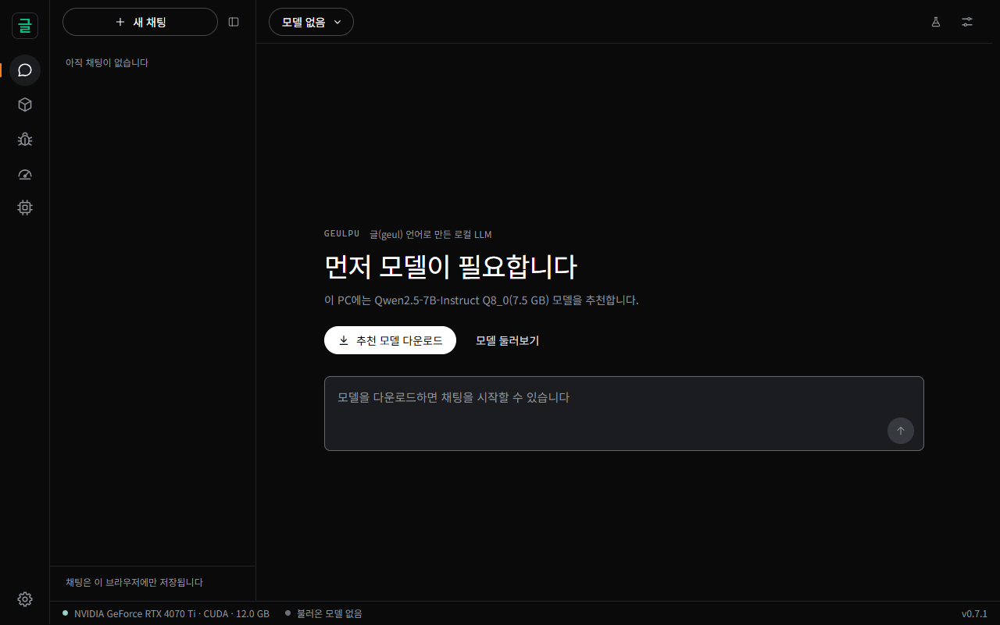
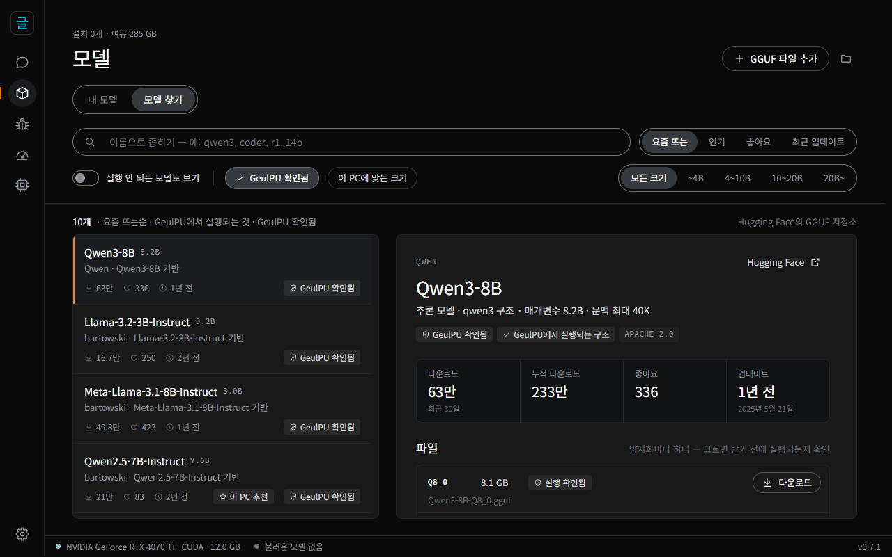
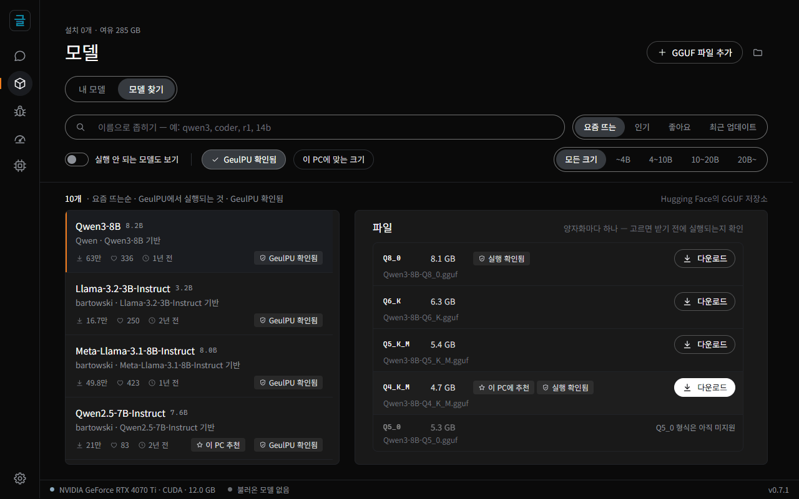
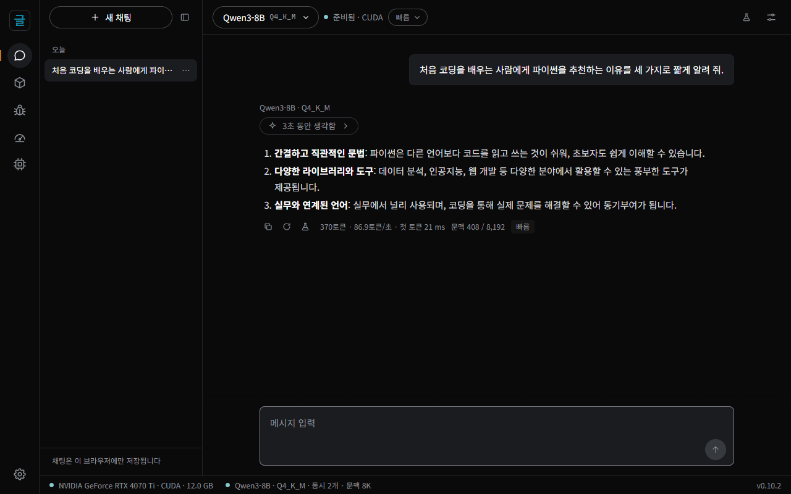
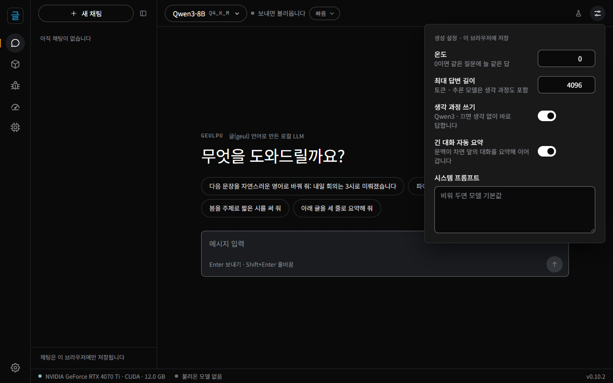
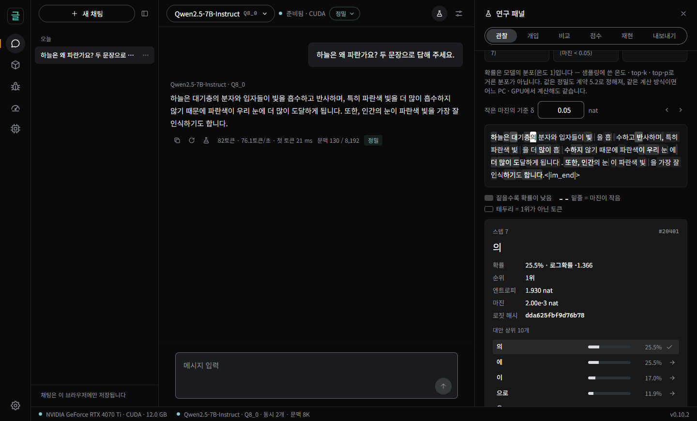
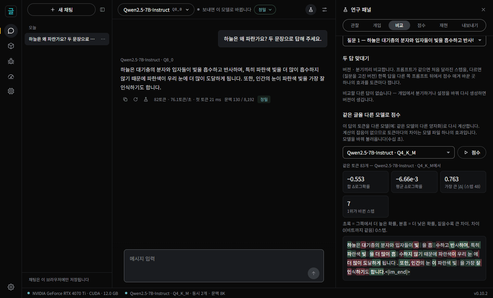
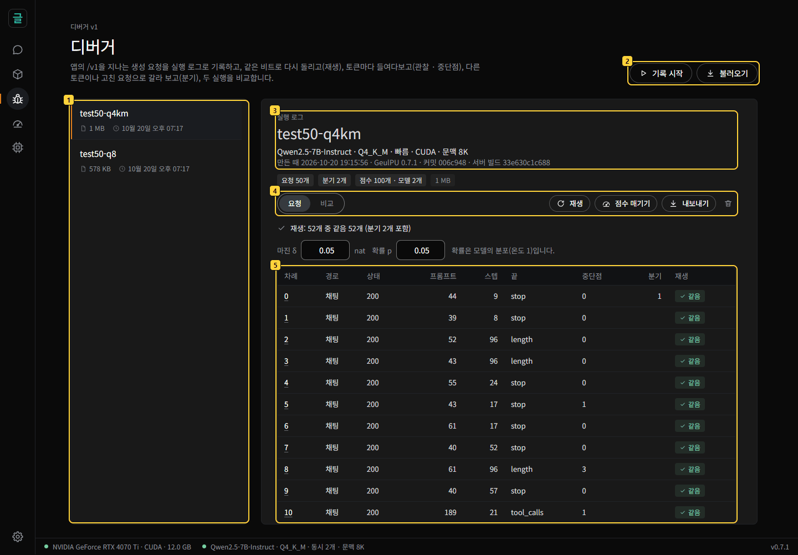
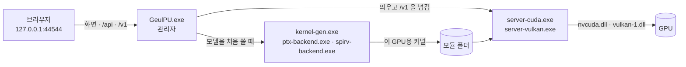

# GeulPU 사용 안내

**[English](docs/user-guide.md)** · [README](README.ko.md) · [디버거 안내서](디버거안내.md) · [연구 패널 안내서](연구자안내.md) ·
[개발](문서/개발.md) · [용어](문서/용어.md)

GeulPU를 설치하고 쓰는 데 필요한 것 — 앱 · 설정 · OpenAI 호환 API · 지원하는 모델 — 과 무엇이 다른지를 측정과 함께 담았습니다. 한눈에
보기는 [README](README.ko.md), 소스에서 빌드하기는 [개발](문서/개발.md)에 있습니다.

[설치](#설치) · [처음 쓰기](#처음-쓰기) · [지원하는 모델](#지원하는-모델) · [실행 방식](#실행-방식) · [문제 해결](#문제-해결) ·
[업데이트 · 삭제](#업데이트--삭제) · [무엇이 다른가](#무엇이-다른가)

## 설치

### 필요한 것

| | |
|---|---|
| 운영체제 | Windows 10 · 11 (64비트) |
| 그래픽카드 | NVIDIA RTX 30 시리즈 이상은 CUDA로, 그 밖의 GPU(AMD Radeon 등)는 Vulkan 1.3으로 돕니다 |
| 그래픽 메모리 | 6 GB부터(작은 모델) — 7B · 8B는 8 GB(Q4_K_M) · 12 GB(Q8_0), 14B는 12 GB 이상([아래 표](#내-pc에-맞는-모델)) |
| 디스크 | 앱 약 5 MB + 모델 하나에 2 ~ 9 GB |
| 인터넷 | 모델을 찾고 받을 때와 새 버전을 확인할 때만 |

그래픽 드라이버는 최신으로 두세요. RTX 20 · GTX 16 이하의 NVIDIA 카드는 CUDA 경로를 쓰지 못합니다(계산 능력 8.0 미만). 이때 앱은 Vulkan으로
돌 수 있는지 스스로 확인합니다. AMD는 Radeon RX 9060 XT에서 확인했습니다.

### 파이썬이 있다면 — 명령 한 줄로

zip을 받아 풀지 않고, 파이썬의 설치 도구로 받아 곧바로 실행할 수 있습니다([PyPI의 geulpu](https://pypi.org/project/geulpu/) — 릴리스
zip과 같은 앱).

```powershell
pipx install geulpu        # 또는 uv tool install geulpu · pip install geulpu
geulpu                     # 브라우저에 http://127.0.0.1:44544 가 열립니다
```

- 업데이트는 앱을 끈 뒤 `pipx upgrade geulpu`(uv는 `uv tool upgrade geulpu`, pip는 `pip install -U geulpu`)입니다. 새 버전이 나오면 앱이
  이 명령을 알려 줍니다.
- 모델 · 설정 · 결과는 zip 버전과 같은 `%USERPROFILE%\GeulPU`에 있어, 패키지를 지워도(`pipx uninstall geulpu`) 남습니다.
- `geulpu` 명령을 찾지 못하면 `python -m geulpu`로 실행합니다(pip의 사용자 설치는 명령 폴더가 PATH에 없을 수 있습니다). pipx · uv를 권합니다.

아래 1 ~ 3은 zip으로 설치하는 길입니다.

### 1. 받기

[릴리스 페이지](https://github.com/wwoosshh/GeulPUv2/releases/latest)에서 **`GeulPU-<버전>-windows-x64.zip`** 을 받습니다. 모델은 들어 있지 않아
작습니다(모델은 앱 안에서 받습니다).

받은 파일이 그대로인지 보려면(선택) 같은 페이지의 `SHA256SUMS.txt` 와 비교합니다. PowerShell에서:

```powershell
Get-FileHash .\GeulPU-*-windows-x64.zip
```

### 2. 압축 풀기

zip을 마우스 오른쪽 단추로 누르고 **모두 압축 풀기** → 원하는 폴더(예: `C:\GeulPU`)에 풉니다. 경로에 한글이 있어도 됩니다.
zip을 연 채로 그 안의 `GeulPU.exe` 를 바로 실행하지 말고, 꼭 풀어서 실행하세요.

### 3. 실행

`GeulPU.exe` 를 두 번 누릅니다.

1. **"Windows의 PC 보호"** 창이 뜨면 **추가 정보 → 실행**을 누릅니다. 코드 서명을 하지 않은 실행 파일이라 나타납니다. 릴리스 zip은
   GitHub Actions가 이 저장소의 소스로 빌드합니다([실행 방식](#실행-방식)).
2. 검은 창(콘솔)이 하나 뜹니다. 이것이 GeulPU 본체입니다 — **이 창을 닫으면 앱이 꺼집니다.**
3. 브라우저에 `http://127.0.0.1:44544` 가 열립니다. 열리지 않으면 이 주소를 주소창에 직접 입력하세요.

## 처음 쓰기

화면 왼쪽 막대의 아이콘은 위에서부터 **채팅 · 모델 · 디버거 · 벤치마크 · 하드웨어**, 맨 아래가 **설정**입니다. 모델이 하나도 없으면 처음에 이런
화면이 나옵니다. **추천 모델 다운로드**는 이 PC의 그래픽 메모리에 맞춰 고른 모델을 바로 받고, **모델 둘러보기**는 아래의 모델 찾기로 갑니다.



### 1. 모델 받기 — 모델 → 모델 찾기

- Hugging Face의 GGUF 모델이 **요즘 뜨는** 순으로 보입니다. **인기 · 좋아요 · 최근 업데이트** 순으로 바꾸거나, 위 칸에 이름(예: `qwen3`,
  `coder`, `14b`)을 넣어 좁힙니다.
- 기본으로 **GeulPU에서 실행되는 모델만** 보입니다. **실행 안 되는 모델도 보기**를 켜면 모두 보이고, 실행되지 않는 것은 흐리게 까닭과
  함께 보입니다. **이 PC에 맞는 크기**를 켜면 그래픽 메모리에 들어가는 것만 남습니다.
- 처음이라면 **GeulPU 확인됨**을 켜 보세요. GeulPU가 직접 돌려 본 파일이 있는 저장소만 남습니다(아래 그림) —
  [내 PC에 맞는 모델](#내-pc에-맞는-모델).



- 모델을 누르면 오른쪽에 설명 · 다운로드 수 · 라이선스와 **파일 목록**이 나옵니다. 이 PC에 가장 알맞은 파일에는 **이 PC에 추천**,
  GeulPU가 직접 돌려 본 파일에는 **실행 확인됨**이 붙고, 그래픽 메모리에 빠듯하거나 모자라는 파일은 그렇게 표시됩니다. 고른 파일의
  **다운로드**를 누릅니다.



- 받기 전에 파일 앞부분만 읽어 실행되는지 먼저 확인하고, 끊기면 이어서 받고, 다 받으면 SHA-256으로 확인합니다. 받는 중인 파일은
  **내 모델** 칸과 아래 상태 막대에서 보고 멈추거나 이을 수 있습니다.
- 이미 가진 GGUF 파일은 위쪽의 **GGUF 파일 추가**로 넣습니다(파일은 그 자리에 둔 채 씁니다).

### 2. 채팅하기

- 위쪽 모델 단추에서 모델을 고르고 메시지를 보냅니다(**Enter** 보내기 · **Shift+Enter** 줄바꿈).
- **처음 한 번**은 이 GPU와 모델에 맞는 커널을 만들고(빠른 CPU에서 10초 안팎, 느리면 1 ~ 3분) 모델을 그래픽 메모리에 올립니다(7B 약
  20초). 다음부터는 올리기만 합니다.
- **추론 모델**(Qwen3 · DeepSeek-R1)은 답하기 전에 생각을 씁니다. 생각은 'N초 동안 생각함'으로 접혀 있고, 눌러서 펼쳐 봅니다. 답 아래에는
  토큰 수 · 속도(토큰/초)가 나옵니다.



- **Qwen3의 생각 끄기**: 오른쪽 위 **생성 설정**(슬라이더 아이콘) → **생각 과정 쓰기**를 끄면 생각 없이 바로 답합니다.
- **생성 설정**에서 온도(0이면 같은 질문에 늘 같은 답) · 최대 답변 길이 · 시스템 프롬프트도 정합니다(이 브라우저에 저장).



- 답을 다시 생성하거나 내 메시지를 고쳐 보낼 수 있고, 앞의 답은 버전으로 남아 ‹ 1 / 2 › 로 넘겨 봅니다. 코드 · 표 · 수식(LaTeX)을
  그려 줍니다.
- **긴 대화**: 대화가 채팅마다 문맥 길이에 가까워지면 앞의 대화를 같은 모델로 요약해(최근 차례는 그대로) 오류 없이 이어 갑니다. 요약은
  대화 안에 카드로 남아 펼쳐 볼 수 있고, 요약된 앞 메시지는 흐리게 남습니다. 답 아래의 '문맥 N / L'이 쓴 양입니다. 생성 설정의
  **긴 대화 자동 요약**으로 끕니다.
- 대화는 이 브라우저에만 저장됩니다.

### 3. 벤치마크 (선택)

- **하드웨어 진단**: 메모리 대역 · 텐서 코어 성능을 재고, 커널마다 하드웨어 한계에 얼마나 가까운지 보여 줍니다.
- **속도 측정**: 프롬프트(512 · 2048 토큰)와 생성 속도(토큰/초).
- **재현성 검증**: DeepSeek-R1-Distill-Qwen-7B Q8_0으로 수학 문제 32개를 풀어 기준 PC의 출력과 비트까지 같은지 비교합니다(빠른 확인은
  문제 2개 · 64토큰).
- 결과는 zip으로 내보낼 수 있습니다(사용자 경로는 지웁니다).

### 4. 설정

GPU 백엔드(자동 · CUDA · Vulkan), Vulkan 장치, 동시 처리 수(동시에 답하는 채팅 수 1 ~ 8)와 채팅마다 문맥 길이, **계산 방식**,
**KV 캐시 8비트**, **빠른 어텐션**, **추측 디코딩**, **프롬프트 캐시**, 모델 폴더, 언어, 새 버전 알림. 바꾸면 바로 저장됩니다.

**계산 방식** — **빠름**(기본)과 **정밀** 가운데 고릅니다. 다음에 모델을 불러올 때 적용됩니다. 채팅 위 막대의 계산 방식 칩으로도
바꿉니다 — 불러온 모델을 그 방식으로 다시 불러옵니다. 답마다 그 답을 셈한 방식(빠름 · 정밀, KV 8비트 · 빠른 어텐션)이 꼬리표로 붙습니다.
- **빠름**: 행렬곱에 들어가는 활성값을 8비트(llama.cpp와 같은 급)로 셉니다. 프롬프트 처리가 정밀보다 1.3 ~ 1.6배 빠릅니다(CUDA · 7B ·
  8B). 다음 토큰 확률의 차이는 llama.cpp와 같은 급입니다([문서/2단계.md](문서/2단계.md)).
- **정밀**: 0.5.0까지의 계약 그대로(활성값 16비트 — 연구용 정밀도)입니다.
- 두 방식 모두 결과가 계약의 CPU 참조와 비트까지 같고, 같은 방식끼리는 어느 길로 계산해도 같은 비트입니다. 재현성 검증과 Vulkan
  장치는 늘 정밀로 셉니다.

**KV 캐시 8비트** — **끔**(기본) · 켬. 켜면 앞 토큰들의 키 · 값(KV 캐시)을 값 32 개마다 8비트 정수와 스케일 하나로 두고 그대로 곱합니다
(계약 F1A′ — [계약/계약.md](계약/계약.md) 2.1). KV 캐시가 0.55 배라 같은 GPU 에 더 긴 문맥이 들어가고, 긴 문맥일수록 빨라집니다 — RTX 4070 Ti
(12 GB)에서 Qwen2.5-7B Q4_K_M 의 한 채팅 문맥 87,488 → 131,072 토큰(두 채팅이면 47,808 → 80,320), Qwen3-8B 35,328 → 59,392, Llama-3.1-8B
39,936 → 66,688, 64k 토큰에서 프롬프트 22 % · 생성 19 % 빠름(짧은 문맥에서도 느려지지 않음). 다음 토큰 확률의 차이는 llama.cpp 의 q8_0 KV
캐시와 같은 급입니다. 계산 방식이 **빠름**이고 CUDA · k-양자화 모델(Q4_K_M 같은 파일)일 때만 쓰고, 그 밖에는 끔과 같습니다(Q8_0 · Q4_0
파일은 품질 기준을 넘지 못해 막습니다). 답의 비트는 16비트 KV 캐시와 다르지만 같은 설정이면 늘 같습니다 — 결과가 계약의 CPU 참조와 비트까지
같고, 디버거 · 재현 파일은 이 설정을 함께 적어 다른 설정이면 알립니다. 다음에 모델을 불러올 때 적용됩니다([문서/긴문맥.md](문서/긴문맥.md) ③b).

**빠른 어텐션** — **끔**(기본) · 켬. **KV 캐시 8비트**를 켰을 때만 쓰고, 그 밖에는 끔과 같습니다. 켜면 어텐션을 더 가벼운 꼴로 셉니다
(계약 F2 — [계약/계약.md](계약/계약.md) 2.2: 값의 스케일을 32 개마다가 아니라 헤드마다 하나, 밑 2 지수 함수, 확률은 키 64 개마다 지수 하나인
16비트 정수). 긴 프롬프트가 빨라집니다 — RTX 4070 Ti 에서 Qwen2.5-7B Q4_K_M 의 깊이 32k · 64k 새 입력 1,024 토큰이 22.6 % · 27.6 %, 빈
프롬프트 32k · 64k 가 17.2 % · 23.0 % 빠르고(Llama-3.1-8B 도 같은 급), 이 넷 모두 llama.cpp 최신(b11796)의 f16 · q8_0 KV 캐시보다 빠릅니다.
생성은 그대로이고 추측 검증 스텝은 4 ~ 6 % 빠릅니다. 다음 토큰 확률의 차이는 KV 캐시 8비트와 같은 급입니다(Qwen2.5 · Llama-3.1 · Mistral 이
품질 기준을 넘었고, Qwen3 계열은 넘지 못해 끔과 같습니다). 답의 비트는 끔과 다르지만 같은 설정이면 늘 같습니다 — 결과가 계약의 CPU 참조와
비트까지 같고, 디버거 · 재현 파일은 이 설정을 함께 적어 다른 설정이면 알립니다. 다음에 모델을 불러올 때 적용됩니다
([문서/빠른어텐션.md](문서/빠른어텐션.md)).

**추측 디코딩** — **켬**(기본) · 끔. 프롬프트와 앞의 답에서 이어질 토큰을 찾아(초안 모델 없음) 한 스텝에 여럿을 검증합니다. 이 엔진은
스텝의 행 수와 상관없이 같은 비트를 내므로 **답 · 로그확률 · 연구 패널의 값이 끈 것과 비트까지 같고**, 코드 고치기 · 문서 고쳐 쓰기 ·
요약처럼 프롬프트의 일부를 되풀이하는 답의 생성이 3.5 ~ 4 배 빨라집니다(보통 채팅 1.0 ~ 1.5 배 — [문서/3단계.md](문서/3단계.md)).
다음에 모델을 불러올 때 적용됩니다.

**프롬프트 캐시** — **기본**(저장 위치가 SSD 면 켬 · HDD 면 끔) · 켬 · 끔. 긴 프롬프트를 읽은 결과(KV)를 256 토큰 청크로 SSD 에 남겨,
같은 앞부분으로 시작하는 요청은 다시 세지 않고 복원합니다 — 앱을 다시 켠 뒤에도, 모델을 바꿨다 돌아와도, 다른 대화가 슬롯을 덮은
뒤에도. 코딩 에이전트처럼 긴 시스템 프롬프트와 대화를 되풀이해 보내는 쓰임에서 첫 토큰이 크게 줄어듭니다 — 앱을 다시 켠 뒤 새 작업의 첫
요청(15k 토큰) 3.2 초 → 0.3 초, 31k 토큰 대화를 다시 열 때 10.0 초 → 0.74 초(청크가 OS 파일 캐시에 없는 재부팅 뒤라면 0.52 초 · 1.1 초 —
Qwen2.5-7B · RTX 4070 Ti). 이 엔진은 어느 길로 채운 KV 든 바이트까지 같아 **답 · 로그확률 · 연구 패널의 값이 끈 것과 비트까지 같습니다.** 청크는
모델 파일의 SHA-256 으로 구분하며, 같은 경로의 파일을 바꾸면(크기나 수정 시각이 달라지면) 다음에 불러올 때 SHA-256 을 다시 계산합니다. 위치(기본
데이터 폴더\문맥저장소), 크기 한도(기본 20 GB — 넘으면 가장 오래 쓰지 않은 것부터 지움), 쓰기 방식(모두 · 비울 때만 · 읽기만)과 **프롬프트 캐시
지우기**도 여기 있습니다. 저장된 청크는 대화에서 나온 값이니 함께 쓰는 PC 라면 끄거나 지우세요. 다음에 모델을 불러올 때 적용됩니다
([문서/문맥저장소.md](문서/문맥저장소.md)).

**언어** — 화면은 브라우저 언어를 따릅니다(한국어가 아니면 영어). **설정 → 언어 · Language**에서 자동 · 한국어 · English를 고를 수 있고,
고른 값은 이 브라우저에 저장됩니다.

### 5. 연구 패널 — 토큰마다 확률 · 개입 · 비교 · 재현

GeulPU의 계산은 계약으로 정해져 있어서, 같은 글을 다시 계산하면 생성할 때와 **같은 비트**의 확률이 나옵니다 — 함께 도는 요청 수 · 캐시 ·
GPU · 백엔드(CUDA · Vulkan)와 상관없이(같은 계산 방식에서 — Vulkan은 늘 정밀이라, CUDA와 비교할 때는 설정의 계산 방식을 정밀로). 그래서 두
실행의 차이는 바꾼 것에서만 나옵니다. 채팅 위쪽의 플라스크 단추나 답 아래의 플라스크로
엽니다(이 버전에서 받은 답부터 — 연구 기록은 이 브라우저에만).

**처음이면 [연구 패널 안내서](연구자안내.md)부터** — 실험 일곱(망설인 스텝 · 거기서 분기 · 두 답 비교 · 양자화의 효과 · 단어 하나의
효과 · 글의 점수 · 재현 파일)을 화면 그림과 함께 따라 하고, 숫자 읽는 법과 API 예시까지 담았습니다.

- **관찰** — 답을 토큰으로: 토큰마다 확률 · 순위 · 대안 상위 10 · 엔트로피 · 1위와 2위의 차(마진). 마진이 작은 스텝(마진 < δ — 계산이나
  설정이 조금만 달라도 다른 토큰이 될 자리)과 1위가 아닌 토큰을 샘플링한 스텝을 표시합니다. 답의 헤더에는 프롬프트를 어디서 다시 썼는지(이
  슬롯 · 다른 슬롯 · 프롬프트 캐시)와 **캐시가 끊긴 위치**(몇 번째 토큰 · 그 앞 글 · 이전 → 이번 토큰)가 나옵니다 — 에이전트가 프롬프트
  앞쪽에 매번 바뀌는 것(시각 · 작업 폴더 경로 등)을 넣으면 거기서 깨지는 것이 보입니다
  ([안내서 — 프롬프트 캐시는 어디서 끊겼나](연구자안내.md#프롬프트-캐시는-어디서-끊겼나)).
- **개입** — 어느 스텝에서 대안 토큰을 골라 **거기서 분기**: 같은 설정 · 같은 시드 · 같은 스텝 번호의 난수로 이어 생성해서 바뀐 것은 고른
  토큰 하나뿐입니다. 온도 · 시드 · 최대 길이만 바꿔 다시 생성할 수도 있습니다. 새 답은 버전으로 남습니다.
- **비교** — 두 답(버전 · 분기)의 처음 갈린 스텝. 질문을 고친 버전이면 같은 답 토큰을 다른 프롬프트로 점수 매겨 토큰마다의 차를,
  같은 글을 다른 모델(예: 같은 모델의 Q8_0 ↔ Q4_K_M)로 점수 매겨 양자화 하나의 효과를 봅니다.
- **점수** — 글을 붙여 넣으면 토큰마다 로그확률과 퍼플렉시티.
- **재현** — 지문(SHA-256 — 계산 방법은 [계약](계약/계약.md) 5.2), 캐시 없이 다시 돌려 확인, **재현 파일**(요청 · 결과 · 로그확률 · 로짓 해시를 JSON 하나로) 내보내기와 불러와
  확인, 엔진 바이너리 · 커널의 해시.
- **내보내기** — 보이는 값 모두 JSON · CSV, 같은 값을 받는 파이썬 코드.

확률은 모델의 분포(온도 1)입니다 — 샘플링에 쓴 온도 · top-k · top-p로 거른 분포가 아닙니다. 패널은 들여다볼 때만 계산하므로 채팅 속도는
그대로입니다.





받은 재현 파일은 GPU 없이도 확인합니다 — 저장소를 받아 가상 환경(venv)에 numpy 를 깔고(`python -m venv .venv` → `.venv/Scripts/pip install numpy` —
`python -I` 는 `pip install --user` 로 깐 패키지를 보지 않습니다) `.venv/Scripts/python -I 도구/repro_check.py <재현 파일.json> <모델.gguf>` 를 실행하면
계약의 CPU 참조 구현이 같은 토큰 · 로짓 해시 · 로그확률을 내는지 봅니다(7B는 몇 분). 재현 파일에는 계산 방식이 적혀 있어 그 방식으로
확인합니다.

### 6. 디버거 — 실행 기록 · 재생 · 분기 · 비교

연구 패널이 답 하나를 들여다본다면, **디버거**(왼쪽 레일의 벌레 단추)는 **실행** — 에이전트 세션이나 테스트 세트처럼 요청 여럿 — 을
다룹니다. 로컬 모델을 만들거나 쓰는 사람이 실행을 같은 비트로 다시 돌리며 어디서 왜 달라졌는지 찾는 도구입니다(0.7.0부터).

**처음이면 [디버거 안내서](디버거안내.md)부터** — 테스트 세트 하나로 기록 · 재생 · 관찰 · 분기 · 비교 · 내보내기와 불러오기를 화면
그림과 함께 따라 하고, 스크립트(`도구/debugger.py`) · API · 실행 로그 형식 · 드는 시간까지 담았습니다.

- **기록** — **기록 시작**을 누르면 앱의 `/v1`을 지나는 생성 요청(에이전트 · 스크립트 · 채팅)이 실행 로그(run log, JSONL)에 한 줄씩
  남습니다 — 요청 · 응답과 시드 · 프롬프트 토큰 · 스텝마다 로짓 해시. 테스트 세트(JSONL)를 실행 하나로 돌릴 수도 있습니다. 기록이 늘리는
  시간은 0.35 %입니다.
- **재생**(replay) — 기록한 요청과 분기를 같은 시드로 다시 보내 토큰과 스텝마다 로짓 해시까지 비교합니다. 같은 버전 · 같은 모델 파일 ·
  같은 계산 방식이면 다른 PC에서도 비트까지 같습니다.
- **관찰 · 중단점**(breakpoint) — 요청마다 토큰마다 확률 · 대안 · 마진(echo 스코어링 — 생성과 같은 비트). 마진이 작은 스텝 · 저확률
  샘플 · 도구 호출의 시작을 중단점으로 찾습니다.
- **분기**(branch) — 어느 스텝에서 대안 토큰으로, 또는 요청(도구 결과 · 시스템 프롬프트 · 설정)을 고쳐 다시 생성합니다. 같은 시드 ·
  같은 난수라 차이는 바꾼 것 하나에서만 나옵니다.
- **비교** — 같은 요청열을 다른 모델 파일 · 양자화 · 설정 · 버전으로 돌린 두 실행을 요청마다: 같은 답인가 · 처음 갈라진 스텝 · 같은 답을
  두 모델로 점수 매긴 로그확률의 차.
- **내보내기 · 불러오기** — 실행 로그 파일 하나로 다른 PC에 옮겨 재생하고, GPU 없이 정밀도 계약의 CPU 참조로 확인합니다
  (`도구/repro_check.py`).



### 다른 프로그램에서 쓰기 (OpenAI 호환 API)

앱에서 모델을 불러온 상태(채팅을 한 번 보내면 불러옵니다)에서 `http://127.0.0.1:44544/v1` 을 OpenAI 호환 주소로 씁니다. `model` 값은
아무 이름이나 됩니다(지금 불러온 모델이 답합니다). 응답의 `model` 도 보낸 이름 그대로이니, 어느 모델이 답했는지는 `/v1/models` 로 봅니다.

PowerShell 창에 붙여 넣어 실행합니다(한글이 깨지지 않게 응답을 UTF-8로 읽습니다 — `.ps1` 파일로 저장하려면 'UTF-8(BOM)'으로).

```powershell
$body = @{ messages = @(@{ role = 'user'; content = '안녕하세요' }) } | ConvertTo-Json -Depth 4
$r = Invoke-WebRequest -Uri http://127.0.0.1:44544/v1/chat/completions -Method Post -ContentType 'application/json; charset=utf-8' -Body ([Text.Encoding]::UTF8.GetBytes($body)) -UseBasicParsing
([Text.Encoding]::UTF8.GetString($r.RawContentStream.ToArray()) | ConvertFrom-Json).choices[0].message.content
```

```python
from openai import OpenAI   # pip install openai
client = OpenAI(base_url="http://127.0.0.1:44544/v1", api_key="geulpu")   # 키는 아무 글자나
r = client.chat.completions.create(model="geulpu", messages=[{"role": "user", "content": "안녕하세요"}])
print(r.choices[0].message.content)
```

- Qwen3의 생각을 끄려면 요청에 `"chat_template_kwargs": {"enable_thinking": false}` 를 넣습니다(Python은 `extra_body=` 로).
- Qwen3 · DeepSeek-R1의 생각은 기본으로 태그 없이 답 앞에 붙어 옵니다. 요청에 `"geulpu": {"special": true}` 를 넣으면 `<think>` ·
  `</think>` 가 글로 와서 생각과 답을 나눌 수 있습니다. 도구(`tools`)를 보낸 요청이면 Qwen3의 생각은 `reasoning_content` 로 따로 옵니다.
- 이 PC 안에서만 접속되고 인증은 없습니다. 다른 웹사이트가 브라우저를 통해 보내는 요청은 막습니다.
- `/v1/chat/completions` 는 Qwen2.5 · Qwen3 · Llama 3(3.1 · 3.2) · Mistral(v0.3)의 채팅 템플릿을 씁니다. DeepSeek-R1은 아직 `/v1/completions` 에
  R1의 채팅 템플릿을 직접 넣어 씁니다.
- Llama 3의 채팅 템플릿은 시스템 헤더에 날짜를 넣습니다 — 같은 질문이 날마다 다른 프롬프트가 되지 않게 `26 Jul 2024`로 고정하고, 요청의
  `"chat_template_kwargs": {"date_string": "16 Oct 2026"}` 로 바꿉니다. Mistral의 채팅 템플릿에는 시스템 역할이 없어 시스템 말은 첫 질문 앞에
  `{시스템}\n\n` 으로 붙입니다(llama.cpp와 같은 방식).
- Llama 3 · Mistral은 글 프롬프트(`/v1/completions` 의 글 · `/tokenize` 의 `prompt`)에 BOS를 앞에 붙입니다(llama.cpp · vLLM과 같이 —
  `/tokenize` 는 `"add_special_tokens": false` 면 붙이지 않음). 토큰 번호 프롬프트는 그대로 씁니다.

**코딩 에이전트에 연결하기(도구 · tools)** — Qwen Code · OpenCode · Continue · Cline처럼 OpenAI 호환 API로 도구(파일 읽기 · 쓰기 ·
명령 실행)를 부르는 에이전트를 붙일 수 있습니다.

- 주소는 `http://127.0.0.1:44544/v1`, API 키는 아무 글자, 모델 이름은 아무거나 됩니다(앱에서 불러 둔 모델이 답합니다 — 에이전트를
  쓰기 전에 앱에서 모델을 불러 두세요).
- 도구를 받는 모델: Qwen2.5(7B · 14B · Coder) · Qwen3 · Llama 3.1 · 3.2. 도구를 낀 프롬프트는 모델 파일의 공식 채팅 템플릿과 토큰까지
  같습니다. Mistral · DeepSeek-R1은 모델 파일의 채팅 템플릿에 도구가 없어 받지 않습니다(400).
- 시험에서는 Qwen2.5-7B · Qwen3-8B가 일을 끝까지 해냈고, Llama 3.x는 도구 결과를 받은 뒤에도 같은 호출을 되풀이할 때가 있었습니다 —
  에이전트에는 Qwen을 권합니다. `tool_choice` 는 `auto`(기본) · `none` 만 받습니다.
- **문맥은 클수록 좋습니다.** 에이전트의 기본 지시문만 1만 ~ 1만 5천 토큰이고(Qwen Code 14,501), 일할수록 늘어납니다. 기능 단위
  개발(예: 로그인 기능을 계획 · 검토 · 구현 · 보고)까지 압축 없이 하려면 100k 토큰 이상이 목표입니다. 설정에서 동시 처리 수를 1로,
  '채팅마다 문맥 길이'를 크게(예: 131072) 두면 엔진이 모델의 최대와 그래픽 메모리에 맞춰 줄입니다. Qwen2.5 7B 이상 · Qwen3 은 문맥이
  모델 파일의 위치 수(32,768 · 40,960)를 넘으면 **YaRN**(Qwen 이 권하는 위치 늘이기 — 배 2 · 4)을 켜 131,072 까지 받습니다 — 모델 목록의
  문맥 옆에 'YaRN' 이 보입니다. 배는 설정한 문맥으로 정하므로(65,536 까지 2, 그 위 4), 그래픽 메모리에 맞춰 문맥을 줄여도 바뀌지 않아 같은
  설정이면 늘 같은 비트입니다. 위치 수가 32,768 보다 작은 파일은 늘이지 않습니다. 늘인 문맥에서는 짧은 글도 같은 식으로 계산하므로(정적
  YaRN — 다른 엔진과 같음) 긴 글이 필요할 때만 문맥을 크게 두세요([문서/긴문맥.md](문서/긴문맥.md)). RTX 4070 Ti(12 GB)에서 된 최대:

  | 모델 | 최대 문맥 | 한계 |
  |---|---|---|
  | Qwen2.5-7B Q4_K_M | 87,488(YaRN — 동시 처리 2 면 47,808) | 그래픽 메모리 |
  | Qwen2.5-7B · Coder-7B Q8_0 | 38,784(YaRN) | 그래픽 메모리 |
  | Qwen3-8B Q4_K_M | 35,328 | 그래픽 메모리 |
  | Llama-3.1-8B Q4_K_M | 39,936 | 그래픽 메모리 |
  | Llama-3.2-3B Q8_0 | 57,984 | 그래픽 메모리 |
  | Qwen2.5-14B Q4_K_M | 8,448 | 그래픽 메모리 |

- 문맥이 넘치면 서버가 OpenAI 호환 오류(`code: context_length_exceeded`, 토큰 수 포함)로 알려 에이전트가 스스로 대화를 줄입니다.
  `/v1/models` 의 `max_model_len` 이 지금 문맥입니다.
- 예(Qwen Code): 환경 변수 `OPENAI_BASE_URL=http://127.0.0.1:44544/v1` · `OPENAI_API_KEY=geulpu` · `OPENAI_MODEL=qwen2.5-7b-instruct-q4_k_m`
  을 두고 작업 폴더에서 `qwen` 을 실행합니다.

**로그확률 · 점수 매기기 · 토큰화(연구용)** — 연구 패널의 값은 모두 API로도 받습니다. 값은 계약 5.2([계약](계약/계약.md))로 정해져 어느
PC · GPU에서든 같은 비트입니다.

- `/v1/chat/completions`: `"logprobs": true, "top_logprobs": 5`(0 ~ 20) — OpenAI 호환(`token` · `logprob` · `bytes` · `top_logprobs`).
- `/v1/completions`: `"logprobs": 5`, `"echo": true`(프롬프트 토큰의 로그확률까지), `"max_tokens": 0`(생성 없이 점수만). `prompt` 는 글이나
  토큰 번호 배열.
- `"geulpu"` 확장 필드: `"logit_hash": true`(스텝마다 로짓 행의 64비트 해시), `"prompt_tokens": true`(채팅 템플릿을 씌운 프롬프트 토큰),
  `"echo_from": n`(echo 의 로그확률을 번호 n 인 토큰부터 — 0부터 센다, 앞은 null), `"step_offset": n`(샘플링 난수의 스텝 번호를 n 부터 —
  분기가 원래 답의 뒤 스텝과 같은 난수로 잇는다), 응답의 `entropy` · `top_ids` · `top_logprobs`(번호와 나란히) · `seed`.
- `/tokenize` · `/detokenize` · `/tokenizer_info` — vLLM과 같은 형식.
- `geulpu` 의 `tokens` · `logit_hashes` 는 멈춘 토큰(EOS)을 샘플링한 스텝까지 담고, 로그확률 배열(`logprobs` · `entropy` · `top_ids` ·
  `top_logprobs`)은 OpenAI처럼 답 글의 토큰만 담습니다 — 답이 EOS로 끝나면 하나 짧습니다(EOS 스텝의 확률은 `tokens` 를 echo로 점수
  매겨 받습니다). `first_token_ms` 는 이름과 달리 µs입니다(호환을 위해 그대로).
- 생성 중 로그확률을 물으면 토큰당 시간이 약 2% 늘어납니다(7B · 8B — 계산을 다음 스텝의 GPU 계산 뒤에 숨긴다). 묻지 않으면 그대로입니다.

```python
# 글의 토큰마다 로그확률(점수 매기기) — 첫 토큰은 앞 맥락이 없어 null
r = client.completions.create(model="geulpu", prompt="The capital of France is Paris.", echo=True, max_tokens=0, logprobs=5)
print(list(zip(r.choices[0].logprobs.tokens, r.choices[0].logprobs.token_logprobs)))
```

**lm-evaluation-harness** — `local-completions` 로 그대로 붙습니다. 토크나이저는 서버의 것을 써서(`tokenizer_backend=remote`) Hugging Face
토크나이저를 받지 않습니다. 문항마다의 결과는 `num_concurrent` · 동시 처리 수 · CUDA ↔ Vulkan과 상관없이 같은 비트입니다
([38단계](https://github.com/wwoosshh/GeulPU/blob/main/문서/38단계.md)). 동시 처리 수는 **설정**에서 올립니다(최대 8).

```bash
pip install "lm-eval[api]"
lm_eval --model local-completions --tasks arc_easy,gsm8k --model_args model=geulpu,base_url=http://127.0.0.1:44544/v1/completions,tokenizer_backend=remote,tokenized_requests=True,num_concurrent=8
```

## 지원하는 모델

GGUF 파일 하나를 받습니다(여러 조각으로 나뉜 파일은 llama.cpp의 `llama-gguf-split --merge` 로 합쳐서).

| 구조 | 모델 | 크기 |
|---|---|---|
| qwen2 | Qwen2.5-Instruct · Qwen2.5-Coder · DeepSeek-R1-Distill-Qwen과 그 미세조정 모델 | 1.5B 이상(헤드 크기 128) — 7B · 14B를 돌려 봄 |
| qwen3 | Qwen3와 그 미세조정 모델 | 1.7B · 8B · 14B |
| llama | Llama 3.1 · 3.2 Instruct, Mistral 7B Instruct v0.3, 같은 채팅 템플릿을 쓰는 그 미세조정 모델 | 3B · 7B · 8B — 70B는 모양을 합성 모델로 |

- **형식**: Q8_0 · Q4_K_M · Q5_K_M · Q6_K, 그리고 모든 텐서가 Q4_0인 Q4_0 파일.
- **라이선스**: 모델마다 다릅니다. 앱 목록의 Llama 3.1 · 3.2는 Meta의 커뮤니티 라이선스(사용 조건 · 이용 정책 — 월 사용자 7억 명이
  넘는 서비스는 Meta의 허가가 필요), Mistral 7B v0.3 · Qwen2.5 · Qwen3 파일은 Apache 2.0, DeepSeek-R1-Distill은 MIT입니다(앱의 모델 설명에도).
- **아직 안 되는 것**: Gemma · Phi 같은 다른 구조, 질의 폭이 너비와 다른 모델(Qwen3의 0.6B · 4B · 32B, Mistral NeMo), 헤드 크기가 64인
  작은 모델(Qwen2.5-0.5B · Llama 3.2 1B), MoE(Mixtral · Qwen3-30B-A3B 등), Llama 3 · Mistral과 다른 채팅 템플릿(ChatML 등)을 쓰는 llama
  구조 미세조정, 이미지 입력, Q2_K · Q3_K · IQ · Q5_0 · F16 · BF16. 모델 찾기는 이런 파일을 기본으로 숨깁니다.
- **GPU에 따라**: k-양자화(Q4_K_M 등)는 CUDA와, 공유 메모리가 48 KB 이상인 Vulkan GPU에서 돕니다. 윈도의 AMD 드라이버(공유 메모리
  32 KB)에서는 지금 Q8_0(과 Q4_0) 파일만 돕니다.

### 내 PC에 맞는 모델

GeulPU가 직접 돌려 본 파일입니다(앱의 **GeulPU 확인됨**). 크기는 윈도 탐색기와 같은 1024 단위입니다.

| 그래픽 메모리 | 권하는 파일 |
|---|---|
| 6 GB | Qwen3-1.7B Q8_0 (1.7 GB) · Llama-3.2-3B-Instruct Q8_0 (3.2 GB) |
| 8 GB | Qwen3-8B Q4_K_M (4.7 GB) · Qwen2.5-7B-Instruct Q4_K_M (4.4 GB) · DeepSeek-R1-Distill-Qwen-7B Q4_K_M (4.4 GB) · Llama-3.1-8B-Instruct Q4_K_M (4.6 GB) · Mistral-7B-Instruct-v0.3 Q4_K_M (4.1 GB) |
| 12 GB | Qwen3-8B Q8_0 (8.1 GB) · Qwen2.5-7B-Instruct Q8_0 · Qwen2.5-Coder-7B-Instruct Q8_0 · DeepSeek-R1-Distill-Qwen-7B Q8_0 (7.5 GB) · Llama-3.1-8B-Instruct Q8_0 (8.0 GB) · Mistral-7B-Instruct-v0.3 Q8_0 (7.2 GB) — 14B Q4_K_M도 문맥을 줄여 돕니다 |
| 16 GB 이상 | Qwen2.5-14B-Instruct Q4_K_M · DeepSeek-R1-Distill-Qwen-14B Q4_K_M (8.4 GB) |

Qwen3-14B Q4_K_M은 같은 모양의 합성 모델로 출력이 비트까지 맞는지만 확인했고 아직 돌려 보지 않았습니다. 앱은 파일마다 이 PC의 그래픽
메모리에 맞는지 미리 알려 줍니다.

## 실행 방식



1. **관리자**(`GeulPU.exe`)가 `127.0.0.1:44544` 에서 화면을 열고 브라우저를 띄웁니다. 이 PC 안에서만 들리고, 같은 포트에 이미 떠 있으면
   그 화면을 엽니다. 44544는 '글'의 유니코드 번호(U+AE00)입니다.
2. 처음에 GPU를 확인합니다 — NVIDIA RTX 30 이상이면 CUDA(`nvcuda.dll`), 아니면 Vulkan(`vulkan-1.dll`). 설정에서 바꿀 수 있습니다.
3. 모델을 처음 쓸 때 **커널을 만듭니다**. 커널 생성기(`kernel-gen.exe`)가 그 모델의 구조 · 모양 · 형식에 맞는 GPU 커널 소스를 글(geul)로
   쓰고, 글 컴파일러의 백엔드(`ptx-backend.exe` · `spirv-backend.exe`)이 그것을 PTX(NVIDIA) · SPIR-V(Vulkan)로 바꿔 데이터 폴더에 둡니다.
   앱 버전마다 한 번입니다.
4. **추론 서버**(`server-cuda.exe` · `server-vulkan.exe`)가 GGUF를 그래픽 메모리에 올리고, 그 커널을 그래픽 드라이버로 바로 돌립니다.
   CUDA 툴킷 · 런타임 · Python이 필요 없습니다.
5. 채팅은 브라우저 → 관리자 → 추론 서버(OpenAI 호환 API)로 가고, 답은 토큰마다 흘러 돌아옵니다.
6. 검은 창을 닫으면 관리자와 그 아래 프로세스(서버 · 도구)가 함께 꺼집니다.

관리자 · 추론 서버 · 커널 생성기 · 백엔드 모두 글(geul)로 썼고, 가져오는 것은 윈도의 DLL(관리자: kernel32 · ws2_32 · shell32 · winhttp ·
bcrypt · advapi32)과 그래픽 드라이버의 DLL뿐입니다.

**zip 안**

| 파일 | 하는 일 |
|---|---|
| `GeulPU.exe` | 관리자 — 화면, 모델 받기 · 확인, 서버와 도구 띄우기 |
| `bin\server-cuda.exe` · `bin\server-vulkan.exe` | 추론 서버(OpenAI 호환 HTTP API) |
| `bin\kernel-gen.exe` | 커널 생성기 — 모델 모양에 맞는 커널 소스(글) |
| `bin\ptx-backend.exe` · `bin\spirv-backend.exe` | 글 컴파일러의 백엔드 — 커널을 PTX · SPIR-V로 |
| `bin\device-*.exe` · `bin\diag-*.exe` · `kernels\` | GPU 확인 · 하드웨어 진단 |
| `web\` | 화면(HTML · CSS · JavaScript) |
| `data\` | 받을 수 있는 모델 목록 · 재현성 검증 기준 |
| `version.json` | 버전 · 커밋 · 파일마다 SHA-256 |

**데이터 폴더** — `%USERPROFILE%\GeulPU` (버전을 바꿔도 그대로 남습니다)

| | |
|---|---|
| `모델\` | 받은 모델(GGUF) |
| `모듈\<버전>\` | 이 GPU에 맞춰 만든 커널 |
| `결과\` | 벤치마크 결과 |
| `기록\` | 서버 · 작업 기록 — 문제가 생기면 여기를 봅니다 |
| `설정.json` · `모델목록.json` · `허깅목록.json` | 설정 · 내 모델 목록 · Hugging Face에서 고른 파일 |

데이터 폴더를 옮기려면 환경 변수 `GEULPU_HOME` 을 두거나 `GeulPU.exe --자료 <폴더>` 로 실행합니다. 그 밖의 실행 옵션은
`--포트 <번호>`(다른 포트) · `--열지않음`(브라우저를 띄우지 않음)입니다.

**네트워크 · 개인정보**

- 관리자와 추론 서버는 `127.0.0.1` 에서만 듣습니다 — 다른 기기에서는 접속할 수 없습니다.
- 인터넷은 세 곳에만 씁니다: 모델 찾기(화면이 Hugging Face API를 직접 읽음), 모델 받기(huggingface.co), 새 버전 확인(GitHub — 설정의 새 버전
  알림으로 끔).
- 사용 통계를 보내지 않습니다. 대화는 브라우저의 저장소에만 남습니다.
- 설치 프로그램이 없고 레지스트리에 쓰지 않습니다.

**빌드 · 신뢰**: 릴리스 zip은 태그를 밀면 GitHub Actions가 이 저장소의 소스로 빌드합니다(`앱/꾸리기.ps1` — 글 컴파일러를 고정점까지 빌드한
뒤 백엔드 · 서버 · 도구 · 관리자). 서버 · 생성기 · 백엔드는 재현성 검증 기준(`교차검증/expected.json`)의 빌드 해시와 같은 바이트인지 확인한 뒤에야
꾸립니다.

## 문제 해결

| 증상 | 할 일 |
|---|---|
| 브라우저가 열리지 않음 | 주소창에 `http://127.0.0.1:44544` 를 직접 입력합니다. |
| "Windows의 PC 보호" | **추가 정보 → 실행**(서명하지 않은 실행 파일). |
| 백신이 실행을 막음 | 풀어 둔 GeulPU 폴더를 예외로 둡니다. 소스와 빌드 과정은 이 저장소에 공개되어 있습니다. |
| 포트 44544를 다른 프로그램이 씀 | `GeulPU.exe --포트 44600` 처럼 다른 포트로 실행합니다. |
| "쓸 수 있는 GPU 없음" | 그래픽 드라이버를 최신으로 올린 뒤 **하드웨어 → 다시 확인**. |
| "이 GPU 미지원" · "그래픽 메모리 부족" | 더 작은 파일(Q4_K_M)이나 작은 모델을 고릅니다. 설정에서 채팅마다 문맥 길이나 동시 처리 수를 줄이면 메모리가 덜 듭니다. |
| 첫 메시지가 오래 걸림 | 처음 한 번은 커널을 만듭니다(1 ~ 3분). 다음부터는 모델을 올리는 시간(수십 초)만 듭니다. |
| 다운로드가 멈춤 | **내 모델** 또는 상태 막대에서 **이어서 다운로드** — 받은 데부터 잇습니다. |
| 그 밖 | `%USERPROFILE%\GeulPU\기록\` 의 기록과 함께 [이슈](https://github.com/wwoosshh/GeulPUv2/issues)를 남겨 주세요. |

## 업데이트 · 삭제

- **새 버전**: 앱 화면이 GitHub의 새 릴리스를 알려 줍니다. 앱을 끄고 새 zip을 풀어 그 `GeulPU.exe` 를 실행하면 됩니다. 모델 · 설정 · 결과는
  데이터 폴더에 그대로 있어 다시 받지 않습니다(커널만 새 버전에 맞춰 한 번 다시 만듭니다). 바뀐 것은 [바뀐것.md](문서/바뀐것.md).
- **삭제**: 앱을 끄고 GeulPU 폴더를 지웁니다. 받은 모델까지 지우려면 `%USERPROFILE%\GeulPU` 도 지웁니다.
- **파이썬 설치 도구로 깐 경우**: 업데이트는 앱을 끈 뒤 `pipx upgrade geulpu`(`uv tool upgrade geulpu` · `pip install -U geulpu`),
  삭제는 `pipx uninstall geulpu`(`uv tool uninstall geulpu` · `pip uninstall geulpu`) — 데이터 폴더는 남습니다.

## 무엇이 다른가

- **정밀도를 계약으로 밝힌다.** 활성값은 32 개 블록마다 정수 — 정밀 모드는 자리 둘(±2¹⁴), 빠른 모드(기본 — [2단계](문서/2단계.md))는
  행렬곱에 들어가는 활성값만 자리 하나(8 비트) —, KV 캐시는 자리 둘 블록 정수, 곱의 합은 정수 텐서 코어의 정확한 합, 지수 함수는 적어 둔
  다항식(적힌지수). 그래서 두 모드 모두 GPU 의 결과가 CPU 참조 구현([계약/정수계약.py](계약/정수계약.py))과 **비트까지** 같다. 손실은
  모델 파일의 형식(Q8_0 · Q4_0 · k-양자화)과 이 계약이 밝힌 만큼뿐이다.
- **어느 길로 계산해도 같은 비트.** 프롬프트를 한 번에 넣든, 나눠 넣든, 하나씩 넣든, 대화로 이어 가든, 여러 문장을 묶든 결과가 같다.
  흔한 엔진(llama.cpp · PyTorch)은 함께 계산하는 양에 따라 결과 비트가 바뀐다. 퍼플렉시티(wikitext-2)도 llama.cpp 는 배치 설정에 따라
  15.8171 ~ 15.8200 으로 바뀌고, 글은 어느 방식으로 넣어도 마지막 비트까지 같다([20단계](https://github.com/wwoosshh/GeulPU/blob/main/문서/20단계.md)). GPU 가 달라도 같다:
  RTX 3080 Ti(Ampere) · RTX 4070 Ti(Ada) · RTX 5070(Blackwell)이 DeepSeek-R1-Distill-Qwen-7B 로 푼 수학 문제 32 개에서 출력과 82,673 스텝의
  로짓까지 비트가 같았고, 회사가 다른 AMD Radeon RX 9060 XT(RDNA4 · Vulkan — 두 PC, 드라이버 두 버전)도 NVIDIA 의 CUDA 기준과 82,673 스텝 모두 같았다(같은 조건에서 llama.cpp 는 한 PC 안에서 함께 도는 요청 수만 바꿔도 32 문제의 출력이 모두 갈렸다 — [교차검증](교차검증/)).
  평가 도구도 같다: lm-evaluation-harness 의 문항마다 결과(arc_easy 500 · gsm8k 100)가 동시 요청 1 ↔ 8 · CUDA ↔ Vulkan 에서 모두 같았다
  (같은 설정에서 llama.cpp b11643 은 gsm8k 100 문항 중 41 문항의 생성 글이 동시 요청 수에 따라 달랐다 — [38단계](https://github.com/wwoosshh/GeulPU/blob/main/문서/38단계.md)).
- **추측 디코딩을 켜도 같은 답.** 위의 성질 덕에 검증 스텝(행 여럿)의 로짓이 하나씩 계산한 로짓과 비트까지 같아, 탐욕은 물론 샘플링
  (스텝 번호로 정한 난수)도 같은 토큰을 낸다 — 추측을 켜도 끈 것과 토큰 · 스텝마다 로짓 해시 · 로그확률이 같다(시험: 요청 열일곱 × 맞는 ·
  틀린 · 반쯤 틀린 초안, 슬롯 넷 동시, CUDA · Vulkan — [3단계](문서/3단계.md)). 같은 측정에서 llama.cpp b11721 의 llama-server 는
  `--spec-type ngram-simple` 을 켜자 같은 탐욕 요청 여덟 중 둘(요약 · 수학)의 답이 추측 없음과 달랐다.
- **프롬프트 캐시를 켜도 같은 답.** SSD 에서 복원한 KV 가 다시 계산한 KV 와 바이트까지 같아(계약 — 어느 길로 채운 KV 든 같다), 프롬프트 캐시를 켜도
  끈 것과 토큰 · 스텝마다 로짓 해시가 같다. 시험: 녹화한 Qwen Code 요청 54 개를 다시 계산 · 프롬프트 캐시 끔 · 빈 프롬프트 캐시 · 서버를 다시 켠 뒤 · 슬롯
  하나로 대화를 번갈아 · 망가뜨린 청크 40 개로 보내 1,728 스텝이 모두 같았고, CUDA 가 쓴 청크를 Vulkan 서버가 읽어도 같았다. 기록한
  답의 길이만큼 생성한 재생(19,552 스텝), 새 작업 · 31k 대화 다시 열기 · 되감기(OS 캐시 · 차가운 SSD), 슬롯보다 대화가 많을 때의 전환도
  모두 같았다([문서/문맥저장소.md](문서/문맥저장소.md)).
- **정밀 모드의 숨은 손실이 작다 — 0.5B 에서 잰 값.** Qwen2.5-0.5B-Instruct(Q8_0)의 숨은 손실(같은 가중치의 fp64 참값 대비 KL)이 llama.cpp 의
  1/615(평가글 461 토큰) · 1/385(wikitext-2 148,920 토큰)다. 퍼플렉시티로 보면 글은 참값과 구별되지 않고(상대 −6.6 × 10⁻⁶), llama.cpp 는
  0.34% 높다 — 가중치를 Q8_0 으로 줄인 손실(0.24%)과 같은 급이라 체감할 만큼은 아니다([20단계](https://github.com/wwoosshh/GeulPU/blob/main/문서/20단계.md)). 7B · 14B 는 실제 엔진의
  출력으로 재지 않았다(반올림 자리만 에뮬레이션한 검토: llama.cpp 식의 1/3805 · 1/4467 — [계약손실검토](https://github.com/wwoosshh/GeulPU/blob/main/문서/계약손실검토.md)).
  빠른 모드는 숨은 손실을 llama.cpp 와 같은 급으로 둔다 — 정밀 모드 대비 다음 토큰 분포의 KL 이 k-양자화 7B · 8B 에서 llama.cpp 의
  0.65 ~ 0.98 배, Q8_0 에서 2.2 ~ 2.4 배다([2단계](문서/2단계.md)).
- **속도 — 빠른 모드의 프롬프트는 4096 토큰까지 llama.cpp 보다 빠르고, 생성은 같은 급이다.** (RTX 4070 Ti)
  - 빠른 모드(4단계 — llama.cpp 최신 공식 릴리스 b11721 · 같은 GGUF · 번갈아 세 바퀴의 가운데 · llama.cpp 는 길이마다 가장 빠른 설정)의
    프롬프트 시간: Qwen2.5-7B Q4_K_M 0.89 · 0.90 · 0.95 · 1.04배, Q8_0 0.74 · 0.76 · 0.81 · 0.92배, Llama-3.1-8B Q4_K_M 0.92 · 0.93 ·
    0.99 · 1.11배(512 · 2048 · 4096 · 8192 토큰 — [4단계](문서/4단계.md)). 긴 문맥에서 늦어지는 것은 어텐션(아직 자리 둘)의 몫이다.
    같은 측정에서 정밀 모드는 1.16 ~ 1.47배.
  - 긴 세션([긴문맥재기](문서/긴문맥재기.md) — 빠른 모드): 빈 캐시에서 16k · 32k 토큰을 넣는 시간이 llama.cpp 의 1.19 · 1.40배(Qwen2.5-7B
    Q4_K_M) · 1.29 · 1.40배(Llama-3.1-8B Q4_K_M), 세션 8k · 16k · 31k 에 새 입력 1,024 토큰이 1.18 · 1.40 · 1.57배 · 1.29 · 1.44 · 1.08배 —
    깊이당 어텐션 비용이 llama.cpp 의 1.9 ~ 2.4배다. 생성은 같은 깊이에서 1.01 ~ 1.06배. 문맥은 Qwen2.5-7B Q4_K_M 이 YaRN 으로 87,488 까지
    (③a — 80k 를 넣는 첫 토큰 50 초, 80k 깊이의 생성 38.8 ms/토큰), Llama-3.1-8B 는 12 GB 에서 33k 남짓.
  - 추측 디코딩(3단계 — 기본 켬, Qwen2.5-7B Q4_K_M · 빠른 모드 · 슬롯 1 · 세 바퀴의 가운데, 생성 토큰/초): 코드 고치기 329 · 356, 문서 고쳐
    쓰기 389, 요약 347 — 추측을 끈 95 의 3.5 ~ 4.1 배이고 llama.cpp b11721 의 가장 빠른 추측(ngram-simple 266 · 245 · 188 · 139)보다
    1.2 ~ 2.5 배 빠르다. 보통 채팅 탐욕 112 · 샘플링 97 · 수학 144, 번역 96(추측 없음 95 — llama.cpp 도 95).
  - 생성은 llama.cpp 와 같은 급이다: 7B · 14B 가 0.970 ~ 1.012배 시간(Q8_0 · Q4_0 · k-양자화 — [23](https://github.com/wwoosshh/GeulPU/blob/main/문서/23단계.md) ·
    [24](https://github.com/wwoosshh/GeulPU/blob/main/문서/24단계.md) · [26단계](https://github.com/wwoosshh/GeulPU/blob/main/문서/26단계.md)). 생성은 가중치를 읽는 시간이 정하므로 더 든 계산이 그 뒤에 숨는다.
    빠른 모드의 생성은 정밀 모드의 0.993 ~ 0.998배 시간이다(2단계 — 문맥 짧을 때 · 2048 · 8192).
  - 정밀 모드의 프롬프트는 짧을 때만 빨랐다(30단계): 7B Q4_0 이 llama.cpp 최신 공식 릴리스(b11567, 같은 GGUF)의 0.85배(32 토큰) · 1.03배(128) ·
    1.11배(2048) · 1.27배(8192) 시간이고, Q8_0 은 0.85 ~ 1.30배, k-양자화는 0.95 ~ 1.56배다(같은 실행 — [30단계](https://github.com/wwoosshh/GeulPU/blob/main/문서/30단계.md)). 활성값을 자리
    둘(16비트)로 두는 계약이라 같은 최적화라면 행렬곱의 정수 텐서 일이 활성값 8비트인 llama.cpp 의 두 배이고, 어텐션의 정확한 합 ·
    적힌 지수도 계산을 더한다. 길수록 비가 커지는 것은 어텐션의 몫이다.
  - 0.5B(프롬프트 128 ~ 8192 토큰 0.55 ~ 0.82배, 생성 0.63 ~ 0.65배 — [14](https://github.com/wwoosshh/GeulPU/blob/main/문서/14단계.md) · [15단계](https://github.com/wwoosshh/GeulPU/blob/main/문서/15단계.md))와 GPT-2 XL
    (프롬프트 0.78 ~ 0.87배)에서 llama.cpp 보다 빨랐던 것은 커널을 합치고 메가커널로 짠 솜씨의 몫이지, 계약이 공짜라서가 아니다.
  - 같은 최적화에서 계약의 값은 2026-10-13 에 같은 엔진에서 제약을 끄고 쟀다(작업 폴더에서 — 원자료는 저장소에 없다). 타일 커널 변형의 활성값
    자리 둘 → 하나: 7B Q4_0 프롬프트 512 · 2048 · 8192 가 1.38 · 1.35 · 1.26 배(하한 — 에필로그와 어텐션의 q 는 자리 둘 그대로). 적힌 지수 →
    근사 지수: 거의 0. 생성은 약 1.0 배(가중치를 읽는 시간이 정한다). 결정성만의 값은 따로 떼어 재지 못했다.
  - 숫자와 재는 법은 [문서/단계기록.md](https://github.com/wwoosshh/GeulPU/blob/main/문서/단계기록.md).

