# GeulPU 연구자 안내서

**[English](docs/research-guide.md)** · [README](README.ko.md) · [사용 안내](사용안내.md) · [계약 5.2](계약/계약.md) · [38단계 기록](https://github.com/wwoosshh/GeulPU/blob/main/문서/38단계.md) · [디버거 안내서](디버거안내.md)

GeulPU 는 채팅의 답 하나하나를 실험의 **실행**으로 남깁니다. **실행 화면**은 답을 토큰마다 나눠 모델이 어느 스텝에서 확신이 없었는지
보이고, 거기서 다른 토큰을 골라 이어 생성하게 하고, 질문의 단어 하나나 모델 파일 하나를 바꿨을 때 같은 답의 확률이 토큰마다 얼마나
바뀌는지 계산합니다. **스텝 · 층 화면**은 스텝 하나의 분포를 층마다 읽습니다. 계산은 모두 실험 폴더에 남고, 파일 하나(재현 파일)로
다른 사람이 자기 PC에서 비트까지 확인할 수 있습니다. 0.23.0 에서 채팅 옆의 연구 패널을 뺐고, 그 기능은 이 화면들로 옮겼습니다.

이 안내서는 실험 여덟 개를 처음부터 끝까지 따라 하며 이 화면들을 하나씩 설명합니다. 같은 모델 파일(Qwen2.5-7B-Instruct Q8_0 — 실험 8 은
Qwen3-0.6B Q8_0) · 정밀 계산 방식 · 온도 0이면 **여러분 PC에서도 이 안내서와 같은 답 · 같은 숫자가 나옵니다** — 그것이 이 화면들의
출발점입니다. 화면 그림도 이 안내서의 실행을 GeulPU 0.23.0 으로 찍은 것입니다 — 실행 번호(r1 · r3 …)는 실험에서 한 일의 차례라
여러분의 것과 다를 수 있습니다.

## 목차

- [0. 왜 GeulPU 인가 — 잡음 없는 비교](#0-왜-geulpu-인가--잡음-없는-비교)
- [1. 준비](#1-준비)
- [2. 실행 화면 열기와 화면 한눈에](#2-실행-화면-열기와-화면-한눈에)
- [3. 숫자 읽는 법](#3-숫자-읽는-법)
- [4. 따라 하기 — 실험 여덟](#4-따라-하기--실험-여덟)
  - [실험 1. 모델은 어디서 망설였나](#실험-1-모델은-어디서-망설였나) (관찰)
  - [실험 2. 다른 토큰을 골랐다면](#실험-2-다른-토큰을-골랐다면) (개입)
  - [실험 3. 두 답은 어디서 갈렸나](#실험-3-두-답은-어디서-갈렸나) (비교)
  - [실험 4. 양자화는 같은 답을 얼마나 바꾸나](#실험-4-양자화는-같은-답을-얼마나-바꾸나) (비교)
  - [실험 5. 질문의 단어 하나는 같은 답을 얼마나 바꾸나](#실험-5-질문의-단어-하나는-같은-답을-얼마나-바꾸나) (비교)
  - [실험 6. 글 한 줄은 얼마나 그럴듯한가](#실험-6-글-한-줄은-얼마나-그럴듯한가) (점수)
  - [실험 7. 결과를 남에게 확인받기](#실험-7-결과를-남에게-확인받기) (재현)
  - [실험 8. 답은 몇 번째 층에서 생기나 — 로짓 렌즈](#실험-8-답은-몇-번째-층에서-생기나--로짓-렌즈) (관찰 — 0.13.0 부터)
  - [프롬프트 캐시는 어디서 끊겼나](#프롬프트-캐시는-어디서-끊겼나) (관찰)
  - [데이터 꺼내기](#데이터-꺼내기) (내보내기)
- [5. 스크립트로 — API](#5-스크립트로--api)
- [6. 주의할 점과 자주 묻는 것](#6-주의할-점과-자주-묻는-것)

## 0. 왜 GeulPU 인가 — 잡음 없는 비교

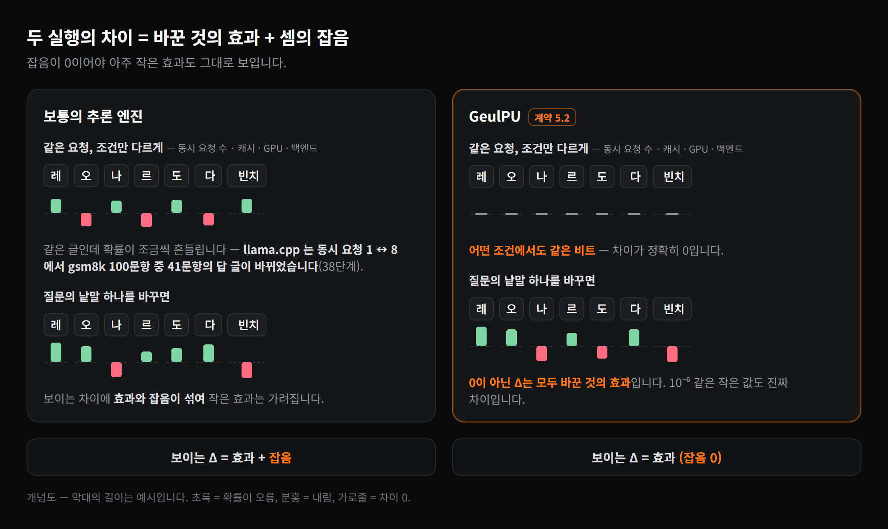

두 실행을 비교하면 보이는 차이는 **바꾼 것의 효과 + 계산의 잡음**입니다. 보통의 추론 엔진은 동시 요청 수 · 배치 크기 · 캐시 · GPU가
바뀌면 같은 요청의 확률도 조금씩 달라집니다. 실제로 llama.cpp는 동시 요청 1개와 8개에서 gsm8k 100문항 중 41문항의 답 글이
달라졌습니다([38단계](https://github.com/wwoosshh/GeulPU/blob/main/문서/38단계.md)). 이런 잡음 위에서는 작은 효과가 가려집니다.

GeulPU는 계산의 차례와 반올림을 [계약](계약/계약.md)으로 정해 두어서, 어떤 조건에서도 같은 비트가 나옵니다(로그확률은 계약 5.2).
그래서 **0이 아닌 Δ는 모두 바꾼 것 하나의 효과**입니다. 10⁻⁶처럼 작은 값도 진짜 차이입니다. 이 성질 덕분에 이런 질문에 깨끗하게 답할
수 있습니다.

- 모델은 답의 어느 스텝에서 망설였나, 그때 거의 고를 뻔한 토큰은 무엇이었나
- 그 자리에서 다른 토큰을 골랐다면 답은 어떻게 이어지나
- 질문의 단어 하나, 모델 파일 하나(양자화)는 같은 답의 확률을 토큰마다 얼마나 바꾸나
- 남이 낸 결과가 내 PC에서도 비트까지 같은가

## 1. 준비

1. **GeulPU 0.23.0 이상**을 설치합니다([사용 안내의 설치](사용안내.md#설치)). 실행 화면 · 스텝 · 층 화면은 0.23.0 부터 있습니다.
2. **모델**: 이 안내서는 **Qwen2.5-7B-Instruct Q8_0**을 씁니다(**모델 › 파일**에서 받기). 실험 4에는 같은 모델의 **Q4_K_M**도
   필요합니다. 다른 모델로도 똑같이 할 수 있고, 숫자만 달라집니다.
3. 채팅 위 막대의 **계산 방식** 칩(**빠름** · **정밀**)을 눌러 **정밀**을 고릅니다(불러온 모델을 정밀로 다시 불러옵니다 — **설정 › 앱**의
   **계산 방식**에서 골라도 같습니다). 답마다 그 답을 계산한 방식이 꼬리표로 붙고, 실행 화면 · 스텝 · 층 화면은 불러온 모델이나 계산
   방식이 그 실행과 다르면 한 줄로 알리고 **이 실행의 모델 불러오기** · **이 실행의 계산 방식으로** 단추로 맞춥니다. 이 안내서의 숫자는
   정밀 모드의 값입니다. 기본인 빠른 모드는 행렬곱에 들어가는 활성값을 8비트로 계산해 확률이 조금 다르고, 영어 질문으로 하면 답이
   `Leonardo da Vinci` 대신 `Vincent van Gogh`로 바뀌기까지 합니다. 두 방식 모두 결정적이고, 정밀 모드는 NVIDIA ↔ AMD, CUDA ↔ Vulkan
   사이에서도 같은 비트입니다.
4. **생성 설정**(채팅 위 오른쪽의 조절 단추)에서 **온도가 0**인지 봅니다. 기본값이 0입니다. 온도 0이면 같은 질문에 늘 같은 답이
   나오므로 이 안내서의 숫자를 그대로 따라갈 수 있습니다. 시스템 프롬프트는 비워 둡니다(모델 기본값).
5. 사이드바의 **실험**에서 **대화**(채팅 화면)를 열고, **새 채팅**에서 질문을 보냅니다.

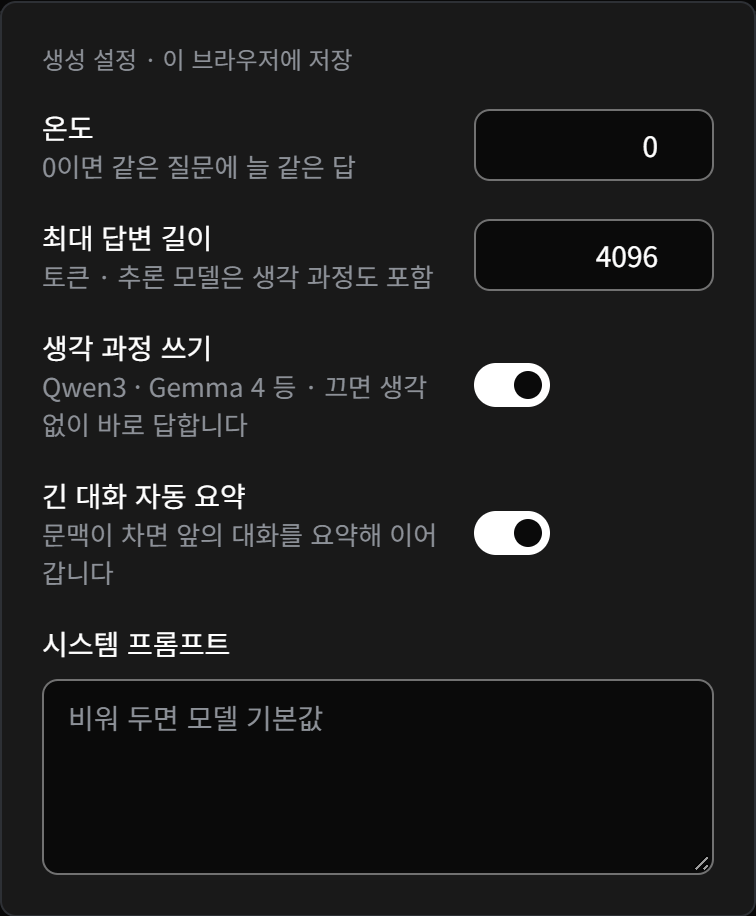

> 0.23.0 부터 채팅의 답은 기본 실험 "대화"의 실행으로 남습니다 — `experiments` 폴더의 `<날짜>-chat` 에서 실행마다
> `records/runs/rN.json` 에 보낸 요청과 받은 응답 전체가 남아, 브라우저 데이터를 지워도 사라지지 않습니다. 화면에서 한 계산(분기 ·
> 점수 · 렌즈)도 그 실험의 실행입니다. 0.23.0 전에 받은 답은 [6절](#6-주의할-점과-자주-묻는-것)을 보세요.

## 2. 실행 화면 열기와 화면 한눈에

질문 `유명한 화가 한 명의 이름만 말해 줘.`를 보내면 답 ` Van Gogh`가 옵니다.

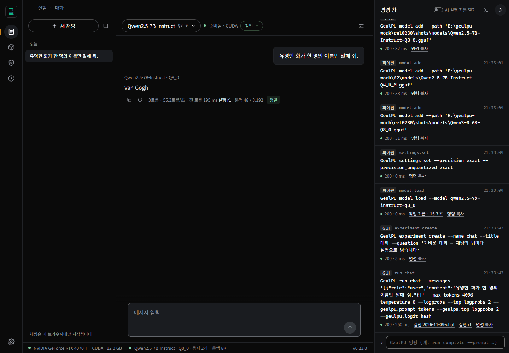

- 답 아래의 **실행 rN** 을 누르면 그 답의 **실행 화면**이 열립니다. 답은 기본 실험 "대화"의 실행으로 남았습니다 — 채팅 화면 위의 경로
  **실험 › 대화**에서 **대화**를 누르면 그 실험의 화면이고, **실행** 탭에 답마다 실행이 있습니다.
- 채팅 위 막대의 **계산 방식** 칩 — 불러온 모델이 지금 계산하는 방식(**정밀** · **빠름**). 눌러서 바꿉니다(준비 3).
- 답의 꼬리표 — 그 답을 계산한 방식. 이 안내서의 답은 모두 **정밀**입니다.
- **생성 설정**(온도 · 최대 길이 · 시스템 프롬프트).

채팅은 답을 생성하면서 스텝마다 상위 후보 2 개 · 엔트로피 · 로짓 해시를 함께 받아 실행 기록에 남기고, 실행 화면은 그 기록을 읽습니다.
상위 후보가 더 필요하거나 끝 토큰의 스텝까지 보려면 실행 화면의 **모든 스텝의 상위 후보**가 같은 토큰을 다시 계산합니다(점수 매기기 —
`echo`). 다시 계산한 값은 생성할 때의 값과 **비트까지 같습니다**(38단계에서 모델 넷 · 두 백엔드로 확인).


**실행 화면** (위에서 아래로)

- **경로와 제목** — `실험 › <실험 id> › 실행 rN`, 실행의 종류(채팅 · 텍스트 생성 · 분기 · 재실행 · 점수 · 로짓 렌즈)와 한 줄 설명.
- **실행 정보** — 모델(SHA-256 의 앞 8 자) · 계산 방식 · GeulPU 버전 · 장치 · 시드 · 샘플링(온도 · top-k · top-p · min-p) · 출처 · 걸린
  시간, 그리고 끝난 까닭 · 토큰/초 · 백엔드 · **지문**([실험 7](#실험-7-결과를-남에게-확인받기)). 불러온 모델이나 계산 방식이 이 실행과
  다르면 그 아래에 한 줄과 단추가 나옵니다(준비 3).
- **요약 수치** — 평균 로그확률 · 퍼플렉서티 · 평균 엔트로피 · 가장 작은 마진과 그 스텝 · 마진 < δ 인 스텝 · 1위가 아닌 스텝.
- **마진 기준 δ** — 마진이 δ 보다 작은 스텝을 셉니다. **이전 — 마진 < δ** · **다음 — 마진 < δ** 로 그런 스텝 사이를 오갑니다. δ 는 이
  브라우저에 기억합니다.
- **막대** — 토큰 아래 막대가 보일 값: **마진** · **확률** · **엔트로피**.
- **토큰별 출력** — 흐린 텍스트가 프롬프트, 그 뒤가 답의 토큰입니다. 마진이 δ 보다 작은 토큰에 점선 밑줄이 생기고, 마진이 가장 작은
  스텝 위에 그 값이 붙습니다. 토큰을 누르면 오른쪽에 그 스텝이 열립니다. 키: ← → 이전 · 다음 스텝, Enter 스텝 · 층 화면, b 가장 높은
  다른 후보로 분기.
- **고른 스텝** — 상위 후보(로그확률과 막대 — 샘플링된 토큰에 '샘플링됨', 나머지에 **이 토큰으로 분기**), 마진 · 샘플링된 토큰의 확률과
  순위 · 엔트로피 · 로짓 해시, 그리고 **스텝 · 층 화면** · **재실행** · **이 설정으로 새 실행** 단추.
- **계산** — **모든 스텝의 상위 후보**, **캐시 없이 재실행**, 다른 모델로 점수(**다른 모델 고르기** → **불러와 점수 매기기**).
- **프롬프트 캐시** — 프롬프트를 어디서 얼마나 다시 썼는지([프롬프트 캐시는 어디서 끊겼나](#프롬프트-캐시는-어디서-끊겼나)).
- **내보내기** — 토큰 표 JSON · CSV, **재현 파일(JSON)**, 파이썬 코드([데이터 꺼내기](#데이터-꺼내기)).

| 하는 일 | 답하는 질문 | 화면 |
|---|---|---|
| **관찰** | 모델은 어느 스텝에서 확신이 없었나 | **실행 화면** — 토큰마다 확률 · 순위 · 엔트로피 · 마진과 상위 후보. **스텝 · 층 화면** — 상위 후보 1 ~ 128 개, 로짓 렌즈 |
| **개입** | 다른 토큰을 골랐다면 | 실행 화면의 **이 토큰으로 분기** · **재실행** · **이 설정으로 새 실행**, 스텝 · 층 화면의 후보마다 **분기** |
| **비교** | 무엇이 얼마나 바꾸나 | 실험의 **비교** 탭 — 두 실행이 처음 다른 스텝, 한 실행의 답을 다른 실행의 프롬프트로 점수(Δ). 실행 화면의 다른 모델로 점수(Δ) |
| **점수** | 이 글은 얼마나 그럴듯한가 | 스텝 · 층 화면의 **점수** — 텍스트 · 토큰 id, 문맥 없이 |
| **재현** | 남도 같은 결과를 얻나 | 실행 정보의 **지문**, **캐시 없이 재실행**, **내보내기 › 재현 파일(JSON)**, **재현 › 검사**(재현 파일 확인 · 엔진 · 커널 해시) |
| **내보내기** | 데이터를 꺼내려면 | 실행 화면의 **내보내기** — 토큰 표 JSON · CSV, 재현 파일, 파이썬 코드 |

화면에서 한 계산(분기 · 상위 후보 · 점수 · 로짓 렌즈)은 모두 그 실험의 실행으로 남습니다 — `records/runs/rN.json` 에 보낸 요청과 받은
응답 전체. 다시 열면 그대로 보이고, 화면 오른쪽의 **명령 창**에 같은 일을 하는 `GeulPU` 명령이 한 줄씩 나옵니다(예:
`GeulPU experiment branch --run r1 --step 3 --token 785`). 연구 기록이 브라우저에만 있지 않으니, 실험 폴더를 그대로 남에게 넘길 수
있습니다.

## 3. 숫자 읽는 법

| 이름 | 뜻 |
|---|---|
| **스텝** | 답의 토큰 하나를 고르는 한 번의 계산. 화면과 CLI 는 0 부터 셉니다 — 스텝 0 이 답의 첫 토큰입니다(분기 실행은 원래 실행의 번호를 잇습니다). |
| **확률 · 로그확률** | 그 스텝에서 모델이 그 토큰에 준 확률과 그 자연로그(nat). 로그확률 −1.725 = 확률 e<sup>−1.725</sup> = 17.8 %. 실행 화면의 상위 후보는 로그확률로, 스텝 · 층 화면의 상위 후보는 확률(%)로도 보입니다. |
| **순위** | 그 스텝의 모든 토큰 가운데 몇 번째로 그럴듯했나. 온도 0이면 늘 1위를 샘플링합니다. |
| **엔트로피** | 그 스텝의 분포가 얼마나 퍼졌나(nat). 0이면 한 토큰에 몰림, 3.9면 약 e<sup>3.9</sup> ≈ 49개 토큰에 고르게 퍼진 것과 같은 불확실성. |
| **마진(margin)** | 1위와 2위의 로그확률 차 = ln(1위 확률 / 2위 확률). 작을수록 1위가 바뀌기 쉽습니다. |
| **마진이 작은 스텝** | 마진이 기준 δ보다 작은 스텝(화면의 '마진 < δ 인 스텝') — 계산이나 설정이 조금만 달라도 다른 토큰이 될 수 있는 스텝. 기본 δ = 0.05 nat(확률비 약 1.05배). |
| **1위가 아닌 스텝** | 샘플링(온도 > 0)이 1위가 아닌 토큰을 고른 스텝의 수. 분기 실행에서 바꾼 토큰은 그 실행의 프롬프트에 있어 세지 않습니다. |
| **퍼플렉서티** | exp(−평균 로그확률). 1에 가까울수록 모델이 그 글을 당연하게 봅니다. |
| **Δ 로그확률** | 같은 토큰을 두 조건에서 계산한 로그확률의 차 — 다른 모델로 점수는 '그 모델 − 이 실행', 비교 탭의 점수는 'B 의 프롬프트 − A'. Δ 의 합이 x면 답 전체의 확률이 e<sup>x</sup> 배. |
| **로짓 해시** | 그 스텝의 로짓 행(어휘 전체의 점수) 64비트 해시. 두 계산이 비트까지 같은지 스텝마다 비교합니다. 화면은 앞 8 자를 보이고, 마우스를 올리면 전체가 보입니다. |
| **끝 토큰** | `<\|im_end\|>` — 모델이 답을 끝낼 때 내는 토큰. 토큰별 출력의 끝에 보이고, 이것도 한 스텝입니다. 생성 기록에는 이 스텝의 확률이 없어(OpenAI 형식의 로그확률 배열처럼) **모든 스텝의 상위 후보**가 답 전체를 점수 매겨 채웁니다 — 토큰 표 · 재현 파일 · 다른 모델로 점수 · 비교 탭의 점수가 그 값을 씁니다. |
| **여러 토큰에 나뉜 글자** | 한글 한 글자의 UTF-8 바이트가 토큰 둘 이상으로 나뉜 것. 토큰별 출력은 그 글자를 첫 토큰에 보이고, 나머지 토큰은 폭 없이 붙여 둡니다(← → 로는 하나씩 옮겨 갑니다). |

**확률은 모델의 분포(온도 1)입니다** — 샘플링에 쓴 온도 · top-k · top-p로 거른 분포가 아닙니다. 그래서 온도를 바꿔 생성해도 같은
토큰의 확률은 같습니다.

## 4. 따라 하기 — 실험 여덟

### 실험 1. 모델은 어디서 망설였나

**질문**: ` Van Gogh`라는 답은 얼마나 확실한 답이었나?

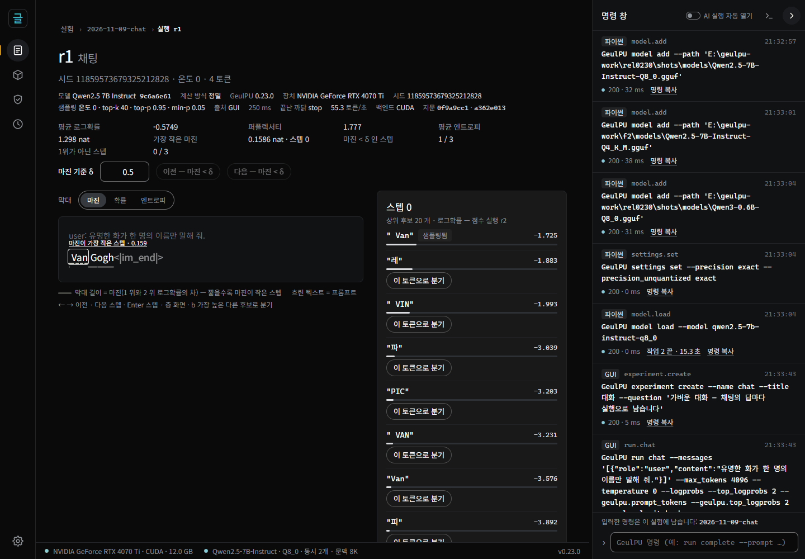

1. 답 아래의 **실행 rN** 으로 실행 화면을 엽니다. 요약 수치의 **가장 작은 마진**이 0.1586 nat · 스텝 0 이고, 화면은 그 스텝을 고른 채
   열립니다(` Van` 위에 '마진이 가장 작은 스텝' 표시).
2. 기본 기준 δ = 0.05 에서는 **마진 < δ 인 스텝**이 0 개입니다. **마진 기준 δ** 에 `0.5` 를 넣으면 1 개가 되고, 토큰별 출력의 ` Van` 에
   점선 밑줄이 생깁니다.
3. 채팅의 답은 스텝마다 상위 후보를 2 개만 기록합니다. **계산**의 **모든 스텝의 상위 후보**(기본 20)에서 **계산**을 누르면 답 전체를
   점수 매긴 실행이 하나 생기고, 고른 스텝에 상위 후보 20 개가 보입니다(CLI 로는 `GeulPU experiment score --run rN --top_logprobs 20`).

**읽기**
- 고른 스텝(스텝 0): **샘플링된 토큰의 확률** 17.8 % · 1 위(로그확률 −1.725), **엔트로피** 3.893 nat, **마진** 0.1586 nat. 1위였지만
  다섯에 한 번도 안 되는 확률입니다.
- **상위 후보**: ` Van` 17.8 % · `레`(레오나르도) 15.2 % · ` VIN` 13.6 % · `파`(파블로 피카소) 4.79 % · `PIC` 4.06 % · ` VAN` 3.95 % …
  실행 화면은 이 값을 로그확률과 막대로, 스텝 · 층 화면(Enter)은 확률(%)로도 보입니다. 모델은 고흐 · 다 빈치 · 피카소 사이에서, 그리고
  같은 고흐를 ` Van` · ` VIN` · ` VAN` 가운데 어느 형태로 쓸지 사이에서 정하지 못하고 있었습니다.
- 첫 토큰이 정해진 뒤의 스텝(` G` · `ogh` · 끝 토큰)은 거의 100 %입니다. **불확실성은 답의 첫 스텝에 몰려 있었습니다.**

> 같은 모델 파일 · 같은 질문이면 여러분의 화면에도 같은 수가 나오고, 로짓 해시도 `2fe16af4`(마우스를 올리면 전체 `2fe16af4381b6517`)로
> 같습니다.

### 실험 2. 다른 토큰을 골랐다면

**질문**: 첫 스텝에서 2위인 `레`를 골랐다면 답은 어떻게 이어졌을까?

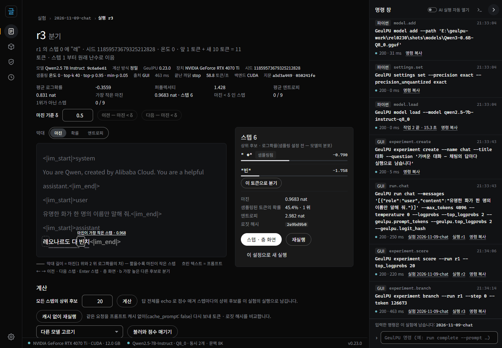

1. 실행 화면에서 스텝 0 을 고른 채로, 상위 후보 `레` 의 **이 토큰으로 분기**를 누릅니다(키 b — 가장 높은 다른 후보로 분기 — 도
   같습니다).

GeulPU는 프롬프트 + 앞 토큰(여기서는 없음) + 바꾼 토큰 `레`로 이어 생성합니다. 샘플링(온도 > 0)이었다면 **같은 시드 · 같은 스텝 번호의
난수**를 써서, 바뀐 것은 그 토큰 하나뿐입니다. 요청은 앱이 원래 실행의 기록(프롬프트 토큰 · 답 · 샘플링 설정 · 시드)에서 짓고, 명령 창에는
`GeulPU experiment branch --run … --step 0 --token …` 같은 명령이 남습니다. 분기는 그 실험의 새 실행이 되고, 원래 실행과 함께 **비교**
탭에 열립니다([실험 3](#실험-3-두-답은-어디서-갈렸나)). 채팅에는 새 버전이 생기지 않습니다.

같은 실행 화면의 **재실행**은 같은 요청을 그대로 다시 보내 재실행(check)으로 남기고, **이 설정으로 새 실행**은 이 실행의 설정을
채운 새 실행 대화상자를 엽니다 — 온도 · 시드 · 최대 토큰 · 메시지를 바꿔 **실행**을 누르면 새 실행입니다. 비운 top-p · top-k · min-p 는
엔진의 기본값(0.95 · 40 · 0.05 — 입력 필드에 흐리게 보입니다)으로 샘플링하고, 시드를 비우면 서버가 고릅니다. 실제로 쓴 값은 실행
기록에 남습니다.

답은 **레오나르도 다 빈치**로 이어졌습니다. 실행 탭에서 분기 실행을 열면 제목 아래 설명이 받은 토큰과 새로 만든 토큰, 원래 난수로 이은
위치를 보이고(그림은 'r1 의 스텝 0 에 "레" · 시드 … · 온도 0 · 앞 1 토큰 + 새 10 토큰 = 11 토큰 · 스텝 1 부터 원래 난수로 이음' — 앞 1 토큰이
바꾼 토큰 `레` 입니다), 흐린 프롬프트의 끝에 바꾼 토큰이 점선 테두리로 표시됩니다. 분기 실행의 스텝 번호는 원래 실행을 잇고, 다른 실행처럼 토큰마다의 값이 있어
바로 관찰 · 비교할 수 있습니다.

### 실험 3. 두 답은 어디서 갈렸나

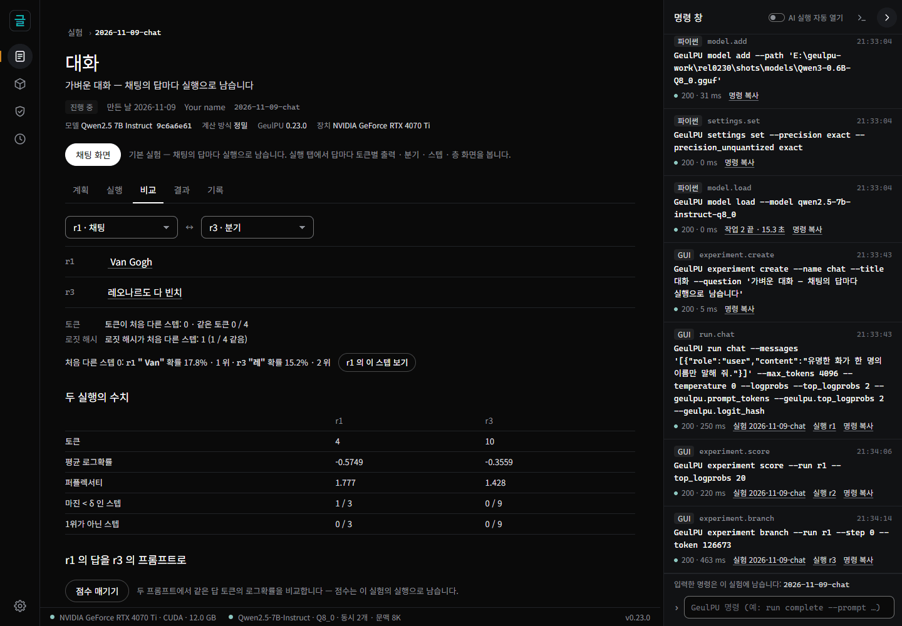

1. 분기를 만들면 **비교** 탭이 원래 실행과 분기 실행을 나란히 연 채로 보입니다. 다른 두 실행은 탭 위의 두 목록(첫째 실행 ↔ 둘째
   실행)에서 고르고, 실행 탭의 **실행 둘 비교**로도 엽니다.

**읽기**
- 맨 위 두 줄 — 두 실행의 답. 같은 앞부분과 달라진 뒷부분을 나눠 보입니다.
- **토큰이 처음 다른 스텝: 0**, 그 아래 **처음 다른 스텝 0** — 원래 실행은 ` Van`(확률 17.8 % · 1 위), 분기 실행은 `레`(15.2 % · 2 위).
  **로짓 해시가 처음 다른 스텝**은 1 입니다: 프롬프트와 앞 토큰이 모두 같으므로 **스텝 0 의 분포는 두 실행에서 같은 비트**이고, 바뀐
  것은 그 토큰뿐입니다. 줄 끝의 **rN 의 이 스텝 보기**는 그 스텝의 스텝 · 층 화면으로 갑니다.
- **두 실행의 수치** — 토큰 · 평균 로그확률 · 퍼플렉서티 · 마진 < δ 인 스텝 · 1위가 아닌 스텝을 나란히 보입니다. 분기 실행의 수치는 새로
  만든 토큰만 셉니다(바꾼 토큰 `레` 는 그 실행의 프롬프트에 있습니다).
- **스텝마다 로짓 해시** · **요청에서 다른 설정** — 처음 다른 스텝 앞뒤의 해시와, 두 요청에서 다른 필드.

설정을 바꿔 만든 실행(**이 설정으로 새 실행** — 예: 온도 0.7, 다른 시드)도 같은 방법으로 비교합니다. 토큰이 처음 다른 스텝이 샘플링이
처음 다른 토큰을 고른 스텝이고, 그 스텝의 로짓 해시는 같습니다 — 분포는 같고 샘플링만 달랐다는 뜻입니다. 같은 값은 CLI 의
`GeulPU experiment compare --path <실험> --a r1 --b r2` 가 모델 없이 실험 기록에서 냅니다.

### 실험 4. 양자화는 같은 답을 얼마나 바꾸나

**질문**: Q8_0 대신 Q4_K_M 파일을 쓰면 같은 답의 확률이 토큰마다 얼마나 달라지나?


1. 분기 실행(`레오나르도 다 빈치`)의 실행 화면에서 먼저 **모든 스텝의 상위 후보**를 계산합니다 — 끝 토큰의 스텝까지 이 실행의
   모델(Q8_0) 값이 생깁니다.
2. **계산**의 **다른 모델 고르기**에서 `Qwen2.5 7B Instruct · Q4_K_M`을 고르고 **불러와 점수 매기기**를 누릅니다. 모델을 바꿔 불러오므로
   수십 초 걸립니다. 어휘와 채팅 템플릿이 같은, 설치된 모델만 목록에 나옵니다. 끝나면 Q4_K_M 이 불러와져 있어 화면 위의 줄이 모델이
   다르다고 알립니다 — **이 실행의 모델 불러오기**로 돌아갑니다.

**읽기** — 분기 실행이 새로 만든 토큰 10 개(`오` 부터 끝 토큰까지)를 Q4_K_M 으로 다시 계산했습니다. 바꾼 토큰 `레` 는 이 실행의
프롬프트에 있어 이 Δ 에 들지 않습니다.
- **다른 모델로 점수 — … · Δ = 그 모델 − 이 실행** 의 **가장 큰 차이** 첫째는 스텝 9 의 `치`(|Δ| 0.327)입니다. 이 10 토큰의 **Δ 의 합**은 −0.378 —
  이 부분의 확률이 Q4_K_M 에서 e<sup>−0.378</sup> ≈ 0.69배입니다.
- 토큰별 Δ — 초록은 Q4_K_M 에서 더 높은 확률, 분홍은 더 낮은 확률, 짙을수록 큰 차이입니다. 차이 0인 스텝이 하나도 없습니다 —
  양자화는 모든 스텝에 흔적을 남깁니다. 계산의 잡음이 0이므로 **이 차이는 모두 모델 파일 하나의 효과**입니다.
- `레` 까지 넣은 답 전체(11 토큰)의 Δ 의 합은 −0.462 — 답 전체의 확률이 Q4_K_M 에서 e<sup>−0.462</sup> ≈ 0.63배이고, 1위가 바뀐 스텝은
  없습니다. `레` 의 변화는 아래 문단의 스텝 0 입니다.

같은 질문을 Q4_K_M으로 직접 물으면 답은 똑같이 ` Van Gogh`지만, 스텝 0 의 2위와 3위가 바뀝니다(Q8_0: `레` 15.2 % ·
` VIN` 13.6 % → Q4_K_M: ` VIN` 14.9 % · `레` 14.0 %). 영어 질문에서는 1위가 바뀌어 **답 자체가 달라집니다** — Q8_0은
`Leonardo da Vinci`, Q4_K_M은 `Vincent van Gogh`([영어 안내서](docs/research-guide.md#experiment-4-how-much-does-quantization-change-the-same-answer)).

### 실험 5. 질문의 단어 하나는 같은 답을 얼마나 바꾸나

**질문**: 질문에 '이탈리아'를 넣으면 `레오나르도 다 빈치`라는 답은 얼마나 더 그럴듯해지나?

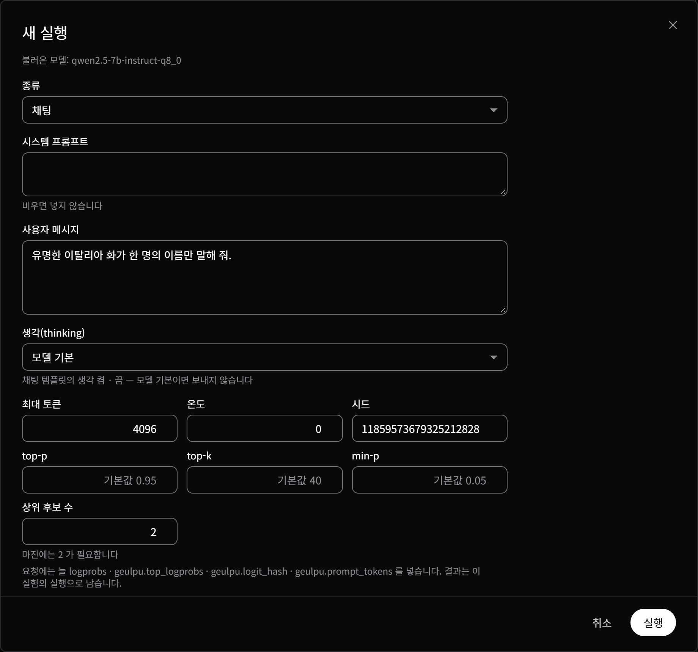

1. 원래 실행(` Van Gogh`)의 실행 화면에서 **이 설정으로 새 실행**을 누릅니다. 새 실행 대화상자가 이 실행의 설정(종류 채팅 · 사용자 메시지 ·
   최대 토큰 · 온도 0 · 시드)으로 열립니다. **사용자 메시지**를 `유명한 이탈리아 화가 한 명의 이름만 말해 줘.`로 고치고 **실행**을
   누르면 답 `레오나르도 다 빈치`가 새 실행으로 남고 그 실행 화면이 열립니다. 채팅에서 질문을 고쳐 보내도 그 답이 "대화"의 새 실행으로
   남습니다.
2. 새 실행의 실행 화면에서 **모든 스텝의 상위 후보**를 계산합니다(끝 토큰의 스텝까지 값이 생깁니다).

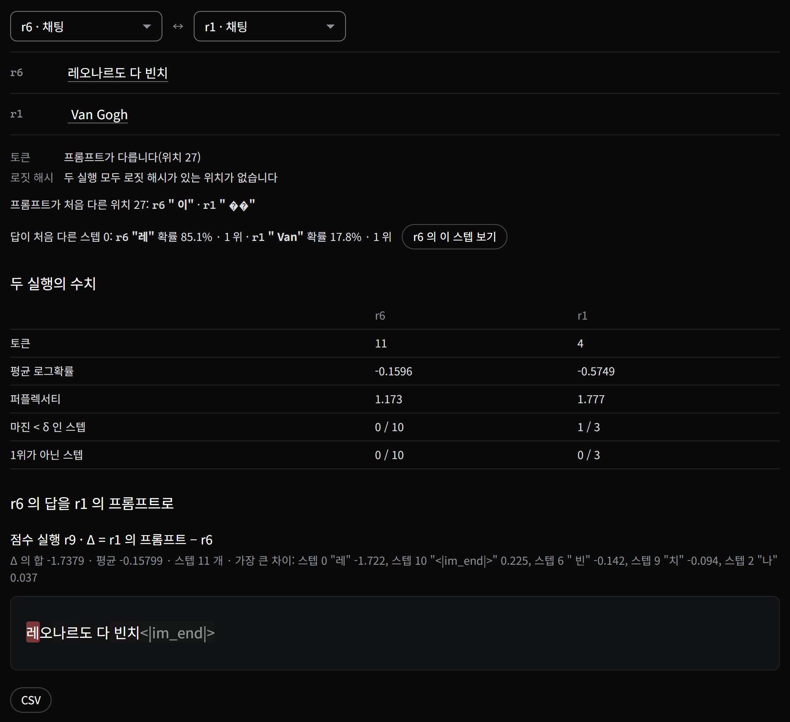

3. **비교** 탭에서 첫째 실행을 새 실행(고친 질문의 답), 둘째 실행을 원래 실행으로 고릅니다. 프롬프트가 다르므로 새 실행의 답을 원래
   실행의 프롬프트로 매기는 부분이 나옵니다(제목은 실행 id 로 — 그림은 'r6 의 답을 r1 의 프롬프트로'). **점수 매기기**를 누르면 새 실행의
   답 토큰을 원래 질문 뒤에서 다시 계산합니다(점수 실행으로 남습니다).

**읽기**
- **Δ 의 합 −1.738** — 여기서 Δ 는 '원래 질문 − 고친 질문'입니다. 원래 질문 뒤에서는 이 답의 확률이 e<sup>−1.738</sup> ≈ 0.18배 —
  곧 '이탈리아' 한 단어가 이 답의 확률을 e<sup>1.738</sup> ≈ **5.7배**로 올렸습니다. 거의 모두 **스텝 0** 몫입니다: `레` 85.1 % →
  15.2 %(Δ −1.722). 위의 **답이 처음 다른 스텝 0** 줄도 두 질문에서 1위가 다르다는 것을 보입니다 — 고친 질문 뒤에서는
  `레`(85.1 % · 1 위), 원래 질문 뒤에서는 ` Van`(17.8 % · 1 위).
- 토큰별 Δ — 나머지 스텝의 Δ는 작지만 0은 아닙니다. 계산의 잡음이 0이므로 이것도 모두 그 단어의 효과입니다.

첫째 · 둘째 실행을 바꾸면 원래 답 ` Van Gogh` 가 고친 질문 뒤에서 얼마나 바뀌는지를 봅니다.

### 실험 6. 글 한 줄은 얼마나 그럴듯한가

**질문**: 모델은 `대한민국의 수도는 부산이다.`라는 글의 어느 자리를 이상하게 보나?

<p>
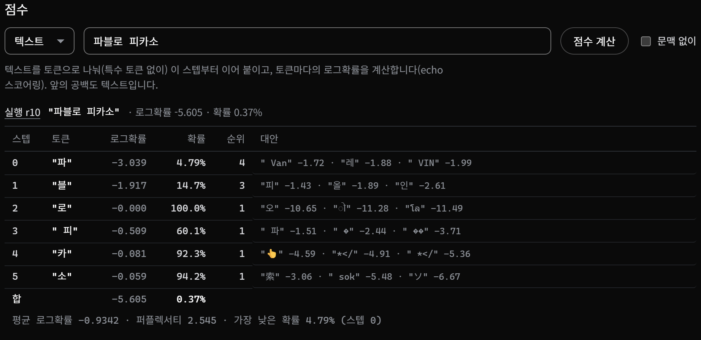
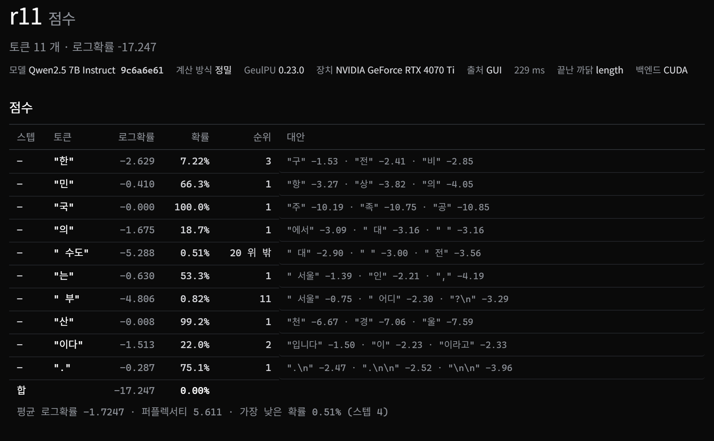
</p>

1. 아무 실행의 스텝 · 층 화면을 엽니다(실행 화면에서 스텝을 고르고 Enter). 아래의 **점수**에서 입력의 종류를 **텍스트**로 두고 글
   `대한민국의 수도는 부산이다.`를 넣은 뒤, **문맥 없이**를 켜고 **점수 계산**을 누릅니다. 계산은 불러온 모델(Q8_0)로 합니다.
2. 점수 실행이 생기고 그 실행 화면이 열립니다(오른쪽 그림).

**읽기**
- **점수** 표 — 토큰마다 로그확률 · 확률 · 순위(상위 20 안이면) · **대안**(그 위치의 다른 상위 후보 셋), 아래에 **합** −17.247 과
  평균 로그확률 · 퍼플렉서티 5.611 · 가장 낮은 확률. 글은 토큰 11 개이고 표는 10 줄입니다 — 문맥 없이는 첫 토큰 `대`에 확률이 없어(이 모델은
  시작 토큰이 없어 첫 토큰을 문맥으로 씁니다) 그 뒤부터 매깁니다. 가장 낮은 곳은 ` 수도`(0.51 %) — 문맥 없이는 글의 앞쪽이 원래 낮게 나옵니다. 그래서
  **궁금한 위치를 봅니다**.
- ` 부`는 0.82 % 로 상위 10 에 들지 못하고, 그 위치의 **대안** 첫째는 ` 서울`(로그확률 −0.75 — 47.1 %)입니다 — 모델은 그 위치에
  서울을 기대했습니다. 글을 `대한민국의 수도는 서울이다.`로 바꿔 점수를 매기면 ` 서울`은 47.1 %(로그확률 −0.75), 퍼플렉서티는
  4.30으로 내려갑니다.

**문맥 없이**를 끄면 글을 그 실행의 그 스텝부터 이어 붙여 계산합니다 — 같은 질문에 대한 후보 답 여럿의 확률을 비교할 때 씁니다(예:
화가 질문의 실행에서 스텝 0 의 스텝 · 층 화면을 열고 `파블로 피카소`를 넣어 보기). 이 점수는 스텝 · 층 화면의 **점수** 아래에 표로
쌓입니다(왼쪽 그림). 텍스트로 적을 수 없는 특수 토큰(예: `<|im_end|>`)은 입력의 종류를 **토큰 id** 로 바꿔 번호로 넣습니다.

### 실험 7. 결과를 남에게 확인받기

**질문**: 내가 본 숫자를 다른 사람도 자기 PC에서 똑같이 볼 수 있나?

<p>
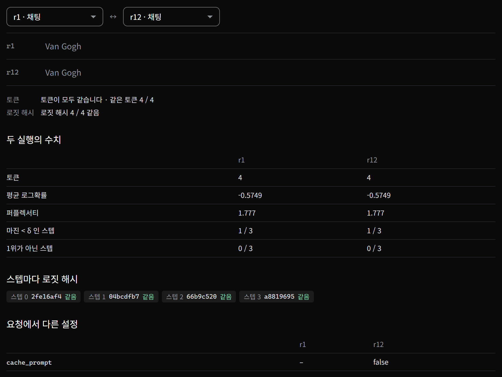
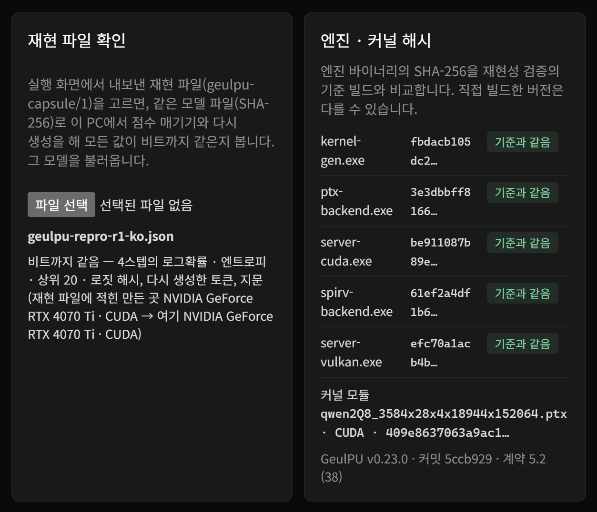
</p>

원래 답(` Van Gogh`)의 실행 화면에서:

- **지문** — 실행 정보 줄 끝의 '지문' 뒤에 토큰 지문(모델 파일 + 프롬프트 + 답 토큰의 SHA-256)과 로짓 지문(+ 스텝마다 로짓 해시)의
  앞 8 자가 보이고, 마우스를 올리면 전체가 보입니다. 같은 모델 파일 · 같은 프롬프트 · 같은 결과면 어느 GPU · 백엔드에서든 같은
  지문입니다. 이 안내서의 답은 토큰 지문이 `0f9a9cc1`로 시작합니다 — 여러분의 것도 그렇다면 **비트까지 같은 답**입니다. 계산 방법은
  [계약 5.2](계약/계약.md)에 있습니다.
- **캐시 없이 재실행** — 같은 요청을 프롬프트 캐시 없이(`cache_prompt: false`) 다시 생성하고, 원래 실행과의 **비교** 탭을 엽니다:
  '토큰이 모두 같습니다', '로짓 해시 4 / 4 같음'(답의 토큰 수 — 왼쪽 그림).
- **내보내기 › 재현 파일(JSON)** — 요청 · 결과 · 스텝마다 로그확률 · 엔트로피 · 상위 후보 · 로짓 해시 · 지문 · 모델 파일 SHA-256 · 만든
  장치 · 실제로 쓴 샘플링 값(온도 · top_k · top_p · min_p · 시드)을 JSON 파일 하나로 받습니다. 계산한 로짓 렌즈도 함께 들어갑니다.
  스텝마다의 값은 답 전체를 점수 매긴 실행에서 오므로, 없으면 먼저 답 전체를 점수 매깁니다(그 실행은 실험에 남습니다).
- **재현 › 검사 › 재현 파일 확인** — 받은 사람이 자기 GeulPU에서 파일을 고릅니다. 같은 모델 파일(SHA-256)이 설치되어 있어야 하고,
  확인하는 동안 그 모델을 불러옵니다. 점수 매기기 · 다시 생성 · 지문을 모두 비교해 '비트까지 같음'이 나오면 확인 끝입니다(오른쪽 그림 —
  재현 파일에 적힌 만든 곳과 여기의 장치 · 백엔드도 보입니다). 다르면 처음 다른 스텝과, 다른 설정(계산 방식 · KV 캐시 · 빠른 어텐션 ·
  YaRN)을 알립니다. NVIDIA ↔ AMD, CUDA ↔ Vulkan 사이에서도 같아야 합니다.
- **재현 › 검사 › 엔진 · 커널 해시** — **엔진 · 커널 해시 보기**를 누르면 엔진 바이너리 다섯이 공식 빌드(교차검증 기준)와 같은지,
  지금 쓰는 커널 모듈은 무엇인지, GeulPU 버전 · 커밋 · 계약이 보입니다.

CLI 로는 `GeulPU experiment repro --path <실험> --run rN --out repro.json`(모델 없이 실험 기록에서 — 답 전체의 점수 실행이 있어야
합니다)과 `GeulPU check repro --json @repro.json`(그 모델을 불러온 이 PC 에서 확인)입니다.

GPU가 없는 사람도 확인할 수 있습니다. 저장소를 받아 가상 환경(venv)에 numpy 를 깔고 계약의 CPU 참조 구현으로 다시 계산합니다(7B는 몇
분 — 내려받은 재현 파일의 이름은 `geulpu-repro-<토큰 지문의 앞 12 자>.json`).

```bash
python -m venv .venv                      # 한 번 — `python -I` 는 `pip install --user` 로 깐 패키지를 보지 않는다
.venv/Scripts/pip install numpy               # 리눅스 · macOS: .venv/bin/pip
.venv/Scripts/python -I 도구/repro_check.py geulpu-repro.json Qwen2.5-7B-Instruct-Q8_0.gguf
```

### 실험 8. 답은 몇 번째 층에서 생기나 — 로짓 렌즈

**질문**: 모델이 답을 쓰기 직전, 가운데 층의 계산은 무엇을 가리키고 있었나?

0.13.0 부터. 다음 토큰은 마지막 층이 내지만, 가운데 층의 계산(residual stream)도 끝의 출력 계산으로 읽어 볼 수 있습니다 —
**로짓 렌즈**(logit lens — 그 층에서 멈췄다면 낼 분포). **Jacobian lens**(Anthropic, 2026)는 그 층의 값을 원본 모델에서 맞춘 행렬 J 로
먼저 끝 층의 바탕에 옮긴 뒤 읽어서, 앞 층에서도 그 위치가 무엇을 향하는지 더 일찍 보입니다. 로짓 렌즈는 Qwen2.5 · Qwen3 · Llama ·
Gemma 4 구조에서 되고(Gemma 4 는 끝 로짓의 소프트캡까지), Jacobian lens 는 J 를 맞춘
Qwen2.5 · Qwen3 · Llama 구조에서 됩니다.

준비가 다른 실험과 조금 다릅니다:

- 모델은 **Qwen3-0.6B Q8_0**(**모델 › 파일**에서 받기)이고, 릴리스에 붙은 J 파일 **`Qwen3-0.6B-Q8_0.jlens.safetensors`** 를 모델 파일과
  같은 폴더에 둔 뒤 모델을 (다시) 불러옵니다. 서버가 J 파일을 받으면 스텝 · 층 화면의 단추가 **로짓 렌즈 · Jacobian lens 계산**이
  됩니다(J 파일이 없으면 **로짓 렌즈 계산**과 J 파일을 두는 법의 안내).
- 계산 방식은 **정밀**, 온도 0, 그리고 생성 설정의 **생각 과정 쓰기**를 끕니다(Qwen3 는 기본으로 생각을 먼저 씁니다).
- 새 채팅에서 **대한민국의 수도는 어디인가요? 한 단어로 답하세요.** 를 보냅니다. 0.6B 모델은 `대한민국의 수도는 **인천**입니다.` 라고
  틀리게 답합니다 — 왜 틀렸는지 들여다보기 좋은 답입니다.

<p>
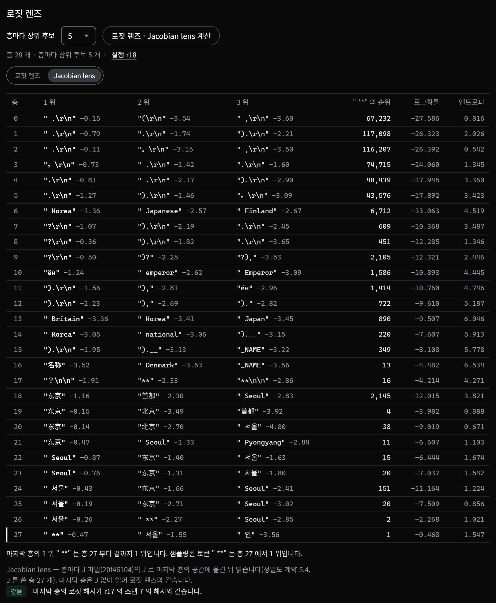
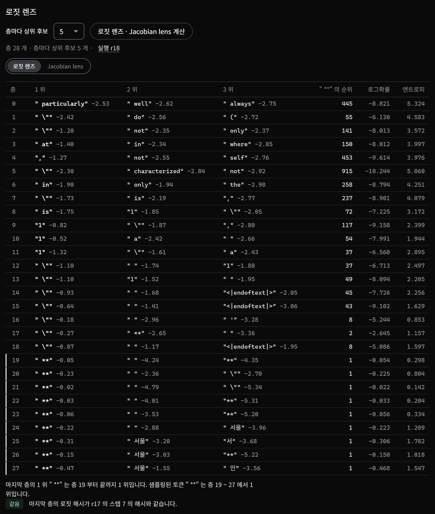
</p>

1. 답 아래의 **실행 rN** 으로 실행 화면을 열고, 토큰별 출력에서 `인천` 바로 앞의 별표 토큰 ` **`(스텝 7)을 누른 뒤 Enter 로 스텝 · 층
   화면을 엽니다.
2. **로짓 렌즈**에서 **층마다 상위 후보**(3 · 5 · 10 · 20 — 기본 5)를 고르고 **로짓 렌즈 · Jacobian lens 계산**을 누릅니다. 층마다(0 ~ 27)
   1 위 · 2 위 · 3 위 후보와 그 로그확률, 샘플링된 토큰의 순위 · 로그확률, 엔트로피가 표로 나옵니다. 층 번호를 누르면 그 층의 상위 후보가
   모두 펼쳐지고, 마지막 층의 1 위가 끝까지 1 위로 남는 첫 층부터 층 번호 왼쪽에 선이 그어집니다. 표 아래의 문장이 그 층과, 샘플링된
   토큰이 1 위인 층을 적습니다. 계산은 이 실험의 로짓 렌즈 실행으로 남습니다.
3. **Jacobian lens**(왼쪽 그림 — 표 위의 **로짓 렌즈** · **Jacobian lens** 로 바꿉니다): 층 18 ~ 21 의 1위가 `东京`(도쿄 — 31.5 ~ 87.2 %),
   층 22 · 23 이 ` Seoul`(41.9 · 46.8 %), 층 24 ~ 26 이 ` 서울`(64.9 · 82.7 · 77.3 %)입니다(표의 값은 로그확률 — 확률 = e<sup>로그확률</sup>).
   별표 다음에 쓸 말로 가운데 층은 **서울**을 가리켰는데, 다음 스텝에서 모델은 `인천` 을 씁니다.
4. **로짓 렌즈**(오른쪽 그림)로 바꾸면 같은 스텝에서 층 19 부터 ` **` 가 1위이고, ` 서울` 은 층 24 ~ 26 에서 2 · 3위(1.9 ~ 4.8 %)로만
   보입니다(마지막 층 27 에서는 2위 21.2 %) — 가운데 층의 값을 끝 층의 것처럼 바로 읽으면 이런 개념이 잘 드러나지 않습니다. 마지막 층(27)은 두 렌즈가 같습니다(J 없이 읽는 끝 출력 — 62.7 %).

영어로 해 보면(**What is the capital of South Korea? Answer in one word.** → `South Korea's capital is Seoul.`) 첫 토큰 `South` 의
스텝(스텝 0)에서 이미 Jacobian lens 의 층 21 ~ 26 이 ` Seoul`(57.0 ~ 97.0 %)입니다 — 답을 쓰기 다섯 토큰 앞에서 답이 가운데 층에 있습니다.
로짓 렌즈는 그 스텝에서 층 22 에만 ` Seoul`(24.8 %)이 잠깐 보입니다.

읽을 때 주의할 것:

- 두 렌즈 모두 정밀도 계약(logit lens 는 [5.3](계약/계약.md), Jacobian lens 는 5.4)으로 정해져 있어 GPU 마다 · 실행마다 같은 비트입니다.
  표 아래의 '같음'은 마지막 층의 로짓 해시가 생성할 때 그 스텝의 해시와 같다는 뜻입니다. 재현 파일([실험 7](#실험-7-결과를-남에게-확인받기))에는
  그 실행의 로짓 렌즈 실행이 들어가고, 받은 사람은 GPU 없이
  `.venv/Scripts/python -I 도구/repro_check.py geulpu-repro.json Qwen3-0.6B-Q8_0.gguf --jlens Qwen3-0.6B-Q8_0.jlens.safetensors` 로
  두 렌즈를 비트까지 확인합니다(J 파일은 SHA-256 으로 같은 것인지 봅니다).
- J 는 원본(BF16) 모델에서 맞춘 것입니다. Q8_0 에서는 원본과 층마다의 1위가 층 9 ~ 26 에서 93.8 % 이상 같다는 것을 미리 정한 기준으로
  쟀습니다([문서/층렌즈.md](문서/층렌즈.md)). Q4_K_M 처럼 비트가 낮은 파일에서는 층마다의 1위가 원본과 덜 맞으니, 어느 층에서 어떤 개념이
  나오는지 정도로 읽으세요.
- 다른 모델의 J 파일은 `도구/jlens_fit.py` 로 원본(Hugging Face) 모델에서 맞춥니다 — GPU 와 torch · transformers · jlens 가 들고,
  0.6B 는 RTX 4070 Ti 에서 약 17 분이었습니다. CLI 로는 `GeulPU experiment lens --run rN --step 7 --jacobian`, API 로는
  [5. 스크립트로 — API](#5-스크립트로--api)의 echo 요청에 `"geulpu": {"echo_from": n, "layer_lens": {"jacobian": true}}` 를 더합니다.

### 프롬프트 캐시는 어디서 끊겼나

**질문**: 코딩 에이전트는 요청마다 같은 긴 지시를 다시 보낸다 — GeulPU 는 그 프롬프트를 얼마나 다시 썼고, 나머지는 왜 다시 계산했나?

GeulPU 는 프롬프트의 앞부분이 토큰까지 같은 만큼 계산한 상태(KV 캐시)를 다시 씁니다 — 그 슬롯에 있던 것, GPU 안에서 다른 슬롯으로부터
복사한 것, **프롬프트 캐시**(SSD 에 256 토큰 청크로 남긴 것 — 앱을 다시 켜도 · 모델을 바꿨다 돌아와도 남는다. 설정 › 프롬프트 캐시, SSD 면
기본으로 켬)에서 읽은 것. KV 는 어떻게 채워도 바이트까지 같아서 다시 써도 답은 하나도 바뀌지 않고 계산만 줄어듭니다. 실행 화면의
**프롬프트 캐시**가 얼마나 다시 썼는지와 어디서 끊겼는지를 보여 줍니다.

![실행 화면의 프롬프트 캐시 — '다시 쓴 프롬프트 458/875 토큰 — 이 슬롯 0 · 다른 슬롯 458 · 프롬프트 캐시 0'과 '캐시가 끊긴 위치: 토큰 458 — 앞 내용과 달라짐 [1 → 2]'](docs/img/guide/14-prompt-cache-ko.png)

첫 줄은 다시 쓴 양과 그 출처, 둘째 줄은 다시 쓰기가 멈춘 까닭입니다 — '캐시가 끊긴 위치: 토큰 N — 앞 내용과 달라짐 [이전 → 이번]',
'캐시가 끊긴 위치: 토큰 N — 프롬프트 캐시에 있던 데까지', 또는 '프롬프트를 끝까지 다시 씀' · '앞 내용을 끝까지 다시 씀' · '같은 앞부분이
없어 처음부터 계산' · '캐시 없이 계산'(`cache_prompt: false`).

1. 생성 설정의 시스템 프롬프트에 아래 글을 넣습니다 — 규칙, `오늘 날짜: 2026-10-19`, 프로젝트 설명 차례. 질문
   `이 프로젝트의 테스트는 어떻게 돌리나요? 한 문장으로 답해 주세요.` 를 보내면 답은 `python -m pytest` 입니다.
2. 날짜를 `2026-10-20` 으로 바꾸고 같은 모델로 **새 채팅**을 열어 같은 질문을 보낸 뒤, 답 아래의 **실행 rN** 으로 실행 화면을 엽니다.

**읽기**
- '다시 쓴 프롬프트 458/875 토큰 — 이 슬롯 0 · 다른 슬롯 458 · 프롬프트 캐시 0'. 새 채팅은 빈 슬롯에서 시작해 같은 앞부분을 첫 채팅의
  슬롯에서 복사했습니다.
- '캐시가 끊긴 위치: 토큰 458 — 앞 내용과 달라짐 [1 → 2]' — 끝의 [ ] 는 그 위치의 이전 → 이번 토큰입니다. 날짜가 바뀌어 그 뒤 —
  프로젝트 설명과 질문, 417 토큰 — 를 다시 계산했습니다.
- 요청마다 바뀌는 것(날짜 · 시각 · 작업 폴더 · git 상태)은 바뀌지 않는 것 **뒤에** 두세요. 코딩 에이전트도 같습니다: Qwen Code 를
  녹화해 보니([문서/문맥저장소.md](문서/문맥저장소.md)의 4단계) 다른 폴더의 새 작업은 14,671 토큰 중 3,819 에서(시스템 프롬프트의 작업
  폴더 경로), 같은 폴더의 다음 날은 13,591 에서(날짜 줄), 같은 날은 작업 지시에서야(14,633) 깨졌습니다.

3. 앱을 다시 켜고(또는 다른 모델을 불러왔다 돌아오고 — 이제 슬롯은 비어 있습니다) 둘째 채팅에 다음 질문을 보냅니다:
   `마감이 지난 할 일만 보여 주는 명령을 더하려면 어느 파일의 무엇을 고쳐야 하나요? 두 문장으로.` 그 답의 실행 화면을 엽니다.

**읽기**
- '다시 쓴 프롬프트 768/923 토큰 — 이 슬롯 0 · 다른 슬롯 0 · 프롬프트 캐시 768'. 슬롯에 남은 것이 없어 채팅의 앞부분을 계산하지 않고
  SSD 에서 읽었습니다(16 ms — 실행 기록의 `geulpu.store.restore_ms`). 프롬프트 캐시는 256 토큰 청크 통째로 남기고, 이 채팅은 청크 셋을
  채웠습니다.
- '캐시가 끊긴 위치: 토큰 768 — 프롬프트 캐시에 있던 데까지'. 나머지(155 토큰 — 첫 주고받음의 끝과 새 질문)만 계산했습니다. 31,000 토큰
  대화를 다시 켠 뒤 다시 열면 첫 토큰이 다시 계산의 10 초 대신 0.74 초, 청크가 OS 파일 캐시에 없을 때(재부팅 뒤처럼)는 1.1 초입니다
  (Qwen2.5-7B Q4_K_M, 4단계).
- 다시 써서 바뀐 것이 없는지는 실행 화면의 **캐시 없이 재실행**이 봅니다 — 프롬프트 캐시 없이 다시 생성해 원래 실행과 스텝마다
  비교합니다.

<details>
<summary>여기서 쓴 시스템 프롬프트</summary>

```text
당신은 아래 프로젝트를 돕는 코딩 도우미입니다. 답은 짧고 정확하게 쓰고, 모르는 것은 모른다고 말합니다. 코드를 고칠 때는 고친 까닭을 한 줄로 덧붙이고 테스트를 함께 고칩니다. 파일을 지우거나 이름을 바꾸기 전에는 먼저 묻습니다.

# 규칙
- 파이썬 3.12, 표준 라이브러리만 씁니다. 바깥 꾸러미가 필요하면 먼저 묻습니다.
- 함수 이름은 snake_case, 클래스 이름은 PascalCase, 상수는 UPPER_CASE 로 씁니다.
- 모든 공개 함수에 docstring 을 쓰고, 인자와 반환값의 타입 힌트를 붙입니다.
- 저장은 todo.json(UTF-8, 들여쓰기 2) 하나에만 합니다. 쓰기는 임시 파일에 쓴 뒤 바꿔 넣어, 도중에 꺼져도 파일이 깨지지 않게 합니다.
- 날짜는 ISO 8601(YYYY-MM-DD)로 다루고, 시간대는 쓰지 않습니다.
- 명령줄 인자는 argparse 로 읽고, 하위 명령마다 도움말을 씁니다.
- 오류는 사용자가 읽을 수 있는 한 줄로 표준 오류에 알리고 종료 코드 1 로 끝냅니다. 예상하지 못한 오류만 트레이스백을 남깁니다.
- 출력은 사람이 읽는 표가 기본이고, --json 을 주면 JSON 한 줄로 냅니다.
- 한 함수는 40 줄을 넘기지 않습니다. 넘으면 작은 함수로 나눕니다.
- 커밋 메시지는 한국어 한 줄 요약 + 빈 줄 + 까닭으로 씁니다.

오늘 날짜: 2026-10-19

# 프로젝트: 할 일 관리 명령줄 도구
파일: todo.py(명령 · 저장), store.py(todo.json 읽기 · 쓰기), tests/test_todo.py · tests/test_store.py(pytest), README.md.

## 명령
- add <제목> [--due 날짜] [--tag 꼬리표] — 할 일을 더하고 번호를 알립니다.
- list [--done] [--tag 꼬리표] [--json] — 할 일을 번호 차례로 보입니다. 기본은 끝내지 않은 것만.
- done <번호> — 끝냄으로 표시합니다. 이미 끝낸 것이면 알리기만 합니다.
- remove <번호> — 지웁니다. 지운 번호는 다시 쓰지 않습니다.
- edit <번호> [--title 제목] [--due 날짜] — 고칩니다.

## 자료
할 일 하나는 {"id": 정수, "title": 글, "due": 날짜 또는 null, "tags": [글], "done": 참거짓, "created": 날짜} 입니다.
todo.json 의 꼴은 {"version": 1, "next_id": 정수, "items": [할 일]} 이고, 판이 다르면 읽기를 멈추고 알립니다.

## 테스트
테스트는 python -m pytest 로 돌리고, 임시 폴더(tmp_path)에서 todo.json 을 만들어 씁니다. 명령마다 성공 · 실패 경우를 하나 이상
둡니다. 날짜가 드는 테스트는 오늘 날짜를 직접 쓰지 않고 함수 인자로 넘깁니다.
```

</details>

### 데이터 꺼내기

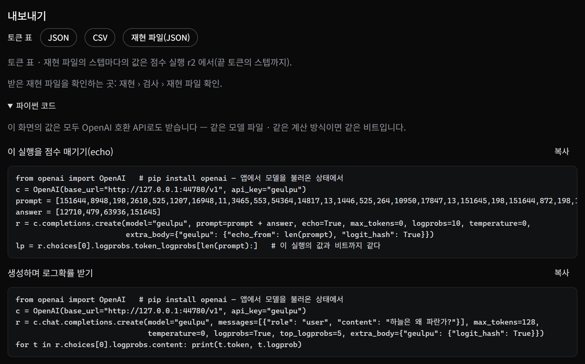

실행 화면 아래의 **내보내기**는 그 실행의 값을 파일로 줍니다.

- **토큰 표** — JSON · CSV. CSV의 열은 `step,id,text,logprob,prob,rank,entropy,margin,logit_hash`(`step` 은 그 실행의 토큰 순서로 1 부터
  — 화면의 스텝 번호와 다릅니다), JSON(`geulpu-tokens/1`)에는 스텝마다 상위 후보와 프롬프트 토큰 · 지문 · 모델 SHA-256 · 만든 곳이 더
  들어갑니다. 답 전체를 점수 매긴 실행이 있으면 그 값(끝 토큰의 스텝까지, 상위 후보가 더 많은 것)을 씁니다.
- **Δ 의 CSV** — 다른 모델로 점수(실험 4)와 비교 탭의 점수(실험 5)의 Δ 아래에 **CSV** 단추가 있습니다. 열은
  `step,id,text,logprob,other_logprob,delta`.
- **재현 파일(JSON)** — [실험 7](#실험-7-결과를-남에게-확인받기).
- **파이썬 코드** — 같은 값을 API로 받는 코드(`openai` 패키지 — 이 실행을 echo 로 점수 매기기, 생성하며 로그확률 받기. 표준 라이브러리만
  쓰는 버전은 아래 5절).

## 5. 스크립트로 — API

실행 화면 · 스텝 · 층 화면의 값은 모두 API로도 받습니다. 앱에서 모델을 불러온 상태에서 `http://127.0.0.1:44544`에 보냅니다. 아래는 표준 라이브러리만
쓰는 파이썬입니다(패키지 설치 없음). API의 기본 온도는 앱의 생성 설정과 따로 0.8이므로, 안내서와 같은 답을 받으려면
`"temperature": 0`을 넣습니다(계산 방식은 준비에서처럼 정밀로).

```python
import json, math, urllib.request

BASE = "http://127.0.0.1:44544"          # 앱에서 모델을 불러온 상태


def post(path, body):
    rq = urllib.request.Request(BASE + path, json.dumps(body).encode(), {"Content-Type": "application/json"})
    with urllib.request.urlopen(rq) as r:
        return json.load(r)


# 예 1 — 생성하며 스텝마다 확률과 대안(실험 1)
r = post("/v1/chat/completions", {
    "messages": [{"role": "user", "content": "유명한 화가 한 명의 이름만 말해 줘."}],
    "temperature": 0, "logprobs": True, "top_logprobs": 5})
print("답:", r["choices"][0]["message"]["content"], "| 모델:", r["model"])
for i, t in enumerate(r["choices"][0]["logprobs"]["content"]):    # 스텝은 화면처럼 0 부터
    alts = ", ".join(f"{a['token']!r} {math.exp(a['logprob']):.1%}" for a in t["top_logprobs"])
    print(f"스텝 {i}: {t['token']!r} {math.exp(t['logprob']):.1%} | {alts}")
```

```text
답:  Van Gogh | 모델: qwen2.5-7b-instruct-q8_0
스텝 0: ' Van' 17.8% | ' Van' 17.8%, '레' 15.2%, ' VIN' 13.6%, '파' 4.8%, 'PIC' 4.1%
스텝 1: ' G' 100.0% | ' G' 100.0%, '.G' 0.0%, 'G' 0.0%, '_G' 0.0%, '\tG' 0.0%
스텝 2: 'ogh' 100.0% | 'ogh' 100.0%, 'ough' 0.0%, 'og' 0.0%, 'oh' 0.0%, 'ог' 0.0%
```

```python
# 예 2 — 같은 답을 두 질문 뒤에서 계산해 단어 하나의 효과를 잰다(실험 5)
def prompt_of(question):            # 채팅 템플릿을 씌운 프롬프트 토큰(답 앞까지)
    return post("/tokenize", {"messages": [{"role": "user", "content": question}]})["tokens"]


def score(prompt, answer):          # 답 토큰마다 로그확률 — 생성하지 않고 점수만(echo)
    r = post("/v1/completions", {"prompt": prompt + answer, "echo": True, "max_tokens": 0, "logprobs": 1,
                                 "geulpu": {"echo_from": len(prompt)}})
    return r["choices"][0]["logprobs"]["token_logprobs"][len(prompt):]


A = prompt_of("유명한 화가 한 명의 이름만 말해 줘.")
B = prompt_of("유명한 이탈리아 화가 한 명의 이름만 말해 줘.")
r = post("/v1/completions", {"prompt": B, "temperature": 0, "max_tokens": 32, "geulpu": {}})
answer = r["geulpu"]["tokens"]      # B에서 생성된 토큰 그대로(끝 토큰 포함) — "레오나르도 다 빈치"
la, lb = score(A, answer), score(B, answer)
for t, a, b in zip(answer, la, lb):
    print(f"{post('/detokenize', {'tokens': [t]})['prompt']!r:8} {math.exp(a):7.2%} → {math.exp(b):7.2%}  Δ {b - a:+.3g}")
print(f"합 Δ {sum(lb) - sum(la):+.3f}")
```

```text
'레'       15.21% →  85.11%  Δ +1.72
'오'       98.32% →  99.25%  Δ +0.00941
'나'       96.89% →  93.38%  Δ -0.0368
'르'       99.06% →  97.53%  Δ -0.0156
'도'       97.21% →  96.99%  Δ -0.00229
' 다'      87.98% →  87.35%  Δ -0.00713
' �'      45.38% →  52.29%  Δ +0.142
'�'       63.05% →  65.13%  Δ +0.0324
'�'       94.74% →  97.19%  Δ +0.0255
'치'       85.51% →  93.92%  Δ +0.0938
'<|im_end|>'  93.67% →  74.78%  Δ -0.225
합 Δ +1.738
```

`'�'` 셋은 `빈` 한 글자의 UTF-8 바이트를 나눠 가진 토큰 셋입니다. 실험 5 와 같은 수입니다 — 실험 5 의 비교 탭은 Δ 를 '원래 질문 − 고친
질문'으로 세어 부호만 반대입니다.

```python
# 예 3 — 글 한 줄의 토큰마다 확률, 맥락 없이(실험 6)
ids = post("/tokenize", {"prompt": "대한민국의 수도는 부산이다."})["tokens"]
for t, x in zip(ids[1:], score(ids[:1], ids[1:])):    # 첫 토큰은 앞 맥락이 없어 확률이 없다
    print(f"{post('/detokenize', {'tokens': [t]})['prompt']!r:8} {math.exp(x):.2%}")
```

```text
'한'      7.22%
'민'      66.34%
'국'      99.98%
'의'      18.72%
' 수도'    0.51%
'는'      53.25%
' 부'     0.82%
'산'      99.16%
'이다'     22.03%
'.'      75.08%
```

자주 쓰는 것:

- **`/v1/chat/completions`**: `"logprobs": true, "top_logprobs": 5`(0 ~ 20). 요청에 `"geulpu": {}`를 넣으면 응답의 `geulpu`에 샘플링한 토큰
  번호(`tokens`) · 시드 · 시간이, `"geulpu": {"logit_hash": true, "prompt_tokens": true}`면 스텝마다 로짓 해시와 채팅 템플릿을 씌운 프롬프트
  토큰이 더해집니다.
- **`/v1/completions`**: `"echo": true, "max_tokens": 0, "logprobs": k`로 생성 없이 점수만. `prompt`는 글이나 토큰 번호 배열,
  `"geulpu": {"echo_from": n}`이면 번호 n부터만 셉니다(그 앞은 `null`). 응답의 `geulpu`에 `prompt_entropy` · `prompt_top_ids` ·
  `prompt_top_logprobs` · `prompt_logit_hashes`.
- **`/tokenize`** (`{"prompt": "…"}` 또는 `{"messages": […]}` — 채팅 템플릿을 씌운 프롬프트) · **`/detokenize`** · **`/tokenizer_info`**
  — vLLM과 같은 형식. `/detokenize` 는 `n_bytes`(토큰들이 나타내는 바이트 그대로의 수 — UTF-8 로 다듬기 전, 0.20.0 부터)도 돌려줍니다.
- 요청에서 **`model`을 빼면** 응답의 `model`에 지금 불러온 모델의 이름이 옵니다(넣으면 넣은 이름이 그대로 옵니다 — 요청의 `model`은
  모델을 고르지 않습니다). 어느 모델이 답했는지 남기려면 빼고 보내세요.
- 생성 응답의 `geulpu.tokens` · `logit_hashes`는 끝 토큰을 샘플링한 스텝까지 담고, 로그확률 배열은 OpenAI처럼 답 글의 토큰만 담습니다
  (답이 끝 토큰으로 끝나면 하나 짧음). 끝 토큰의 확률은 `tokens`를 echo로 점수 매기면 나옵니다(실행 화면의 **모든 스텝의 상위 후보**가 이렇게 셉니다).
- **CLI · 명령 창** — 화면의 계산은 모두 `GeulPU` 명령으로도 됩니다: `experiment branch --run r1 --step 3 --token 785` ·
  `experiment score --run r1 [--step 3]` · `experiment lens --run r1 --step 3 [--jacobian]` · `experiment summary` ·
  `experiment compare --path <실험> --a r1 --b r2` · `experiment repro`. 요청은 앱이 실행의 기록에서 짓고 결과는 그 실험의 실행으로 남습니다.
  화면에서 누르면 명령 창에 같은 명령이 나옵니다 — [사용 안내의 6절](사용안내.md#6-명령-창--cli--파이썬--화면과-같은-기능을-명령으로),
  파이썬은 `import geulpu`([문서/파이썬API.md](문서/파이썬API.md)), AI 에이전트용 한 쪽 안내는 [docs/cli.md](docs/cli.md)(영어).
- **lm-evaluation-harness** — `local-completions` + `tokenizer_backend=remote`로 붙습니다. 문항마다의 결과가 동시 요청 수 · CUDA ↔
  Vulkan과 상관없이 같은 비트입니다([README](사용안내.md#다른-프로그램에서-쓰기-openai-호환-api)).

## 6. 주의할 점과 자주 묻는 것

- **답 아래에 '실행 rN'이 없어요.** 0.23.0 전에 받은 답이거나, 실험을 만들지 못했을 때의 답입니다. 이 브라우저에 그 답의 연구 기록이
  있으면 답 아래의 **이 답을 실험에 남기기**(플라스크 단추)가 같은 요청 · 같은 시드로 다시 생성해 "대화"의 실행으로 남기고, 토큰이
  기록과 같으면 답에 링크를 붙입니다. 기록이 없으면 질문을 새로 보내세요.
- **마진이 작은 스텝이 0개예요.** 기본 기준 δ = 0.05 nat는 확률비 1.05배보다 가까운 스텝만 셉니다. 넓게 보려면 0.3 ~ 0.7로 올리세요(0.5 ≈
  1위가 2위의 1.65배 이내).
- **예전 안내서와 스텝 번호가 하나씩 달라요.** 연구 패널은 스텝을 1 부터 셌고, 0.23.0 의 화면과 CLI 는 0 부터 셉니다.
- **모델이 바뀌었어요.** **불러와 점수 매기기**(다른 모델로 점수), 재현 파일 확인, **이 실행의 모델 불러오기**는 필요한 모델을
  불러옵니다(수십 초). 채팅을 다시 보내면 그 채팅의 모델로 돌아옵니다. API도 지금 불러온 모델로 답하니, 스크립트를 돌리는 동안에는
  화면에서 모델을 바꾸지 마세요.
- **확률이 생성 설정과 맞지 않아요.** 화면의 확률은 온도 1의 모델 분포입니다. 온도 · top-k · top-p는 어느 토큰을 샘플링할지에만 쓰입니다.
- **0.00% 로 보이는 작은 확률.** 화면은 확률을 10 % 이상이면 17.8% 처럼, 그 아래면 4.79% 처럼 보여서, 0.005 % 보다 작은 확률은
  0.00% 가 됩니다. 로그확률을 보세요(로그확률 −10 = 0.0045 %).
- **재현 파일 확인이 다르다고 나와요.** 재현 파일을 다른 도구로 열어 다시 저장하면 시드(64비트 정수)가 정밀도를 잃을 수 있습니다 — JavaScript의
  `JSON.parse`는 정밀도를 잃습니다. 파일을 고치지 말고 그대로 전하세요. '만든 곳'은 재현 파일을 만든 쪽이 적은 기록일 뿐 확인에는 쓰지
  않습니다.
- **기록은 어디에?** 실험 폴더에 — 채팅의 답은 기본 실험 "대화"(`experiments` 폴더의 `<날짜>-chat`)의 실행으로 남고, 실행마다
  `records/runs/rN.json`(보낸 요청과 받은 응답 전체), 화면 · CLI 의 기능 호출은 `records/commands.jsonl` 에 있습니다. 폴더를 그대로 남에게
  넘길 수 있습니다. 0.23.0 전의 연구 기록(이 브라우저의 최근 60 개)은 **이 답을 실험에 남기기**만 읽습니다.
- **채팅 속도가 느려지나요?** 생성 중 로그확률을 받으면 토큰당 시간이 약 2 % 늘어납니다 — 0.23.0 의 채팅은 실행 화면을 위해 답마다 상위
  후보 2 개와 로짓 해시를 함께 받습니다. 실행 화면 · 스텝 · 층 화면의 다른 계산(상위 후보 · 점수 · 렌즈)은 누를 때만 합니다.
- **더 깊이**: 로그확률의 정의는 [계약 5.2](계약/계약.md), 이 기능의 판정과 수치는 [38단계](https://github.com/wwoosshh/GeulPU/blob/main/문서/38단계.md), GPU 없는 확인은
  [`도구/repro_check.py`](도구/repro_check.py), CLI 는 [docs/cli.md](docs/cli.md)(영어).
- **요청 여럿을 한꺼번에?** 에이전트 세션 · 테스트 세트처럼 요청 여럿을 실행 단위로 기록 · 재생 · 분기 · 비교하는 것은
  [디버거 안내서](디버거안내.md)에 있습니다. 디버거는 실험 화면의 **기록** 탭에서 엽니다.
