# GeulPU 연구 패널 안내서 — 연구자용

**[English](docs/research-guide.md)** · [README](README.ko.md) · [사용 안내](사용안내.md) · [계약 5.2](계약/계약.md) · [38단계 기록](https://github.com/wwoosshh/GeulPU/blob/main/문서/38단계.md) · [디버거 안내서](디버거안내.md)

GeulPU의 **연구 패널**은 채팅 옆에 붙은 실험대입니다. 답을 토큰마다 쪼개 모델이 어디서 망설였는지 보고, 다른 토큰을 골라 이어 생성해
보고, 질문의 단어 하나나 모델 파일 하나를 바꿨을 때 같은 답의 확률이 얼마나 바뀌는지 잽니다. 결과는 파일 하나(재현 파일)로 남겨 다른
사람이 자기 PC에서 비트까지 확인할 수 있습니다.

이 안내서는 실험 여덟 개를 처음부터 끝까지 따라 하며 패널의 모든 칸을 설명합니다. 같은 모델 파일(Qwen2.5-7B-Instruct Q8_0 — 실험 8 은 Qwen3-0.6B Q8_0) · 정밀
계산 방식 · 온도 0이면 **여러분 PC에서도 이 안내서와 같은 답 · 같은 숫자가 나옵니다** — 그것이 이 패널의 출발점입니다.

## 목차

- [0. 왜 이 패널인가 — 잡음 없는 비교](#0-왜-이-패널인가--잡음-없는-비교)
- [1. 준비](#1-준비)
- [2. 패널 열기와 화면 한눈에](#2-패널-열기와-화면-한눈에)
- [3. 숫자 읽는 법](#3-숫자-읽는-법)
- [4. 따라 하기 — 실험 여덟](#4-따라-하기--실험-여덟)
  - [실험 1. 모델은 어디서 망설였나](#실험-1-모델은-어디서-망설였나) (관찰)
  - [실험 2. 다른 토큰을 골랐다면](#실험-2-다른-토큰을-골랐다면) (개입)
  - [실험 3. 두 답은 어디서 갈렸나](#실험-3-두-답은-어디서-갈렸나) (비교)
  - [실험 4. 양자화는 같은 답을 얼마나 바꾸나](#실험-4-양자화는-같은-답을-얼마나-바꾸나) (비교)
  - [실험 5. 질문의 단어 하나는 같은 답을 얼마나 바꾸나](#실험-5-질문의-단어-하나는-같은-답을-얼마나-바꾸나) (비교)
  - [실험 6. 글 한 줄은 얼마나 그럴듯한가](#실험-6-글-한-줄은-얼마나-그럴듯한가) (점수)
  - [실험 7. 결과를 남에게 확인받기](#실험-7-결과를-남에게-확인받기) (재현)
  - [실험 8. 답은 몇 번째 층에서 생기나 — 층 렌즈](#실험-8-답은-몇-번째-층에서-생기나--층-렌즈) (관찰 — 0.13.0 부터)
  - [프롬프트 캐시는 어디서 끊겼나](#프롬프트-캐시는-어디서-끊겼나) (관찰)
  - [데이터 꺼내기](#데이터-꺼내기) (내보내기)
- [5. 스크립트로 — API](#5-스크립트로--api)
- [6. 주의할 점과 자주 묻는 것](#6-주의할-점과-자주-묻는-것)

## 0. 왜 이 패널인가 — 잡음 없는 비교

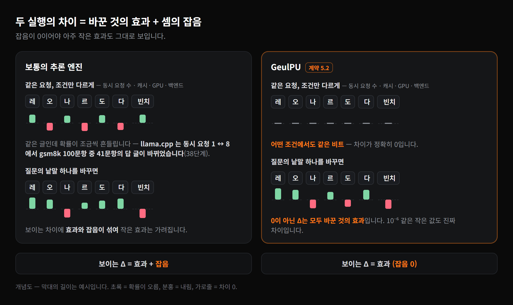

두 실행을 비교하면 보이는 차이는 **바꾼 것의 효과 + 계산의 잡음**입니다. 보통의 추론 엔진은 동시 요청 수 · 배치 크기 · 캐시 · GPU가
바뀌면 같은 요청의 확률도 조금씩 달라집니다. 실제로 llama.cpp는 동시 요청 1개와 8개에서 gsm8k 100문항 중 41문항의 답 글이
달라졌습니다([38단계](https://github.com/wwoosshh/GeulPU/blob/main/문서/38단계.md)). 이런 잡음 위에서는 작은 효과가 가려집니다.

GeulPU는 계산의 차례와 반올림을 [계약](계약/계약.md)으로 정해 두어서, 어떤 조건에서도 같은 비트가 나옵니다(로그확률은 계약 5.2).
그래서 **0이 아닌 Δ는 모두 바꾼 것 하나의 효과**입니다. 10⁻⁶처럼 작은 값도 진짜 차이입니다. 이 성질 덕분에 이런 질문에 깨끗하게 답할
수 있습니다.

- 모델은 답의 어느 스텝에서 망설였나, 그때 거의 고를 뻔한 토큰은 무엇이었나
- 그 자리에서 다른 토큰을 골랐다면 답은 어떻게 이어지나
- 질문의 단어 하나, 모델 파일 하나(양자화)는 같은 답의 확률을 토큰마다 얼마나 바꾸나
- 남이 낸 결과가 내 PC에서도 비트까지 같은가

## 1. 준비

1. **GeulPU 0.5.0 이상**을 설치합니다([README의 설치](사용안내.md#설치)).
2. **모델**: 이 안내서는 **Qwen2.5-7B-Instruct Q8_0**을 씁니다(모델 → 모델 찾기에서 받기). 실험 4에는 같은 모델의 **Q4_K_M**도
   필요합니다. 다른 모델로도 똑같이 할 수 있고, 숫자만 달라집니다.
3. 채팅 위 막대의 **계산 방식** 칩(**빠름** · **정밀**)을 눌러 **정밀**을 고릅니다(불러온 모델을 정밀로 다시 불러옵니다 — **설정 →
   계산 방식**에서 골라도 같습니다). 답마다 그 답을 셈한 방식이 꼬리표로 붙고, 연구 패널은 값을 셈한 서버의 방식이 답과 다르면
   알리고 답의 방식으로 다시 셈하게 합니다. 이 안내서의 숫자는 정밀 모드의
   값입니다. 기본인 빠른 모드는 행렬곱에 들어가는 활성값을 8비트로 계산해 확률이 조금 다르고, 영어 질문으로 하면 답이 `Leonardo da
   Vinci` 대신 `Vincent van Gogh`로 바뀌기까지 합니다. 두 방식 모두 결정적이고, 정밀 모드는 NVIDIA ↔ AMD, CUDA ↔ Vulkan 사이에서도
   같은 비트입니다.
4. **생성 설정**(채팅 위 오른쪽의 조절 단추)에서 **온도가 0**인지 봅니다. 기본값이 0입니다. 온도 0이면 같은 질문에 늘 같은 답이
   나오므로 이 안내서의 숫자를 그대로 따라갈 수 있습니다. 시스템 프롬프트는 비워 둡니다(모델 기본값).
5. **새 채팅**에서 질문을 보냅니다.

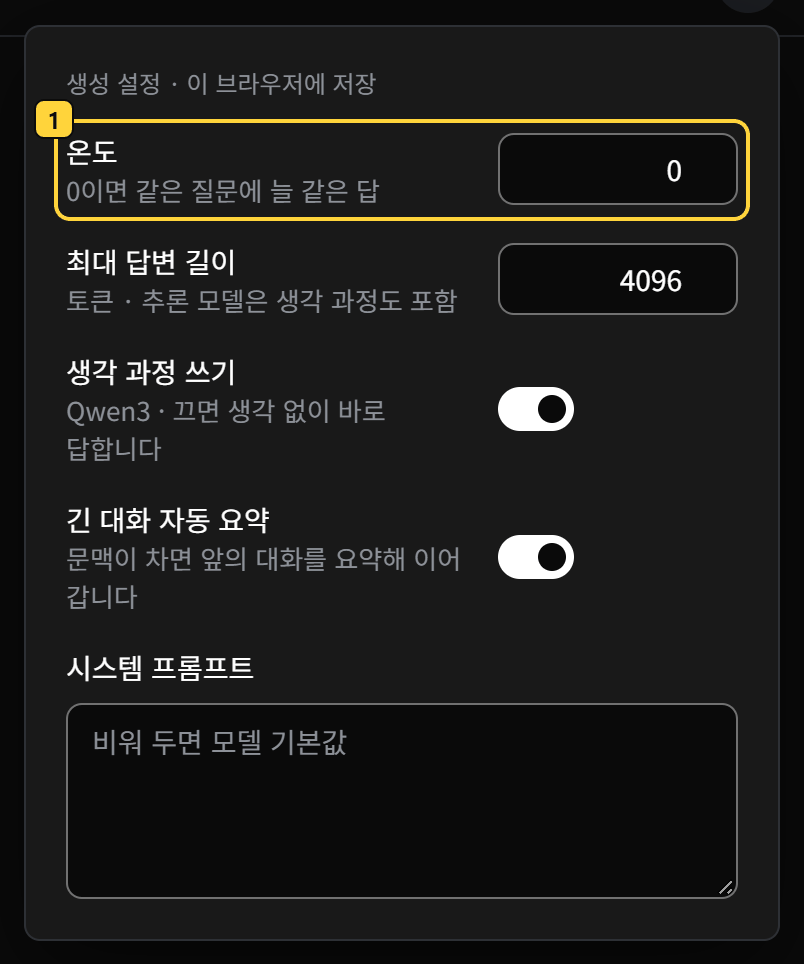

> 연구 기록은 **0.5.0에서 받은 답부터** 남고, **이 브라우저에만** 저장됩니다(최근 60개). 브라우저 데이터를 지우면 사라지니, 남길
> 결과는 [내보내기](#데이터-꺼내기)로 파일에 담아 두세요.

## 2. 패널 열기와 화면 한눈에

질문 `유명한 화가 한 명의 이름만 말해 줘.`를 보내면 답 ` Van Gogh`가 옵니다.

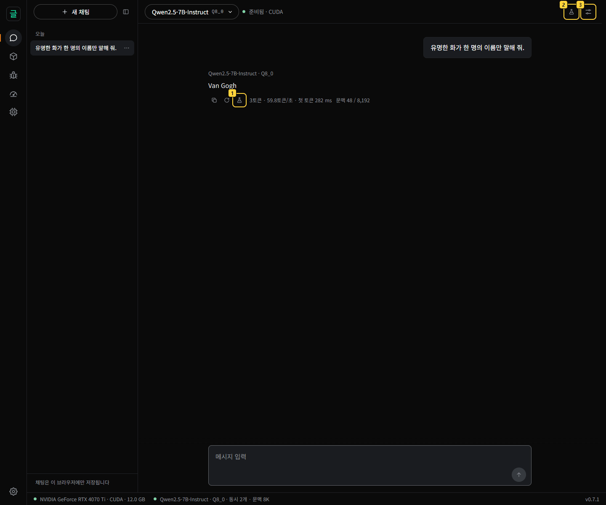

- **①** 답 아래의 **플라스크 단추**를 누르면 오른쪽에 패널이 열리고, 그 답을 토큰마다 계산합니다(몇 초).
- **②** 채팅 위의 플라스크는 패널을 열고 닫습니다. 좁은 창에서는 패널이 채팅 위를 덮습니다.
- **③** 생성 설정(온도 · 최대 길이 · 시스템 프롬프트).
- **④** **계산 방식** 칩 — 불러온 모델이 지금 셈하는 방식(**정밀** · **빠름**). 눌러서 바꿉니다(준비 3).
- **⑤** 답의 꼬리표 — 그 답을 셈한 방식. 이 안내서의 답은 모두 **정밀**입니다.

패널은 채팅 속도에 손대지 않습니다. 채팅은 평소처럼 생성하고, 패널을 열 때만 그 답의 토큰을 다시 계산합니다(점수 매기기 — `echo`).
다시 계산한 값은 생성할 때의 값과 **비트까지 같습니다**(38단계에서 모델 넷 · 두 백엔드로 확인).

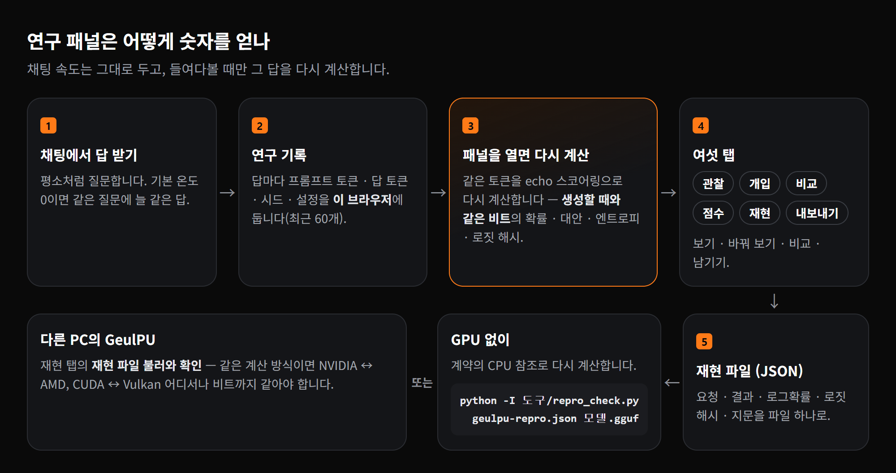

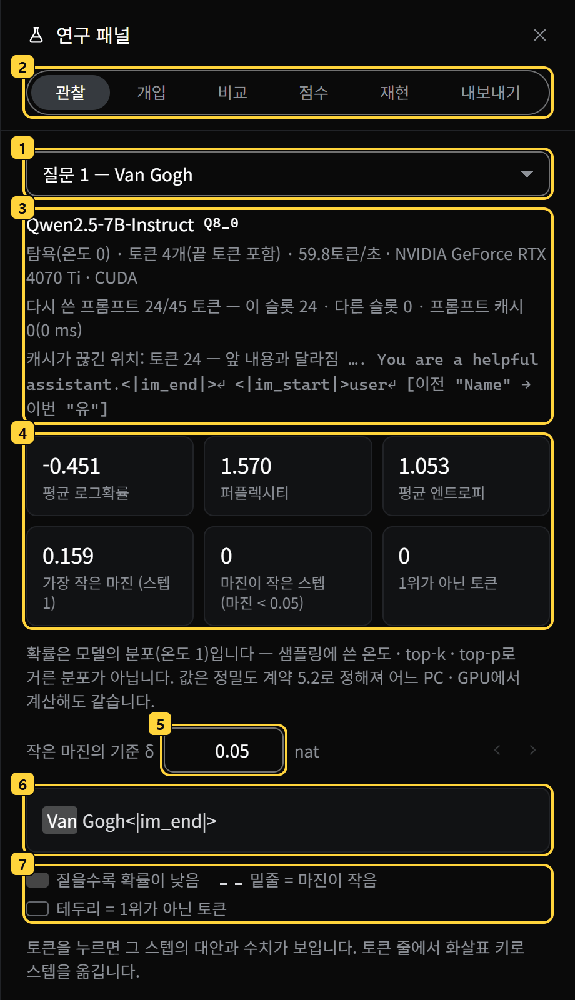

**패널의 칸** (오른쪽 그림의 번호)

1. **분석할 답** — 이 채팅의 답(질문 · 버전 · 분기)을 고릅니다. 앞 버전도 고를 수 있습니다.
2. **탭 여섯** — 관찰 · 개입 · 비교 · 점수 · 재현 · 내보내기(아래 표).
3. **답의 헤더** — 모델 · 양자화, 온도(0이면 '탐욕')와 시드, 토큰 수(끝 토큰 포함), 생성 속도, 만든 장치 · 백엔드, 그리고 이 답을
   셈한 **계산 방식**(정밀이면 초록 줄 — 같은 모델 파일 · 같은 요청이면 어느 PC · GPU에서도 같은 비트).
4. **요약 수 여섯** — 평균 로그확률 · 퍼플렉시티 · 평균 엔트로피 · 가장 작은 마진 · 마진이 작은 스텝 수 · 1위가 아닌 토큰 수.
5. **작은 마진의 기준 δ** — 1위와 2위의 차(마진)가 δ보다 작은 스텝을 '마진이 작은 스텝'로 셉니다. 옆의 ‹ › 로 그런 스텝 사이를 오갑니다.
6. **토큰 줄** — 답의 토큰. 짙을수록 확률이 낮고, 밑줄은 마진이 작은 스텝, 테두리는 1위가 아닌 토큰을 샘플링한 스텝입니다. 누르면 아래에 그
   스텝의 카드가 열립니다(화살표 키로도 옮김).
7. **범례**.

<br clear="right">

| 탭 | 답하는 질문 | 하는 일 |
|---|---|---|
| **관찰** | 모델은 어디서 망설였나 | 토큰마다 확률 · 순위 · 엔트로피 · 마진, 대안 상위 10 |
| **개입** | 다른 토큰을 골랐다면 | 거기서 분기(그 스텝에서 대안을 골라 이어 생성), 설정을 바꿔 다시 생성 |
| **비교** | 무엇이 얼마나 바꾸나 | 두 답이 처음 갈린 스텝, 같은 답을 다른 모델 · 다른 프롬프트로 계산한 토큰마다의 Δ |
| **점수** | 이 글은 얼마나 그럴듯한가 | 붙여 넣은 글의 토큰마다 로그확률 · 퍼플렉시티 |
| **재현** | 남도 같은 결과를 얻나 | 지문, 캐시 없이 다시 돌려 확인, 재현 파일 내보내기 · 불러와 확인, 엔진 해시 |
| **내보내기** | 데이터를 꺼내려면 | 보이는 값 모두 JSON · CSV, 같은 값을 받는 파이썬 코드 |

## 3. 숫자 읽는 법

| 이름 | 뜻 |
|---|---|
| **스텝** | 답의 토큰 하나를 고르는 한 번의 계산. 스텝 1이 답의 첫 토큰입니다. |
| **확률 · 로그확률** | 그 스텝에서 모델이 그 토큰에 준 확률과 그 자연로그(nat). 로그확률 −1.725 = 확률 e<sup>−1.725</sup> = 17.8 %. |
| **순위** | 그 스텝의 모든 토큰 가운데 몇 번째로 그럴듯했나. 온도 0이면 늘 1위를 샘플링합니다. |
| **엔트로피** | 그 스텝의 분포가 얼마나 퍼졌나(nat). 0이면 한 토큰에 몰림, 3.9면 약 e<sup>3.9</sup> ≈ 49개 토큰에 고르게 퍼진 것과 같은 불확실성. |
| **마진(margin)** | 1위와 2위의 로그확률 차 = ln(1위 확률 / 2위 확률). 작을수록 1위가 바뀌기 쉽습니다. |
| **마진이 작은 스텝** | 마진이 기준 δ보다 작은 스텝 — 계산이나 설정이 조금만 달라도 다른 토큰이 될 자리. 기본 δ = 0.05 nat(확률비 약 1.05배). |
| **1위가 아닌 토큰** | 샘플링(온도 > 0)나 분기가 1위가 아닌 토큰을 고른 스텝의 수. |
| **퍼플렉시티** | exp(−평균 로그확률). 1에 가까울수록 모델이 그 글을 당연하게 봅니다. |
| **Δ로그확률** | 같은 토큰을 두 조건에서 계산한 로그확률의 차(그쪽 − 이 답). 합 Δ가 x면 답 전체의 확률이 e<sup>x</sup> 배. |
| **로짓 해시** | 그 스텝의 로짓 행(어휘 전체의 점수) 64비트 해시. 두 계산이 비트까지 같은지 스텝마다 비교합니다. |
| **끝 토큰** | `<\|im_end\|>` — 모델이 답을 끝내기로 고른 토큰. 토큰 줄의 끝에 보이고, 이것도 한 스텝입니다. |
| **바이트 조각** | 한글 한 글자가 토큰 둘 이상으로 나뉜 것. 토큰 줄에서 점선 경계로 이어 보입니다. |

**확률은 모델의 분포(온도 1)입니다** — 샘플링에 쓴 온도 · top-k · top-p로 거른 분포가 아닙니다. 그래서 온도를 바꿔 생성해도 같은
토큰의 확률은 같습니다.

## 4. 따라 하기 — 실험 여덟

### 실험 1. 모델은 어디서 망설였나

**질문**: ` Van Gogh`라는 답은 얼마나 확실한 답이었나?

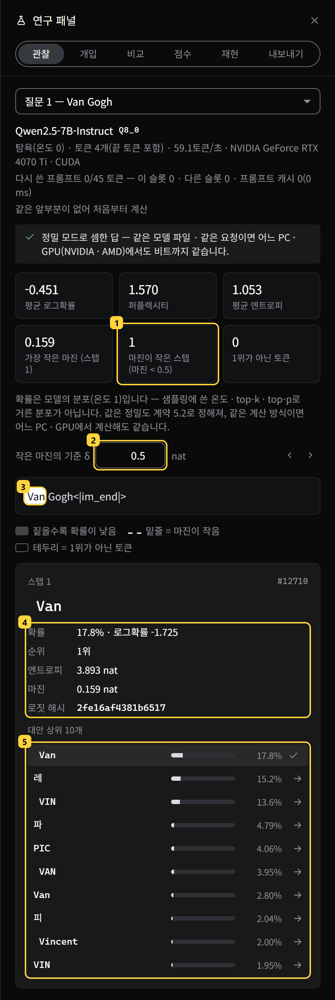

1. 패널을 열면 **관찰** 탭입니다. 요약의 **가장 작은 마진**가 0.159(스텝 1)입니다.
2. 기본 기준 δ = 0.05에서는 마진이 작은 스텝이 0개입니다. **②** δ 칸에 `0.5`를 넣으면 **①** 마진이 작은 스텝이 1개가 되고, **③** 토큰 줄의
   ` Van`에 밑줄이 생깁니다.
3. ` Van`을 누르면 스텝 1의 카드가 열립니다.

**읽기**
- **④** 확률 17.8 %(로그확률 −1.725), 1위, **엔트로피 3.893 nat**, 마진 0.159 nat. 1위였지만 다섯에 한 번도 안 되는 확률입니다.
- **⑤ 대안 상위 10**: ` Van` 17.8 % · `레`(레오나르도) 15.2 % · ` VIN` 13.6 % · `파`(파블로 피카소) 4.79 % · `PIC` 4.06 % ·
  ` VAN` 3.95 % … 모델은 고흐 · 다 빈치 · 피카소 사이에서, 그리고 같은 고흐를 ` Van` · ` VIN` · ` VAN` 가운데 어느 형태로 쓸지 사이에서
  망설였습니다.
- 첫 토큰이 정해진 뒤의 스텝(` G` · `ogh` · 끝 토큰)은 거의 100 %입니다. **불확실성은 답의 첫 스텝에 몰려 있었습니다.**

<br clear="right">

> 같은 모델 파일 · 같은 질문이면 여러분의 카드에도 같은 수가 나오고, 로짓 해시도 `2fe16af4381b6517`로 같습니다.

### 실험 2. 다른 토큰을 골랐다면

**질문**: 첫 스텝에서 2위인 `레`를 골랐다면 답은 어떻게 이어졌을까?

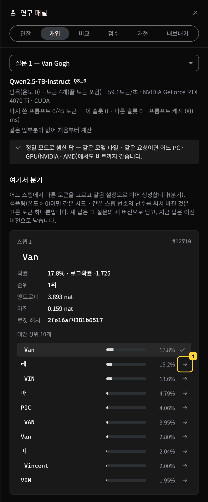

1. **개입** 탭을 엽니다. 관찰에서 고른 스텝 1의 카드가 그대로 보입니다(스텝을 고르지 않았으면 '마진이 가장 작은 스텝 고르기').
2. 대안 `레` 옆의 **① 화살표**(거기서 분기)를 누릅니다.

GeulPU는 프롬프트 + 앞 토큰(여기서는 없음) + 고른 토큰 `레`로 이어 생성합니다. 샘플링(온도 > 0)였다면 **같은 시드 · 같은 스텝 번호의
난수**를 써서, 바뀐 것은 고른 토큰 하나뿐입니다. 새 답은 그 질문의 새 버전이 되고, 원래 답은 앞 버전으로 남습니다.

같은 탭 아래의 **설정을 바꿔 다시 생성**은 같은 질문 · 같은 대화로 온도 · 시드 · 최대 길이만 바꿔 새 버전을 만듭니다. 시드를 비우면
서버가 고르고 기록에 남습니다.

<br clear="right">

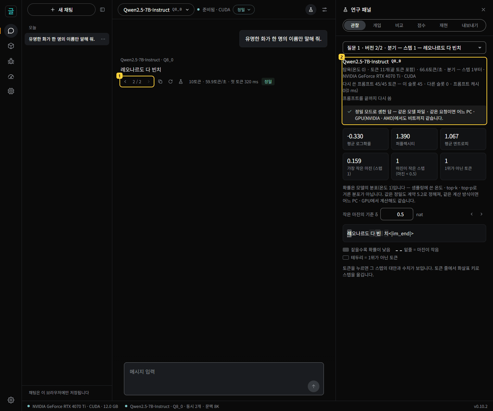

답은 **레오나르도 다 빈치**로 이어졌습니다. **①** 채팅에는 버전 넘기기(‹ 2 / 2 ›)가 생겨 원래 답(` Van Gogh`)과 오갈 수 있고,
**②** 패널의 헤더에는 '분기 — 스텝 1부터'가 붙습니다. 이 답도 다른 답처럼 계산되어 있어 바로 관찰 · 비교할 수 있습니다.

### 실험 3. 두 답은 어디서 갈렸나

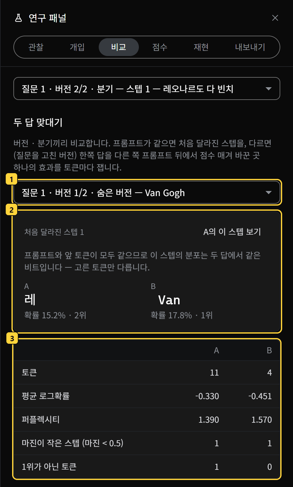

1. **비교** 탭을 엽니다. 위의 '분석할 답'(A)은 분기 답입니다.
2. **① 비교할 답**(B)에서 원래 답(버전 1)을 고릅니다.

**읽기**
- **② 처음 갈린 스텝 1** — A는 `레`(15.2 %, 2위), B는 ` Van`(17.8 %, 1위). 프롬프트와 앞 토큰이 모두 같으므로 **이 스텝의 분포는 두
  답에서 같은 비트**이고, 고른 토큰만 다릅니다. 'A의 이 스텝 보기'는 관찰 탭의 그 스텝으로 갑니다.
- **③ 요약 표** — 토큰 11 ↔ 4, 평균 로그확률 −0.330 ↔ −0.451, 1위가 아닌 토큰 1 ↔ 0(A는 분기로 2위를 골랐으므로).

설정을 바꿔 다시 생성한 버전(예: 온도 0.7, 다른 시드)도 같은 방법으로 비교합니다. 처음 갈린 스텝이 샘플링이 처음 다른 토큰을 고른
자리입니다.

<br clear="right">

### 실험 4. 양자화는 같은 답을 얼마나 바꾸나

**질문**: Q8_0 대신 Q4_K_M 파일을 쓰면 같은 답의 확률이 토큰마다 얼마나 달라지나?

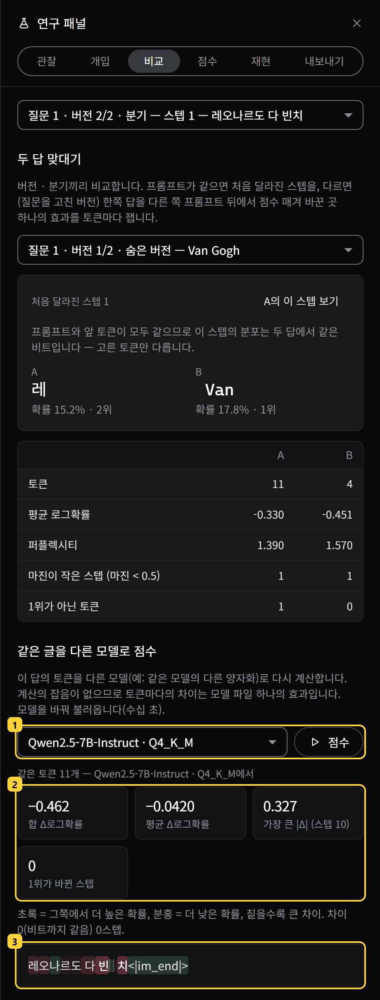

1. 비교 탭의 아래, **같은 글을 다른 모델로 점수**에서 **①** `Qwen2.5-7B-Instruct · Q4_K_M`을 고르고 **점수**를 누릅니다. 모델을 바꿔
   불러오므로 수십 초 걸립니다. 어휘와 채팅 템플릿이 같은 모델만 목록에 나옵니다.

**읽기** — 답 `레오나르도 다 빈치`의 토큰 11개를 Q4_K_M으로 다시 계산했습니다.
- **② 합 Δ −0.462** — 이 답 전체의 확률이 Q4_K_M에서 e<sup>−0.462</sup> ≈ 0.63배. **가장 큰 |Δ| 0.327**은 스텝 10(`치`), **1위가 바뀐
  스텝 0**.
- **③ 토큰 줄** — 초록은 Q4_K_M에서 더 높은 확률, 분홍은 더 낮은 확률, 짙을수록 큰 차이입니다. 차이 0인 스텝이 하나도 없습니다 —
  양자화는 모든 스텝에 흔적을 남깁니다. 계산의 잡음이 0이므로 **이 차이는 모두 모델 파일 하나의 효과**입니다.

<br clear="right">

같은 질문을 Q4_K_M으로 직접 물으면 답은 똑같이 ` Van Gogh`지만, 스텝 1의 2위와 3위가 자리를 바꿉니다(Q8_0: `레` 15.2 % ·
` VIN` 13.6 % → Q4_K_M: ` VIN` 14.9 % · `레` 14.0 %). 영어 질문에서는 1위가 바뀌어 **답 자체가 달라집니다** — Q8_0은
`Leonardo da Vinci`, Q4_K_M은 `Vincent van Gogh`([영어 안내서](docs/research-guide.md#experiment-4-how-much-does-quantization-change-the-same-answer)).

### 실험 5. 질문의 단어 하나는 같은 답을 얼마나 바꾸나

**질문**: 질문에 '이탈리아'를 넣으면 `레오나르도 다 빈치`라는 답은 얼마나 더 그럴듯해지나?

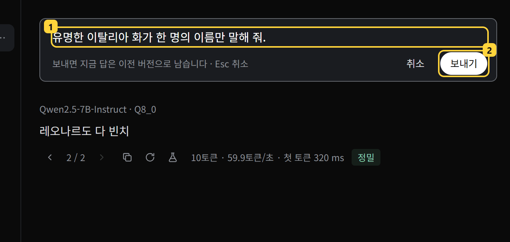

1. 채팅에서 질문 위에 마우스를 올리면 나오는 **연필**(수정)을 누르고, **①** `유명한 이탈리아 화가 한 명의 이름만 말해 줘.`로 고쳐
   **② 보내기**를 누릅니다. 답 `레오나르도 다 빈치`가 새 버전(3/3)으로 옵니다. 앞의 두 답은 숨은 버전으로 남습니다.

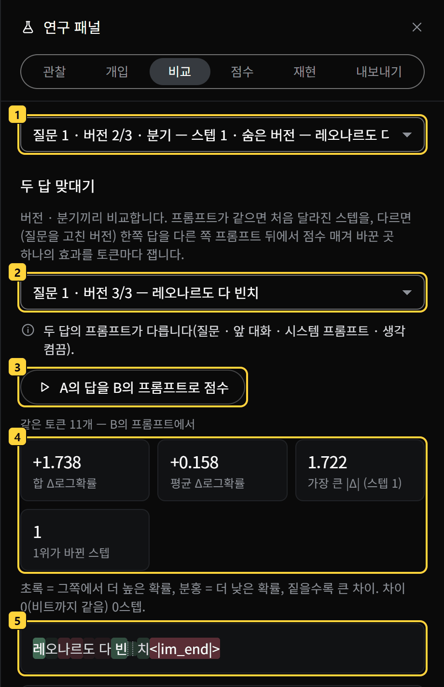

2. 패널에서 **① 분석할 답**(A)을 분기 답(버전 2 — 원래 질문 뒤의 `레오나르도 다 빈치`)으로, 비교 탭의 **② 비교할 답**(B)을 버전 3으로
   고릅니다. B가 아직 계산되지 않았으면 'B도 계산하기'를 먼저 누릅니다.
3. **③ A의 답을 B의 프롬프트로 점수**를 누릅니다. A의 답 토큰을 B의 질문 뒤에서 다시 계산합니다.

**읽기**
- **④ 합 Δ +1.738** — '이탈리아' 한 단어이 이 답의 확률을 e<sup>1.738</sup> ≈ **5.7배**로 올렸습니다. 거의 모두 **스텝 1** 몫입니다:
  `레` 15.2 % → 85.1 %(Δ +1.722). **1위가 바뀐 스텝 1** — 스텝 1의 1위가 ` Van`에서 `레`로 바뀌었습니다.
- **⑤ 토큰 줄** — 나머지 스텝의 Δ는 작지만 0은 아닙니다. 계산의 잡음이 0이므로 이것도 모두 그 단어의 효과입니다.

<br clear="right">

### 실험 6. 글 한 줄은 얼마나 그럴듯한가

**질문**: 모델은 `대한민국의 수도는 부산이다.`라는 글의 어느 자리를 이상하게 보나?

<p>
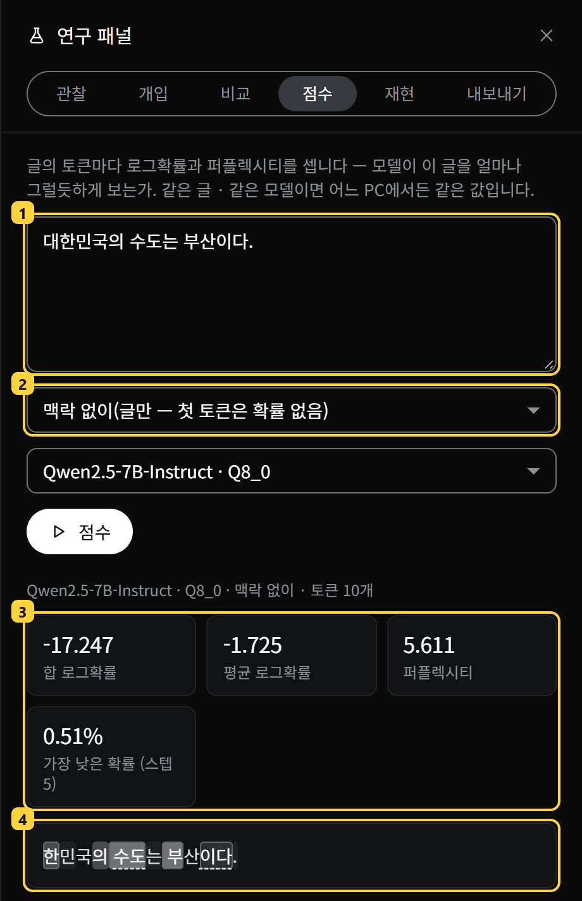
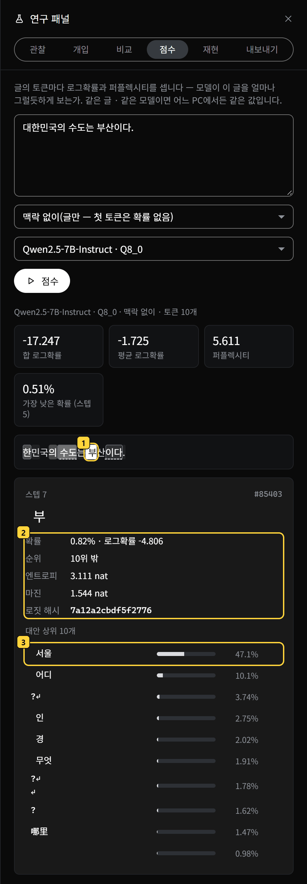
</p>

1. **점수** 탭에서 **①** 글을 붙여 넣고, **② 맥락**을 '맥락 없이'로, 모델을 Q8_0으로 두고 **점수**를 누릅니다.
2. 토큰 줄에서 ` 부`를 누릅니다(오른쪽 그림).

**읽기**
- **③** 토큰 10개, 합 로그확률 −17.247, 퍼플렉시티 5.611. 맥락 없이는 글의 앞쪽이 원래 낮게 나옵니다(첫 토큰 `대`는 확률이 없고,
  가장 낮은 곳은 스텝 5의 ` 수도` 0.51 %). 그래서 **궁금한 자리를 눌러 봅니다**.
- ` 부`는 **0.82 %, 10위 밖**이고, 그 자리의 대안 1위는 ` 서울`(**47.1 %**)입니다 — 모델은 그 자리에 서울을 기대했습니다. 글을
  `대한민국의 수도는 서울이다.`로 바꿔 점수를 매기면 ` 서울`은 47.1 %(로그확률 −0.75), 퍼플렉시티는 4.30으로 내려갑니다.

**맥락**의 다른 선택지 '**고른 답의 자리에**'는 글을 고른 답과 같은 질문 · 대화 뒤에서 계산합니다 — 같은 질문에 대한 후보 답 여럿의
확률을 비교할 때 씁니다(예: 화가 질문에 `파블로 피카소`를 넣어 보기). 이때 모델은 그 답의 모델입니다.

### 실험 7. 결과를 남에게 확인받기

**질문**: 내가 본 숫자를 다른 사람도 자기 PC에서 똑같이 볼 수 있나?

<p>
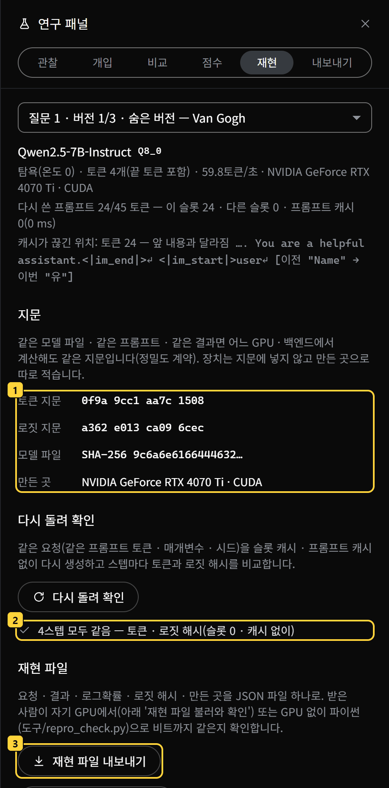
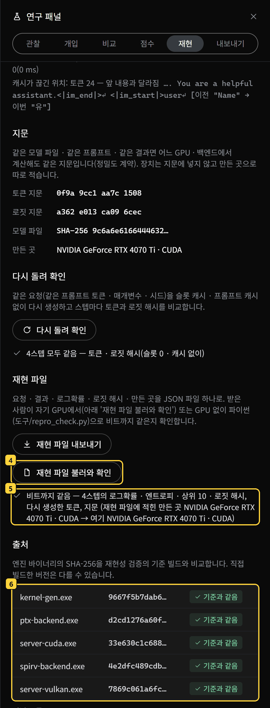
</p>

**재현** 탭에서 원래 답(버전 1)을 고르고:

- **① 지문** — 토큰 지문(모델 파일 + 프롬프트 + 답 토큰의 SHA-256)과 로짓 지문(+ 스텝마다 로짓 해시). 같은 모델 파일 · 같은 프롬프트
  · 같은 결과면 어느 GPU · 백엔드에서든 같은 지문입니다. 이 안내서의 답은 토큰 지문이 `0f9a 9cc1 aa7c 1508…`로 시작합니다 —
  여러분의 것도 그렇다면 **비트까지 같은 답**입니다. 계산 방법은 [계약 5.2](계약/계약.md)에 있습니다.
- **② 다시 돌려 확인** — 같은 요청(프롬프트 토큰 · 매개변수 · 시드)을 캐시 없이 다시 생성해 스텝마다 토큰과 로짓 해시를 비교합니다:
  '4스텝 모두 같음'.
- **③ 재현 파일 내보내기** — 요청 · 결과 · 로그확률 · 로짓 해시 · 지문 · 모델 파일 SHA-256을 JSON 파일 하나로 받습니다.
- **④ 재현 파일 불러와 확인** — 받은 사람이 자기 GeulPU에서 엽니다. 같은 모델 파일(SHA-256)이 설치되어 있어야 하고, 확인하는 동안 그
  모델을 불러옵니다. 점수 매기기 · 다시 생성 · 지문을 모두 비교해 **⑤ '비트까지 같음'이** 나오면 확인 끝입니다. NVIDIA ↔ AMD,
  CUDA ↔ Vulkan 사이에서도 같아야 합니다.
- **⑥ 엔진 · 커널 해시 보기** — 엔진 바이너리 다섯이 공식 빌드(교차검증 기준)와 같은지, 지금 쓰는 커널 모듈은 무엇인지.

GPU가 없는 사람도 확인할 수 있습니다. 저장소를 받아 가상 환경(venv)에 numpy 를 깔고 계약의 CPU 참조 구현으로 다시 계산합니다(7B는 몇 분).

```bash
python -m venv .venv                      # 한 번 — `python -I` 는 `pip install --user` 로 깐 패키지를 보지 않는다
.venv/Scripts/pip install numpy               # 리눅스 · macOS: .venv/bin/pip
.venv/Scripts/python -I 도구/repro_check.py geulpu-repro.json Qwen2.5-7B-Instruct-Q8_0.gguf
```

### 실험 8. 답은 몇 번째 층에서 생기나 — 층 렌즈

**질문**: 모델이 답을 쓰기 직전, 가운데 층의 계산은 무엇을 가리키고 있었나?

0.13.0 부터. 다음 토큰은 마지막 층이 내지만, 가운데 층의 계산(residual stream)도 끝의 출력 계산으로 읽어 볼 수 있습니다 —
**logit lens**(그 층에서 멈췄다면 낼 분포). **Jacobian lens**(Anthropic, 2026)는 그 층의 값을 원본 모델에서 맞춘 행렬 J 로 먼저 끝 층의
바탕에 옮긴 뒤 읽어서, 앞 층에서도 그 자리가 무엇을 향하는지 더 일찍 보입니다. 층 렌즈는 Qwen2.5 · Qwen3 · Llama 구조에서 됩니다.

준비가 다른 실험과 조금 다릅니다:

- 모델은 **Qwen3-0.6B Q8_0**(모델 찾기에서 받기)이고, 릴리스에 붙은 J 파일 **`Qwen3-0.6B-Q8_0.jlens.safetensors`** 를 모델 파일과 같은
  폴더에 둔 뒤 모델을 (다시) 불러옵니다. 앱이 J 파일을 서버에 넘기고, 서버가 받으면 층 렌즈에 'logit lens | Jacobian lens' 바꾸기가
  생깁니다(J 파일이 없으면 logit lens 만).
- 계산 방식은 **정밀**, 온도 0, 그리고 생성 설정의 **생각 과정 쓰기**를 끕니다(Qwen3 는 기본으로 생각을 먼저 씁니다).
- 새 채팅에서 **대한민국의 수도는 어디인가요? 한 단어로 답하세요.** 를 보냅니다. 0.6B 모델은 `대한민국의 수도는 **인천**입니다.` 라고
  틀리게 답합니다 — 왜 틀렸는지 들여다보기 좋은 답입니다.

<p>
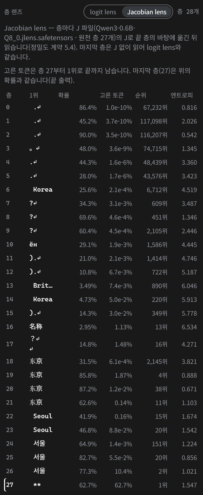
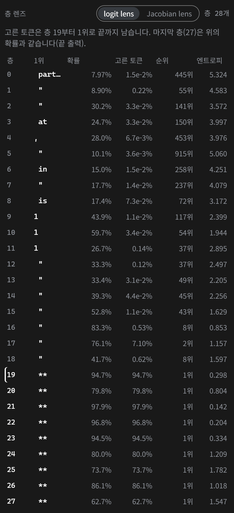
</p>

1. 답 아래의 플라스크로 패널을 열고(관찰), 토큰 띠에서 `인천` 바로 앞의 별표 토큰 ` **`(스텝 8)을 누릅니다.
2. 스텝 상세 아래의 **층 렌즈 → 층마다 읽기**를 누릅니다. 층마다(0 ~ 27) 1위 토큰과 그 확률, 고른 토큰의 확률 · 순위, 엔트로피가
   나옵니다. 층을 누르면 그 층의 상위 k 가 펼쳐지고, 고른 토큰이 1위로 끝까지 남는 첫 층에 선이 그어집니다.
3. **Jacobian lens**(왼쪽 그림): 층 18 ~ 21 의 1위가 `东京`(도쿄 — 31.5 ~ 87.2 %), 층 22 · 23 이 ` Seoul`(41.9 · 46.8 %), 층 24 ~ 26 이
   ` 서울`(64.9 · 82.7 · 77.3 %)입니다. 별표 다음에 쓸 말로 가운데 층은 **서울**을 가리켰는데, 다음 스텝에서 모델은 `인천` 을 씁니다.
4. **logit lens**(오른쪽 그림)로 바꾸면 같은 걸음에서 층 19 부터 ` **` 만 1위이고 `서울` 은 보이지 않습니다 — 가운데 층의 값을 끝
   층의 것처럼 바로 읽으면 이런 개념이 잘 드러나지 않습니다. 마지막 층(27)은 두 렌즈가 같습니다(J 없이 읽는 끝 출력 — 62.7 %).

영어로 해 보면(**What is the capital of South Korea? Answer in one word.** → `South Korea's capital is Seoul.`) 첫 토큰 `South` 를 고른
걸음에서 이미 Jacobian lens 의 층 21 ~ 26 이 ` Seoul`(57.0 ~ 97.0 %)입니다 — 답을 쓰기 다섯 토큰 앞에서 답이 가운데 층에 있습니다.
logit lens 는 그 걸음에서 층 22 에만 ` Seoul`(24.8 %)이 잠깐 보입니다.

읽을 때 주의할 것:

- 두 렌즈 모두 정밀도 계약(logit lens 는 [5.3](계약/계약.md), Jacobian lens 는 5.4)으로 정해져 있어 GPU 마다 · 실행마다 같은 비트입니다.
  재현 파일([실험 7](#실험-7-결과를-남에게-확인받기))에 셈한 층 렌즈가 들어가고, 받은 사람은 GPU 없이
  `.venv/Scripts/python -I 도구/repro_check.py geulpu-repro.json Qwen3-0.6B-Q8_0.gguf --jlens Qwen3-0.6B-Q8_0.jlens.safetensors` 로
  두 렌즈를 비트까지 확인합니다(J 파일은 SHA-256 으로 같은 것인지 봅니다).
- J 는 원본(BF16) 모델에서 맞춘 것입니다. Q8_0 에서는 원본과 층마다의 1위가 층 9 ~ 26 에서 93.8 % 이상 같다는 것을 미리 정한 기준으로
  쟀습니다([문서/층렌즈.md](문서/층렌즈.md)). Q4_K_M 처럼 비트가 낮은 파일에서는 층마다의 1위가 원본과 덜 맞으니, 어느 층에서 어떤 개념이
  나오는지 정도로 읽으세요.
- 다른 모델의 J 파일은 `도구/jlens_fit.py` 로 원본(Hugging Face) 모델에서 맞춥니다 — GPU 와 torch · transformers · jlens 가 들고,
  0.6B 는 RTX 4070 Ti 에서 약 17 분이었습니다. API 로는 [5. 스크립트로 — API](#5-스크립트로--api)의 echo 요청에
  `"geulpu": {"echo_from": n, "layer_lens": {"jacobian": true}}` 를 더합니다.

### 프롬프트 캐시는 어디서 끊겼나

**질문**: 코딩 에이전트는 요청마다 같은 긴 지시를 다시 보낸다 — GeulPU 는 그 프롬프트를 얼마나 다시 썼고, 나머지는 왜 다시 계산했나?

GeulPU 는 프롬프트의 앞부분이 토큰까지 같은 만큼 계산한 상태(KV 캐시)를 다시 씁니다 — 그 슬롯에 있던 것, GPU 안에서 다른 슬롯으로부터
복사한 것, **프롬프트 캐시**(SSD 에 256 토큰 청크로 남긴 것 — 앱을 다시 켜도 · 모델을 바꿨다 돌아와도 남는다. 설정 → 프롬프트 캐시, SSD 면
기본으로 켬)에서 읽은 것. KV 는 어느 길로 채워도 바이트까지 같아서 다시 써도 답은 하나도 바뀌지 않고 계산만 줄어듭니다. 답의 헤더가
얼마나 다시 썼는지와 어디서 끊겼는지를 보여 줍니다.

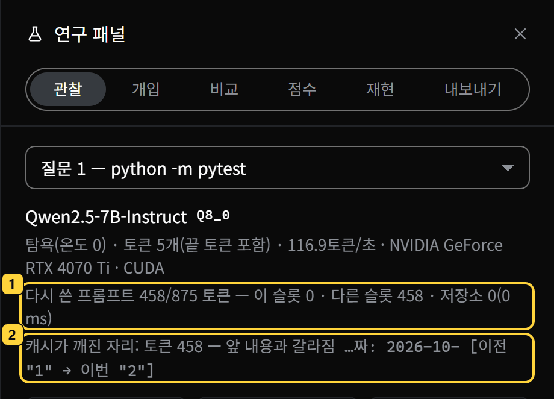

1. 생성 설정의 시스템 프롬프트에 아래 글을 넣습니다 — 규칙, `오늘 날짜: 2026-10-19`, 프로젝트 설명 차례. 질문
   `이 프로젝트의 테스트는 어떻게 돌리나요? 한 문장으로 답해 주세요.` 를 보내면 답은 `python -m pytest` 입니다.
2. 날짜를 `2026-10-20` 으로 바꾸고 같은 모델로 **새 채팅**을 열어 같은 질문을 보낸 뒤, 이 답을 패널에서 엽니다.

**읽기**
- **①** 다시 쓴 프롬프트 458/875 토큰 — 이 슬롯 0 · 다른 슬롯 458 · 프롬프트 캐시 0. 새 채팅은 빈 슬롯에서 시작해 같은 앞부분을 첫 채팅의
  슬롯에서 복사했습니다.
- **②** 캐시가 끊긴 위치: 토큰 458 — 앞 내용과 달라짐, 그 앞 12 토큰의 글(…`짜: 2026-10-`)과 그 자리의 이전 → 이번 토큰(`"1"` → `"2"`).
  날짜가 바뀌어 그 뒤 — 프로젝트 설명과 질문, 417 토큰 — 를 다시 계산했습니다. (앞 글이 글자 가운데서 시작하면 그 조각은 빼고 보입니다 —
  여기서는 '날'.)
- 요청마다 바뀌는 것(날짜 · 시각 · 작업 폴더 · git 상태)은 바뀌지 않는 것 **뒤에** 두세요. 코딩 에이전트도 같습니다: Qwen Code 를
  녹화해 보니([문서/문맥저장소.md](문서/문맥저장소.md)의 4단계) 다른 폴더의 새 작업은 14,671 토큰 중 3,819 에서(시스템 프롬프트의 작업
  폴더 경로), 같은 폴더의 다음 날은 13,591 에서(날짜 줄), 같은 날은 작업 지시에서야(14,633) 깨졌습니다.

<br clear="right">

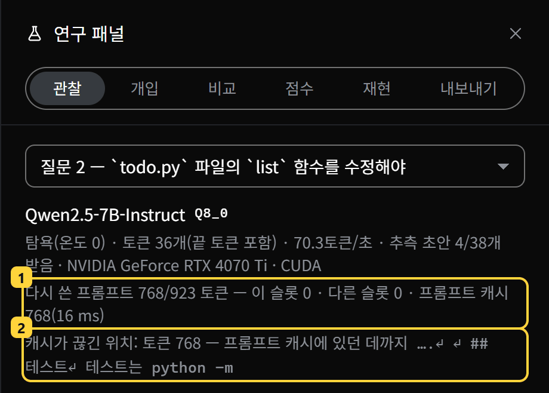

3. 앱을 다시 켜고(또는 다른 모델을 불러왔다 돌아오고 — 이제 슬롯은 비어 있습니다) 둘째 채팅에 다음 질문을 보냅니다:
   `마감이 지난 할 일만 보여 주는 명령을 더하려면 어느 파일의 무엇을 고쳐야 하나요? 두 문장으로.`

**읽기**
- **①** 다시 쓴 프롬프트 768/923 토큰 — 프롬프트 캐시 768(16 ms). 슬롯에 남은 것이 없어 채팅의 앞부분을 계산하지 않고 SSD 에서 읽었습니다.
  프롬프트 캐시는 256 토큰 청크 통째로 남기고, 이 채팅은 청크 셋을 채웠습니다.
- **②** 캐시가 끊긴 위치: 토큰 768 — 프롬프트 캐시에 있던 데까지. 나머지(155 토큰 — 첫 주고받음의 끝과 새 질문)만 계산했습니다. 31,000 토큰 대화를
  다시 켠 뒤 다시 열면 첫 토큰이 다시 계산의 10 초 대신 0.74 초, 청크가 OS 파일 캐시에 없을 때(재부팅 뒤처럼)는 1.1 초입니다
  (Qwen2.5-7B Q4_K_M, 4단계).
- 다시 써서 바뀐 것이 없는지는 **재현 → 다시 돌려 확인** 이 봅니다 — 캐시 · 프롬프트 캐시 없이 다시 생성해 스텝마다 비교합니다.

<br clear="right">

<details>
<summary>여기서 쓴 시스템 프롬프트</summary>

```text
당신은 아래 프로젝트를 돕는 코딩 도우미입니다. 답은 짧고 정확하게 쓰고, 모르는 것은 모른다고 말합니다. 코드를 고칠 때는 고친 까닭을 한 줄로 덧붙이고 테스트를 함께 고칩니다. 파일을 지우거나 이름을 바꾸기 전에는 먼저 묻습니다.

# 규칙
- 파이썬 3.12, 표준 라이브러리만 씁니다. 바깥 꾸러미가 필요하면 먼저 묻습니다.
- 함수 이름은 snake_case, 클래스 이름은 PascalCase, 상수는 UPPER_CASE 로 씁니다.
- 모든 공개 함수에 docstring 을 쓰고, 인자와 반환값의 타입 힌트를 붙입니다.
- 저장은 todo.json(UTF-8, 들여쓰기 2) 하나에만 합니다. 쓰기는 임시 파일에 쓴 뒤 바꿔 넣어, 도중에 꺼져도 파일이 깨지지 않게 합니다.
- 날짜는 ISO 8601(YYYY-MM-DD)로 다루고, 시간대는 쓰지 않습니다.
- 명령줄 인자는 argparse 로 읽고, 하위 명령마다 도움말을 씁니다.
- 오류는 사용자가 읽을 수 있는 한 줄로 표준 오류에 알리고 종료 코드 1 로 끝냅니다. 예상하지 못한 오류만 트레이스백을 남깁니다.
- 출력은 사람이 읽는 표가 기본이고, --json 을 주면 JSON 한 줄로 냅니다.
- 한 함수는 40 줄을 넘기지 않습니다. 넘으면 작은 함수로 나눕니다.
- 커밋 메시지는 한국어 한 줄 요약 + 빈 줄 + 까닭으로 씁니다.

오늘 날짜: 2026-10-19

# 프로젝트: 할 일 관리 명령줄 도구
파일: todo.py(명령 · 저장), store.py(todo.json 읽기 · 쓰기), tests/test_todo.py · tests/test_store.py(pytest), README.md.

## 명령
- add <제목> [--due 날짜] [--tag 꼬리표] — 할 일을 더하고 번호를 알립니다.
- list [--done] [--tag 꼬리표] [--json] — 할 일을 번호 차례로 보입니다. 기본은 끝내지 않은 것만.
- done <번호> — 끝냄으로 표시합니다. 이미 끝낸 것이면 알리기만 합니다.
- remove <번호> — 지웁니다. 지운 번호는 다시 쓰지 않습니다.
- edit <번호> [--title 제목] [--due 날짜] — 고칩니다.

## 자료
할 일 하나는 {"id": 정수, "title": 글, "due": 날짜 또는 null, "tags": [글], "done": 참거짓, "created": 날짜} 입니다.
todo.json 의 꼴은 {"version": 1, "next_id": 정수, "items": [할 일]} 이고, 판이 다르면 읽기를 멈추고 알립니다.

## 테스트
테스트는 python -m pytest 로 돌리고, 임시 폴더(tmp_path)에서 todo.json 을 만들어 씁니다. 명령마다 성공 · 실패 경우를 하나 이상
둡니다. 날짜가 드는 테스트는 오늘 날짜를 직접 쓰지 않고 함수 인자로 넘깁니다.
```

</details>

### 데이터 꺼내기

<p>
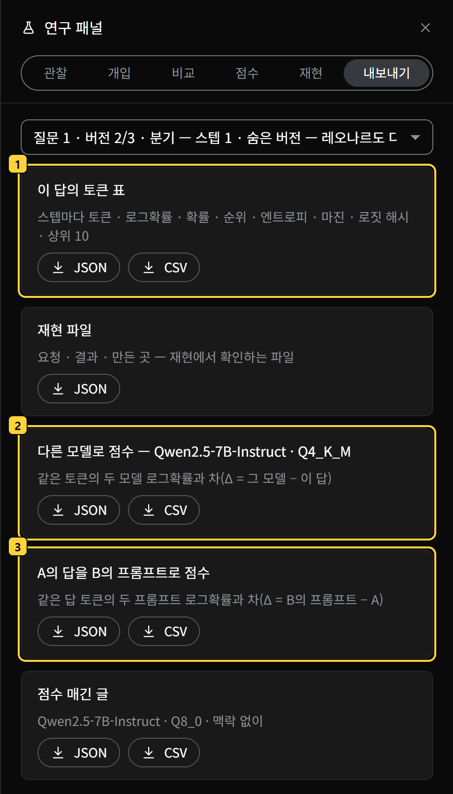
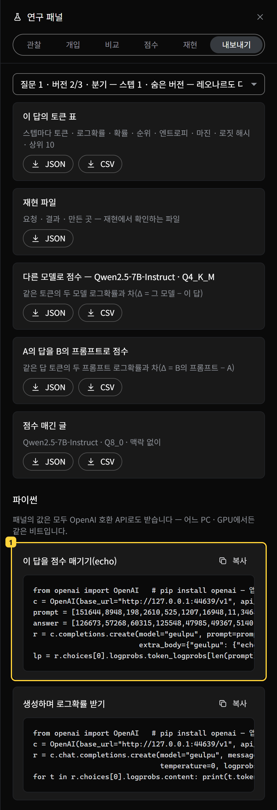
</p>

**내보내기** 탭은 패널에 보이는 값을 모두 파일로 줍니다.

- **이 답의 토큰 표** — JSON · CSV. CSV의 열은 `step,id,text,logprob,prob,rank,entropy,margin,logit_hash`, JSON에는 스텝마다 상위 10과
  프롬프트 토큰 · 지문 · 모델 SHA-256이 더 들어갑니다.
- **다른 모델로 점수 · A의 답을 B의 프롬프트로 점수** — 위 열에 `other_logprob` · `delta`가 더해집니다. 실험 4 · 5를 했을 때 나옵니다.
- **점수 매긴 글 · 재현 파일**.
- **파이썬** — 같은 값을 API로 받는 코드(`openai` 패키지 — 표준 라이브러리만 쓰는 버전은 아래 5절).

## 5. 스크립트로 — API

패널의 값은 모두 API로도 받습니다. 앱에서 모델을 불러온 상태에서 `http://127.0.0.1:44544`에 보냅니다. 아래는 표준 라이브러리만
쓰는 파이썬입니다(패키지 설치 없음). API의 기본 온도는 앱의 생성 설정과 따로 0.8이므로, 안내서와 같은 답을 받으려면
`"temperature": 0`을 넣습니다(계산 방식은 준비에서처럼 정밀로).

```python
import json, math, urllib.request

BASE = "http://127.0.0.1:44544"          # 앱에서 모델을 불러온 상태


def post(path, body):
    rq = urllib.request.Request(BASE + path, json.dumps(body).encode(), {"Content-Type": "application/json"})
    with urllib.request.urlopen(rq) as r:
        return json.load(r)


# 예 1 — 생성하며 스텝마다 확률과 대안(실험 1)
r = post("/v1/chat/completions", {
    "messages": [{"role": "user", "content": "유명한 화가 한 명의 이름만 말해 줘."}],
    "temperature": 0, "logprobs": True, "top_logprobs": 5})
print("답:", r["choices"][0]["message"]["content"], "| 모델:", r["model"])
for i, t in enumerate(r["choices"][0]["logprobs"]["content"], 1):
    alts = ", ".join(f"{a['token']!r} {math.exp(a['logprob']):.1%}" for a in t["top_logprobs"])
    print(f"스텝 {i}: {t['token']!r} {math.exp(t['logprob']):.1%} | {alts}")
```

```text
답:  Van Gogh | 모델: qwen2.5-7b-instruct-q8_0
스텝 1: ' Van' 17.8% | ' Van' 17.8%, '레' 15.2%, ' VIN' 13.6%, '파' 4.8%, 'PIC' 4.1%
스텝 2: ' G' 100.0% | ' G' 100.0%, '.G' 0.0%, 'G' 0.0%, '_G' 0.0%, '\tG' 0.0%
스텝 3: 'ogh' 100.0% | 'ogh' 100.0%, 'ough' 0.0%, 'og' 0.0%, 'oh' 0.0%, 'ог' 0.0%
```

```python
# 예 2 — 같은 답을 두 질문 뒤에서 계산해 단어 하나의 효과를 잰다(실험 5)
def prompt_of(question):            # 채팅 템플릿을 씌운 프롬프트 토큰(답 앞까지)
    return post("/tokenize", {"messages": [{"role": "user", "content": question}]})["tokens"]


def score(prompt, answer):          # 답 토큰마다 로그확률 — 생성하지 않고 점수만(echo)
    r = post("/v1/completions", {"prompt": prompt + answer, "echo": True, "max_tokens": 0, "logprobs": 1,
                                 "geulpu": {"echo_from": len(prompt)}})
    return r["choices"][0]["logprobs"]["token_logprobs"][len(prompt):]


A = prompt_of("유명한 화가 한 명의 이름만 말해 줘.")
B = prompt_of("유명한 이탈리아 화가 한 명의 이름만 말해 줘.")
r = post("/v1/completions", {"prompt": B, "temperature": 0, "max_tokens": 32, "geulpu": {}})
answer = r["geulpu"]["tokens"]      # B에서 생성된 토큰 그대로(끝 토큰 포함) — "레오나르도 다 빈치"
la, lb = score(A, answer), score(B, answer)
for t, a, b in zip(answer, la, lb):
    print(f"{post('/detokenize', {'tokens': [t]})['prompt']!r:8} {math.exp(a):7.2%} → {math.exp(b):7.2%}  Δ {b - a:+.3g}")
print(f"합 Δ {sum(lb) - sum(la):+.3f}")
```

```text
'레'       15.21% →  85.11%  Δ +1.72
'오'       98.32% →  99.25%  Δ +0.00941
'나'       96.89% →  93.38%  Δ -0.0368
'르'       99.06% →  97.53%  Δ -0.0156
'도'       97.21% →  96.99%  Δ -0.00229
' 다'      87.98% →  87.35%  Δ -0.00713
' �'      45.38% →  52.29%  Δ +0.142
'�'       63.05% →  65.13%  Δ +0.0324
'�'       94.74% →  97.19%  Δ +0.0255
'치'       85.51% →  93.92%  Δ +0.0938
'<|im_end|>'  93.67% →  74.78%  Δ -0.225
합 Δ +1.738
```

`'�'` 셋은 `빈` 한 글자를 나눈 바이트 조각 토큰입니다. 패널의 실험 5와 같은 수가 나옵니다.

```python
# 예 3 — 글 한 줄의 토큰마다 확률, 맥락 없이(실험 6)
ids = post("/tokenize", {"prompt": "대한민국의 수도는 부산이다."})["tokens"]
for t, x in zip(ids[1:], score(ids[:1], ids[1:])):    # 첫 토큰은 앞 맥락이 없어 확률이 없다
    print(f"{post('/detokenize', {'tokens': [t]})['prompt']!r:8} {math.exp(x):.2%}")
```

```text
'한'      7.22%
'민'      66.34%
'국'      99.98%
'의'      18.72%
' 수도'    0.51%
'는'      53.25%
' 부'     0.82%
'산'      99.16%
'이다'     22.03%
'.'      75.08%
```

자주 쓰는 것:

- **`/v1/chat/completions`**: `"logprobs": true, "top_logprobs": 5`(0 ~ 20). 요청에 `"geulpu": {}`를 넣으면 응답의 `geulpu`에 샘플링한 토큰
  번호(`tokens`) · 시드 · 시간이, `"geulpu": {"logit_hash": true, "prompt_tokens": true}`면 스텝마다 로짓 해시와 채팅 템플릿을 씌운 프롬프트
  토큰이 더해집니다.
- **`/v1/completions`**: `"echo": true, "max_tokens": 0, "logprobs": k`로 생성 없이 점수만. `prompt`는 글이나 토큰 번호 배열,
  `"geulpu": {"echo_from": n}`이면 번호 n부터만 셉니다(그 앞은 `null`). 응답의 `geulpu`에 `prompt_entropy` · `prompt_top_ids` ·
  `prompt_top_logprobs` · `prompt_logit_hashes`.
- **`/tokenize`** (`{"prompt": "…"}` 또는 `{"messages": […]}` — 채팅 템플릿을 씌운 프롬프트) · **`/detokenize`** · **`/tokenizer_info`**
  — vLLM과 같은 형식.
- 요청에서 **`model`을 빼면** 응답의 `model`에 지금 불러온 모델의 이름이 옵니다(넣으면 넣은 이름이 그대로 옵니다 — 요청의 `model`은
  모델을 고르지 않습니다). 어느 모델이 답했는지 남기려면 빼고 보내세요.
- 생성 응답의 `geulpu.tokens` · `logit_hashes`는 끝 토큰을 샘플링한 스텝까지 담고, 로그확률 배열은 OpenAI처럼 답 글의 토큰만 담습니다
  (답이 끝 토큰으로 끝나면 하나 짧음). 끝 토큰의 확률은 `tokens`를 echo로 점수 매기면 나옵니다(패널은 이렇게 셉니다).
- **lm-evaluation-harness** — `local-completions` + `tokenizer_backend=remote`로 붙습니다. 문항마다의 결과가 동시 요청 수 · CUDA ↔
  Vulkan과 상관없이 같은 비트입니다([README](사용안내.md#다른-프로그램에서-쓰기-openai-호환-api)).

## 6. 주의할 점과 자주 묻는 것

- **답 아래에 플라스크가 없어요.** 연구 기록은 0.5.0에서 받은 답부터 남습니다. 질문을 새로 보내세요.
- **마진이 작은 스텝이 0개예요.** 기본 기준 δ = 0.05 nat는 확률비 1.05배보다 가까운 스텝만 셉니다. 넓게 보려면 0.3 ~ 0.7로 올리세요(0.5 ≈
  1위가 2위의 1.65배 이내).
- **모델이 바뀌었어요.** 비교의 '다른 모델로 점수', 재현 파일 확인, 다른 모델로 만든 답의 분석은 필요한 모델을 불러옵니다(수십 초). 채팅을
  다시 보내면 그 채팅의 모델로 돌아옵니다. API도 지금 불러온 모델로 답하니, 스크립트를 돌리는 동안에는 패널에서 모델을 바꾸지 마세요.
- **확률이 생성 설정과 맞지 않아요.** 패널의 확률은 온도 1의 모델 분포입니다. 온도 · top-k · top-p는 어느 토큰을 샘플링할지에만 쓰입니다.
- **0.0041 % 같은 작은 값.** 0.1 % 아래의 확률은 `4.1e-3%`처럼 지수로 보입니다(단위는 늘 %).
- **재현 파일 확인이 다르다고 나와요.** 재현 파일을 다른 도구로 열어 다시 저장하면 시드(64비트 정수)가 정밀도를 잃을 수 있습니다 — JavaScript의
  `JSON.parse`는 정밀도를 잃습니다. 파일을 고치지 말고 그대로 전하세요. '만든 곳'은 재현 파일을 만든 쪽이 적은 기록일 뿐 확인에는 쓰지
  않습니다.
- **기록은 어디에?** 이 브라우저(localStorage)에 최근 60개까지. 다른 브라우저 · 다른 PC로는 옮겨지지 않으니 내보내기로 남기세요.
- **채팅 속도가 느려지나요?** 아니요. 패널은 들여다볼 때만 계산합니다. API에서 생성 중 로그확률을 물으면 토큰당 시간이 약 2 % 늘어납니다.
- **더 깊이**: 로그확률의 정의는 [계약 5.2](계약/계약.md), 이 기능의 판정과 수치는 [38단계](https://github.com/wwoosshh/GeulPU/blob/main/문서/38단계.md), GPU 없는 확인은
  [`도구/repro_check.py`](도구/repro_check.py).
- **요청 여럿을 한꺼번에?** 에이전트 세션 · 테스트 세트처럼 요청 여럿을 실행 단위로 기록 · 재생 · 분기 · 비교하는 것은
  [디버거 안내서](디버거안내.md)에 있습니다.
